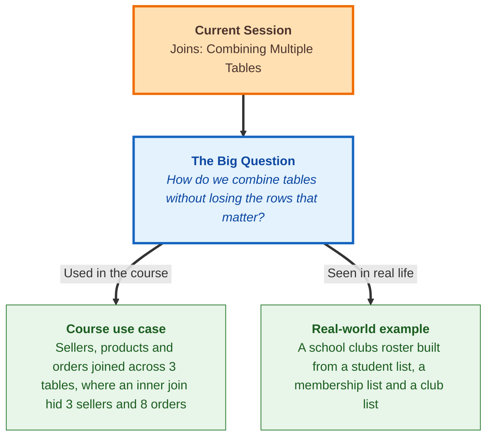

## Joins: Combining Multiple Tables

### Mental Map

---

### What You'll Learn

Have you ever wondered how a school finds every student who has not joined any club?

By the end of this session, you will be able to:

- **Identify** the roll number that links the student list to the membership list.
- **Predict** the number of lines in a combined list when one student joins 2 clubs.
- **Compare** a list that keeps every student with a list that keeps only students in a club.
- **Examine** a diagram of three lists to find which links a question needs.
- **Build** a list of students with no club, using the student, membership and club lists.
- **Justify** which way of combining fits a report, by the rows that must stay.

> **Topics you will meet:** keys, INNER JOIN, LEFT JOIN, RIGHT JOIN, FULL JOIN, row counts, three tables.
>
> Join the session to learn each of these in detail.

---

### Why You Are Learning This Topic

Mr. Menon coordinates clubs at his school. He has three lists: students, memberships and clubs. He combines the student list with the membership list and keeps only matches. His new list shows 22 students. The school has 25. Three students joined no club and vanished from the list.

A **join** means a way to combine two lists by matching a shared value, such as a roll number.

In this course, you will join tables on a key and pick the join that keeps the right rows.

> **Think about it:** Which rule for combining the lists made three students disappear?

---

### The School Clubs Roster Puzzle

Here are small pieces of the three lists.

| List | What it holds | Link |
|:----------:|:----------:|:----------:|
| Students | Roll number, name | Roll number |
| Memberships | Roll number, club number | Roll number and club number |
| Clubs | Club number, club name | Club number |

**What you want to happen:**

- Mr. Menon sees every student, with the club if there is one.
- Mr. Menon lists only the students who have no club.
- Mr. Menon links students to club names through the membership list.

> **Wonder about this:**
>
> - What happens to a student with no membership when only matches are kept?
> - If Asha joins 2 clubs, does she appear once or twice?

---

### Think It Through

There is no wrong first try. Keep your guesses for the session.

**1. The school has 25 students and 3 have no club. What count of students do you see when you keep only matches?**
Hint: Remove the students with no partner.

**2. Ravi is in the Chess club and the Art club. What is the count of lines Ravi gives in the combined list?**
Hint: Count the matches for his roll number.

**3. To print a club name next to a student, which two links must you follow?**
Hint: Student to membership, then membership to club.

---

### One Question to Carry Into the Session

> **How does the choice of join decide which rows survive?**
>
> Which list would you keep whole if you had to find students with no club?
