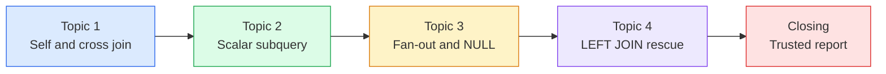
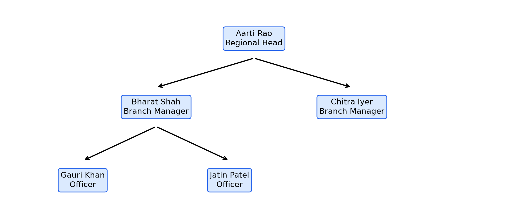
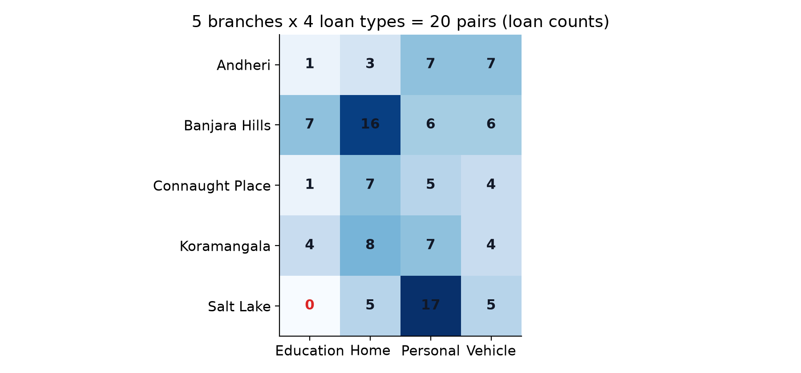
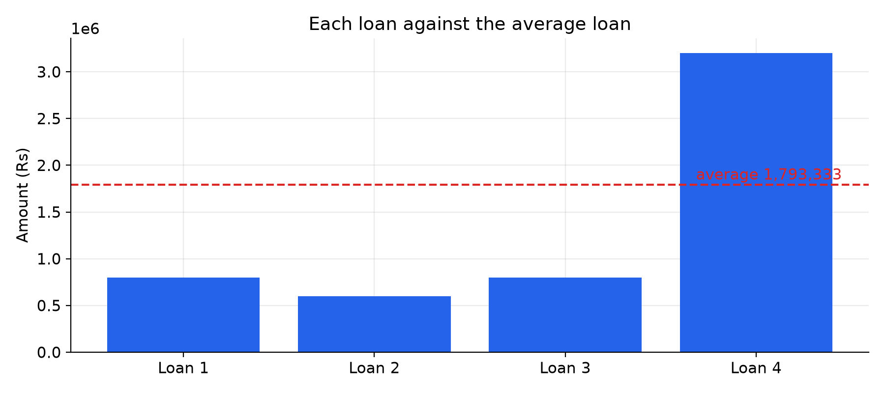
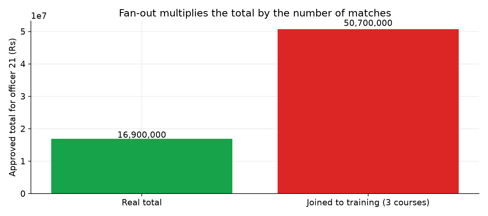
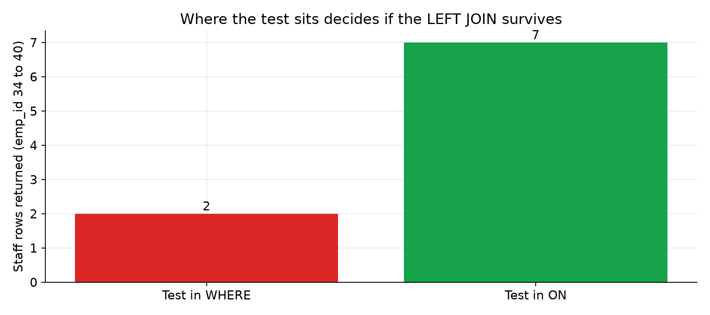
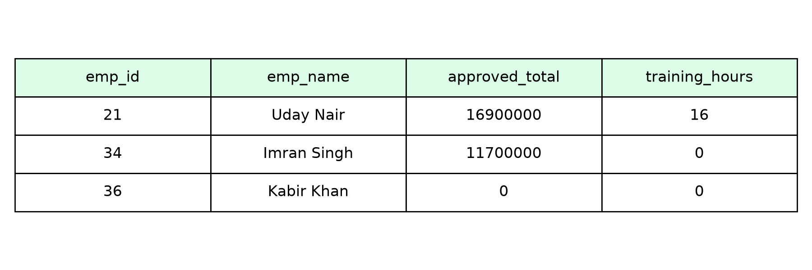

# <font color='#1d4ed8'>Lecture Script: Self and Cross Joins with Subqueries (MySQL)</font>

---

## <font color='blue'>Agenda</font>

The lecture runs as four topics. Each topic ends with a quiz.

| Topic | What we do | Learning objectives covered | Minutes |
|:-:|:--|:--|:-:|
| 1 | Join a table to itself, and know what a cross join makes | Join a table to itself to relate rows within one table<br>Explain what a CROSS JOIN produces and when it is intended | 30 |
| 2 | Attach an aggregate to every row with a subquery | Write a scalar subquery in the SELECT list to attach an aggregate to every row | 20 |
| 3 | Catch an inflated SUM and a NULL comparison | Diagnose an inflated SUM caused by join fan-out<br>Predict the result of a comparison involving NULL | 30 |
| 4 | Rescue a LEFT JOIN that a WHERE turned inner | Debug a LEFT JOIN silently reduced to an inner join by a WHERE filter | 25 |
| — | Closing: Outcome & Summary | | 15 |
| | **Total** | | **120** |

> <font color="red">**🎯 Instructor Note**</font> Pace: spend the time on join fan-out in Topic 3 and on the `ON` against `WHERE` move in Topic 4. Keep the scalar subquery to one clear pattern.
> Load `data/bank_branch.sql` once. It creates `staff`, `loans`, `training`, `branches` and `loan_types`.

---

## <font color='blue'>Scenario</font>

**A comparison of two reports.** The regional office of an HDFC Bank-style bank asked for one number: the total of approved loans.

| | Report from the analyst | Ledger from the loans team |
|:--|:--|:--|
| Approved loans | Rs 21.09 crore | Rs 15.79 crore |
| Built from | `loans` joined to `training` | `loans` alone |
| Officers shown | Only those with an approved loan | All officers |
| Staff with no bonus | Left out of a bonus check | Included |

> <font color="red">**🎯 Instructor Note**</font> HDFC Bank is only the setting. Do not claim it uses this data. The tables in `data/bank_branch.sql` (CSV copies included) are invented for teaching. Use MySQL 8.0 or later (outputs captured on MySQL 9.7).

---

## <font color='blue'>Problem Statement</font>

The regional office saw two totals for approved loans: Rs 21.09 crore in the analyst's report and Rs 15.79 crore in the ledger. The analyst had joined `loans` to the `training` table to show training hours, and each loan was repeated once for every course of its officer. A second report that listed officers with approved loans left out the new joiners. A third check on bonuses skipped everyone whose bonus was blank.

> <font color='purple'>**How do we relate rows inside one table, attach totals safely, and spot the three quiet mistakes that change a report's numbers?**</font>

> <font color="red">**🎯 Instructor Note**</font> Poll: "`SELECT NULL = NULL` in MySQL. What does it return?" Options: 1 (true), 0 (false) or NULL. Give learners 30 seconds to respond in chat. Reveal the answer in the Closing.

---

## <font color='blue'>What We Will Use</font>

Last session you joined different tables. Today a table joins itself, and one query sits inside another. The tool is MySQL, run from MySQL Workbench or any MySQL editor.

| Topic | Tools | In one line |
|:-:|:--|:--|
| 1 | Self join, `CROSS JOIN` | Pair rows within one table, or pair every row with every row |
| 2 | Subquery in `SELECT` | Compute an aggregate and show it on every row |
| 3 | Fan-out, `NULL` comparisons | Spot repeated rows inflating a `SUM`, and comparisons that return no answer |
| 4 | `ON` against `WHERE` | Keep a `LEFT JOIN` from turning into an inner join |

---

## <font color='blue'>How: Walking Through the Bank Reports</font>



---

## <font color='blue'>Topic 1: Join a table to itself, and know what a cross join makes</font> `30 min`

> <font color='purple'>**Each employee row holds a `manager_id`. How do we show the manager's name, which sits in the same table?**</font>

### <font color='green'>Example: A self join</font>

> <font color='purple'>**Who is each employee's manager, and what do they earn?**</font>

A **self join** joins a table to itself. We give the table two aliases, `e` for the employee and `m` for the manager. `e.manager_id = m.emp_id` links each employee row to the manager's row.

**Predict before running: What will happen?**

> <font color="red">**🎯 Instructor Note**</font> Expected: each employee with the manager's name. The head of the region has no manager, so a `LEFT JOIN` shows NULL for the manager.

```sql
SELECT e.emp_name AS employee, e.salary,
       m.emp_name AS manager, m.salary AS mgr_salary
FROM staff e
LEFT JOIN staff m ON e.manager_id = m.emp_id
ORDER BY e.emp_id
LIMIT 7;
```

**Output**

```
+---------------+--------+-------------+------------+
| employee      | salary | manager     | mgr_salary |
+---------------+--------+-------------+------------+
| Aarti Rao     | 260000 | NULL        |       NULL |
| Bharat Shah   | 150000 | Aarti Rao   |     260000 |
| Chitra Iyer   | 155000 | Aarti Rao   |     260000 |
| Deepak Sen    | 160000 | Aarti Rao   |     260000 |
| Esha Reddy    | 165000 | Aarti Rao   |     260000 |
| Farhan Kapoor | 170000 | Aarti Rao   |     260000 |
| Gauri Khan    |  55000 | Bharat Shah |     150000 |
+---------------+--------+-------------+------------+
```

#### <font color='#c2410c'>Code Explanation</font>

- **Lines 3 and 4** The same table appears twice, with different aliases.
- **Line 4** An employee's `manager_id` matches the manager's `emp_id`. `LEFT JOIN` keeps the head, who has no manager.

> <font color='green'>**Result**</font> Aarti Rao is the head and has a NULL manager. Every branch manager reports to her.

<p align="center"></p>

### <font color='green'>Extending it: Who earns more than their manager?</font>

> <font color='purple'>**Does anyone earn more than their own manager?**</font>

> <font color="red">**🎯 Instructor Note**</font> Ask for a prediction. Expected: one person, Jatin Patel, who earns more than manager Bharat Shah.

```sql
SELECT e.emp_name AS employee, e.salary,
       m.emp_name AS manager, m.salary AS mgr_salary
FROM staff e
JOIN staff m ON e.manager_id = m.emp_id
WHERE e.salary > m.salary;
```

**Output**

```
+-------------+--------+-------------+------------+
| employee    | salary | manager     | mgr_salary |
+-------------+--------+-------------+------------+
| Jatin Patel | 160000 | Bharat Shah |     150000 |
+-------------+--------+-------------+------------+
```

> <font color='green'>**Result**</font> Jatin Patel earns Rs 160,000 against his manager's Rs 150,000. Comparing two rows of one table needs a self join.

### <font color='green'>Extending it: A cross join pairs every row with every row</font>

> <font color='purple'>**What do 5 branches and 4 loan types produce when we cross join them?**</font>

A **cross join** pairs every row of one table with every row of the other, with no `ON`. 5 rows times 4 rows give 20 rows. It is intended when we want every combination. It is a mistake when the `ON` was forgotten.

> <font color="red">**🎯 Instructor Note**</font> Ask for a prediction. Expected: 20 with `CROSS JOIN`. Forgetting `ON` on `staff` and `loans` gives 40 times 120 = 4800 rows.

```sql
SELECT COUNT(*) AS combos
FROM branches
CROSS JOIN loan_types;
```

**Output**

```
+--------+
| combos |
+--------+
|     20 |
+--------+
```

```sql
SELECT COUNT(*) AS accidental
FROM staff, loans;
```

**Output**

```
+------------+
| accidental |
+------------+
|       4800 |
+------------+
```

> <font color='green'>**Result**</font> The cross join of 5 and 4 gives 20 combinations. A comma between two tables with no `ON` is also a cross join, and gives 4800 rows.

### <font color='green'>Extending it: An intended cross join: branch by loan type</font>

> <font color='purple'>**Which branch and loan type pairs have 0 or 1 loans?**</font>

> <font color="red">**🎯 Instructor Note**</font> Ask for a prediction. Expected: Salt Lake has no Education loans (0). Andheri and Connaught Place have 1 each.

```sql
SELECT b.branch, t.loan_type, COUNT(l.loan_id) AS loans
FROM branches b
CROSS JOIN loan_types t
LEFT JOIN staff s ON s.branch = b.branch
LEFT JOIN loans l ON l.officer_id = s.emp_id
                  AND l.loan_type = t.loan_type
GROUP BY b.branch, t.loan_type
HAVING COUNT(l.loan_id) <= 1
ORDER BY b.branch, t.loan_type;
```

**Output**

```
+-----------------+-----------+-------+
| branch          | loan_type | loans |
+-----------------+-----------+-------+
| Andheri         | Education |     1 |
| Connaught Place | Education |     1 |
| Salt Lake       | Education |     0 |
+-----------------+-----------+-------+
```

#### <font color='#c2410c'>Code Explanation</font>

- **Lines 2 and 3** The cross join builds all 20 branch and loan type pairs first.
- **Lines 4 to 6** `LEFT JOIN`s attach the loans that exist. A pair with no loans stays, with a count of 0.
- **Line 8** `HAVING` keeps the pairs with 0 or 1 loans.

> <font color='green'>**Result**</font> Salt Lake has written no Education loan. Without the cross join, that pair would never have appeared in the output.

<p align="center"></p>

### <font color='purple'>Quiz 1</font>

**Question:** Table A has 6 rows and table B has 7 rows. `A CROSS JOIN B` returns how many rows?

**Options:**
- A) 42
- B) 7
- C) 13
- D) 6

**Correct Answer:** A

**Explanation:**
- **A)** Correct. Every one of 6 rows pairs with every one of 7 rows: 6 times 7 is 42.
- **B)** That is the larger table only.
- **C)** That adds the rows. A cross join multiplies them.
- **D)** That is the smaller table only.

---

---

## <font color='blue'>Topic 2: Attach an aggregate to every row with a subquery</font> `20 min`

> <font color='purple'>**Each loan row should show how it compares with the average loan. How do we put one number on every row?**</font>

### <font color='green'>Example: A scalar subquery in SELECT</font>

> <font color='purple'>**How far is each loan from the average loan?**</font>

A **scalar subquery** is a `SELECT` inside brackets that returns exactly one value. In the select list, MySQL runs it once and repeats the value on every row. `ROUND(x)` with no second argument rounds to a whole number.

**Predict before running: What will happen?**

> <font color="red">**🎯 Instructor Note**</font> Expected: the same average on every row, and an `vs_avg` value that is the loan minus that average.

```sql
SELECT loan_id, amount,
       (SELECT ROUND(AVG(amount)) FROM loans) AS avg_amount,
       amount - (SELECT ROUND(AVG(amount)) FROM loans) AS vs_avg
FROM loans
ORDER BY loan_id
LIMIT 4;
```

**Output**

```
+---------+---------+------------+----------+
| loan_id | amount  | avg_amount | vs_avg   |
+---------+---------+------------+----------+
|       1 |  800000 |    1793333 |  -993333 |
|       2 |  600000 |    1793333 | -1193333 |
|       3 |  800000 |    1793333 |  -993333 |
|       4 | 3200000 |    1793333 |  1406667 |
+---------+---------+------------+----------+
```

#### <font color='#c2410c'>Code Explanation</font>

- **Line 2** The subquery returns one value: the average of all 120 loans.
- **Line 3** The same value is used in arithmetic with each row's `amount`.

> <font color='green'>**Result**</font> The average is the same on every row. A loan with a positive `vs_avg` is above average.

<p align="center"></p>

### <font color='green'>Extending it: A subquery that follows the row</font>

> <font color='purple'>**How much did the same officer approve in total, shown beside each loan?**</font>

If the subquery uses a column of the outer row, such as `l.officer_id`, it runs for each row and returns that row's own total.

> <font color="red">**🎯 Instructor Note**</font> Ask for a prediction. Expected: loans of the same officer show the same total.

```sql
SELECT l.loan_id, l.officer_id, l.amount,
       (SELECT SUM(x.amount) FROM loans x
        WHERE x.officer_id = l.officer_id
          AND x.status = 'Approved') AS officer_approved
FROM loans l
WHERE l.officer_id = 21
ORDER BY l.loan_id;
```

**Output**

```
+---------+------------+---------+------------------+
| loan_id | officer_id | amount  | officer_approved |
+---------+------------+---------+------------------+
|      17 |         21 | 4200000 |         16900000 |
|      34 |         21 | 3900000 |         16900000 |
|      55 |         21 |  600000 |         16900000 |
|     116 |         21 | 4400000 |         16900000 |
|     117 |         21 | 4400000 |         16900000 |
+---------+------------+---------+------------------+
```

#### <font color='#c2410c'>Code Explanation</font>

- **Lines 2 to 4** The inner query adds approved loans for the outer row's officer.
- **Line 6** Only officer 21's loans are shown.

> <font color='green'>**Result**</font> Every row of officer 21 carries the same approved total, 16,900,000. No `GROUP BY` and no join were needed.

### <font color='purple'>Quiz 2</font>

**Question:** Which statement about a scalar subquery in the select list is true?

**Options:**
- A) It returns many rows
- B) It replaces the FROM clause
- C) It must have a GROUP BY
- D) It returns exactly one value

**Correct Answer:** D

**Explanation:**
- **A)** A subquery that returns many rows would raise an error here.
- **B)** It sits inside the `SELECT` list, not in `FROM`.
- **C)** It may use `GROUP BY`, but does not have to.
- **D)** Correct. A scalar subquery returns one value for each row of the outer query.

---

---

## <font color='blue'>Topic 3: Catch an inflated SUM and a NULL comparison</font> `30 min`

> <font color='purple'>**The analyst's total was too high. And a bonus check skipped people. What went wrong?**</font>

### <font color='green'>Example: Join fan-out inflates a SUM</font>

> <font color='purple'>**Officer 21 has 4 approved loans and 3 training courses. What does joining them do to the total?**</font>

**Fan-out** happens when a join repeats a row once for every match on the other side. Officer 21 has 3 training rows, so each approved loan appears 3 times, and a `SUM` over those rows counts every loan 3 times.

**Predict before running: What will happen?**

> <font color="red">**🎯 Instructor Note**</font> Expected: the join total is 3 times the real total: 50,700,000 against 16,900,000.

```sql
SELECT SUM(l.amount) AS joined_total
FROM loans l
JOIN training t ON t.emp_id = l.officer_id
WHERE l.officer_id = 21 AND l.status = 'Approved';
```

**Output**

```
+--------------+
| joined_total |
+--------------+
|     50700000 |
+--------------+
```

```sql
SELECT SUM(amount) AS real_total
FROM loans
WHERE officer_id = 21 AND status = 'Approved';
```

**Output**

```
+------------+
| real_total |
+------------+
|   16900000 |
+------------+
```

> <font color='green'>**Result**</font> The joined total is 50,700,000. The real total is 16,900,000. The ratio is exactly 3, the number of training rows. Across the bank the same fan-out turned Rs 15.79 crore into Rs 21.09 crore.

<p align="center"></p>

### <font color='green'>Extending it: The fix: aggregate each table separately</font>

> <font color='purple'>**How do we show approved total and training hours together without fan-out?**</font>

> <font color="red">**🎯 Instructor Note**</font> Ask for a prediction. Expected: officer 21 shows 16,900,000 and 16 hours. Each subquery adds its own table, so there is no repeated row.

```sql
SELECT s.emp_id, s.emp_name,
       (SELECT SUM(l.amount) FROM loans l
        WHERE l.officer_id = s.emp_id AND l.status = 'Approved') AS approved_total,
       (SELECT SUM(t.hours) FROM training t
        WHERE t.emp_id = s.emp_id) AS training_hours
FROM staff s
WHERE s.emp_id IN (21, 36);
```

**Output**

```
+--------+------------+----------------+----------------+
| emp_id | emp_name   | approved_total | training_hours |
+--------+------------+----------------+----------------+
|     21 | Uday Nair  |       16900000 |             16 |
|     36 | Kabir Khan |           NULL |           NULL |
+--------+------------+----------------+----------------+
```

#### <font color='#c2410c'>Code Explanation</font>

- **Lines 2 and 3** The approved total comes from `loans` alone.
- **Lines 4 and 5** The hours come from `training` alone.
- Officer 36 has neither, so both values are NULL.

> <font color='green'>**Result**</font> Officer 21 shows the right total. Each aggregate is worked out in its own subquery, so nothing is multiplied.

### <font color='green'>Extending it: NULL in a comparison</font>

> <font color='purple'>**Which staff have a bonus other than 5000?**</font>

`NULL` means unknown. A comparison with an unknown gives an unknown result, not true or false. A `WHERE` keeps a row only when the test is true, so such rows disappear.

> <font color="red">**🎯 Instructor Note**</font> Ask for a prediction. Expected: 18. The 11 staff with a NULL bonus are left out, even though their bonus is not 5000.

```sql
SELECT NULL = NULL AS a, NULL <> 1 AS b, 1 = 1 AS c, NULL IS NULL AS d;
```

**Output**

```
+------+------+---+---+
| a    | b    | c | d |
+------+------+---+---+
| NULL | NULL | 1 | 1 |
+------+------+---+---+
```

```sql
SELECT COUNT(*) AS not_5000
FROM staff
WHERE bonus <> 5000;
```

**Output**

```
+----------+
| not_5000 |
+----------+
|       18 |
+----------+
```

```sql
SELECT COUNT(*) AS not_5000_or_blank
FROM staff
WHERE bonus <> 5000 OR bonus IS NULL;
```

**Output**

```
+-------------------+
| not_5000_or_blank |
+-------------------+
|                29 |
+-------------------+
```

> <font color='green'>**Result**</font> `NULL = NULL` is NULL, not 1. The first count, 18, silently skips the 11 staff with a blank bonus. Adding `OR bonus IS NULL` gives 29.

> <font color='#b45309'>**Common mistake**</font> Assuming `<>` includes missing values. Fix: handle NULL on purpose with `IS NULL`.

### <font color='purple'>Quiz 3</font>

**Question:** What does `WHERE bonus <> 5000` do to a row whose bonus is NULL?

**Options:**
- A) Keeps it, because NULL is not 5000
- B) Drops it, because the comparison is unknown
- C) Raises an error
- D) Sets the bonus to 0

**Correct Answer:** B

**Explanation:**
- **A)** The test is unknown, and `WHERE` keeps only rows where the test is true.
- **B)** Correct. A comparison with NULL is unknown, so the row is dropped.
- **C)** MySQL runs the query without an error.
- **D)** `SELECT` never changes stored data.

---

---

## <font color='blue'>Topic 4: Rescue a LEFT JOIN that a WHERE turned inner</font> `25 min`

> <font color='purple'>**The new joiners vanished from the approved-loans report. What did the `WHERE` do?**</font>

### <font color='green'>Example: A WHERE that undoes the LEFT JOIN</font>

> <font color='purple'>**How many approved loans does each of staff 34 to 40 have?**</font>

A `LEFT JOIN` keeps staff with no loans by filling the loan columns with NULL. A `WHERE l.status = 'Approved'` then tests that NULL. The test is unknown, so the row is dropped, and the `LEFT JOIN` behaves like an inner join.

**Predict before running: What will happen?**

> <font color="red">**🎯 Instructor Note**</font> Expected: only the staff who have approved loans appear: 2 rows instead of 7.

```sql
SELECT s.emp_id, s.emp_name, COUNT(l.loan_id) AS approved
FROM staff s
LEFT JOIN loans l ON l.officer_id = s.emp_id
WHERE l.status = 'Approved'
  AND s.emp_id BETWEEN 34 AND 40
GROUP BY s.emp_id, s.emp_name
ORDER BY s.emp_id;
```

**Output**

```
+--------+-------------+----------+
| emp_id | emp_name    | approved |
+--------+-------------+----------+
|     34 | Imran Singh |        3 |
|     35 | Jaya Singh  |        4 |
+--------+-------------+----------+
```

#### <font color='#c2410c'>Code Explanation</font>

- **Line 4** The status test is in `WHERE`, so it is applied after the join, to the NULL rows too.

> <font color='green'>**Result**</font> Only 2 of the 7 staff appear. The five new joiners with no loans were silently removed.

### <font color='green'>Extending it: Move the test into ON</font>

> <font color='purple'>**How do we keep the staff with no approved loans?**</font>

> <font color="red">**🎯 Instructor Note**</font> Ask for a prediction. Expected: 7 rows, with 0 for the new joiners. A filter on the right-hand table belongs in the `ON` clause.

```sql
SELECT s.emp_id, s.emp_name, COUNT(l.loan_id) AS approved
FROM staff s
LEFT JOIN loans l ON l.officer_id = s.emp_id
                  AND l.status = 'Approved'
WHERE s.emp_id BETWEEN 34 AND 40
GROUP BY s.emp_id, s.emp_name
ORDER BY s.emp_id;
```

**Output**

```
+--------+--------------+----------+
| emp_id | emp_name     | approved |
+--------+--------------+----------+
|     34 | Imran Singh  |        3 |
|     35 | Jaya Singh   |        4 |
|     36 | Kabir Khan   |        0 |
|     37 | Lata Joshi   |        0 |
|     38 | Mohan Nair   |        0 |
|     39 | Neha Khan    |        0 |
|     40 | Pranav Singh |        0 |
+--------+--------------+----------+
```

#### <font color='#c2410c'>Code Explanation</font>

- **Line 4** The status test is part of the match. Staff without an approved loan keep a NULL partner.
- **Line 5** `WHERE` filters only the left table, which does not undo the join.

> <font color='green'>**Result**</font> All 7 staff appear. The five new joiners show 0. Put conditions on the right table in `ON`, and conditions on the left table in `WHERE`.

<p align="center"></p>

### <font color='purple'>Quiz 4</font>

**Question:** `A LEFT JOIN B ON ... WHERE B.col = 5`. What happens to rows of A that have no match in B?

**Options:**
- A) They stay, with NULL in B's columns
- B) They are duplicated
- C) They are dropped, so the join acts like an inner join
- D) MySQL raises an error

**Correct Answer:** C

**Explanation:**
- **A)** The NULL rows fail `B.col = 5`, so `WHERE` removes them.
- **B)** Duplicates come from fan-out, not from `WHERE`.
- **C)** Correct. The `WHERE` test on the right table drops the NULL rows.
- **D)** The query is valid and runs without an error.

---

---

## <font color='blue'>Closing: Outcome & Summary</font> `15 min`

Back to the regional office. One query now gives trusted numbers for every officer. It uses every topic once.

> <font color='purple'>**1. Who is related to whom, and which combinations matter? (Topic 1)**</font>

A self join gave each employee's manager, and a cross join listed every branch and loan type, including the pair with no loans.

> <font color='purple'>**2, 3 and 4. What are the correct approved totals and hours, with no new joiner missing? (Topics 2, 3 and 4)**</font>

```sql
SELECT s.emp_id, s.emp_name,
  COALESCE((SELECT SUM(l.amount) FROM loans l
            WHERE l.officer_id = s.emp_id AND l.status = 'Approved'), 0) AS approved_total,
  COALESCE((SELECT SUM(t.hours) FROM training t
            WHERE t.emp_id = s.emp_id), 0) AS training_hours
FROM staff s
WHERE s.emp_id IN (21, 34, 36)
ORDER BY s.emp_id;
```

**Output**

```
+--------+-------------+----------------+----------------+
| emp_id | emp_name    | approved_total | training_hours |
+--------+-------------+----------------+----------------+
|     21 | Uday Nair   |       16900000 |             16 |
|     34 | Imran Singh |       11700000 |              0 |
|     36 | Kabir Khan  |              0 |              0 |
+--------+-------------+----------------+----------------+
```

#### <font color='#c2410c'>Code Explanation</font>

- **Lines 2 and 3** One subquery adds the approved loans of the officer, from `loans` alone (Topics 2 and 3).
- **Lines 4 and 5** A second subquery adds training hours, from `training` alone, so there is no fan-out (Topic 3).
- **COALESCE(x, 0)** shows 0 where `x` is NULL. It makes the "no loans" case explicit (Topic 3).
- **Lines 6 and 7** The query starts from `staff`, so officers 34 and 36 stay in the report (Topic 4).

<p align="center"></p>

### <font color='green'>Outcome</font>

| | The analyst's report | The new report |
|:--|:-:|:-:|
| Approved loans (Rs crore) | 21.09 | 15.79 |
| Join used for totals | loans joined to training | Separate subqueries |
| Officers with no loans | Dropped | Shown with 0 |

> <font color='green'>**Therefore,**</font> aggregate each table on its own, keep the left table whole with filters in `ON`, and treat NULL on purpose. The Rs 21.09 crore total came from join fan-out. The correct approved total is Rs 15.79 crore. `NULL = NULL` is NULL, which is why unknown values quietly drop rows.

> <font color="red">**🎯 Instructor Note**</font> Reveal the poll: NULL. A comparison with NULL is unknown, not true or false.

### <font color='green'>Summary</font>

| Learning objective | Takeaway |
|:--|:--|
| Self join | Give one table two aliases and match `manager_id` to `emp_id` |
| CROSS JOIN | Every row paired with every row. Intended for combination grids, a mistake when `ON` is missing |
| Scalar subquery in SELECT | Returns one value, repeated on every row, such as an average or a per-officer total |
| Join fan-out | A row repeats once per match, so a `SUM` is multiplied. Aggregate each table separately |
| NULL comparisons | `NULL = NULL` and `NULL <> 5` give NULL, so `WHERE` drops the row. Use `IS NULL` |
| LEFT JOIN with WHERE | A `WHERE` on the right table turns the join inner. Move the test into `ON` |
| **Practical value** | Three quiet mistakes change totals without an error message. Knowing them lets you check any report before it reaches a meeting. |

---

# <font color='red'>Launch the Feedback Poll</font>

> <font color="red">**🎯 Instructor Note**</font> Reminder: launch the feedback poll now to collect learner feedback.
