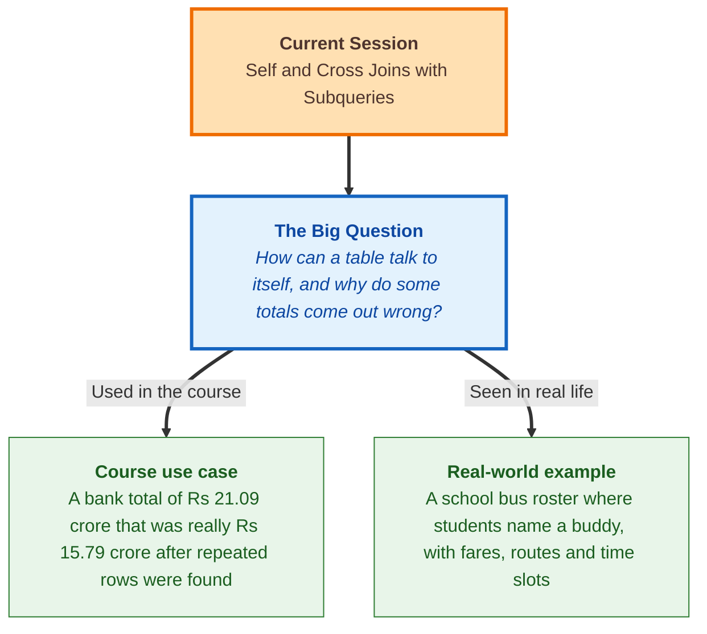

## Self and Cross Joins with Subqueries

### Mental Map

---

### What You'll Learn

Have you ever wondered how a school can print every student's buddy name from a single roster?

By the end of this session, you will be able to:

- **Explain** why 3 routes and 4 time slots give 12 pairs.
- **Predict** whether a comparison with a blank buddy answers yes, no or unknown.
- **Use** the roster twice to print each student's buddy name next to the student.
- **Examine** why a fee total doubles when each student has 2 stops.
- **Check** why students with no stop vanish from a list that should keep them.
- **Write** a line that shows each fare beside the average fare.

> **Topics you will meet:** self join, cross join, subquery in SELECT, join fan-out, NULL in comparisons, LEFT JOIN turned inner.
>
> Join the session to learn each of these in detail.

---

### Why You Are Learning This Topic

Mr. Thomas runs the school bus roster. Each student row names a buddy, who is another student on the same list. Fees are Rs 600 a month. A helper joined the fee list to the stop list. Every student with 2 stops showed a fee of Rs 1,200. The total looked too high by Rs 6,000.

A **fan-out** means a repeat of one row for every match found on the other side.

In this course, you will join a table to itself and check that each total is counted once.

> **Think about it:** Why did a student with 2 stops show the fee twice?

---

### The School Bus Roster Puzzle

Here is part of the roster.

| Student | Buddy | Route | Fare |
|:----------:|:----------:|:----------:|:----------:|
| Asha | Bilal | Route A | Rs 600 |
| Bilal | Asha | Route A | Rs 600 |
| Chitra | Not named | Route B | Rs 750 |
| Dev | Chitra | Route B | Rs 750 |

**What you want to happen:**

- The school prints each student's buddy name.
- The school lists every route with every time slot.
- The school shows each fare beside the average fare.

> **Wonder about this:**
>
> - What should the list show for Chitra, who has no buddy named?
> - What happens to a fee total if one student appears twice?

---

### Think It Through

There is no wrong first try. Keep your guesses for the session.

**1. The school has 3 routes and 4 time slots. What is the count of route and slot pairs?**
Hint: Pair every route with every slot.

**2. Chitra has no buddy named. Is the sentence 'Chitra's buddy is Asha' true, false or unknown?**
Hint: Think about what an empty entry tells you.

**3. A student with 2 stops shows a fee twice. How could you total fees without repeating a student?**
Hint: Total the fees before you add the stops.

---

### One Question to Carry Into the Session

> **How can we compare rows of one table, and trust a total after joining?**
>
> Which line of Mr. Thomas's roster would you check first for a repeated fee?
