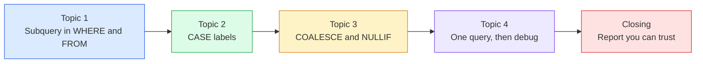
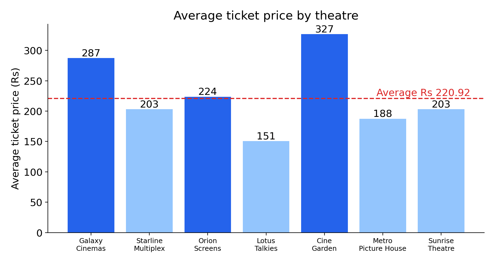
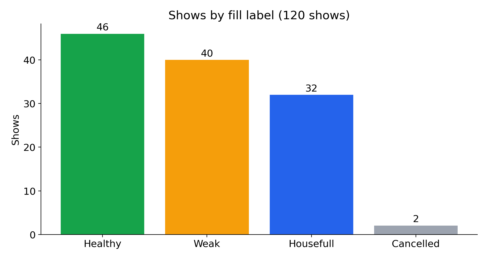
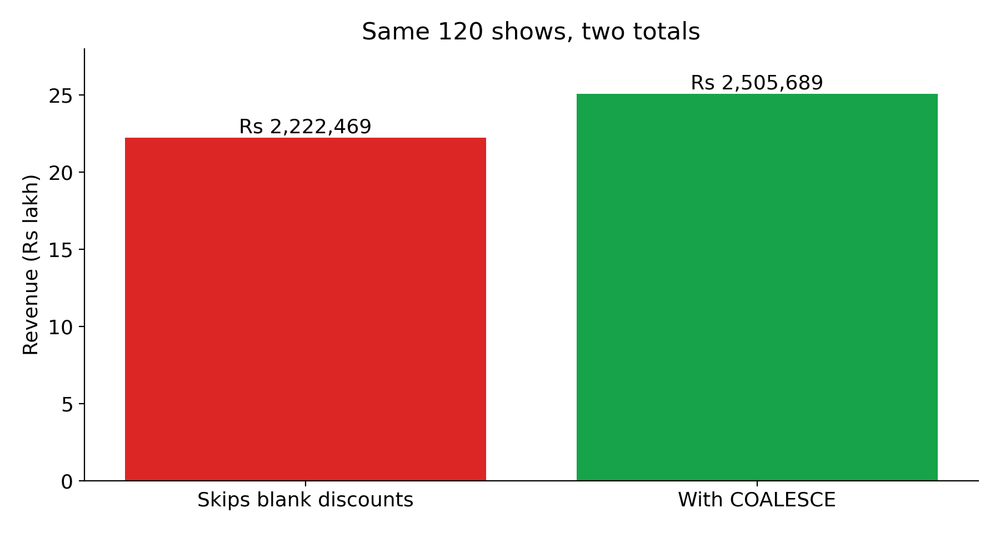
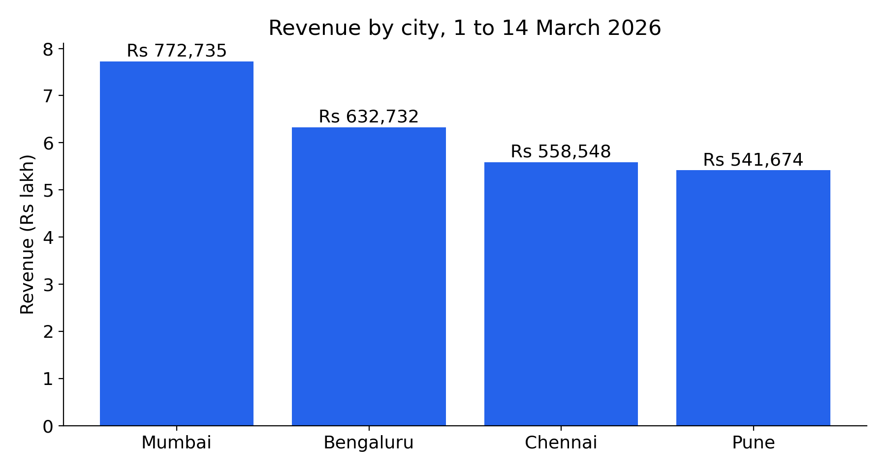

# <font color='#1d4ed8'>Lecture Script: Subqueries Contd and CASE WHEN (MySQL)</font>

---

## <font color='blue'>Agenda</font>

The lecture runs as four topics. Each topic ends with a quiz.

| Topic | What we do | Learning objectives covered | Minutes |
|:-:|:--|:--|:-:|
| 1 | Put a query inside WHERE and inside FROM | Filter rows using a subquery in the WHERE clause<br>Query a derived table defined in the FROM clause | 30 |
| 2 | Label rows with CASE | Write conditional logic into a query using a CASE expression | 25 |
| 3 | Control how blanks and zeros appear | Apply COALESCE and NULLIF to control how nulls appear in query output | 20 |
| 4 | Join, filter and total in one query, then fix a wrong one | Write a single query combining a join, a filter and an aggregate to answer a business question<br>Debug a SQL query that runs but returns the wrong answer by correcting a column, filter or aggregate | 30 |
| — | Closing: Outcome & Summary | | 15 |
| | **Total** | | **120** |

> <font color="red">**🎯 Instructor Note**</font> Pace: spend the time on the derived table in Topic 1 and on the debugging habit in Topic 4. Keep `COALESCE` and `NULLIF` to one clear job each.
> Load `data/bookmyshow.sql` once. It creates the database `cinema` with `theatres`, `movies` and `shows`.

---

## <font color='blue'>Scenario</font>

**A single weekly report, three drafts.** A BookMyShow-style ticketing app sends theatre managers one report every Monday. It covers 120 shows in 8 theatres of 4 cities, from 1 to 14 March 2026.

| Table | Rows | Holds |
|:--|:-:|:--|
| `theatres` | 8 | Name, city, screens |
| `movies` | 10 | Title, language, genre |
| `shows` | 120 | One row per show: capacity, seats sold, ticket price, discount percent |

> <font color="red">**🎯 Instructor Note**</font> BookMyShow is only the setting. Do not claim it uses this data. All tables are invented for teaching (CSV copies are in `data/`). A blank `discount_pct` means no offer was recorded. Use MySQL 8.0 or later (outputs captured on MySQL 9.7).

---

## <font color='blue'>Problem Statement</font>

The first draft of the Monday report showed a revenue total of Rs 22.22 lakh. The real total was Rs 25.06 lakh. The 12 shows with a blank discount had quietly dropped out of the sum. The second draft of the city table showed Bengaluru at "2,430" because the query added ticket prices instead of money collected. The third draft left out the 2 cancelled shows, because their fill percentage could not be worked out. A manager had already planned a new show on the wrong numbers.

> <font color='purple'>**How do we use one query inside another, label every show, handle blanks and zeros on purpose, and check that a report that runs also gives the right numbers?**</font>

> <font color="red">**🎯 Instructor Note**</font> Poll: "`SELECT 5 / NULLIF(0, 0);` What does it return?" Options: an error, 0 or NULL. Give learners 30 seconds to respond in chat. Reveal the answer in the Closing.

---

## <font color='blue'>What We Will Use</font>

Last session you pulled one aggregate into every row with a subquery in `SELECT`, and you saw how NULL breaks a comparison. Today the same idea moves into `WHERE` and `FROM`, and NULL gets a plan. The tool is MySQL, run from MySQL Workbench or any MySQL editor.

| Topic | Tools | In one line |
|:-:|:--|:--|
| 1 | Subquery in `WHERE`, derived table in `FROM` | Filter by a computed value, or treat a result as a table |
| 2 | `CASE WHEN … THEN … ELSE … END` | Turn a number into a label |
| 3 | `COALESCE`, `NULLIF` | Replace a blank with a value, or turn a value into a blank |
| 4 | `JOIN` + `WHERE` + `GROUP BY`, checks | Answer one question end to end, then test the answer |

---

## <font color='blue'>How: Walking Through the Monday Report</font>



---

## <font color='blue'>Topic 1: Put a query inside WHERE and inside FROM</font> `30 min`

> <font color='purple'>**A manager asks, "Which shows charge more than our average ticket?" The average is not in any column. Where does it come from?**</font>

### <font color='green'>Example: A subquery in WHERE</font>

> <font color='purple'>**Which shows have a ticket price above the average ticket price?**</font>

A **subquery** is a `SELECT` inside brackets. MySQL runs the inner query first and hands its answer to the outer query. Last session the inner query sat in the `SELECT` list. Here it sits in `WHERE` and returns one value, so we can compare with `>`.

**Predict before running: What will happen?**

> <font color="red">**🎯 Instructor Note**</font> Expected: 37 of 120 shows are above the average of Rs 220.92. Cine Garden (theatre 5) holds the top prices.

```sql
SELECT show_id, theatre_id, ticket_price
FROM shows
WHERE ticket_price > (SELECT AVG(ticket_price) FROM shows)
ORDER BY ticket_price DESC, show_id
LIMIT 5;
```

**Output**

```
+---------+------------+--------------+
| show_id | theatre_id | ticket_price |
+---------+------------+--------------+
|     117 |          5 |          380 |
|     118 |          5 |          360 |
|      92 |          5 |          350 |
|     108 |          5 |          340 |
|      20 |          5 |          330 |
+---------+------------+--------------+
```

#### <font color='#c2410c'>Code Explanation</font>

- **Line 3** The brackets hold the inner query. It returns one number, the average price.
- **Line 3** The outer `WHERE` compares every row's price with that one number.
- **Line 4** `show_id` breaks ties so the order never changes between runs.

> <font color='green'>**Result**</font> All five top-priced shows are in Cine Garden. In total, 37 of the 120 shows are priced above the average.

<p align="center"></p>

### <font color='green'>Extending it: A subquery that returns a list</font>

> <font color='purple'>**How many shows run in theatres of one city, when the city is stored only in `theatres`?**</font>

> <font color="red">**🎯 Instructor Note**</font> Ask for a prediction. `IN` works when the inner query returns a column of values. Expected: 33 shows in Pune.

```sql
SELECT COUNT(*) AS pune_shows
FROM shows
WHERE theatre_id IN (SELECT theatre_id FROM theatres WHERE city = 'Pune');
```

**Output**

```
+------------+
| pune_shows |
+------------+
|         33 |
+------------+
```

> <font color='green'>**Result**</font> Pune has 2 theatres. Together they run 33 shows.

> <font color='#b45309'>**Common mistake**</font> A comparison such as `>` needs one value. If the inner query returns many rows, MySQL stops with an error. Use `IN` for a list.

```sql
SELECT show_id FROM shows
WHERE ticket_price > (SELECT ticket_price FROM shows WHERE theatre_id = 5);
```

**Output**

```
ERROR 1242 (21000) at line 1: Subquery returns more than 1 row
```

### <font color='green'>Example: A derived table in FROM</font>

> <font color='purple'>**Can we treat "shows and average seats sold per theatre" as a small table, then join its theatre names?**</font>

A **derived table** is a subquery in `FROM`. It must have an alias, and its columns can be used by the outer query like any table.

**Predict before running: What will happen?**

> <font color="red">**🎯 Instructor Note**</font> Expected: 7 rows. Harbour Cinemas in Kochi has no shows, so it does not appear. Lotus Talkies has the smallest average.

```sql
SELECT t.theatre_name, d.shows, d.avg_sold
FROM (SELECT theatre_id, COUNT(*) AS shows,
             ROUND(AVG(seats_sold), 1) AS avg_sold
      FROM shows GROUP BY theatre_id) AS d
JOIN theatres t ON t.theatre_id = d.theatre_id
ORDER BY t.theatre_id;
```

**Output**

```
+---------------------+-------+----------+
| theatre_name        | shows | avg_sold |
+---------------------+-------+----------+
| Galaxy Cinemas      |    15 |     90.3 |
| Starline Multiplex  |    18 |    121.9 |
| Orion Screens       |    17 |    116.9 |
| Lotus Talkies       |    16 |     59.3 |
| Cine Garden         |    13 |    100.1 |
| Metro Picture House |    16 |     92.6 |
| Sunrise Theatre     |    25 |    117.7 |
+---------------------+-------+----------+
```

#### <font color='#c2410c'>Code Explanation</font>

- **Lines 3 to 5** The inner query groups `shows` by theatre. Its result is named `d`.
- **Line 6** The outer query joins `d` to `theatres` to bring the theatre names.

> <font color='green'>**Result**</font> Lotus Talkies averages 59.3 seats sold per show. Starline Multiplex averages 121.9.

> <font color='#b45309'>**Common mistake**</font> Forgetting the alias after the closing bracket.

```sql
SELECT COUNT(*) FROM (SELECT show_id FROM shows);
```

**Output**

```
ERROR 1248 (42000) at line 1: Every derived table must have its own alias
```

### <font color='purple'>Quiz 1</font>

**Question:** Which query lists the shows priced above the average ticket price?

**Options:**
- A) `WHERE ticket_price > AVG(ticket_price)`
- B) `WHERE ticket_price > (SELECT AVG(ticket_price) FROM shows)`
- C) `WHERE ticket_price > (SELECT ticket_price FROM shows)`
- D) `FROM (SELECT AVG(ticket_price) FROM shows) WHERE ticket_price > 0`

**Correct Answer:** B

**Explanation:**
- **A)** An aggregate such as `AVG` cannot be used directly in `WHERE`. MySQL returns an error.
- **B)** The inner query returns one value, the average. The outer `WHERE` compares each price with it.
- **C)** The inner query returns 120 prices. A `>` comparison needs one value, so MySQL raises an error.
- **D)** The derived table has no alias and no `ticket_price` column, so it cannot filter shows.

---

## <font color='blue'>Topic 2: Label rows with CASE</font> `25 min`

> <font color='purple'>**The manager does not want 120 fill numbers. They want each show called Housefull, Healthy, Weak or Cancelled. How do we turn a number into a label?**</font>

### <font color='green'>Example: Bucket shows by fill</font>

> <font color='purple'>**How many shows fall in each fill label?**</font>

A **CASE expression** checks its `WHEN` conditions from top to bottom and returns the `THEN` value of the first one that is true. If none is true it returns the `ELSE` value. Fill is $\text{fill} = \dfrac{\text{seats sold}}{\text{seat capacity}} \times 100$.

$$\boxed{\text{fill \%} = \frac{\text{seats\_sold} \times 100}{\text{seat\_capacity}}}$$

**Predict before running: What will happen?**

> <font color="red">**🎯 Instructor Note**</font> Expected: 32 Housefull, 46 Healthy, 40 Weak, 2 Cancelled. Cancelled shows have capacity 0, so their fill is NULL and falls to `ELSE`.

```sql
SELECT label, COUNT(*) AS shows
FROM (SELECT CASE WHEN seats_sold * 100 / seat_capacity >= 80 THEN 'Housefull'
                  WHEN seats_sold * 100 / seat_capacity >= 50 THEN 'Healthy'
                  WHEN seats_sold * 100 / seat_capacity >= 0  THEN 'Weak'
                  ELSE 'Cancelled' END AS label
      FROM shows) AS x
GROUP BY label ORDER BY shows DESC;
```

**Output**

```
+-----------+-------+
| label     | shows |
+-----------+-------+
| Healthy   |    46 |
| Weak      |    40 |
| Housefull |    32 |
| Cancelled |     2 |
+-----------+-------+
```

#### <font color='#c2410c'>Code Explanation</font>

- **Lines 2 to 5** Each `WHEN` tests one range. The first true one wins.
- **Line 5** `ELSE` catches the rest. A fill of NULL (capacity 0) is not `>= 0`, so it lands here.
- **Lines 1 and 7** The derived table from Topic 1 holds the labels. The outer query counts them.

> <font color='green'>**Result**</font> 32 Housefull, 46 Healthy, 40 Weak and 2 Cancelled shows. The 2 cancelled shows are not lost.

<p align="center"></p>

### <font color='green'>Extending it: The order of WHEN matters</font>

> <font color='purple'>**What if we write the 50 percent test before the 80 percent test?**</font>

> <font color="red">**🎯 Instructor Note**</font> Ask for a prediction. Expected: no show is Housefull, because every show at 80 percent or more already matched the first `WHEN`.

```sql
SELECT CASE WHEN seats_sold * 100 / seat_capacity >= 50 THEN 'Healthy'
            WHEN seats_sold * 100 / seat_capacity >= 80 THEN 'Housefull'
            ELSE 'Other' END AS label, COUNT(*) AS shows
FROM shows GROUP BY label ORDER BY shows DESC;
```

**Output**

```
+---------+-------+
| label   | shows |
+---------+-------+
| Healthy |    78 |
| Other   |    42 |
+---------+-------+
```

> <font color='green'>**Result**</font> Housefull has disappeared. All 78 shows at 50 percent or more became Healthy. Always test the narrowest condition first.

### <font color='green'>Extending it: Bucket a price</font>

> <font color='purple'>**How many shows are Premium (Rs 300 or more), Standard (Rs 200 to 299) or Value?**</font>

```sql
SELECT CASE WHEN ticket_price >= 300 THEN 'Premium'
            WHEN ticket_price >= 200 THEN 'Standard'
            ELSE 'Value' END AS price_band, COUNT(*) AS shows
FROM shows GROUP BY price_band ORDER BY shows DESC;
```

**Output**

```
+------------+-------+
| price_band | shows |
+------------+-------+
| Standard   |    54 |
| Value      |    44 |
| Premium    |    22 |
+------------+-------+
```

> <font color='green'>**Result**</font> Standard shows lead with 54 rows, then Value with 44 and Premium with 22. The same pattern works for any number-to-label rule.

### <font color='purple'>Quiz 2</font>

**Question:** A show has 85 percent fill. The query lists `WHEN fill >= 50 THEN 'Healthy'` first and `WHEN fill >= 80 THEN 'Housefull'` second. Which label does the show get?

**Options:**
- A) Housefull
- B) Weak
- C) Cancelled
- D) Healthy

**Correct Answer:** D

**Explanation:**
- **A)** Housefull is tested second. The first true `WHEN` has already returned.
- **B)** Weak needs a fill below 50, and 85 is not below 50.
- **C)** Cancelled applies only to capacity 0, which gives a NULL fill.
- **D)** 85 is at least 50, so the first `WHEN` is true and returns Healthy.

---

## <font color='blue'>Topic 3: Control how blanks and zeros appear</font> `20 min`

> <font color='purple'>**The Monday revenue total looked low. Twelve shows have a blank discount. What did the sum do with them?**</font>

### <font color='green'>Example: COALESCE gives a blank a value</font>

> <font color='purple'>**What is the revenue with and without a plan for the blank discounts?**</font>

Revenue for one show is $\text{seats sold} \times \text{price} \times \left(1 - \dfrac{\text{discount}}{100}\right)$. Any arithmetic with NULL gives NULL, and `SUM` skips NULL rows. `COALESCE(a, b)` returns the first value that is not NULL.

**Predict before running: What will happen?**

> <font color="red">**🎯 Instructor Note**</font> Expected: the first total is lower, because 12 shows vanish. Both totals are in rupees.

```sql
SELECT
  SUM(seats_sold * ticket_price * (1 - discount_pct / 100)) AS skips_blank,
  SUM(seats_sold * ticket_price *
      (1 - COALESCE(discount_pct, 0) / 100)) AS with_coalesce
FROM shows;
```

**Output**

```
+--------------+---------------+
| skips_blank  | with_coalesce |
+--------------+---------------+
| 2222469.0000 |  2505689.0000 |
+--------------+---------------+
```

#### <font color='#c2410c'>Code Explanation</font>

- **Line 2** A blank discount makes the whole product NULL, so `SUM` leaves that show out.
- **Lines 3 and 4** `COALESCE(discount_pct, 0)` turns a blank into 0 percent, meaning no discount.

> <font color='green'>**Result**</font> The first draft total was Rs 22,22,469. With `COALESCE` it is Rs 25,05,689. The 12 blank rows were worth Rs 2,83,220.

<p align="center"></p>

> <font color='#b45309'>**Common mistake**</font> `COALESCE(discount_pct, 0)` says a blank means "no discount". Check that this is true before using it. A blank might also mean "not known".

### <font color='green'>Extending it: Blanks and AVG</font>

> <font color='purple'>**Does the average discount change when blanks count as 0?**</font>

> <font color="red">**🎯 Instructor Note**</font> Ask for a prediction. `AVG` ignores NULL, so it divides by 108, not 120.

```sql
SELECT ROUND(AVG(discount_pct), 2) AS ignores_blank,
       ROUND(AVG(COALESCE(discount_pct, 0)), 2) AS blank_as_zero
FROM shows;
```

**Output**

```
+---------------+---------------+
| ignores_blank | blank_as_zero |
+---------------+---------------+
|          7.82 |          7.04 |
+---------------+---------------+
```

> <font color='green'>**Result**</font> The average is 7.82 percent over 108 shows with a discount, and 7.04 percent over all 120. Neither is wrong. They answer different questions.

### <font color='green'>Extending it: NULLIF turns a value into a blank</font>

> <font color='purple'>**Two cancelled shows have capacity 0. How do we keep a fill percentage from dividing by zero, and still print a word for them?**</font>

> <font color="red">**🎯 Instructor Note**</font> `NULLIF(a, b)` returns NULL when a equals b, else a. MySQL returns NULL for a division by zero in a `SELECT`, with a warning. Other databases stop with an error, so `NULLIF` states the plan.

```sql
SELECT show_id, seats_sold, seat_capacity,
  COALESCE(CONCAT(ROUND(seats_sold * 100 / NULLIF(seat_capacity, 0)), '%'),
           'cancelled') AS fill
FROM shows WHERE show_id IN (1, 6, 18, 45, 91) ORDER BY show_id;
```

**Output**

```
+---------+------------+---------------+-----------+
| show_id | seats_sold | seat_capacity | fill      |
+---------+------------+---------------+-----------+
|       1 |        100 |           120 | 83%       |
|       6 |          0 |             0 | cancelled |
|      18 |        180 |           180 | 100%      |
|      45 |          0 |             0 | cancelled |
|      91 |          0 |           100 | 0%        |
+---------+------------+---------------+-----------+
```

#### <font color='#c2410c'>Code Explanation</font>

- **Line 3** `NULLIF(seat_capacity, 0)` turns a capacity of 0 into NULL, so the division gives NULL.
- **Lines 3 and 4** `COALESCE` then turns that NULL into the word `cancelled`. `CONCAT` adds the `%` sign.

> <font color='green'>**Result**</font> Shows 6 and 45 print `cancelled`. Show 91 sold 0 seats but has a capacity of 100, so its fill is `0%`. A cancelled show and an empty show are different.

### <font color='purple'>Quiz 3</font>

**Question:** Four shows have discounts 5, 10, NULL and 15. What does `AVG(COALESCE(discount_pct, 0))` return?

**Options:**
- A) 7.5
- B) 10
- C) 0
- D) NULL

**Correct Answer:** A

**Explanation:**
- **A)** The values become 5, 10, 0 and 15. The sum is 30, and 30 divided by 4 is 7.5.
- **B)** 10 is the average when NULL is skipped, which is `AVG(discount_pct)` alone: 30 divided by 3.
- **C)** `COALESCE` changes only the NULL value. The other three values stay.
- **D)** After `COALESCE` there is no NULL left, so the average is a number.

---

## <font color='blue'>Topic 4: Join, filter and total in one query, then fix a wrong one</font> `30 min`

> <font color='purple'>**The manager asks, "What did Hindi movies earn in each city in the first week?" The answer needs three tables, a filter and a total. And last week's answer was wrong. How do we build it, and how do we know it is right?**</font>

### <font color='green'>Example: One query that answers the question</font>

> <font color='purple'>**What was the revenue from Hindi movies in each city from 1 to 7 March?**</font>

Last session you joined tables and watched the numbers for fan-out. Here the join brings the city and the language, the `WHERE` keeps the week and the language, and `GROUP BY` totals the revenue.

**Predict before running: What will happen?**

> <font color="red">**🎯 Instructor Note**</font> Expected: 4 rows, one per city, with Bengaluru first at Rs 2,40,443.

```sql
SELECT th.city,
  ROUND(SUM(s.seats_sold * s.ticket_price *
            (1 - COALESCE(s.discount_pct, 0) / 100))) AS revenue
FROM shows s
JOIN theatres th ON th.theatre_id = s.theatre_id
JOIN movies m ON m.movie_id = s.movie_id
WHERE m.language = 'Hindi' AND s.show_date BETWEEN '2026-03-01' AND '2026-03-07'
GROUP BY th.city ORDER BY revenue DESC;
```

**Output**

```
+-----------+---------+
| city      | revenue |
+-----------+---------+
| Bengaluru |  240443 |
| Chennai   |  199940 |
| Mumbai    |  180240 |
| Pune      |  142720 |
+-----------+---------+
```

#### <font color='#c2410c'>Code Explanation</font>

- **Lines 2 and 3** Revenue uses the Topic 3 formula with `COALESCE`.
- **Lines 5 and 6** Two joins bring the city and the language.
- **Line 7** The filter keeps Hindi shows in the first week. `BETWEEN` includes both end dates.

> <font color='green'>**Result**</font> Bengaluru leads with Rs 2,40,443, then Chennai at Rs 1,99,940, Mumbai at Rs 1,80,240 and Pune at Rs 1,42,720.

### <font color='green'>Extending it: Debug a query that runs but is wrong</font>

> <font color='purple'>**This draft gives Bengaluru "2,430". It runs without any error. What is wrong?**</font>

Think before you read on: a query that runs is not a query that is right. First compare the result with a number you can trust. A city that earned Rs 2,430 from many shows cannot be correct.

> <font color="red">**🎯 Instructor Note**</font> Ask learners to find the bug. Expected: `SUM(s.ticket_price)` adds the price of each show once, not the tickets sold.

```sql
SELECT th.city, SUM(s.ticket_price) AS revenue
FROM shows s
JOIN theatres th ON th.theatre_id = s.theatre_id
JOIN movies m ON m.movie_id = s.movie_id
WHERE m.language = 'Hindi' AND s.show_date BETWEEN '2026-03-01' AND '2026-03-07'
GROUP BY th.city ORDER BY th.city;
```

**Output**

```
+-----------+---------+
| city      | revenue |
+-----------+---------+
| Bengaluru |    2430 |
| Chennai   |    1630 |
| Mumbai    |    2140 |
| Pune      |    1300 |
+-----------+---------+
```

> <font color='green'>**Result**</font> The wrong column is added. `ticket_price` is one price per show. Money collected is `seats_sold * ticket_price` with the discount. Swap the column and the numbers match the example above.

### <font color='green'>Extending it: A wrong filter that also runs</font>

> <font color='purple'>**The column is fixed, but the date filter says `show_date < '2026-03-07'`. What changes?**</font>

> <font color="red">**🎯 Instructor Note**</font> Ask for a prediction. Expected: shows on 7 March are dropped. The week now has 6 days.

```sql
SELECT th.city, ROUND(SUM(s.seats_sold * s.ticket_price *
       (1 - COALESCE(s.discount_pct, 0) / 100))) AS revenue
FROM shows s
JOIN theatres th ON th.theatre_id = s.theatre_id
JOIN movies m ON m.movie_id = s.movie_id
WHERE m.language = 'Hindi' AND s.show_date < '2026-03-07'
GROUP BY th.city ORDER BY th.city;
```

**Output**

```
+-----------+---------+
| city      | revenue |
+-----------+---------+
| Bengaluru |  208070 |
| Chennai   |  160340 |
| Mumbai    |  133750 |
| Pune      |  142720 |
+-----------+---------+
```

> <font color='green'>**Result**</font> Bengaluru falls from Rs 2,40,443 to Rs 2,08,070, and Mumbai from Rs 1,80,240 to Rs 1,33,750. Pune stays the same because it had no Hindi show on 7 March. A query can be wrong in one city and right in another.

> <font color='#b45309'>**Common mistake**</font> Trusting a query because it runs. Check three things every time: the column being summed, the filter edges and the grouping.

### <font color='purple'>Quiz 4</font>

**Question:** A city revenue query gives the same total whether 5 or 150 seats were sold per show. Which cause is most likely?

**Options:**
- A) The `GROUP BY` uses `city` instead of `theatre_id`
- B) The `ORDER BY` has no tie-breaker
- C) It sums `ticket_price` instead of `seats_sold * ticket_price`
- D) `COALESCE` was used on the discount column

**Correct Answer:** C

**Explanation:**
- **A)** Grouping by city changes how many rows come back, not whether seats sold matter.
- **B)** `ORDER BY` changes the row order, not the numbers.
- **C)** `ticket_price` is one price per show. Without `seats_sold` the total ignores how many tickets sold.
- **D)** `COALESCE` replaces a blank discount with 0. It does not remove `seats_sold` from the sum.

---

## <font color='blue'>Closing: Outcome & Summary</font> `15 min`

Back to the Monday report. We now have what we need for a trusted version.

> <font color='purple'>**1. Which shows need a review because they sold fewer seats than the average show?**</font>

A subquery in `WHERE` (Topic 1) gives the average of 101.8 seats. Cancelled shows are excluded with `seat_capacity > 0`.

```sql
SELECT show_id, seats_sold FROM shows
WHERE seats_sold < (SELECT AVG(seats_sold) FROM shows) AND seat_capacity > 0
ORDER BY seats_sold, show_id LIMIT 3;
```

**Output**

```
+---------+------------+
| show_id | seats_sold |
+---------+------------+
|      91 |          0 |
|      88 |         27 |
|      96 |         33 |
+---------+------------+
```

> <font color='purple'>**2. What is one correct city table, with labels, cancelled shows and revenue together?**</font>

```sql
SELECT th.city,
  SUM(CASE WHEN s.seat_capacity = 0 THEN 1 ELSE 0 END) AS cancelled,
  SUM(CASE WHEN s.seats_sold * 100 / NULLIF(s.seat_capacity, 0) >= 80 THEN 1 ELSE 0 END) AS housefull,
  ROUND(SUM(s.seats_sold * s.ticket_price * (1 - COALESCE(s.discount_pct, 0) / 100))) AS revenue
FROM shows s JOIN theatres th ON th.theatre_id = s.theatre_id
GROUP BY th.city ORDER BY revenue DESC;
```

**Output**

```
+-----------+-----------+-----------+---------+
| city      | cancelled | housefull | revenue |
+-----------+-----------+-----------+---------+
| Mumbai    |         1 |         9 |  772735 |
| Bengaluru |         0 |         6 |  632732 |
| Chennai   |         0 |         7 |  558548 |
| Pune      |         1 |        10 |  541674 |
+-----------+-----------+-----------+---------+
```

#### <font color='#c2410c'>Code Explanation</font>

- **Line 2** `CASE` counts cancelled shows (Topic 2), so no show is dropped.
- **Line 3** `NULLIF` guards the division (Topic 3) and `CASE` flags Housefull shows.
- **Line 4** `COALESCE` keeps the 12 blank-discount shows in the revenue (Topic 3).
- **Lines 5 and 6** The join, the grouping and the sort answer one question (Topic 4).

<p align="center"></p>

### <font color='green'>Outcome</font>

| | First draft | Final report |
|:--|:-:|:-:|
| Total revenue | Rs 22,22,469 | Rs 25,05,689 |
| Shows with blank discount | Dropped (12) | Counted (12) |
| Cancelled shows | Missing | 2 counted |
| City table column | `ticket_price` summed | `seats_sold × ticket_price` less discount |

> <font color='green'>**Therefore,**</font> a report that runs is not yet a report that is right. Use a subquery to get a computed value, `CASE` to label, `COALESCE` and `NULLIF` to plan for blanks and zeros, and one joined query with a check against a trusted number. The final city totals add up to Rs 25,05,689.

> <font color="red">**🎯 Instructor Note**</font> Reveal the poll: `SELECT 5 / NULLIF(0, 0);` returns NULL. `NULLIF(0, 0)` is NULL, and 5 divided by NULL is NULL. Run it live.

### <font color='green'>Summary</font>

| Learning objective | Takeaway |
|:--|:--|
| Subquery in WHERE | The inner query runs first and returns one value (or a list for `IN`) to the outer filter |
| Derived table in FROM | A subquery in `FROM` needs an alias and works like a small table |
| CASE expression | First true `WHEN` wins, so test the narrowest condition first and add an `ELSE` |
| COALESCE and NULLIF | `COALESCE` fills a blank, `NULLIF` makes a blank from a chosen value |
| Join, filter and aggregate in one query | Joins bring columns, `WHERE` filters rows, `GROUP BY` totals them |
| Debug a query that runs but is wrong | Compare with a trusted number and check the column, the filter edges and the grouping |
| **Practical value** | Weekly reports stay honest when blanks, zeros and filters are checked on purpose |

---

# <font color='red'>Launch the Feedback Poll</font>

> <font color="red">**🎯 Instructor Note**</font> Reminder: launch the feedback poll now to collect learner feedback.
