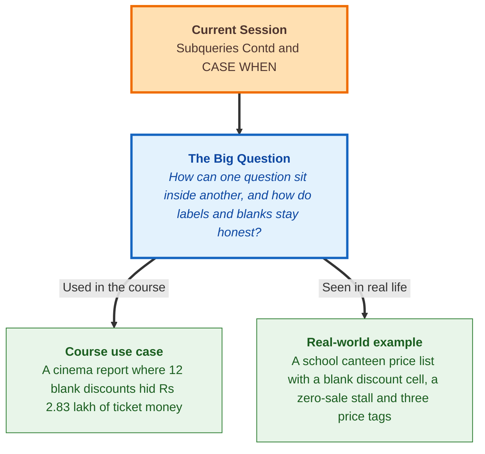

## Subqueries Contd and CASE WHEN

### Mental Map

---

### What You'll Learn

Have you ever wondered how a canteen board tags each snack as Costly, Fair or Cheap on its own?

By the end of this session, you will be able to:

- **Identify** the 2 snacks priced above the canteen average of Rs 25.
- **Classify** each of the 5 snacks as Costly, Fair or Cheap by its price.
- **Predict** how blank discounts move the money total from Rs 1,900 to Rs 1,000.
- **Explain** why Juice, with 0 sold, breaks a price-per-item sum.
- **Trace** a total that runs without a warning and still shows the wrong money.
- **Check** the total against a figure you already know, such as the cash box.

> **Topics you will meet:** subquery in WHERE, subquery in FROM, CASE WHEN and bucketing, COALESCE and NULLIF, join filter and aggregate in one query, fixing a query that runs but gives the wrong answer.
>
> Join the session to learn each of these in detail.

---

### Why You Are Learning This Topic

Meena runs the school canteen board. Each week she lists snacks, prices and counts sold. Last week the board said the canteen earned Rs 1,000. The cash box held Rs 1,900. Two snacks had a blank discount. The board skipped them without a word.

A **subquery** means a question placed inside another question, so the first answer feeds the second.

In this course, you will place one query inside another and test each total against a figure you know.

> **Think about it:** Why did the board show Rs 1,000 when the cash box held Rs 1,900?

---

### Canteen Board Puzzle

Here is part of Meena's board for one week.

| Snack | Price | Sold | Discount per item |
|:----------:|:----------:|:----------:|:----------:|
| Samosa | Rs 15 | 40 | Rs 0 |
| Sandwich | Rs 30 | 20 | Blank |
| Pasta | Rs 45 | 10 | Rs 5 |
| Juice | Rs 25 | 0 | Rs 0 |
| Biscuits | Rs 10 | 30 | Blank |

**What you want to happen:**

- The board lists the snacks priced above the average price.
- Each snack gets a tag that matches its price.
- The money total counts every snack, even with a blank discount.

> **Wonder about this:**
>
> - What should the board do with a blank in the discount column?
> - How do you work out a price per item for Juice, which sold 0?

---

### Think It Through

There is no wrong first try. Keep your guesses for the session.

**1. The 5 prices add up to Rs 125. Which snacks cost more than the average?**
Hint: Divide the sum by 5 first.

**2. A blank discount is treated as Rs 0. What is the money for Sandwich, with 20 sold?**
Hint: Price minus discount, times the count sold.

**3. The board adds only the snacks with a filled discount. Which snacks are left out?**
Hint: Look at the Discount column.

---

### One Question to Carry Into the Session

> **Which part of a board can you trust only after you check it against a figure you know?**
>
> What would you test first on Meena's board before sending it to the principal?
