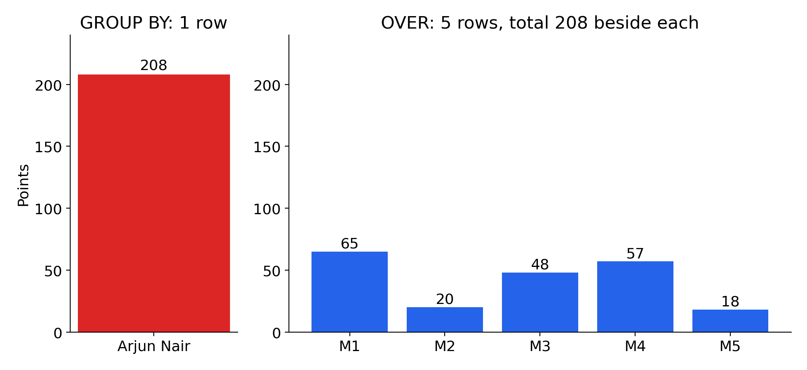
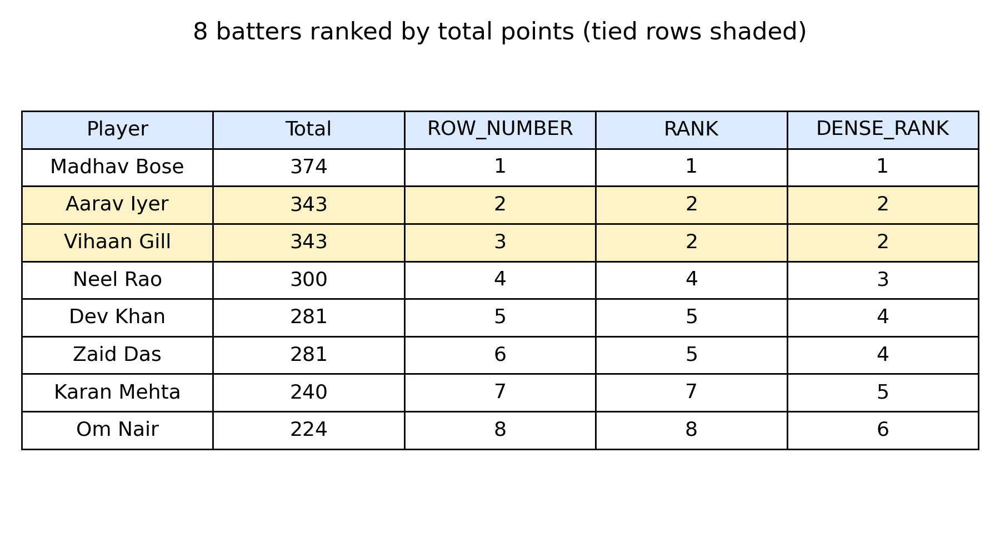
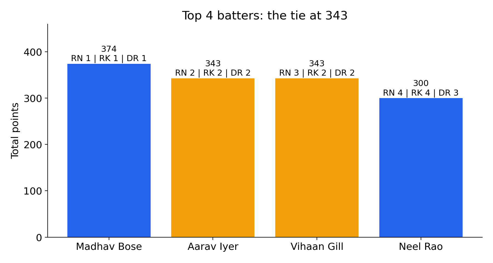
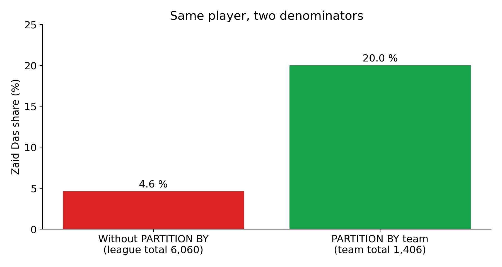
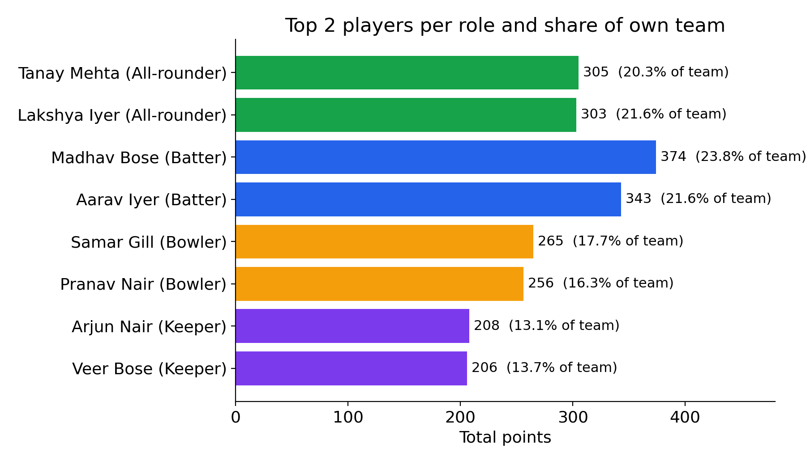

# <font color='#1d4ed8'>Lecture Script: Window Functions and Ranking (MySQL)</font>

---

## <font color='blue'>Agenda</font>

The lecture runs as four topics. Each topic ends with a quiz.

| Topic | What we do | Learning objectives covered | Minutes |
|:-:|:--|:--|:-:|
| 1 | Keep every row and add a total beside it | Explain what the OVER clause gives that GROUP BY cannot<br>Compute an aggregate alongside each detail row using a window function | 30 |
| 2 | Rank players inside each role | Apply ROW_NUMBER, RANK and DENSE_RANK to rank rows within a partition | 25 |
| 3 | See what ties do to each ranking | Compare ROW_NUMBER, RANK and DENSE_RANK on tied values | 20 |
| 4 | Pick the top 2 per role, then fix a wrong total | Retrieve the top N rows per group using a ranked subquery<br>Debug a window query returning wrong totals because PARTITION BY is missing | 30 |
| — | Closing: Outcome & Summary | | 15 |
| | **Total** | | **120** |

> <font color="red">**🎯 Instructor Note**</font> Pace: spend the time on the three ranking functions in Topics 2 and 3, and on the ranked subquery in Topic 4. Keep the first window aggregate to one clear example.
> Load `data/fantasy.sql` once. It creates the database `fantasy` with one table, `scores`.

---

## <font color='blue'>Scenario</font>

A Dream11-style fantasy cricket app runs a league of 4 teams and 24 players. After 5 matches, every player has a row for each match, 120 rows in all. The app wants a leaderboard with three asks:

1. Show every match score with the player's total beside it.
2. Show the top 2 players in each role: Batter, Bowler, All-rounder and Keeper.
3. Show each player's share of their own team's points.

> <font color="red">**🎯 Instructor Note**</font> Dream11 is only the setting. Do not claim it uses this data. The teams, players and points in `scores` are invented for teaching (a CSV copy is in `data/`). Use MySQL 8.0 or later (outputs captured on MySQL 9.7). Window functions need MySQL 8.0 or later.

---

## <font color='blue'>Problem Statement</font>

The first leaderboard draft used `RANK` and showed 3 batters in a "top 2" list, because two batters tied on 343 points. The second draft used `ROW_NUMBER` and showed exactly 2 batters, but it dropped one of the tied batters without telling anyone. The third draft showed Zaid Das with a team share of 4.6 percent. His real share of the Chennai Chargers' points was 20.0 percent. The percent was divided by the points of the whole league. A user dropped a player because of that number.

> <font color='purple'>**How do we keep every row and still add totals and ranks, choose what happens when scores tie, and avoid a total that is quietly computed over the wrong group?**</font>

> <font color="red">**🎯 Instructor Note**</font> Poll: "Scores in descending order are 90, 80, 80, 70. What does `RANK()` give the score 70?" Options: 2, 3 or 4. Give learners 30 seconds to respond in chat. Reveal the answer in the Closing.

---

## <font color='blue'>What We Will Use</font>

Last session you used a derived table in `FROM` and a `CASE` label. Today a derived table feeds a window function. The tool is MySQL 8.0 or later, run from MySQL Workbench or any MySQL editor.

| Topic | Tools | In one line |
|:-:|:--|:--|
| 1 | `OVER`, `PARTITION BY`, `SUM() OVER` | Add an aggregate beside each row without collapsing rows |
| 2 | `ROW_NUMBER`, `RANK`, `DENSE_RANK` | Number rows inside each group |
| 3 | `ORDER BY` inside `OVER` | See how each function treats equal values |
| 4 | Ranked subquery, `WHERE rank <= N` | Keep the top N rows per group, and check the partition |

---

## <font color='blue'>How: Walking Through the Leaderboard</font>


---

## <font color='blue'>Topic 1: Keep every row and add a total beside it</font> `30 min`

> <font color='purple'>**Arjun Nair, a keeper, played 5 matches. A user wants all 5 scores and the total together. `GROUP BY` gave one row. Where did the other 4 go?**</font>

### <font color='green'>Example: GROUP BY collapses, OVER keeps</font>

> <font color='purple'>**How do we show Arjun's total without losing his 5 match rows?**</font>

Last session you grouped rows to get one total per group. `GROUP BY` returns one row per group. A **window function** computes over a group of rows but keeps every row. The `OVER` clause says which rows form the window. `PARTITION BY` splits the rows into groups, like `GROUP BY`, but nothing collapses.

**Predict before running: What will happen?**

> <font color="red">**🎯 Instructor Note**</font> Expected: the `GROUP BY` query returns 1 row with total 208. The window query returns 5 rows, each with 208 on its right.

```sql
SELECT player, SUM(points) AS player_total
FROM scores WHERE player = 'Arjun Nair'
GROUP BY player;
```

**Output**

```
+------------+--------------+
| player     | player_total |
+------------+--------------+
| Arjun Nair |          208 |
+------------+--------------+
```

```sql
SELECT player, match_no, points,
       SUM(points) OVER (PARTITION BY player) AS player_total
FROM scores WHERE player = 'Arjun Nair'
ORDER BY match_no;
```

**Output**

```
+------------+----------+--------+--------------+
| player     | match_no | points | player_total |
+------------+----------+--------+--------------+
| Arjun Nair |        1 |     65 |          208 |
| Arjun Nair |        2 |     20 |          208 |
| Arjun Nair |        3 |     48 |          208 |
| Arjun Nair |        4 |     57 |          208 |
| Arjun Nair |        5 |     18 |          208 |
+------------+----------+--------+--------------+
```

#### <font color='#c2410c'>Code Explanation</font>

- **First query** `GROUP BY player` squeezes 5 rows into 1.
- **Second query, line 2** `SUM(points) OVER (PARTITION BY player)` adds the points of the player's rows and writes that total on each row.
- **Second query, line 3** The `WHERE` runs first. The window only sees the rows that pass the filter.

> <font color='green'>**Result**</font> The group query shows Arjun's total, 208, once. The window query keeps all 5 matches and puts 208 beside each.

<p align="center"></p>

### <font color='green'>Extending it: Each match as a share of the total</font>

> <font color='purple'>**What share of Aarav Iyer's 343 points came from each match?**</font>

> <font color="red">**🎯 Instructor Note**</font> Ask for a prediction. The window total is the denominator. Expected: match 4 is his best, at 23.6 percent.

```sql
SELECT player, match_no, points,
  ROUND(points * 100 / SUM(points) OVER (PARTITION BY player), 1) AS pct_of_total,
  ROUND(AVG(points) OVER (PARTITION BY player), 1) AS avg_points
FROM scores WHERE player = 'Aarav Iyer'
ORDER BY match_no;
```

**Output**

```
+------------+----------+--------+--------------+------------+
| player     | match_no | points | pct_of_total | avg_points |
+------------+----------+--------+--------------+------------+
| Aarav Iyer |        1 |     69 |         20.1 |       68.6 |
| Aarav Iyer |        2 |     56 |         16.3 |       68.6 |
| Aarav Iyer |        3 |     66 |         19.2 |       68.6 |
| Aarav Iyer |        4 |     81 |         23.6 |       68.6 |
| Aarav Iyer |        5 |     71 |         20.7 |       68.6 |
+------------+----------+--------+--------------+------------+
```

> <font color='green'>**Result**</font> Aarav's 5 matches add up to 343. Match 4 gave 81 points, 23.6 percent. Two window functions in one query use the same partition. Each row keeps its own `points` next to the group's sum and average.

### <font color='purple'>Quiz 1</font>

**Question:** What does `SUM(points) OVER (PARTITION BY team)` return?

**Options:**
- A) One row per team, like `GROUP BY team`
- B) Only the first row of each team
- C) Every row, with the team's total repeated on each row of that team
- D) An error, because `GROUP BY` is missing

**Correct Answer:** C

**Explanation:**
- **A)** That is what `GROUP BY` does. A window function never collapses rows.
- **B)** Nothing is dropped. Every row stays in the result.
- **C)** The window is the rows of one team. Each row of that team gets the same total, and no row is lost.
- **D)** A window function does not need `GROUP BY`. `OVER` supplies the grouping.

---

## <font color='blue'>Topic 2: Rank players inside each role</font> `25 min`

> <font color='purple'>**The leaderboard needs "1st, 2nd, 3rd" among batters, and a fresh 1st among bowlers. How do we number rows inside each role?**</font>

### <font color='green'>Example: Three ranking functions side by side</font>

> <font color='purple'>**How do `ROW_NUMBER`, `RANK` and `DENSE_RANK` number the 8 batters by total points?**</font>

A ranking function needs an order. Inside `OVER`, `PARTITION BY role` restarts the numbering for each role, and `ORDER BY total DESC` puts the highest total first. The totals come from a derived table (last session), because a window function reads rows that already exist.

- `ROW_NUMBER()` gives each row a different number: 1, 2, 3 and so on.
- `RANK()` gives equal rows the same number, then skips numbers.
- `DENSE_RANK()` gives equal rows the same number and does not skip.

**Predict before running: What will happen?**

> <font color="red">**🎯 Instructor Note**</font> Expected: Madhav Bose is 1 in all three columns. The two batters on 343 split the three columns. Let learners guess the third batter's number before the run.

```sql
SELECT player, total,
  ROW_NUMBER() OVER (PARTITION BY role ORDER BY total DESC, player) AS rn,
  RANK() OVER (PARTITION BY role ORDER BY total DESC) AS rk,
  DENSE_RANK() OVER (PARTITION BY role ORDER BY total DESC) AS dr
FROM (SELECT player, role, SUM(points) AS total
      FROM scores GROUP BY player, role) AS t
WHERE role = 'Batter' ORDER BY rn;
```

**Output**

```
+-------------+-------+----+----+----+
| player      | total | rn | rk | dr |
+-------------+-------+----+----+----+
| Madhav Bose |   374 |  1 |  1 |  1 |
| Aarav Iyer  |   343 |  2 |  2 |  2 |
| Vihaan Gill |   343 |  3 |  2 |  2 |
| Neel Rao    |   300 |  4 |  4 |  3 |
| Dev Khan    |   281 |  5 |  5 |  4 |
| Zaid Das    |   281 |  6 |  5 |  4 |
| Karan Mehta |   240 |  7 |  7 |  5 |
| Om Nair     |   224 |  8 |  8 |  6 |
+-------------+-------+----+----+----+
```

#### <font color='#c2410c'>Code Explanation</font>

- **Lines 2 to 4** Three ranking functions over the same partition and order.
- **Line 2** `player` after `total DESC` is a tie-breaker, so `ROW_NUMBER` never changes between runs.
- **Lines 5 and 6** The derived table gives one total per player.

> <font color='green'>**Result**</font> Madhav Bose leads with 374. The first column is always 1 to 8. The other two columns repeat a number when totals are equal.

<p align="center"></p>

### <font color='green'>Extending it: Rank inside a team instead of a role</font>

> <font color='purple'>**What changes if the partition is the team?**</font>

> <font color="red">**🎯 Instructor Note**</font> Ask for a prediction. Expected: numbering restarts at 1 for each team. The partition decides where numbering restarts.

```sql
SELECT team, player, total,
  RANK() OVER (PARTITION BY team ORDER BY total DESC) AS rk
FROM (SELECT player, team, SUM(points) AS total
      FROM scores GROUP BY player, team) AS t
ORDER BY team, rk, player LIMIT 6;
```

**Output**

```
+------------------+--------------+-------+----+
| team             | player       | total | rk |
+------------------+--------------+-------+----+
| Chennai Chargers | Lakshya Iyer |   303 |  1 |
| Chennai Chargers | Zaid Das     |   281 |  2 |
| Chennai Chargers | Parth Khan   |   243 |  3 |
| Chennai Chargers | Om Nair      |   224 |  4 |
| Chennai Chargers | Dhruv Gill   |   179 |  5 |
| Chennai Chargers | Reyansh Rao  |   176 |  6 |
+------------------+--------------+-------+----+
```

> <font color='green'>**Result**</font> In Chennai Chargers, Lakshya Iyer (303) is 1st and Zaid Das (281) is 2nd. The first 6 rows are all Chennai Chargers. The next team would start again at 1.

### <font color='purple'>Quiz 2</font>

**Question:** Which part of the window makes the rank start again at 1 for each role?

**Options:**
- A) `PARTITION BY role`
- B) `ORDER BY role`
- C) `GROUP BY role`
- D) `DENSE_RANK`

**Correct Answer:** A

**Explanation:**
- **A)** `PARTITION BY role` makes one window per role. Numbering restarts inside each window.
- **B)** `ORDER BY` inside `OVER` sets the order within a window. It does not split the rows into windows.
- **C)** `GROUP BY` would collapse the rows. It does not restart a rank on its own.
- **D)** `DENSE_RANK` is a function. A partition is still needed to restart numbering.

---

## <font color='blue'>Topic 3: See what ties do to each ranking</font> `20 min`

> <font color='purple'>**Aarav Iyer and Vihaan Gill both scored 343. Whose rank is 2 and whose is 3? Does the app have to choose?**</font>

### <font color='green'>Example: Reading the tie in the batter ranking</font>

> <font color='purple'>**What number does each function give the batter after the tie, Neel Rao on 300?**</font>

Look again at the rows from Topic 2. Two batters share 343 points, so ties start at the second place.

| Player | Total | `ROW_NUMBER` | `RANK` | `DENSE_RANK` |
|:--|:-:|:-:|:-:|:-:|
| Madhav Bose | 374 | 1 | 1 | 1 |
| Aarav Iyer | 343 | 2 | 2 | 2 |
| Vihaan Gill | 343 | 3 | 2 | 2 |
| Neel Rao | 300 | 4 | 4 | 3 |

**Predict before running: What will happen?**

> <font color="red">**🎯 Instructor Note**</font> Ask for the three numbers for Neel Rao before showing the output. Expected: 4, 4 and 3.

```sql
SELECT player, total,
  ROW_NUMBER() OVER (ORDER BY total DESC, player) AS rn,
  RANK() OVER (ORDER BY total DESC) AS rk,
  DENSE_RANK() OVER (ORDER BY total DESC) AS dr
FROM (SELECT player, SUM(points) AS total FROM scores
      WHERE role = 'Batter' GROUP BY player) AS t
ORDER BY rn LIMIT 4;
```

**Output**

```
+-------------+-------+----+----+----+
| player      | total | rn | rk | dr |
+-------------+-------+----+----+----+
| Madhav Bose |   374 |  1 |  1 |  1 |
| Aarav Iyer  |   343 |  2 |  2 |  2 |
| Vihaan Gill |   343 |  3 |  2 |  2 |
| Neel Rao    |   300 |  4 |  4 |  3 |
+-------------+-------+----+----+----+
```

#### <font color='#c2410c'>Logic Explanation</font>

- `ROW_NUMBER` ignores ties. Tied rows get different numbers, so the order between them comes only from the tie-breaker `player`.
- `RANK` gives both tied players 2, then skips 3. Neel Rao is 4, because 3 rows are ahead of him.
- `DENSE_RANK` gives both tied players 2 and does not skip. Neel Rao is 3.

> <font color='green'>**Result**</font> Neel Rao is 4th by `ROW_NUMBER`, 4th by `RANK` and 3rd by `DENSE_RANK`. The right function depends on the app's rule for a tie.

<p align="center"></p>

### <font color='green'>Extending it: Ties among bowlers</font>

> <font color='purple'>**Which rank does the pair of bowlers on 200 points get, using `RANK` across all bowlers?**</font>

> <font color="red">**🎯 Instructor Note**</font> Ask for a prediction. Expected: Kabir Mehta and Rohan Bose share 5th, and the next bowler is 7th.

```sql
SELECT player, total,
  RANK() OVER (ORDER BY total DESC) AS rk
FROM (SELECT player, SUM(points) AS total FROM scores
      WHERE role = 'Bowler' GROUP BY player) AS t
ORDER BY total DESC, player LIMIT 7;
```

**Output**

```
+-------------+-------+----+
| player      | total | rk |
+-------------+-------+----+
| Samar Gill  |   265 |  1 |
| Pranav Nair |   256 |  2 |
| Parth Khan  |   243 |  3 |
| Nikhil Das  |   238 |  4 |
| Kabir Mehta |   200 |  5 |
| Rohan Bose  |   200 |  5 |
| Reyansh Rao |   176 |  7 |
+-------------+-------+----+
```

> <font color='green'>**Result**</font> Both players on 200 are 5th. There is no 6th, and Reyansh Rao is 7th. `RANK` leaves a gap after a tie. `DENSE_RANK` would not.

### <font color='purple'>Quiz 3</font>

**Question:** Scores in descending order are 374, 343, 343 and 300. What does `DENSE_RANK()` give the score 300?

**Options:**
- A) 4
- B) 2
- C) 1
- D) 3

**Correct Answer:** D

**Explanation:**
- **A)** 4 is the `RANK` and `ROW_NUMBER` of 300. Both count the 3 rows ahead of it.
- **B)** 2 is the number given to both 343 scores.
- **C)** 1 belongs to 374 only.
- **D)** `DENSE_RANK` gives 1, 2, 2 and then 3, with no gap after the tie.

---

## <font color='blue'>Topic 4: Pick the top 2 per role, then fix a wrong total</font> `30 min`

> <font color='purple'>**The app wants the top 2 players in every role. The ranks are ready. Why can we not put `RANK() <= 2` in `WHERE`?**</font>

### <font color='green'>Example: A ranked subquery</font>

> <font color='purple'>**Which players are in the top 2 of their role?**</font>

`WHERE` runs before window functions are computed, so MySQL does not allow a window function there. We rank first in a subquery, then filter in the outer query. This is the same derived table idea from last session.

**Predict before running: What will happen?**

> <font color="red">**🎯 Instructor Note**</font> Expected: an error for the first query. The second returns 9 rows, because 2 batters tie for 2nd place.

```sql
SELECT role, player, total
FROM (SELECT player, role, SUM(points) AS total
      FROM scores GROUP BY player, role) AS t
WHERE RANK() OVER (PARTITION BY role ORDER BY total DESC) <= 2;
```

**Output**

```
ERROR 3593 (HY000) at line 1: You cannot use the window function 'rank' in this context.'
```

```sql
SELECT role, player, total, rk
FROM (SELECT role, player, total,
        RANK() OVER (PARTITION BY role ORDER BY total DESC) AS rk
      FROM (SELECT player, role, SUM(points) AS total
            FROM scores GROUP BY player, role) AS t) AS r
WHERE rk <= 2 ORDER BY role, rk, player;
```

**Output**

```
+-------------+--------------+-------+----+
| role        | player       | total | rk |
+-------------+--------------+-------+----+
| All-rounder | Tanay Mehta  |   305 |  1 |
| All-rounder | Lakshya Iyer |   303 |  2 |
| Batter      | Madhav Bose  |   374 |  1 |
| Batter      | Aarav Iyer   |   343 |  2 |
| Batter      | Vihaan Gill  |   343 |  2 |
| Bowler      | Samar Gill   |   265 |  1 |
| Bowler      | Pranav Nair  |   256 |  2 |
| Keeper      | Arjun Nair   |   208 |  1 |
| Keeper      | Veer Bose    |   206 |  2 |
+-------------+--------------+-------+----+
```

#### <font color='#c2410c'>Code Explanation</font>

- **First query** A window function in `WHERE` is not allowed.
- **Second query, lines 2 to 4** The inner query computes a rank column named `rk`.
- **Second query, line 6** The outer `WHERE rk <= 2` filters on an ordinary column.

> <font color='green'>**Result**</font> There are 9 rows for 4 roles. Aarav Iyer and Vihaan Gill both stay for batters, because both are ranked 2.

### <font color='green'>Extending it: Exactly 2 per role</font>

> <font color='purple'>**What if the app has exactly 2 slots per role?**</font>

> <font color="red">**🎯 Instructor Note**</font> Ask for a prediction. Expected: 8 rows. `ROW_NUMBER` with a tie-breaker (`player`) keeps Aarav Iyer and drops Vihaan Gill.

```sql
SELECT role, player, total, rn
FROM (SELECT role, player, total,
        ROW_NUMBER() OVER (PARTITION BY role ORDER BY total DESC, player) AS rn
      FROM (SELECT player, role, SUM(points) AS total
            FROM scores GROUP BY player, role) AS t) AS r
WHERE rn <= 2 ORDER BY role, rn;
```

**Output**

```
+-------------+--------------+-------+----+
| role        | player       | total | rn |
+-------------+--------------+-------+----+
| All-rounder | Tanay Mehta  |   305 |  1 |
| All-rounder | Lakshya Iyer |   303 |  2 |
| Batter      | Madhav Bose  |   374 |  1 |
| Batter      | Aarav Iyer   |   343 |  2 |
| Bowler      | Samar Gill   |   265 |  1 |
| Bowler      | Pranav Nair  |   256 |  2 |
| Keeper      | Arjun Nair   |   208 |  1 |
| Keeper      | Veer Bose    |   206 |  2 |
+-------------+--------------+-------+----+
```

> <font color='green'>**Result**</font> 8 rows, exactly 2 per role. The tie-breaker `player` decided who stayed, so say the rule aloud to the product team. `RANK` and `ROW_NUMBER` answer different questions.

### <font color='green'>Example: Debug a wrong share of the team total</font>

> <font color='purple'>**Zaid Das shows 4.6 percent. The query runs. What is missing?**</font>

Check a result against a number you can compute by hand. Chennai Chargers scored 1,406 points in total, and Zaid scored 281. That is 20.0 percent, not 4.6. The league total is 6,060, and 281 out of 6,060 is 4.6 percent. Without `PARTITION BY`, `OVER ()` makes one window of all rows.

> <font color="red">**🎯 Instructor Note**</font> Ask learners to spot the cause from the numbers. Expected: the denominator is the league total, 6,060.

```sql
SELECT player, team, total,
  ROUND(total * 100 / SUM(total) OVER (), 1) AS pct_wrong,
  ROUND(total * 100 / SUM(total) OVER (PARTITION BY team), 1) AS pct_right
FROM (SELECT player, team, SUM(points) AS total
      FROM scores GROUP BY player, team) AS t
ORDER BY team, player LIMIT 6;
```

**Output**

```
+--------------+------------------+-------+-----------+-----------+
| player       | team             | total | pct_wrong | pct_right |
+--------------+------------------+-------+-----------+-----------+
| Dhruv Gill   | Chennai Chargers |   179 |       3.0 |      12.7 |
| Lakshya Iyer | Chennai Chargers |   303 |       5.0 |      21.6 |
| Om Nair      | Chennai Chargers |   224 |       3.7 |      15.9 |
| Parth Khan   | Chennai Chargers |   243 |       4.0 |      17.3 |
| Reyansh Rao  | Chennai Chargers |   176 |       2.9 |      12.5 |
| Zaid Das     | Chennai Chargers |   281 |       4.6 |      20.0 |
+--------------+------------------+-------+-----------+-----------+
```

#### <font color='#c2410c'>Code Explanation</font>

- **Line 2** `OVER ()` has no partition, so `SUM(total)` adds all 24 players.
- **Line 3** `OVER (PARTITION BY team)` adds only the 6 players of that team.
- **Line 6** The `LIMIT` runs last, so both windows still see all 24 rows.

> <font color='green'>**Result**</font> Zaid Das is 4.6 percent against the league and 20.0 percent against his team. The query with no `PARTITION BY` runs and looks reasonable, which is why it needs a hand check.

<p align="center"></p>

> <font color='#b45309'>**Common mistake**</font> Writing `OVER ()` and expecting a per-group total. Always ask: "Total of which rows?" and name the partition.

### <font color='purple'>Quiz 4</font>

**Question:** `WHERE RANK() OVER (PARTITION BY role ORDER BY total DESC) <= 2` fails with an error. What is the fix?

**Options:**
- A) Replace `WHERE` with `HAVING`
- B) Compute the rank in a subquery, then filter `rk <= 2` in the outer query
- C) Add `LIMIT 2` at the end
- D) Replace `PARTITION BY role` with `GROUP BY role`

**Correct Answer:** B

**Explanation:**
- **A)** `HAVING` also runs before window functions are computed, so the error stays.
- **B)** The inner query creates `rk` as a normal column. The outer `WHERE` can filter it.
- **C)** `LIMIT 2` keeps 2 rows in total, not 2 per role.
- **D)** `GROUP BY` collapses rows and loses the ranking inside each role.

---

## <font color='blue'>Closing: Outcome & Summary</font> `15 min`

Back to the three asks. One query now answers them together, using a derived table, two windows and a filter.

> <font color='purple'>**1. Who are the top 2 in each role, and what share of their own team's points do they hold?**</font>

```sql
SELECT role, player, total, ROUND(total * 100 / team_total, 1) AS pct_of_team
FROM (SELECT role, player, total,
        SUM(total) OVER (PARTITION BY team) AS team_total,
        ROW_NUMBER() OVER (PARTITION BY role ORDER BY total DESC, player) AS rn
      FROM (SELECT player, team, role, SUM(points) AS total
            FROM scores GROUP BY player, team, role) AS t) AS r
WHERE rn <= 2 ORDER BY role, rn;
```

**Output**

```
+-------------+--------------+-------+-------------+
| role        | player       | total | pct_of_team |
+-------------+--------------+-------+-------------+
| All-rounder | Tanay Mehta  |   305 |        20.3 |
| All-rounder | Lakshya Iyer |   303 |        21.6 |
| Batter      | Madhav Bose  |   374 |        23.8 |
| Batter      | Aarav Iyer   |   343 |        21.6 |
| Bowler      | Samar Gill   |   265 |        17.7 |
| Bowler      | Pranav Nair  |   256 |        16.3 |
| Keeper      | Arjun Nair   |   208 |        13.1 |
| Keeper      | Veer Bose    |   206 |        13.7 |
+-------------+--------------+-------+-------------+
```

#### <font color='#c2410c'>Code Explanation</font>

- **Lines 5 and 6** The innermost query gives one total per player (Topic 1 idea, grouped first).
- **Line 3** `SUM(total) OVER (PARTITION BY team)` writes the team total beside each player (Topic 1).
- **Line 4** `ROW_NUMBER` numbers the players inside each role, with `player` as the tie-breaker (Topics 2 and 3).
- **Line 7** The outer `WHERE rn <= 2` keeps the top 2 per role (Topic 4).

<p align="center"></p>

### <font color='green'>Outcome</font>

| | Draft 1 | Draft 2 | Final |
|:--|:-:|:-:|:-:|
| Function | `RANK` | `ROW_NUMBER` (no tie-breaker named) | `ROW_NUMBER` with `player` as tie-breaker |
| Rows in "top 2 per role" | 9 | 8 | 8 |
| Tied batter | Both kept | One dropped silently | One dropped by a stated rule |
| Team share for Zaid Das | – | – | 20.0 percent (partition by team) |

> <font color='green'>**Therefore,**</font> use `OVER` to add totals without losing rows, and rank inside a partition. Choose `ROW_NUMBER`, `RANK` or `DENSE_RANK` by the rule for ties, and say the rule aloud. Filter ranks with a ranked subquery, and check a window total by hand against a known number.

> <font color="red">**🎯 Instructor Note**</font> Reveal the poll: the score 70 gets `RANK` 4, because 3 rows are ahead of it (90, 80, 80). `DENSE_RANK` would give 3. Run it live if needed.

### <font color='green'>Summary</font>

| Learning objective | Takeaway |
|:--|:--|
| OVER versus GROUP BY | `GROUP BY` collapses rows. `OVER` keeps every row and adds a value |
| Window aggregate | `SUM(...) OVER (PARTITION BY ...)` puts the group's total on each detail row |
| ROW_NUMBER, RANK, DENSE_RANK | Number rows inside a partition, in the order you give |
| Ties | `ROW_NUMBER` splits ties, `RANK` shares and skips, `DENSE_RANK` shares and does not skip |
| Top N per group | Rank in a subquery, then filter the rank in the outer query |
| Missing PARTITION BY | `OVER ()` is one window of all rows, so group totals come out wrong |
| **Practical value** | Leaderboards, "top N per group" lists and shares of a total become one clear query |

---

# <font color='red'>Launch the Feedback Poll</font>

> <font color="red">**🎯 Instructor Note**</font> Reminder: launch the feedback poll now to collect learner feedback.
