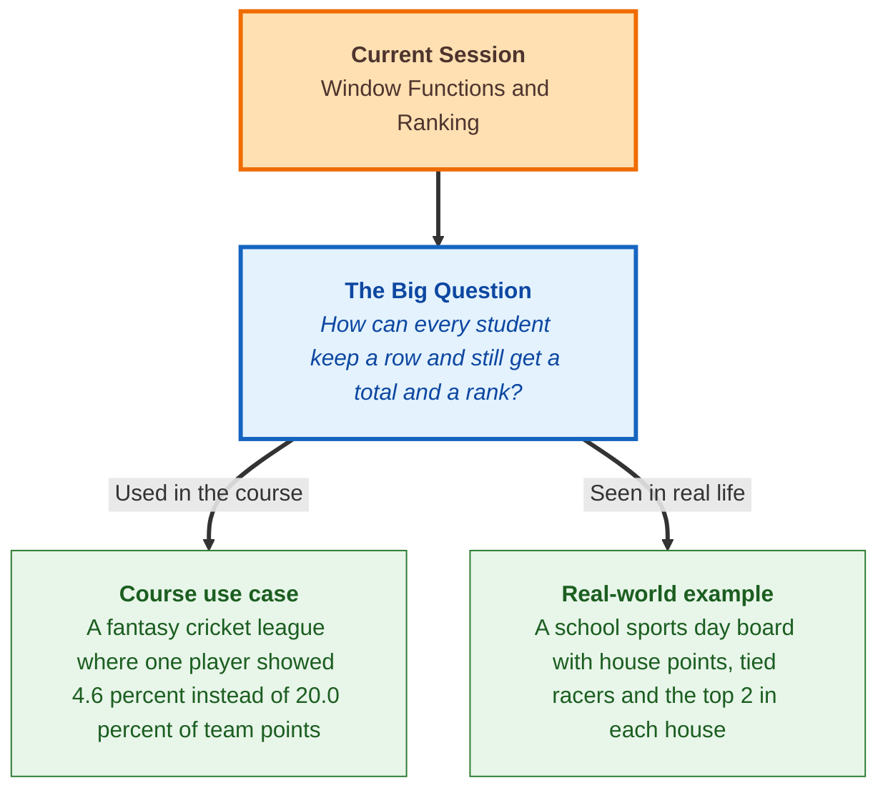

## Window Functions and Ranking

### Mental Map

---

### What You'll Learn

Have you ever wondered how a sports day board shows each student's points and the house total on one line?

By the end of this session, you will be able to:

- **Describe** how the board keeps all 3 Red house rows and still shows the house total of 250.
- **Predict** the rank of Chitra when Asha and Bilal tie at 90 points.
- **Calculate** the Red house share for Chitra, who scored 70 of 250 points.
- **Determine** the top 2 students in each house from one ranked list.
- **Compare** three ways to number tied students: 1, 2, 3 or 1, 1, 3 or 1, 1, 2.
- **Check** why a share of 18 percent is wrong when 28 percent is the right figure.

> **Topics you will meet:** OVER vs GROUP BY, window aggregate, ROW_NUMBER RANK and DENSE_RANK, ties in ranking, top N per group, PARTITION BY errors.
>
> Join the session to learn each of these in detail.

---

### Why You Are Learning This Topic

Mr. Thomas keeps the sports day board. Each student has a row with a house and race points. He wants each row to show the house total too. A totals list gave one line per house, and the student rows vanished. Two racers tied on 90 points. The board gave them different places, and a parent complained.

A **window** means a group of rows that you can total or rank while every row stays on the list.

In this course, you will add totals and ranks beside each row and pick the top students in each group.

> **Think about it:** Why did the student rows vanish when Mr. Thomas asked for house totals?

---

### Sports Day Board Puzzle

Here is part of the board.

| Student | House | Race points |
|:----------:|:----------:|:----------:|
| Asha | Red | 90 |
| Bilal | Red | 90 |
| Chitra | Red | 70 |
| Dev | Blue | 80 |
| Esha | Blue | 60 |

**What you want to happen:**

- Each student row shows the house total beside it.
- Tied racers get a place that Mr. Thomas can explain.
- The board lists the top 2 students in each house.

> **Wonder about this:**
>
> - What place should Chitra get if Asha and Bilal both take first?
> - What happens to a share if you divide by the points of both houses?

---

### Think It Through

There is no wrong first try. Keep your guesses for the session.

**1. The Red house has 90, 90 and 70 points. What is the Red total?**
Hint: Add the three scores.

**2. Chitra scored 70. What share of the Red total is that, in percent?**
Hint: Divide 70 by the house total, then multiply by 100.

**3. Asha and Bilal tie in first place. What are two fair places for Chitra?**
Hint: One answer skips a number and one does not.

---

### One Question to Carry Into the Session

> **How can a list keep every row and still tell each row where it stands?**
>
> Which rule for tied students would you explain to the parents?
