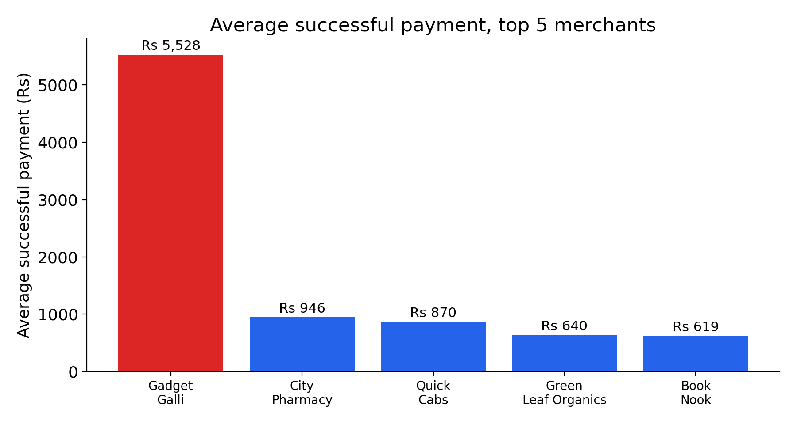
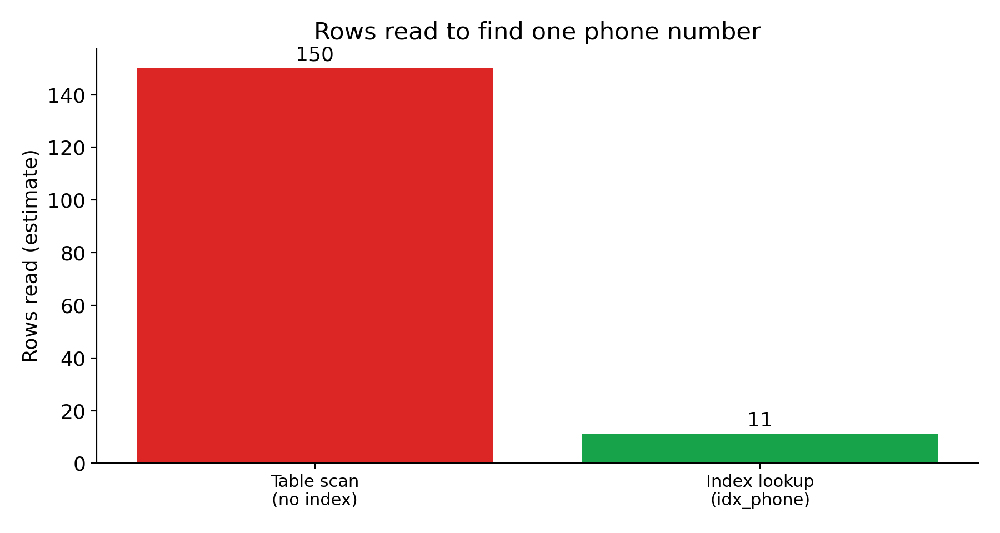
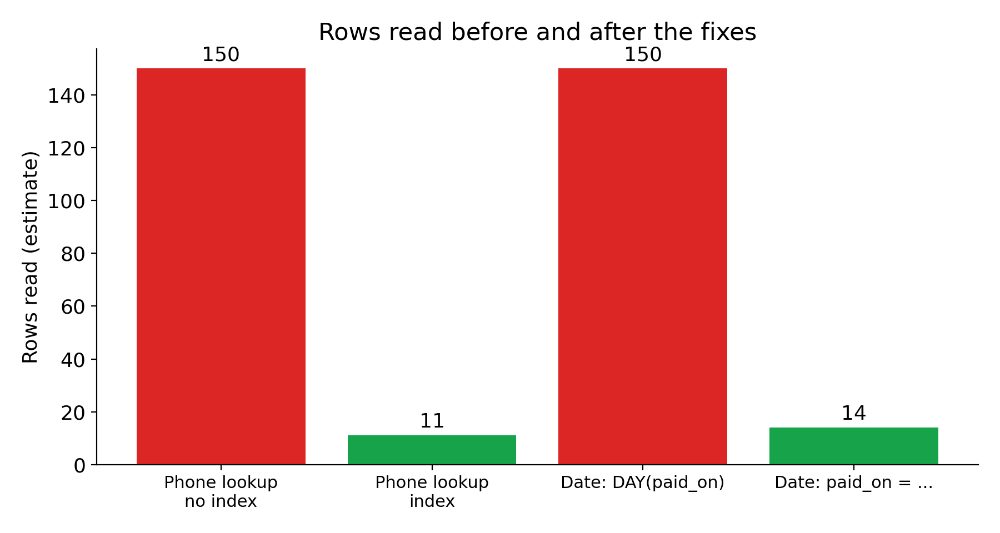

# <font color='#1d4ed8'>Lecture Script: CTEs and Views with Indexes (MySQL)</font>

---

## <font color='blue'>Agenda</font>

The lecture runs as four topics. Each topic ends with a quiz.

| Topic | What we do | Learning objectives covered | Minutes |
|:-:|:--|:--|:-:|
| 1 | Name an intermediate result with a CTE | Write a CTE that names an intermediate result with WITH | 25 |
| 2 | Save a query as a view | Build a view that encapsulates a reusable query | 20 |
| 3 | Make a lookup fast with an index | Explain how an index changes the cost of finding a row<br>Build an index on a column used in a filter or join | 30 |
| 4 | Find out why an index is skipped, and read a query you did not write | Explain why an index is skipped when its column is wrapped in a function<br>Interpret an unfamiliar SQL query, stating in prose what it returns | 30 |
| — | Closing: Outcome & Summary | | 15 |
| | **Total** | | **120** |

> <font color="red">**🎯 Instructor Note**</font> Pace: spend the time on the index reading in Topic 3 and on the "wrapped in a function" case in Topic 4. Keep the view to one clear idea: it stores a query, not rows.
> Load `data/upi_payments.sql` once. It creates the database `upi` with `merchants` and `payments`. Reload it to start from a clean state, because Topics 2 to 4 create a view and indexes.

---

## <font color='blue'>Scenario</font>

A PhonePe-style payments app keeps every merchant payment as a row. The data team supports three daily dashboards and a help desk.

| Who | Needs | What goes wrong today |
|:--|:--|:--|
| Dashboard 1, 2 and 3 | Total of successful payments per day | The same long query is pasted in three places |
| Help desk | All payments of one phone number, in seconds | Every search reads the whole table |
| A new analyst | To understand an inherited query | Nobody wrote down what it returns |

> <font color="red">**🎯 Instructor Note**</font> PhonePe is only the setting. Do not claim it uses this data. The 12 merchants and 150 payments from 1 to 14 March 2026 are invented for teaching (CSV copies are in `data/`). Use MySQL 8.0.16 or later, because `EXPLAIN FORMAT=TREE` needs it (outputs captured on MySQL 9.7). `EXPLAIN` costs can differ slightly by version. Read the node names and row counts.

---

## <font color='blue'>Problem Statement</font>

The same query for "days with above-average sales" was pasted into three dashboards. One copy had the typo `'SUCCES'`, so that dashboard showed no days at all. The help desk looked up a customer by phone number, and MySQL read every row of the table to find 11 payments. An engineer then added an index on the payment date, but the help desk's date search still read every row. The new analyst opened an inherited query and could not say what it returned.

> <font color='purple'>**How do we write a query once and name its parts, reuse it safely, make a lookup cheap, and know why an index is sometimes ignored?**</font>

> <font color="red">**🎯 Instructor Note**</font> Poll: "A table has an index on `paid_on`. Does `WHERE DAY(paid_on) = 5` use that index?" Options: yes, no or only on big tables. Give learners 30 seconds to respond in chat. Reveal the answer in the Closing.

---

## <font color='blue'>What We Will Use</font>

Last session you ranked rows with window functions on top of a derived table. Today you give a derived table a name with `WITH`, save a query as a view, and speed up lookups with an index. The tool is MySQL 8.0 or later, run from MySQL Workbench or any MySQL editor.

| Topic | Tools | In one line |
|:-:|:--|:--|
| 1 | `WITH name AS (...)` | Name an intermediate result and use it like a table |
| 2 | `CREATE VIEW` | Save a query under a name and select from it |
| 3 | `CREATE INDEX`, `EXPLAIN` | Add a lookup structure, and read how MySQL will find rows |
| 4 | Index and functions, reading queries | See when an index cannot be used, and describe a query in prose |

---

## <font color='blue'>How: Walking Through the Payments Team</font>


---

## <font color='blue'>Topic 1: Name an intermediate result with a CTE</font> `25 min`

> <font color='purple'>**A nested query is hard to read from the inside out. How do we give the inner result a name and read the query top to bottom?**</font>

### <font color='green'>Example: Average successful payment per merchant</font>

> <font color='purple'>**Which merchants have the highest average successful payment?**</font>

A **CTE** (common table expression) is a named result that lives for one statement. It starts with `WITH name AS ( ... )`. The main query after it uses the name like a table. Last session you wrote the same shape as a derived table in `FROM`. The CTE puts it first, with a name.

**Predict before running: What will happen?**

> <font color="red">**🎯 Instructor Note**</font> Expected: 5 rows. Gadget Galli, an electronics merchant, is far ahead with an average above Rs 5,500.

```sql
WITH merchant_avg AS (
  SELECT merchant_id, COUNT(*) AS n, ROUND(AVG(amount), 2) AS avg_amt
  FROM payments WHERE status = 'SUCCESS' GROUP BY merchant_id)
SELECT m.merchant_name, a.n, a.avg_amt
FROM merchant_avg a JOIN merchants m ON m.merchant_id = a.merchant_id
ORDER BY a.avg_amt DESC, m.merchant_id LIMIT 5;
```

**Output**

```
+---------------------+----+---------+
| merchant_name       | n  | avg_amt |
+---------------------+----+---------+
| Gadget Galli        | 17 | 5528.41 |
| City Pharmacy       |  8 |  945.50 |
| Quick Cabs          |  7 |  870.43 |
| Green Leaf Organics | 12 |  640.25 |
| Book Nook           | 16 |  619.19 |
+---------------------+----+---------+
```

#### <font color='#c2410c'>Code Explanation</font>

- **Lines 1 to 3** `WITH merchant_avg AS (...)` runs the inner query and names its result.
- **Line 5** The main query joins that name to `merchants`, like any other table.
- **Line 6** `merchant_id` is the tie-breaker for equal averages.

> <font color='green'>**Result**</font> Gadget Galli averages Rs 5,528.41 over 17 successful payments. The next merchant, City Pharmacy, averages Rs 945.50.

<p align="center"></p>

### <font color='green'>Extending it: Use the same name twice</font>

> <font color='purple'>**Which merchants are above the average of all merchant averages?**</font>

> <font color="red">**🎯 Instructor Note**</font> Ask for a prediction. A CTE can be used twice in one statement, which a derived table cannot do without repeating it. Expected: only Gadget Galli, above Rs 1,017.33.

```sql
WITH merchant_avg AS (
  SELECT merchant_id, ROUND(AVG(amount), 2) AS avg_amt
  FROM payments WHERE status = 'SUCCESS' GROUP BY merchant_id)
SELECT m.merchant_name, a.avg_amt
FROM merchant_avg a JOIN merchants m ON m.merchant_id = a.merchant_id
WHERE a.avg_amt > (SELECT AVG(avg_amt) FROM merchant_avg);
```

**Output**

```
+---------------+---------+
| merchant_name | avg_amt |
+---------------+---------+
| Gadget Galli  | 5528.41 |
+---------------+---------+
```

> <font color='green'>**Result**</font> Only Gadget Galli passes. The name `merchant_avg` is written once and used in the join and in the subquery.

> <font color='#b45309'>**Common mistake**</font> A CTE lives for one statement only. In the next statement the name is gone.

```sql
SELECT merchant_id FROM merchant_avg;
```

**Output**

```
ERROR 1146 (42S02) at line 1: Table 'upi.merchant_avg' doesn't exist
```

### <font color='purple'>Quiz 1</font>

**Question:** What is the life of a CTE named `merchant_avg`?

**Options:**
- A) It exists only for the one statement that starts with `WITH`
- B) It is saved in the database for later queries
- C) It speeds up the query by storing an index
- D) It can only be used once inside its statement

**Correct Answer:** A

**Explanation:**
- **A)** A CTE is named for one statement. The next statement cannot see it.
- **B)** Saving a query for later is what a view does, not a CTE.
- **C)** A CTE names a result. It does not build an index.
- **D)** A CTE can be used several times in its statement, as the `JOIN` and the subquery just did.

---

## <font color='blue'>Topic 2: Save a query as a view</font> `20 min`

> <font color='purple'>**The same long query is pasted in three dashboards, and one copy has a typo. How do we write it once and let everyone use it?**</font>

### <font color='green'>Example: A view of successful payments</font>

> <font color='purple'>**How do we save "successful payments with merchant details" under one name?**</font>

A **view** is a saved query with a name. It stores the query, not the rows. Every time you select from the view, MySQL runs the saved query on the current data. Because the filter lives in the view, no dashboard can mistype `'SUCCESS'`.

**Predict before running: What will happen?**

> <font color="red">**🎯 Instructor Note**</font> Expected: creating the view prints only a Query OK line. Then the count is 127 successful payments worth Rs 1,54,073.

```sql
CREATE OR REPLACE VIEW successful_payments AS
SELECT p.payment_id, m.merchant_name, m.city, m.category,
       p.user_phone, p.paid_on, p.amount
FROM payments p JOIN merchants m ON m.merchant_id = p.merchant_id
WHERE p.status = 'SUCCESS';
```

**Output**

```
Query OK, 0 rows affected
```

```sql
SELECT COUNT(*) AS payments, SUM(amount) AS total
FROM successful_payments;
```

**Output**

```
+----------+--------+
| payments | total  |
+----------+--------+
|      127 | 154073 |
+----------+--------+
```

#### <font color='#c2410c'>Code Explanation</font>

- **Line 1** `CREATE OR REPLACE VIEW` saves the query under the name `successful_payments`.
- **Lines 2 to 5** The saved query joins the two tables and keeps only `'SUCCESS'` rows.
- **Second query** The view is used in `FROM` like a table.

> <font color='green'>**Result**</font> The view returns 127 payments worth Rs 1,54,073. Of the 150 payments, 14 failed and 9 are pending, so they are not in the view.

### <font color='green'>Extending it: A view always shows today's data</font>

> <font color='purple'>**If a new successful payment arrives, does the view need to be rebuilt?**</font>

> <font color="red">**🎯 Instructor Note**</font> Ask for a prediction. Expected: no. The count becomes 128. Then delete the test row so the later outputs stay the same.

```sql
INSERT INTO payments VALUES (151, 1, '9810012005', '2026-03-14', 300, 'SUCCESS');
SELECT COUNT(*) AS payments, SUM(amount) AS total FROM successful_payments;
```

**Output**

```
+----------+--------+
| payments | total  |
+----------+--------+
|      128 | 154373 |
+----------+--------+
```

```sql
DELETE FROM payments WHERE payment_id = 151;
```

**Output**

```
Query OK, 1 row affected
```

> <font color='green'>**Result**</font> The new row appeared at once: 128 payments and Rs 1,54,373. The view never stored rows. It reran its query.

> <font color='#b45309'>**Common mistake**</font> Treating a view as a copy of the data. If you want the old numbers, a view will not keep them.

### <font color='purple'>Quiz 2</font>

**Question:** What does a view store?

**Options:**
- A) A copy of the rows from the day it was created
- B) An index on the first column
- C) A temporary name that disappears after one statement
- D) The query, which runs again each time the view is used

**Correct Answer:** D

**Explanation:**
- **A)** A view does not keep a copy. That is why it shows new rows at once.
- **B)** A view is not an index.
- **C)** That describes a CTE. A view stays in the database until it is dropped.
- **D)** The view saves the query text. Each `SELECT` from it runs the query on current data.

---

## <font color='blue'>Topic 3: Make a lookup fast with an index</font> `30 min`

> <font color='purple'>**The help desk searches by phone number. How can MySQL find 11 payments without reading all 150 rows?**</font>

### <font color='green'>Example: Before and after an index</font>

> <font color='purple'>**How does MySQL find the payments of one phone number, with and without an index?**</font>

An **index** is a sorted list of one column's values, each pointing to its rows, like the index at the back of a book. Without it MySQL scans every row. With it MySQL jumps to the matching entries. `EXPLAIN FORMAT=TREE` shows the plan MySQL will use, with a cost estimate and the number of rows it expects to read.

**Predict before running: What will happen?**

> <font color="red">**🎯 Instructor Note**</font> Expected: first a table scan of 150 rows. After the index, an index lookup of about 11 rows. The cost numbers fall as well.

```sql
EXPLAIN FORMAT=TREE
SELECT * FROM payments WHERE user_phone = '9810012000';
```

**Output**

```
-> Filter: (payments.user_phone = '9810012000')  (cost=15.2 rows=15)
    -> Table scan on payments  (cost=15.2 rows=150)
```

```sql
CREATE INDEX idx_phone ON payments (user_phone);
```

**Output**

```
Query OK, 0 rows affected
```

```sql
EXPLAIN FORMAT=TREE
SELECT * FROM payments WHERE user_phone = '9810012000';
```

**Output**

```
-> Index lookup on payments using idx_phone (user_phone = '9810012000')  (cost=1.85 rows=11)
```

#### <font color='#c2410c'>Code Explanation</font>

- **First plan** `Table scan on payments (rows=150)`: MySQL reads all 150 rows and tests each one.
- **Second statement** `CREATE INDEX idx_phone ON payments (user_phone)` builds the sorted list on one column.
- **Last plan** `Index lookup ... using idx_phone (rows=11)`: MySQL goes straight to about 11 entries.

> <font color='green'>**Result**</font> The same question now reads about 11 rows instead of 150, and the cost estimate falls from 15.2 to 1.85. On a table of crores of rows this difference decides whether a search takes a blink or a minute.

<p align="center"></p>

### <font color='green'>Extending it: An index on a join column</font>

> <font color='purple'>**Does an index also help a join?**</font>

> <font color="red">**🎯 Instructor Note**</font> Ask for a prediction. Expected: before the index MySQL reads all 150 payments and joins with a hash. After, it finds the merchant row first, then jumps into `payments` by `merchant_id`.

```sql
CREATE INDEX idx_merchant ON payments (merchant_id);
EXPLAIN FORMAT=TREE
SELECT p.payment_id, p.amount
FROM merchants m JOIN payments p ON p.merchant_id = m.merchant_id
WHERE m.merchant_name = 'Gadget Galli';
```

**Output**

```
-> Nested loop inner join  (cost=3.26 rows=13.6)
    -> Filter: (m.merchant_name = 'Gadget Galli')  (cost=1.15 rows=1)
        -> Table scan on m  (cost=1.15 rows=9)
    -> Index lookup on p using idx_merchant (merchant_id = m.merchant_id)  (cost=2.11 rows=13.6)
```

> <font color='green'>**Result**</font> The plan now starts from the one merchant row and uses `Index lookup on p using idx_merchant`. It reads about 14 payments, not 150. A column used in a filter or in a join is a good index candidate.

> <font color='#b45309'>**Common mistake**</font> Indexing every column. Each index takes space and makes inserts slower. Index the columns people filter and join on.

### <font color='purple'>Quiz 3</font>

**Question:** The help desk always filters `payments` by `user_phone`. What is the best change?

**Options:**
- A) Create a view over `payments`
- B) Create an index on `user_phone`
- C) Wrap `user_phone` in a CTE
- D) Create an index on `amount`

**Correct Answer:** B

**Explanation:**
- **A)** A view saves a query. It does not make the search faster.
- **B)** An index on the filtered column lets MySQL jump to the matching rows.
- **C)** A CTE names a result for one statement. It does not change how rows are found.
- **D)** The search does not filter on `amount`, so that index would not be used.

---

## <font color='blue'>Topic 4: Find out why an index is skipped, and read a query you did not write</font> `30 min`

> <font color='purple'>**An engineer added an index on `paid_on`. The help desk's date search is still slow. Why?**</font>

### <font color='green'>Example: The index and a function</font>

> <font color='purple'>**Which date filters can use the index on `paid_on`?**</font>

An index is a sorted list of the stored values. If the filter wraps the column in a function, such as `DAY(paid_on)`, MySQL cannot search the sorted list. It would need to compute `DAY()` for every row first, so it scans the table. The fix is to leave the column bare and put the work on the other side of the comparison.

**Predict before running: What will happen?**

> <font color="red">**🎯 Instructor Note**</font> Expected: the plain filter uses the index, with about 14 rows. The `DAY()` filter is a table scan of 150 rows, even though the index exists.

```sql
CREATE INDEX idx_paid_on ON payments (paid_on);
EXPLAIN FORMAT=TREE SELECT * FROM payments WHERE paid_on = '2026-03-05';
```

**Output**

```
-> Index lookup on payments using idx_paid_on (paid_on = DATE'2026-03-05')  (cost=2.15 rows=14)
```

```sql
EXPLAIN FORMAT=TREE SELECT * FROM payments WHERE DAY(paid_on) = 5;
```

**Output**

```
-> Filter: (dayofmonth(payments.paid_on) = 5)  (cost=15.2 rows=150)
    -> Table scan on payments  (cost=15.2 rows=150)
```

#### <font color='#c2410c'>Code Explanation</font>

- **First plan** `Index lookup ... using idx_paid_on`: the bare column matches the sorted list.
- **Second plan** `Table scan on payments (rows=150)`: `DAY(paid_on)` hides the stored value, so the index is skipped.

> <font color='green'>**Result**</font> Both queries look for the 5th of March. The first reads about 14 rows. The second reads all 150, because its column is wrapped in a function.

> <font color='#b45309'>**Common mistake**</font> Assuming that an index on a column helps every filter on it. It only helps when the column appears bare.

### <font color='green'>Extending it: Move the function to the other side</font>

> <font color='purple'>**A filter says "the day before 6 March". How do we write it so the index still works?**</font>

> <font color="red">**🎯 Instructor Note**</font> Ask learners which side should hold the function. Expected: the constant side, so `paid_on` stays bare.

```sql
EXPLAIN FORMAT=TREE
SELECT * FROM payments
WHERE DATE_ADD(paid_on, INTERVAL 1 DAY) = '2026-03-06';
```

**Output**

```
-> Filter: ((payments.paid_on + interval 1 day) = '2026-03-06')  (cost=15.2 rows=150)
    -> Table scan on payments  (cost=15.2 rows=150)
```

```sql
EXPLAIN FORMAT=TREE
SELECT * FROM payments
WHERE paid_on = DATE_SUB('2026-03-06', INTERVAL 1 DAY);
```

**Output**

```
-> Index lookup on payments using idx_paid_on (paid_on = ('2026-03-06' - interval 1 day))  (cost=2.15 rows=14)
```

> <font color='green'>**Result**</font> The first form scans all 150 rows. The second gives the same answer, the 5th of March, and uses the index. Same meaning, very different cost.

### <font color='green'>Example: Reading a query you did not write</font>

> <font color='purple'>**What does this inherited query return? Say it in one sentence before running it.**</font>

To read an unfamiliar query, go from the inside out. First, what does the named part hold? Next, what does the outer query do with it? Say the result in plain words, with the filter and the grouping.

**Predict before running: What will happen?**

> <font color="red">**🎯 Instructor Note**</font> Give learners 30 seconds to respond in chat. Expected answer: the days on which total successful sales were above the average day's total.

```sql
WITH daily AS (
  SELECT paid_on, SUM(amount) AS total
  FROM payments WHERE status = 'SUCCESS' GROUP BY paid_on)
SELECT paid_on, total FROM daily
WHERE total > (SELECT AVG(total) FROM daily)
ORDER BY paid_on;
```

**Output**

```
+------------+-------+
| paid_on    | total |
+------------+-------+
| 2026-03-01 | 20445 |
| 2026-03-02 | 11043 |
| 2026-03-03 | 16836 |
| 2026-03-04 | 11735 |
| 2026-03-07 | 12302 |
| 2026-03-11 | 20270 |
| 2026-03-13 | 15575 |
+------------+-------+
```

#### <font color='#c2410c'>Logic Explanation</font>

- `daily` holds one row per date with the total of successful payments.
- `AVG(total)` over `daily` is the average day, Rs 11,005.21 over 14 days.
- The outer query keeps the days above that average, in date order.

> <font color='green'>**Result**</font> 7 of the 14 days beat the average, led by 1 March at Rs 20,445.

### <font color='green'>Extending it: Another query to read</font>

> <font color='purple'>**What does this one return?**</font>

> <font color="red">**🎯 Instructor Note**</font> Ask for the sentence first. Expected: the number and the total of successful payments made at Pune merchants.

```sql
WITH pune AS (SELECT merchant_id FROM merchants WHERE city = 'Pune')
SELECT COUNT(*) AS n, SUM(amount) AS total
FROM payments
WHERE merchant_id IN (SELECT merchant_id FROM pune)
  AND status = 'SUCCESS';
```

**Output**

```
+----+-------+
| n  | total |
+----+-------+
| 14 |  5563 |
+----+-------+
```

> <font color='green'>**Result**</font> Pune merchants had 14 successful payments worth Rs 5,563. A good reading names the filter, the list, the status and the totals.

### <font color='purple'>Quiz 4</font>

**Question:** `paid_on` has an index. Which filter can use it?

**Options:**
- A) `WHERE DAY(paid_on) = 5`
- B) `WHERE DATE_ADD(paid_on, INTERVAL 1 DAY) = '2026-03-06'`
- C) `WHERE paid_on = '2026-03-05'`
- D) `WHERE YEAR(paid_on) = 2026`

**Correct Answer:** C

**Explanation:**
- **A)** `DAY()` wraps the column, so MySQL cannot use the sorted list.
- **B)** `DATE_ADD` wraps the column, so the index is skipped.
- **C)** The column is bare and compared with a constant. MySQL can jump straight to the entries.
- **D)** `YEAR()` wraps the column. The index is skipped.

---

## <font color='blue'>Closing: Outcome & Summary</font> `15 min`

Back to the payments team. We can now fix all four problems.

> <font color='purple'>**1. What is the above-average days query, written once on top of the view?**</font>

```sql
WITH daily AS (
  SELECT paid_on, SUM(amount) AS total
  FROM successful_payments GROUP BY paid_on)
SELECT paid_on, total FROM daily
WHERE total > (SELECT AVG(total) FROM daily)
ORDER BY paid_on;
```

**Output**

```
+------------+-------+
| paid_on    | total |
+------------+-------+
| 2026-03-01 | 20445 |
| 2026-03-02 | 11043 |
| 2026-03-03 | 16836 |
| 2026-03-04 | 11735 |
| 2026-03-07 | 12302 |
| 2026-03-11 | 20270 |
| 2026-03-13 | 15575 |
+------------+-------+
```

#### <font color='#c2410c'>Code Explanation</font>

- **Line 3** The view `successful_payments` (Topic 2) already holds the status filter, so no dashboard can mistype it.
- **Lines 1 to 3** The CTE `daily` (Topic 1) names the day totals.
- **Lines 4 to 6** The outer query keeps the days above average and gives the same 7 days as before.

> <font color='purple'>**2. Does the help desk's phone lookup use the index, even through the view?**</font>

```sql
EXPLAIN FORMAT=TREE
SELECT * FROM successful_payments WHERE user_phone = '9810012000';
```

**Output**

```
-> Nested loop inner join  (cost=1.25 rows=1.1)
    -> Filter: ((p.`status` = 'SUCCESS') and (p.merchant_id is not null))  (cost=0.86 rows=1.1)
        -> Index lookup on p using idx_phone (user_phone = '9810012000')  (cost=0.86 rows=11)
    -> Single-row index lookup on m using PRIMARY (merchant_id = p.merchant_id)  (cost=0.341 rows=1)
```

> <font color='green'>**Result**</font> MySQL uses `Index lookup on p using idx_phone` (Topic 3) inside the view's join. The filter keeps the column bare (Topic 4), so the index works.

<p align="center"></p>

### <font color='green'>Outcome</font>

| | Before | After |
|:--|:-:|:-:|
| Copies of the daily-sales query | 3 (one with a typo) | 1 view, used by all dashboards |
| Phone lookup | Table scan, 150 rows | Index lookup, about 11 rows |
| Date search by day | `DAY(paid_on)`, table scan, 150 rows | `paid_on = ...`, index lookup, about 14 rows |
| Inherited query | Unreadable | Described in one sentence |

> <font color='green'>**Therefore,**</font> name a step with a CTE, save a shared query as a view, index the columns that people filter and join on, and keep those columns bare inside the `WHERE`. Read any query from the inside out and say what it returns in one sentence.

> <font color="red">**🎯 Instructor Note**</font> Reveal the poll: no. `DAY(paid_on)` wraps the column, so MySQL scans the table, as in Topic 4. Show the second plan again if needed.

### <font color='green'>Summary</font>

| Learning objective | Takeaway |
|:--|:--|
| CTE | `WITH name AS (...)` names an intermediate result for one statement |
| View | `CREATE VIEW` saves a query, not rows, so it always shows current data |
| How an index changes cost | An index lets MySQL jump to matching rows instead of scanning all of them |
| Build an index | `CREATE INDEX name ON table (column)` on a filtered or joined column |
| Index skipped by a function | Wrapping the column in a function hides the stored values, so keep the column bare |
| Interpret an unfamiliar query | Read the named parts first, then the outer query, and say the result in a sentence |
| **Practical value** | Shared logic lives in one place, lookups stay fast, and inherited queries become readable |

---

# <font color='red'>Launch the Feedback Poll</font>

> <font color="red">**🎯 Instructor Note**</font> Reminder: launch the feedback poll now to collect learner feedback.
