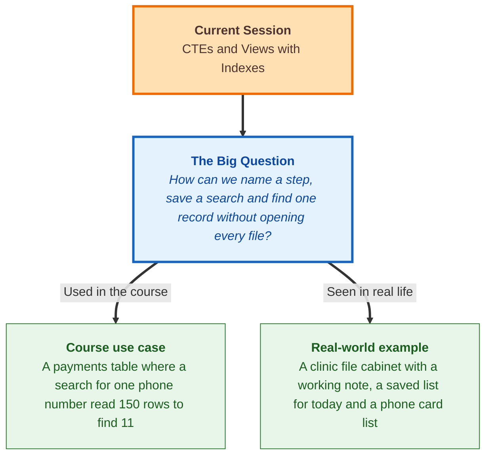

## CTEs and Views with Indexes

### Mental Map

---

### What You'll Learn

Have you ever wondered how a clinic front desk finds all files of one phone number without opening every drawer?

By the end of this session, you will be able to:

- **Describe** how a working note can hold the March fee average of Rs 312.50 for one job.
- **Explain** why a saved list for today shows a new file the moment it is added.
- **Interpret** a search note you did not write, and say in one sentence what it finds.
- **Judge** why a card list sorted by phone cannot help a search by the day of the month.
- **Plan** a phone card list that lets the desk jump to the 11 files of one phone number.

> **Topics you will meet:** CTE (WITH), view, what an index does, create an index, index skipped by a function, explaining what an unfamiliar query returns.
>
> Join the session to learn each of these in detail.

---

### Why You Are Learning This Topic

Nisha works at a clinic front desk. The cabinet holds 150 patient files in drawers sorted by surname. A caller gives a phone number. Nisha opens every drawer to find the 11 matching files. The same weekly search note is copied on three desks. One copy has a typo, so that desk finds nothing.

An **index** means a sorted list of one detail, such as a phone number, that points to the files.

In this course, you will name steps, save shared searches and add sorted lists to make lookups quick.

> **Think about it:** Why does Nisha open all 150 files to find the 11 she needs?

---

### Clinic Cabinet Puzzle

Here are 4 files from the cabinet.

| Patient | Phone | Last visit | Fee |
|:----------:|:----------:|:----------:|:----------:|
| Rao | 9810012000 | 2 March | Rs 300 |
| Iyer | 9810012007 | 5 March | Rs 450 |
| Khan | 9810012000 | 7 March | Rs 200 |
| Das | 9810012011 | 5 March | Rs 300 |

**What you want to happen:**

- The desk finds every file of one phone number without opening all 150.
- All three desks use one saved search note.
- A new colleague can read a search note and say what it finds.

> **Wonder about this:**
>
> - Would a card list sorted by phone help a search for visits on the 5th?
> - What happens to a saved list when a new file arrives?

---

### Think It Through

There is no wrong first try. Keep your guesses for the session.

**1. The 4 fees add up to Rs 1,250. What is the average fee?**
Hint: Divide the total by the number of files.

**2. Rao and Khan share one phone number. What is the count of files a phone search finds for it in this table?**
Hint: Count the rows with the same number.

**3. A card list is sorted by phone number. Can it help find every visit that happened on the 5th?**
Hint: Think about what the cards are sorted by.

---

### One Question to Carry Into the Session

> **How can we ask a question once, save it and still get an answer fast?**
>
> Which of the 4 files would your phone card list point to for 9810012000?
