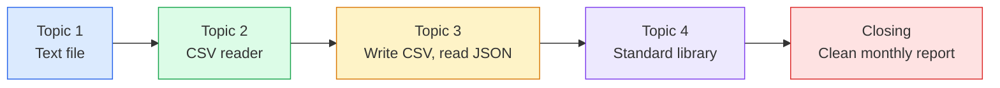
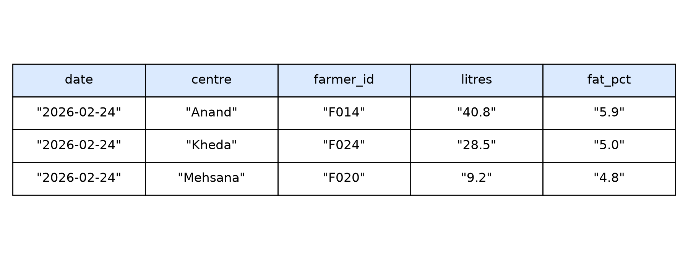
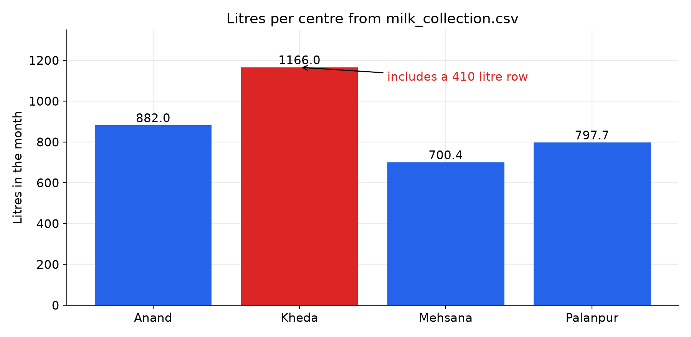
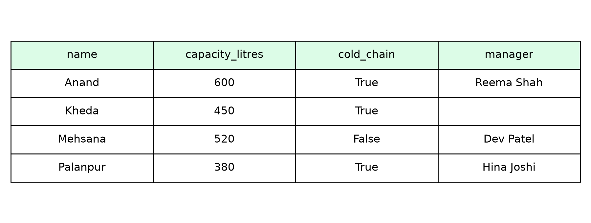
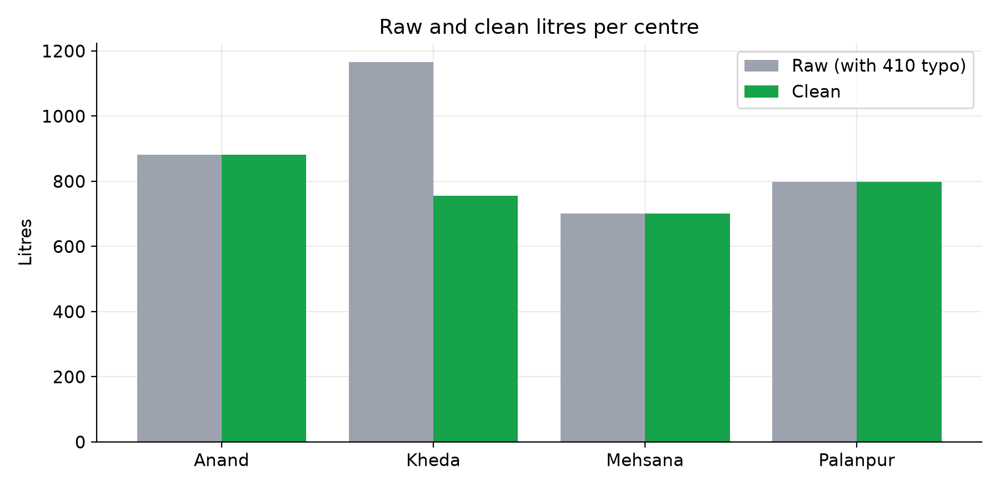

# <font color='#1d4ed8'>Lecture Script: Python Files and Data Handling</font>

---

## <font color='blue'>Agenda</font>

The lecture runs as four topics. Each topic ends with a quiz.

| Topic | What we do | Learning objectives covered | Minutes |
|:-:|:--|:--|:-:|
| 1 | Read a text file with a with-block | Write a script that reads a text file into a string using a with-block | 20 |
| 2 | Parse a CSV file into rows | Parse a CSV file into rows using the csv module's reader | 30 |
| 3 | Write a CSV report and read a JSON file | Write a list of records to a CSV file including a header row<br>Parse a JSON file from disk into Python dictionaries and lists | 30 |
| 4 | Use datetime, collections and random | Apply a standard library module such as datetime, random or collections to a stated task | 25 |
| — | Closing: Outcome & Summary | | 15 |
| | **Total** | | **120** |

> <font color="red">**🎯 Instructor Note**</font> Pace: keep the text file quick in Topic 1. Spend the most time on CSV rows being text in Topic 2.
> Learners upload the `data` folder to Colab (Files pane) so paths such as `data/milk_collection.csv` work.

---

## <font color='blue'>Scenario</font>

An Amul-style dairy cooperative weighs milk at 4 village centres every morning. Three files describe one month.

| File | What it holds | Shape |
|:--|:--|:--|
| `collection_notes.txt` | Rules for the weighing desk | Plain text, 5 lines |
| `milk_collection.csv` | Date, centre, farmer, litres, fat percentage | 120 rows and a header |
| `centres.json` | Capacity, cold chain and manager of each centre | Nested records |

> <font color="red">**🎯 Instructor Note**</font> Amul is only the setting. Do not claim it uses these files or numbers. The 120 rows are invented for teaching and saved in `data/` (CSV, JSON and text). Totals were recomputed independently with pandas. Use Google Colab and Python 3.

---

## <font color='blue'>Problem Statement</font>

Every evening an analyst copied the milk log into a notebook by hand. Two rows had a blank litres cell because the scale was offline, and she typed 0. One row said 410 litres instead of 41.0. The Kheda total looked one and a half times too high, and the cooperative nearly overpaid its farmers.

> <font color='purple'>**How can one script read the text note, the CSV log and the JSON file, write a clean report, and use ready-made library tools?**</font>

> <font color="red">**🎯 Instructor Note**</font> Poll: "A CSV cell holds 40.8. After the csv module reads it, what Python type is it?" Options: float, int or str. Give learners 30 seconds to respond in chat. Reveal the answer in the Closing.

---

## <font color='blue'>What We Will Use</font>

Last session you parsed JSON text with `json.loads`. Today the data lives in files on disk. The tool is Google Colab, plus modules that ship with Python.

| Topic | Tools | In one line |
|:-:|:--|:--|
| 1 | `open`, `with`, `read` | Open a text file and close it for you |
| 2 | `import csv`, `csv.reader` | Turn each CSV line into a list of text values |
| 3 | `csv.writer`, `json.load` | Write a table to disk and read a JSON file |
| 4 | `datetime`, `collections`, `random` | Ready-made tools for dates, counts and random picks |

---

## <font color='blue'>How: Walking Through the Milk Log Files</font>



---

## <font color='blue'>Topic 1: Read a text file with a with-block</font> `20 min`

> <font color='purple'>**The weighing rules sit in a text file. How do we read them into the notebook?**</font>

### <font color='green'>Example: Read the whole file into a string</font>

> <font color='purple'>**How do we open the notes file and keep its text in a variable?**</font>

`open(path)` opens a file. A **with-block** opens it, runs the indented lines and closes the file automatically, even if an error happens. `read()` returns the whole content as one string.

**Predict before running: What will happen?**

> <font color="red">**🎯 Instructor Note**</font> Expected: the 5 lines of the note, printed as they are in the file.

```python
with open("data/collection_notes.txt") as f:
    notes = f.read()
print(notes)
```

**Output**

```
Dairy Union collection notes
Milk is weighed in litres at the centre gate.
Fat percentage is tested on every can.
A can with fat below 3.5 percent is flagged for the quality team.
Blank litres means the scale was offline, not zero.
```

#### <font color='#c2410c'>Code Explanation</font>

- **Line 1** `open` opens the file and `as f` names it `f`. The colon starts the with-block.
- **Line 2** `f.read()` returns all the text. It is stored in `notes`.
- **Line 3** The print is outside the block. The file is already closed.

> <font color='green'>**Result**</font> `notes` now holds the whole file as one string. The with-block closed the file as soon as the block ended.

### <font color='green'>Extending it: Prove the file is closed and read line by line</font>

> <font color='purple'>**Is the file really closed, and how do we count its lines?**</font>

> <font color="red">**🎯 Instructor Note**</font> Ask for a prediction. Expected: 5 lines, then True for closed. A for loop over a file gives one line at a time.

```python
count = 0
with open("data/collection_notes.txt") as f:
    for line in f:
        count = count + 1
print(count, f.closed)
```

**Output**

```
5 True
```

#### <font color='#c2410c'>Code Explanation</font>

- **Line 3** A for loop over the file gives one line per pass.
- **Line 5** `f.closed` is True once the block ends.

> <font color='green'>**Result**</font> The file has 5 lines, and `f.closed` is True after the with-block.

### <font color='green'>Extending it: A wrong path</font>

> <font color='purple'>**What happens when the file name is wrong?**</font>

> <font color="red">**🎯 Instructor Note**</font> Ask for a prediction. Expected: a FileNotFoundError. The path must match the Files pane.

```python
with open("data/notes.txt") as f:
    text = f.read()
```

**Output**

```
FileNotFoundError: [Errno 2] No such file or directory: 'data/notes.txt'
```

> <font color='green'>**Result**</font> Python names the path it could not find. Check spelling and the folder before anything else.

### <font color='purple'>Quiz 1</font>

**Question:** What does a with-block do after its last indented line?

**Options:**
- A) Deletes the file
- B) Closes the file automatically
- C) Reads the file again
- D) Leaves the file open for later

**Correct Answer:** B

**Explanation:**
- **A)** Closing a file does not delete it.
- **B)** Correct. It closes the file, even if an error occurred inside the block.
- **C)** It does not read again. `read()` does that only when called.
- **D)** Leaving it open is what the with-block avoids.

---

---

## <font color='blue'>Topic 2: Parse a CSV file into rows</font> `30 min`

> <font color='purple'>**The log has 120 rows. How do we turn each line into a list we can loop over?**</font>

### <font color='green'>Example: Read the CSV with csv.reader</font>

> <font color='purple'>**How many lines does the file hold, and what do the header and the first row look like?**</font>

A **module** is a file of ready-made tools. `import csv` loads the `csv` module. `csv.reader` splits each line at the commas and gives a list of text values.

**Predict before running: What will happen?**

> <font color="red">**🎯 Instructor Note**</font> Expected: 121 lines (a header and 120 rows). A common wrong guess is 120.

```python
import csv
with open("data/milk_collection.csv", newline="") as f:
    rows = list(csv.reader(f))
print(len(rows), rows[0])
print(rows[1])
```

**Output**

```
121 ['date', 'centre', 'farmer_id', 'litres', 'fat_pct']
['2026-02-24', 'Anand', 'F014', '40.8', '5.9']
```

#### <font color='#c2410c'>Code Explanation</font>

- **Line 1** Load the module.
- **Line 2** `newline=""` lets the csv module handle line endings itself.
- **Line 3** `list(...)` gathers every row into one list of lists.
- **Lines 4 and 5** The first row is the header. The second is the first record.

> <font color='green'>**Result**</font> There are 121 lines: 1 header and 120 records. Every value, even 40.8, is text.

<p align="center"></p>

### <font color='green'>Extending it: Totals need numbers</font>

> <font color='purple'>**How do we total the litres when two cells are blank?**</font>

> <font color="red">**🎯 Instructor Note**</font> Ask for a prediction. Expected: float('') raises a ValueError, so we skip blanks. The total is 3546.1.

```python
total = 0
for r in rows[1:]:
    if r[3] == "":
        continue
    total = total + float(r[3])
print(round(total, 1))
```

**Output**

```
3546.1
```

#### <font color='#c2410c'>Code Explanation</font>

- **Line 2** `rows[1:]` skips the header (slicing from last session).
- **Lines 3 and 4** A blank litres cell is skipped with `continue`.
- **Line 5** `float` turns the text into a number before adding.

> <font color='green'>**Result**</font> The litres total is 3546.1, from 118 rows with a reading. The csv module never converts types, so we convert.

### <font color='green'>Extending it: Total per centre, and spot the typo</font>

> <font color='purple'>**Which centre looks wrong?**</font>

> <font color="red">**🎯 Instructor Note**</font> Ask learners to guess in chat. Expected: Kheda, because of the 410 typo.

```python
by_centre = {}
for r in rows[1:]:
    if r[3] == "":
        continue
    by_centre[r[1]] = by_centre.get(r[1], 0) + float(r[3])
for c in by_centre:
    print(c, round(by_centre[c], 1))
```

**Output**

```
Anand 882.0
Kheda 1166.0
Mehsana 700.4
Palanpur 797.7
```

#### <font color='#c2410c'>Code Explanation</font>

- **Line 5** `get` starts a centre at 0 the first time it is seen (Dictionaries session).
- **Lines 6 and 7** Print each centre with its total.

> <font color='green'>**Result**</font> Kheda shows 1166.0 against about 700 to 880 for the others. One row of 410 litres is the cause.

<p align="center"></p>

### <font color='purple'>Quiz 2</font>

**Question:** `csv.reader` reads the line `2026-02-24,Anand,F014,40.8,5.9`. What is `row[3]`?

**Options:**
- A) The float 40.8
- B) The text "F014"
- C) The text "40.8"
- D) The int 40

**Correct Answer:** C

**Explanation:**
- **A)** The csv module does not convert text to numbers.
- **B)** `F014` is `row[2]`. Index 3 is the fourth value.
- **C)** Correct. Every CSV value comes back as text. Use `float()` before maths.
- **D)** There is no conversion to int either.

---

---

## <font color='blue'>Topic 3: Write a CSV report and read a JSON file</font> `30 min`

> <font color='purple'>**The totals live only in memory. How do we save them as a CSV, and read the centre details from JSON?**</font>

### <font color='green'>Example: Write the totals with csv.writer</font>

> <font color='purple'>**How do we save one row per centre, with a header, to a new file?**</font>

`csv.writer` writes lists as CSV lines. `writerow` writes one row, such as the header. `writerows` writes a list of rows. Mode `"w"` creates the file, or replaces it if it exists.

**Predict before running: What will happen?**

> <font color="red">**🎯 Instructor Note**</font> Expected: a 5-line file with a header, then one line per centre.

```python
records = []
for c in by_centre:
    records.append([c, round(by_centre[c], 1)])
with open("data/centre_totals.csv", "w", newline="") as f:
    w = csv.writer(f)
    w.writerow(["centre", "litres"])
    w.writerows(records)
with open("data/centre_totals.csv") as f:
    print(f.read())
```

**Output**

```
centre,litres
Anand,882.0
Kheda,1166.0
Mehsana,700.4
Palanpur,797.7
```

#### <font color='#c2410c'>Code Explanation</font>

- **Lines 1 to 3** Build a list of records, one `[centre, litres]` list each.
- **Line 4** Mode `"w"` opens the file for writing.
- **Lines 6 and 7** `writerow` writes the header and `writerows` writes every record.
- **Lines 8 and 9** Read the file back to check it.

> <font color='green'>**Result**</font> `data/centre_totals.csv` now has a header and 4 rows. Always write the header first.

> <font color='#b45309'>**Common mistake**</font> Opening the file with `"w"` when it holds data you need. It erases the file. Choose the file name with care.

### <font color='green'>Extending it: Read the centre details from JSON</font>

> <font color='purple'>**How do we read `centres.json` straight from disk?**</font>

`json.load(f)` reads JSON from an open file. Last session `json.loads(text)` read JSON from text already in memory.

> <font color="red">**🎯 Instructor Note**</font> Ask for a prediction. Expected: a dictionary with a list of 4 centres. Kheda has no manager, so it prints None.

```python
import json
with open("data/centres.json") as f:
    info = json.load(f)
print(info["union"], type(info["centres"]).__name__)
for centre in info["centres"]:
    print(centre["name"], centre["capacity_litres"], centre["manager"])
```

**Output**

```
Invented Dairy Union list
Anand 600 Reema Shah
Kheda 450 None
Mehsana 520 Dev Patel
Palanpur 380 Hina Joshi
```

#### <font color='#c2410c'>Code Explanation</font>

- **Line 3** `json.load` returns a dictionary here.
- **Line 4** The key `centres` holds a list.
- **Lines 5 and 6** Each list item is a dictionary. `null` became `None` for Kheda.

> <font color='green'>**Result**</font> The file gave us a dictionary with a list of 4 centre dictionaries. Kheda's manager is `None`.

<p align="center"></p>

### <font color='purple'>Quiz 3</font>

**Question:** Which call writes the header row once and then all records?

**Options:**
- A) writerow(header) then writerows(records)
- B) writerows(header) then writerow(records)
- C) write(header)
- D) reader(header)

**Correct Answer:** A

**Explanation:**
- **A)** Correct. `writerow` writes one row, and `writerows` writes a list of rows.
- **B)** The two calls are swapped. `writerow` takes one row and `writerows` takes many.
- **C)** `csv.writer` has `writerow` and `writerows`.
- **D)** `reader` reads. It does not write.

---

---

## <font color='blue'>Topic 4: Use datetime, collections and random</font> `25 min`

> <font color='purple'>**Python ships with tools for dates, counting and random picks. Which one fits each task?**</font>

### <font color='green'>Example: datetime: which weekday had the typo?</font>

> <font color='purple'>**The 410 litre row is on 28 February 2026. Which weekday was it?**</font>

A **standard library module** comes with Python and needs only an import. `datetime.strptime` turns text into a date using a pattern, and `strftime("%A")` gives the weekday name.

**Predict before running: What will happen?**

> <font color="red">**🎯 Instructor Note**</font> Expected: Saturday. 28 February 2026 is the day before 1 March, a Sunday.

```python
from datetime import datetime
bad = rows[18]
day = datetime.strptime(bad[0], "%Y-%m-%d")
print(bad)
print(day.strftime("%A"), day.month)
```

**Output**

```
['2026-02-28', 'Kheda', 'F002', '410.0', '5.1']
Saturday 2
```

#### <font color='#c2410c'>Code Explanation</font>

- **Line 1** Load only the `datetime` tool from the module.
- **Line 2** `rows[18]` is the 18th record (row 0 is the header).
- **Line 3** `%Y-%m-%d` matches 2026-02-28.
- **Line 5** `%A` is the weekday name.

> <font color='green'>**Result**</font> The 410 litre row is a Saturday in February, the last day of the month. The pattern must match the text exactly.

### <font color='green'>Extending it: collections: count the low-fat cans per centre</font>

> <font color='purple'>**A can with fat below 3.5 percent is flagged. Which centre has the most?**</font>

> <font color="red">**🎯 Instructor Note**</font> Ask for a prediction. Expected: Counter shows the flagged cans per centre, most common first.

```python
from collections import Counter
low = []
for r in rows[1:]:
    if float(r[4]) < 3.5:
        low.append(r[1])
print(Counter(low))
```

**Output**

```
Counter({'Mehsana': 2, 'Palanpur': 1})
```

#### <font color='#c2410c'>Code Explanation</font>

- **Lines 3 to 5** Collect the centre of each low-fat can.
- **Line 6** `Counter` counts how often each name appears.

> <font color='green'>**Result**</font> `Counter` counted the flagged cans per centre in one call. It works on any list of names.

### <font color='green'>Extending it: random: pick 3 farmers for an audit</font>

> <font color='purple'>**How do we pick 3 farmers at random, and get the same picks again?**</font>

> <font color="red">**🎯 Instructor Note**</font> Ask for a prediction. Expected: three farmer ids. The seed makes the picks repeatable; the ids may differ on another Python version.

```python
import random
ids = []
for r in rows[1:]:
    ids.append(r[2])
farmers = sorted(set(ids))
random.seed(7)
print(random.sample(farmers, 3))
```

**Output**

```
['F011', 'F005', 'F013']
```

#### <font color='#c2410c'>Code Explanation</font>

- **Lines 2 to 5** A sorted list of the 30 different farmer ids.
- **Line 6** `seed(7)` fixes the random sequence.
- **Line 7** `random.sample` picks 3 different ids.

> <font color='green'>**Result**</font> Three farmer ids are chosen for the audit. Running the cell again gives the same three, because the seed is fixed.

### <font color='purple'>Quiz 4</font>

**Question:** You need to count how many times each centre name appears in a list. Which module helps most?

**Options:**
- A) random
- B) datetime
- C) json
- D) collections

**Correct Answer:** D

**Explanation:**
- **A)** `random` picks random values.
- **B)** `datetime` works with dates and times.
- **C)** `json` reads and writes JSON.
- **D)** Correct. `collections.Counter` counts items.

---

---

## <font color='blue'>Closing: Outcome & Summary</font> `15 min`

Back to the milk log. One script now reads three files, flags bad rows, writes a clean report and uses library tools. It uses every topic once.

> <font color='purple'>**1 and 2. How do we read the log and flag the bad rows? (Topics 1 and 2)**</font>

```python
clean = []
for r in rows[1:]:
    if r[3] == "":
        print("blank litres:", r[0], r[1])
    elif float(r[3]) > 100:
        print("suspect litres:", r[0], r[1], r[3])
    else:
        clean.append([r[1], float(r[3])])
print(len(clean), "clean rows")
```

**Output**

```
suspect litres: 2026-02-28 Kheda 410.0
blank litres: 2026-03-07 Anand
blank litres: 2026-03-19 Kheda
117 clean rows
```

#### <font color='#c2410c'>Code Explanation</font>

- **Lines 3 and 4** A blank litres cell is reported (Topic 2).
- **Lines 5 and 6** A reading over 100 litres is flagged as a suspect typo (Topic 2).
- **Line 8** Only clean rows are kept as `[centre, litres]` (Topic 2).

> <font color='purple'>**3. How do we save the clean totals? (Topic 3)**</font>

```python
totals = {}
for c, litres in clean:
    totals[c] = totals.get(c, 0) + litres
with open("data/clean_totals.csv", "w", newline="") as f:
    w = csv.writer(f)
    w.writerow(["centre", "litres"])
    for c in totals:
        w.writerow([c, round(totals[c], 1)])
with open("data/clean_totals.csv") as f:
    print(f.read())
```

**Output**

```
centre,litres
Anand,882.0
Kheda,756.0
Mehsana,700.4
Palanpur,797.7
```

#### <font color='#c2410c'>Code Explanation</font>

- **Lines 1 to 3** Total per centre from the clean rows.
- **Lines 4 to 8** Write a header and one row per centre with `csv.writer` (Topic 3).
- **Lines 9 and 10** Read the file back with a with-block (Topic 1).

<p align="center"></p>

### <font color='green'>Outcome</font>

| | Hand copy | Script |
|:--|:-:|:-:|
| Blank litres | Typed as 0 | Reported and skipped |
| The 410 litre row | Not noticed | Flagged for review |
| Kheda total (litres) | 1166.0 | 756.0 without the suspect row |

> <font color='green'>**Therefore,**</font> a short script reads each file, flags what looks wrong and writes the clean totals to a new file. The 410 litre typo made Kheda look 410 litres too high. The script flags it, so someone can correct the row.

> <font color="red">**🎯 Instructor Note**</font> Reveal the poll: the answer is str, because the csv module returns every value as text.

### <font color='green'>Summary</font>

| Learning objective | Takeaway |
|:--|:--|
| Read a text file | `with open(path) as f: f.read()` reads the text and closes the file for you |
| Parse a CSV | `csv.reader` gives lists of text. Convert with `float()` before maths |
| Write a CSV | `csv.writer`, then `writerow` for the header and `writerows` for the records |
| Read JSON | `json.load(f)` gives dictionaries and lists. `null` becomes None |
| Standard library | `datetime` for dates, `collections.Counter` for counts, `random` for repeatable picks with a seed |
| **Practical value** | Nearly every analysis starts with a file. These four patterns load, check and save data before any chart or model. |

---

# <font color='red'>Launch the Feedback Poll</font>

> <font color="red">**🎯 Instructor Note**</font> Reminder: launch the feedback poll now to collect learner feedback.
