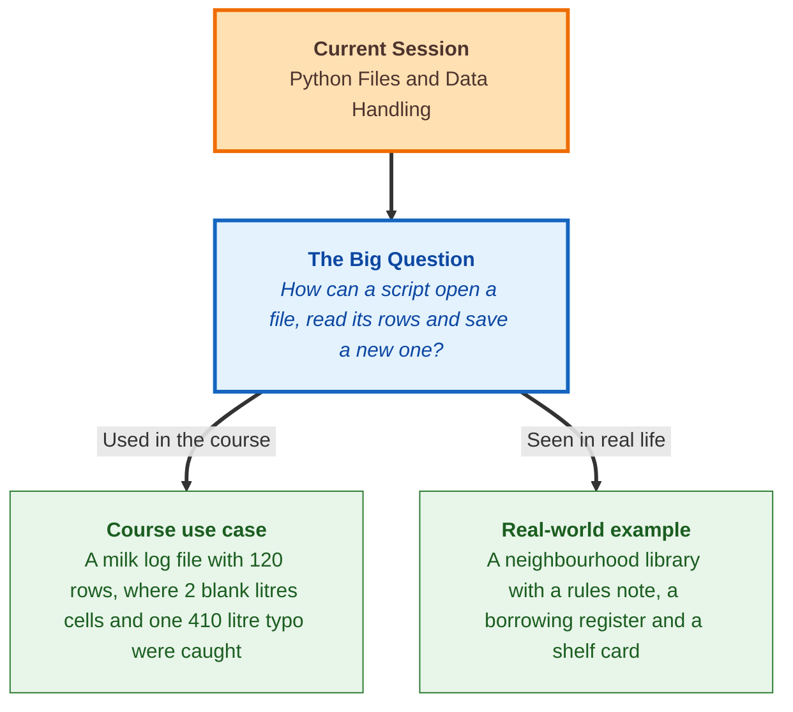

## <span style="color:#2F7DDE">Python Files and Data Handling</span>

### <span style="color:#2F7DDE">Mental Map</span>



---

### <span style="color:#2F7DDE">What You'll Learn</span>

Have you ever wondered how a librarian finds every overdue book in a register of 120 lines?

By the end of this session, you will be able to:

- <span style="color:#D9660B">**Describe**</span> how a rules note is opened, read and closed again.
- <span style="color:#D9660B">**Interpret**</span> each line of the register as separate words and numbers.
- <span style="color:#D9660B">**Use**</span> a ready-made tool to add 14 days to a borrowing date.
- <span style="color:#D9660B">**Examine**</span> a shelf card that holds labels, a list of books and an empty value.
- <span style="color:#D9660B">**Write**</span> a new register page that starts with a header line.

> <span style="color:#2F7DDE">**Topics you will meet:**</span> text file, import, CSV read, CSV write, JSON file, standard library.
>
> Join the session to learn each of these in detail.

---

### <span style="color:#2F7DDE">Why You Are Learning This Topic</span>

Sunita runs a library in her housing society. She keeps three records: a rules note, a register of 120 borrowings and a shelf card. Each evening she copies lines by hand to find overdue books. Last week she skipped a blank line and typed a wrong date. A child was told a book was late when it was not.

A <span style="color:#D9660B">**file**</span> means a named store of information that you open, read from or write to.

In this course, you will open files of text, rows and records, and save your results to a new file.

> <span style="color:#2F7DDE">**Think about it:**</span> What could go wrong when Sunita copies 120 lines by hand?

---

### <span style="color:#2F7DDE">The Neighbourhood Library Puzzle</span>

Here is a small piece of what Sunita keeps.

| Item | What it holds |
|:----------:|:----------:|
| Rules note | Return books in 14 days |
| Register line | Asha, Malgudi Days, 2 March |
| Shelf card | Shelf 3, 40 books, no label for the manager |
| Overdue page | A new list Sunita wants to print |

<span style="color:#D9660B">**What you want to happen:**</span>

- Sunita reads the rules note in one step.
- Sunita splits each register line into its parts.
- Sunita saves the overdue list with a header on top.

Here is how it might start. You do not need to understand it yet.

```python
with open("rules.txt") as f:
    print(f.read())
```

> <span style="color:#D9660B">**Wonder about this:**</span>
>
> - What would happen if the register had a blank date on one line?
> - Would the date 2 March be a number or a word when first read?

---

### <span style="color:#2F7DDE">Think It Through</span>

There is no wrong first try. Keep your guesses for the session.

**1. The rules note has 5 lines. Why might you close it after reading?**
Hint: Think about what an open note blocks.

**2. A register line reads 'Asha, Malgudi Days, 2 March'. What is the count of separate parts it holds?**
Hint: Count the commas, then add one.

**3. The shelf card has no manager label. What should a script show for it?**
Hint: Think of a word for 'no value'.

---

### <span style="color:#2F7DDE">One Question to Carry Into the Session</span>

> <span style="color:#2F7DDE">**How can a script read and write files so no one has to copy lines by hand?**</span>
>
> Which of the three files would you open first, and why?
