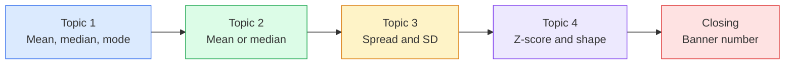
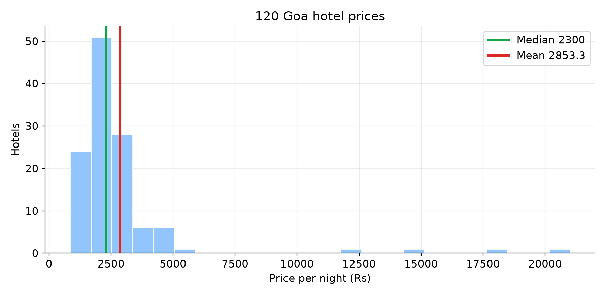
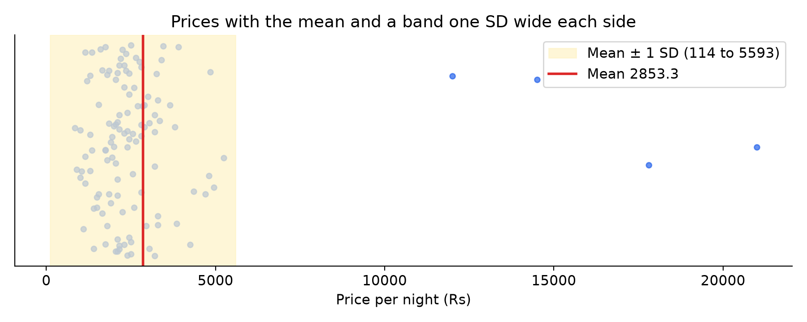
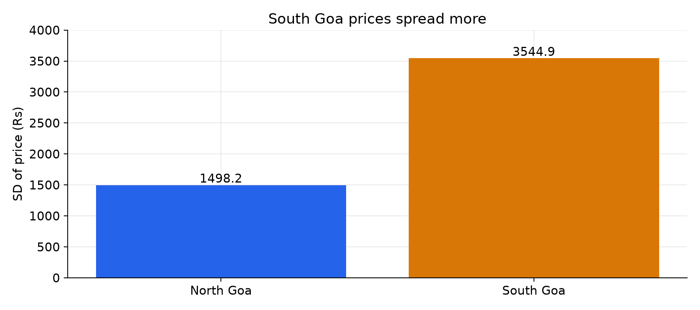
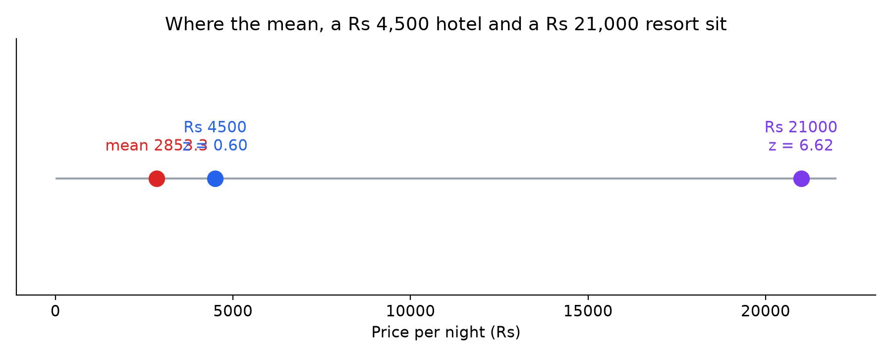
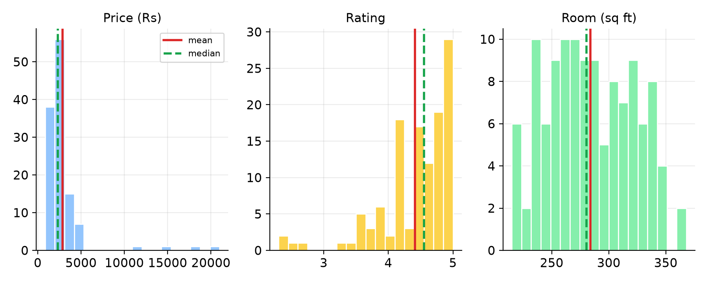
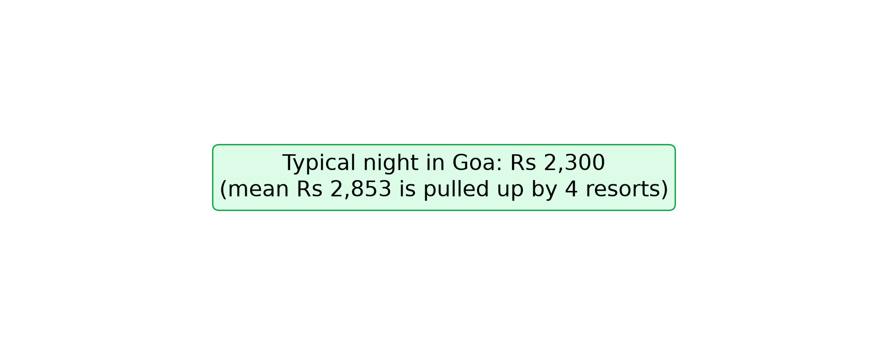

# <font color='#1d4ed8'>Lecture Script: Descriptive Statistics</font>

---

## <font color='blue'>Agenda</font>

The lecture runs as four topics. Each topic ends with a quiz.

| Topic | What we do | Learning objectives covered | Minutes |
|:-:|:--|:--|:-:|
| 1 | Find the centre: mean, median and mode | Compute the mean, median and mode of a numeric dataset | 25 |
| 2 | Pick the right centre for skewed prices | Select between the mean and the median as the centre measure, justifying by skew and outliers | 25 |
| 3 | Measure the spread and read it in rupees | Compute the range, variance and standard deviation of a dataset<br>Interpret a standard deviation in the units and context of the variable | 30 |
| 4 | Place a value with a z-score and name the shape | Compute a z-score expressing how far a value sits from the mean<br>Describe the shape of a distribution as symmetric, right-skewed or left-skewed | 25 |
| — | Closing: Outcome & Summary | | 15 |
| | **Total** | | **120** |

> <font color="red">**🎯 Instructor Note**</font> Pace: keep mode quick in Topic 1. Spend the time on why four resorts move the mean in Topic 2, and on reading the standard deviation in rupees in Topic 3.
> Every code block is a Google Colab cell. Upload `data/goa_hotels.csv` to the Files pane so the path matches.

---

## <font color='blue'>Scenario</font>

A MakeMyTrip-style travel app lists 120 hotels in Goa. A banner must say what a night "usually" costs.

| Column | Meaning | Unit |
|:--|:--|:--|
| `price_inr` | Price for one night | Rupees |
| `rating` | Guest score, 5.0 is best | Points |
| `room_sqft` | Room size | Square feet |
| `area` | North Goa or South Goa | Text |

> <font color="red">**🎯 Instructor Note**</font> MakeMyTrip is only the setting. Do not claim it uses this data. The 120 hotels in `data/goa_hotels.csv` are invented for teaching, with 4 luxury resorts planned as outliers. Values were recomputed independently with pandas.

---

## <font color='blue'>Problem Statement</font>

The app banner said "Average Goa hotel: Rs 2,853 a night." Most travellers looked at the list and found rooms near Rs 2,300. They felt the banner was too high, and bookings fell. Four luxury resorts had pulled the average up.

> <font color='purple'>**Which number should the banner show for a typical night, how spread out are the prices, and how unusual is one particular hotel?**</font>

> <font color="red">**🎯 Instructor Note**</font> Poll: "Four luxury resorts are added to a list of 116 normal hotels. Which centre moves more: the mean or the median?" Options: mean, median or both equally. Give learners 30 seconds to respond in chat. Reveal the answer in the Closing.

---

## <font color='blue'>What We Will Use</font>

The tool is Google Colab. You read a CSV file last session, and the `statistics` module is one more standard library module. These are the measures and formulas for today.

| Topic | Tools | In one line |
|:-:|:--|:--|
| 1 | Mean, median, mode | Three ways to name the centre: $\bar{x}=\frac{\sum x_i}{n}$, the middle value, the most common value |
| 2 | Skew and outliers | A few very large values pull the mean toward them. The median stays put |
| 3 | Range, variance, SD | $\text{range}=\max-\min$, $s^2=\frac{\sum (x_i-\bar{x})^2}{n-1}$, $s=\sqrt{s^2}$ |
| 4 | Z-score and shape | $z=\frac{x-\bar{x}}{s}$, and the position of the mean against the median shows the shape |

---

## <font color='blue'>How: Walking Through the Goa Hotel Banner</font>



---

## <font color='blue'>Topic 1: Find the centre: mean, median and mode</font> `25 min`

> <font color='purple'>**The banner needs one number for a typical night. What are the ways to find the centre of 120 prices?**</font>

### <font color='green'>Example: Read the CSV and compute the three centres</font>

> <font color='purple'>**What are the mean, median and mode of the nightly price?**</font>

The **mean** adds all values and divides by the count. The **median** is the middle value when the values are sorted. The **mode** is the value that appears most often. `import statistics as st` loads the module and lets us write `st` for short.

**Predict before running: What will happen?**

> <font color="red">**🎯 Instructor Note**</font> Expected: the mean (about 2853) is higher than the median (2300). The mode is 2100. A common wrong guess is that all three agree.

```python
import csv, statistics as st
with open("data/goa_hotels.csv", newline="") as f:
    rows = list(csv.reader(f))
prices, ratings, sizes = [], [], []
for r in rows[1:]:
    prices.append(int(r[2]))
    ratings.append(float(r[3]))
    sizes.append(int(r[4]))
print(len(prices), round(st.mean(prices), 1), st.median(prices), st.mode(prices))
```

**Output**

```
120 2853.3 2300.0 2100
```

#### <font color='#c2410c'>Code Explanation</font>

- **Lines 1 to 3** Read the file with the csv module, as in the last session.
- **Lines 4 to 8** Fill one list per numeric column, converting text to numbers.
- **Line 9** Count, mean (rounded), median and mode of the prices.

> <font color='green'>**Result**</font> 120 hotels. The mean is 2853.3, the median 2300 and the mode 2100. The three centres disagree, which is a hint that the data is not balanced.

### <font color='green'>Extending it: Check the mean by hand</font>

> <font color='purple'>**Does `st.mean` agree with adding and dividing?**</font>

> <font color="red">**🎯 Instructor Note**</font> Ask for the answer in chat. Expected: the same value, 2853.3.

```python
total = 0
for p in prices:
    total = total + p
print(total, round(total / len(prices), 1))
```

**Output**

```
342400 2853.3
```

#### <font color='#c2410c'>Code Explanation</font>

- **Lines 1 to 3** Add every price.
- **Line 4** Divide the total by the count, 120.

> <font color='green'>**Result**</font> 342400 divided by 120 is 2853.3, the same as `st.mean`.

### <font color='green'>Extending it: A small list shows the median at work</font>

> <font color='purple'>**Five hotels cost 2000, 2200, 2400, 2600 and 40000. What are the mean and the median?**</font>

> <font color="red">**🎯 Instructor Note**</font> Ask for a prediction. Expected: mean 9840 and median 2400. One large value drags the mean up.

```python
five = [2000, 2200, 2400, 2600, 40000]
print(st.mean(five), st.median(five))
```

**Output**

```
9840 2400
```

#### <font color='#c2410c'>Code Explanation</font>

- **Line 2** The median is the third value after sorting. The mean uses all five values.

> <font color='green'>**Result**</font> The mean is 9840, which no hotel in the list charges. The median is 2400, a real middle hotel.

### <font color='purple'>Quiz 1</font>

**Question:** The prices 10, 20, 30, 40, 100 are listed. What is the median?

**Options:**
- A) 30
- B) 20
- C) 40
- D) 40 (the mean)

**Correct Answer:** A

**Explanation:**
- **A)** Correct. Sorted, the middle of 5 values is the third value, 30.
- **B)** 20 is the second value.
- **C)** 40 is the fourth value, not the middle.
- **D)** The mean is 40, but the median is the middle value, 30.

---

---

## <font color='blue'>Topic 2: Pick the right centre for skewed prices</font> `25 min`

> <font color='purple'>**The mean (2853) and the median (2300) differ by more than Rs 550. Which should the banner use?**</font>

### <font color='green'>Example: Mean versus median, with and without the four resorts</font>

> <font color='purple'>**How much do the four luxury resorts move each centre?**</font>

**Skew** means one tail of the data is longer than the other. An **outlier** is a value far from the rest. Outliers pull the mean toward them. The median hardly moves.

**Predict before running: What will happen?**

> <font color="red">**🎯 Instructor Note**</font> Expected: the mean falls by about Rs 460 without the resorts. The median falls by only Rs 25.

```python
core = sorted(prices)[:-4]
print(max(core), len(core))
print(round(st.mean(core), 1), st.median(core))
print(round(st.mean(prices) - st.mean(core), 1), st.median(prices) - st.median(core))
```

**Output**

```
5250 116
2388.8 2275.0
464.5 25.0
```

#### <font color='#c2410c'>Code Explanation</font>

- **Line 1** `sorted(prices)[:-4]` drops the 4 largest prices.
- **Line 2** The largest price left, and the count.
- **Lines 3 and 4** Centres without the resorts, then how far each centre moved.

> <font color='green'>**Result**</font> Without the 4 resorts the mean is 2388.8 and the median is 2275.0. The mean moved by 464.5 and the median by 25.0, so the median is steadier.

<p align="center"></p>

### <font color='green'>Extending it: The rule: which centre when</font>

> <font color='purple'>**What do we choose for left-skewed ratings?**</font>

> <font color="red">**🎯 Instructor Note**</font> Ask learners to guess in chat. Expected: median again, because a few very low ratings pull the mean down.

```python
print(round(st.mean(ratings), 2), st.median(ratings))
```

**Output**

```
4.41 4.55
```

#### <font color='#c2410c'>Code Explanation</font>

- **Line 1** Ratings are bunched near 5.0 with a few low scores, so the mean sits below the median.

> <font color='green'>**Result**</font> The mean rating is 4.41 and the median is 4.55. A tail to the left pulls the mean down. Use the median whenever the data is skewed or has outliers, and the mean when it is balanced.

### <font color='purple'>Quiz 2</font>

**Question:** Prices are right-skewed with a few very large values. Which centre best describes a typical price?

**Options:**
- A) The mean
- B) The largest value
- C) The range
- D) The median

**Correct Answer:** D

**Explanation:**
- **A)** The mean is pulled up by the large values.
- **B)** The largest value is an outlier, not a typical price.
- **C)** The range measures spread, not the centre.
- **D)** Correct. The median stays near the middle of the data when a few values are extreme.

---

---

## <font color='blue'>Topic 3: Measure the spread and read it in rupees</font> `30 min`

> <font color='purple'>**Two cities can share a median and still differ in how far prices stray. How do we measure that?**</font>

### <font color='green'>Example: Range, variance and standard deviation</font>

> <font color='purple'>**How spread out are the 120 prices?**</font>

The **range** is the largest value minus the smallest. The **variance** is the average squared distance from the mean, divided by $n-1$ for a sample. The **standard deviation** (SD) is the square root of the variance, so it is back in the original unit.

**Predict before running: What will happen?**

> <font color="red">**🎯 Instructor Note**</font> Expected: a range of 20150. The SD is about 2740, in rupees. The variance is a huge number, in squared rupees.

```python
print(max(prices) - min(prices))
print(round(st.variance(prices)))
print(round(st.stdev(prices), 1))
```

**Output**

```
20150
7505283
2739.6
```

#### <font color='#c2410c'>Code Explanation</font>

- **Line 1** Largest minus smallest.
- **Line 2** `st.variance` is the sample variance, in rupees squared.
- **Line 3** `st.stdev` is the square root of the variance, in rupees.

> <font color='green'>**Result**</font> The range is 20150 rupees. The variance is 7505283 rupees squared and the SD is 2739.6 rupees. Only the SD can be read as a price difference.

<p align="center"></p>

### <font color='green'>Extending it: Build the variance by hand</font>

> <font color='purple'>**Does a loop give the same SD?**</font>

> <font color="red">**🎯 Instructor Note**</font> Ask for a prediction. Expected: the same 2739.6.

```python
m = st.mean(prices)
sq = 0
for p in prices:
    sq = sq + (p - m) ** 2
var = sq / (len(prices) - 1)
print(round(var ** 0.5, 1))
```

**Output**

```
2739.6
```

#### <font color='#c2410c'>Code Explanation</font>

- **Line 4** Add each squared distance from the mean.
- **Line 5** Divide by $n-1$, which is 119.
- **Line 6** `** 0.5` is the square root.

> <font color='green'>**Result**</font> The loop gives 2739.6, the same as `st.stdev`.

### <font color='green'>Extending it: Read the SD in rupees and compare areas</font>

> <font color='purple'>**North Goa and South Goa: which has the wider spread?**</font>

> <font color="red">**🎯 Instructor Note**</font> Ask for a prediction. Expected: South Goa spreads more, because 3 of the 4 resorts are there. Prices and square feet are different units, so their SDs cannot be compared.

```python
north, south = [], []
for r in rows[1:]:
    if r[1] == "North Goa":
        north.append(int(r[2]))
    else:
        south.append(int(r[2]))
print(round(st.stdev(north), 1), round(st.stdev(south), 1))
print(round(st.stdev(sizes), 1))
```

**Output**

```
1498.2 3544.9
37.3
```

#### <font color='#c2410c'>Code Explanation</font>

- **Lines 1 to 6** Split the prices into a North Goa list and a South Goa list.
- **Line 7** SD of each area, in rupees.
- **Line 8** SD of room size, in square feet.

> <font color='green'>**Result**</font> South Goa's SD is 3544.9 rupees and North Goa's is 1498.2. In South Goa a hotel typically sits about Rs 3,545 from the mean. Room size has an SD of 37.3 square feet, which is a different unit and cannot be compared with rupees.

<p align="center"></p>

### <font color='purple'>Quiz 3</font>

**Question:** Prices have a mean of Rs 2,853 and an SD of Rs 2,740. What does the SD tell the banner team?

**Options:**
- A) Every hotel costs exactly Rs 2,740
- B) Prices typically sit about Rs 2,740 away from the mean
- C) The cheapest hotel costs Rs 113
- D) Half the hotels cost less than Rs 2,740

**Correct Answer:** B

**Explanation:**
- **A)** The SD is a spread, not a price.
- **B)** Correct. It is the typical distance from the mean, in rupees.
- **C)** It is not a price difference between the mean and the cheapest hotel.
- **D)** That statement describes the median, not the SD.

---

---

## <font color='blue'>Topic 4: Place a value with a z-score and name the shape</font> `25 min`

> <font color='purple'>**A hotel costs Rs 4,500. Is that high? And what shape do the prices make?**</font>

### <font color='green'>Example: The z-score of a hotel</font>

> <font color='purple'>**How many standard deviations from the mean is a Rs 4,500 hotel, and a Rs 21,000 resort?**</font>

A **z-score** says how many SDs a value sits above or below the mean. Positive means above. Negative means below. A z-score near 0 is typical.

**Predict before running: What will happen?**

> <font color="red">**🎯 Instructor Note**</font> Expected: about 0.6 for Rs 4,500 and about 6.6 for Rs 21,000.

```python
m, s = st.mean(prices), st.stdev(prices)
for price in [4500, 21000]:
    print(price, round((price - m) / s, 2))
```

**Output**

```
4500 0.6
21000 6.62
```

#### <font color='#c2410c'>Code Explanation</font>

- **Line 1** The mean and the SD from the same list.
- **Line 3** The distance from the mean, divided by the SD.

> <font color='green'>**Result**</font> Rs 4,500 sits 0.6 SDs above the mean and is ordinary. Rs 21,000 sits 6.6 SDs above the mean and is an outlier.

<p align="center"></p>

### <font color='green'>Extending it: Compare a price and a rating on one scale</font>

> <font color='purple'>**Which is more unusual: a Rs 4,500 price or a rating of 3.0?**</font>

> <font color="red">**🎯 Instructor Note**</font> Ask for a prediction. Expected: the 3.0 rating, about 2.5 SDs below the mean (the exact z is -2.47).

```python
rm, rs = st.mean(ratings), st.stdev(ratings)
print(round((3.0 - rm) / rs, 2))
```

**Output**

```
-2.47
```

#### <font color='#c2410c'>Code Explanation</font>

- **Line 1** The mean and the SD of the ratings.
- **Line 2** The z-score of a 3.0 rating.

> <font color='green'>**Result**</font> A rating of 3.0 has a z-score of -2.47. It sits 2.47 SDs below the mean, which is more unusual than the 0.6 for the price. A z-score lets us compare values on different units.

### <font color='green'>Extending it: Name the shape</font>

> <font color='purple'>**Are prices, ratings and room sizes symmetric, right-skewed or left-skewed?**</font>

> <font color="red">**🎯 Instructor Note**</font> Ask for a prediction per column. Expected: prices right, ratings left, sizes symmetric. Rule: mean above median means right-skewed, below means left-skewed, close means symmetric.

```python
for name, v in [("price", prices), ("rating", ratings), ("sqft", sizes)]:
    print(name, round(st.mean(v), 2), st.median(v))
```

**Output**

```
price 2853.33 2300.0
rating 4.41 4.55
sqft 283.95 280.5
```

#### <font color='#c2410c'>Code Explanation</font>

- **Line 2** The mean and the median of each column. The gap shows which tail is longer.

> <font color='green'>**Result**</font> Prices: mean 2853.33 above median 2300, so right-skewed. Ratings: mean 4.41 below median 4.55, so left-skewed. Room sizes: mean 283.95 close to median 280.5, so symmetric.

<p align="center"></p>

### <font color='purple'>Quiz 4</font>

**Question:** A column has a mean of 52 and a median of 40. What shape is it likely to have?

**Options:**
- A) Symmetric
- B) Left-skewed
- C) Right-skewed
- D) It cannot have a shape

**Correct Answer:** C

**Explanation:**
- **A)** A symmetric shape has a mean close to the median.
- **B)** Left-skewed data has a mean below the median.
- **C)** Correct. The mean is above the median, so a long tail runs to the right.
- **D)** Every numeric column has a shape.

---

---

## <font color='blue'>Closing: Outcome & Summary</font> `15 min`

Back to the banner. One cell now gives the typical price, the spread and the position of one hotel. It uses every topic once.

> <font color='purple'>**1 and 2. Which number should the banner show? (Topics 1 and 2)**</font>

```python
print("mean", round(st.mean(prices), 1), "median", st.median(prices))
print("mean minus median", round(st.mean(prices) - st.median(prices), 1))
```

**Output**

```
mean 2853.3 median 2300.0
mean minus median 553.3
```

#### <font color='#c2410c'>Code Explanation</font>

- **Line 1** The mean and median of all 120 prices (Topic 1).
- **Line 2** A gap this large says the prices are skewed, so the median is the honest centre (Topic 2).

> <font color='purple'>**3 and 4. How spread out are prices, and where does a Rs 4,500 hotel sit? (Topics 3 and 4)**</font>

```python
s = st.stdev(prices)
print("SD", round(s, 1), "rupees; range", max(prices) - min(prices))
z = (4500 - st.mean(prices)) / s
print("z for Rs 4500:", round(z, 2))
```

**Output**

```
SD 2739.6 rupees; range 20150
z for Rs 4500: 0.6
```

#### <font color='#c2410c'>Code Explanation</font>

- **Line 1 and 2** The SD in rupees and the range (Topic 3).
- **Lines 3 and 4** The z-score of one hotel (Topic 4).

<p align="center"></p>

### <font color='green'>Outcome</font>

| | Mean banner | Median banner |
|:--|:-:|:-:|
| Number shown | Rs 2,853 | Rs 2,300 |
| Affected by 4 resorts | Yes, by Rs 464.5 | Barely, by Rs 25 |
| Shape of prices | Right-skewed | Right-skewed |

> <font color='green'>**Therefore,**</font> show the median, Rs 2,300, as the typical night. The mean is Rs 2,853 only because four resorts at Rs 12,000 to Rs 21,000 pull it up. Prices spread about Rs 2,740 around the mean, so a Rs 4,500 hotel is ordinary and a Rs 21,000 resort is an outlier.

> <font color="red">**🎯 Instructor Note**</font> Reveal the poll: the answer is the mean. The four resorts moved it by Rs 464.5, while the median moved by Rs 25.

### <font color='green'>Summary</font>

| Learning objective | Takeaway |
|:--|:--|
| Mean, median, mode | Mean is the average, median is the middle value, mode is the most common value |
| Mean or median | Use the median when data is skewed or has outliers. The mean is pulled toward the tail |
| Range, variance, SD | Range is max minus min. SD is the square root of the sample variance and is in the original unit |
| Reading the SD | Say it in the variable's unit: prices stray about Rs 2,740 from the mean |
| Z-score | $z=(x-\bar{x})/s$ gives how many SDs a value sits from the mean |
| Shape | Mean above median is right-skewed, below is left-skewed, close is symmetric |
| **Practical value** | Averages in reports, dashboards and news can mislead. Checking the median, the spread and the shape tells you whether a single number is honest. |

---

# <font color='red'>Launch the Feedback Poll</font>

> <font color="red">**🎯 Instructor Note**</font> Reminder: launch the feedback poll now to collect learner feedback.
