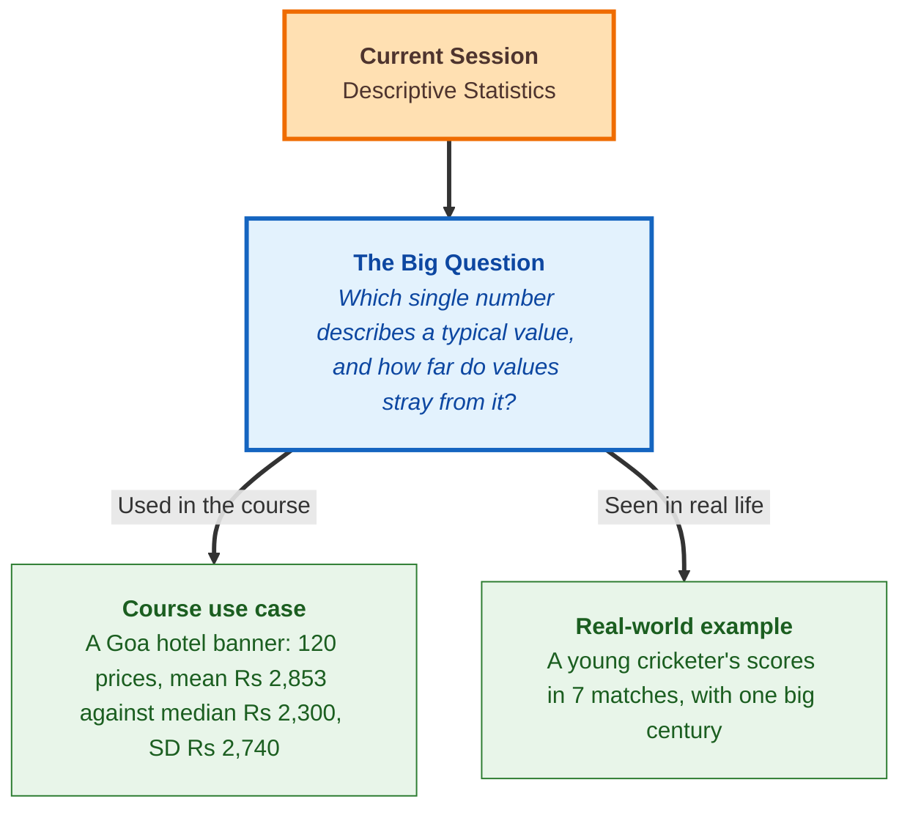

## <span style="color:#2F7DDE">Descriptive Statistics</span>

### <span style="color:#2F7DDE">Mental Map</span>



---

### <span style="color:#2F7DDE">What You'll Learn</span>

Have you ever wondered why one huge innings can make a batter's average look higher than the batter usually plays?

By the end of this session, you will be able to:

- <span style="color:#D9660B">**Describe**</span> whether Rohan's scores bunch low, balance evenly or stretch toward one big score.
- <span style="color:#D9660B">**Interpret**</span> how far his scores stray from the average, in runs.
- <span style="color:#D9660B">**Calculate**</span> his average, middle score and most common score over 7 matches.
- <span style="color:#D9660B">**Determine**</span> the gap between his highest and lowest score, and the typical stray.
- <span style="color:#D9660B">**Use**</span> a single number to say how unusual his 100-run innings is.
- <span style="color:#D9660B">**Judge**</span> whether the average or the middle score tells his coach the truth.

> <span style="color:#2F7DDE">**Topics you will meet:**</span> mean, median, mode, skew, range, variance, standard deviation, z-score.
>
> Join the session to learn each of these in detail.

---

### <span style="color:#2F7DDE">Why You Are Learning This Topic</span>

Rohan plays for his school team. His scores in 7 matches are 12, 8, 15, 9, 14, 11 and 100. His coach reads out the average and says Rohan is a star. The team knows Rohan scores around 12 on most days. One lucky century lifted the average.

A <span style="color:#D9660B">**average**</span> means the total of all scores divided by the number of matches.

In this course, you will describe a column of numbers with a centre, a spread and a shape.

> <span style="color:#2F7DDE">**Think about it:**</span> Would you trust one average that one score has lifted?

---

### <span style="color:#2F7DDE">The Cricket Scorecard Puzzle</span>

Here are Rohan's scores.

| Match | Runs |
|:----------:|:----------:|
| 1 | 12 |
| 2 | 8 |
| 3 | 15 |
| 7 | 100 |

<span style="color:#D9660B">**What you want to happen:**</span>

- The coach names a typical score that fits most matches.
- The coach states how far scores stray from that number.
- The coach spots which innings is unusual.

Here is how it might start. You do not need to understand it yet.

```python
import statistics as st
scores = [12, 8, 15, 9, 100]
print(st.mean(scores), st.median(scores))
```

> <span style="color:#D9660B">**Wonder about this:**</span>
>
> - Which of the two numbers would you tell a new coach?
> - How would the picture of the scores look: balanced or stretched?

---

### <span style="color:#2F7DDE">Think It Through</span>

There is no wrong first try. Keep your guesses for the session.

**1. Rohan scores 12, 8, 15 and 100. What is the middle of these four scores?**
Hint: Sort them, then look at the two in the centre.

**2. A second batter scores 40, 42, 41 and 43 in four matches. Who strays more from the average?**
Hint: Compare how far each score sits from its own average.

**3. A 100-run innings is far above Rohan's usual. How could you say how far, in one number?**
Hint: Count the number of 'typical strays' between his usual score and 100.

---

### <span style="color:#2F7DDE">One Question to Carry Into the Session</span>

> <span style="color:#2F7DDE">**How do we describe a list of numbers honestly, with one centre, one spread and one shape?**</span>
>
> Would you pick the average or the middle score to describe Rohan?
