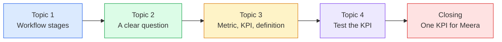
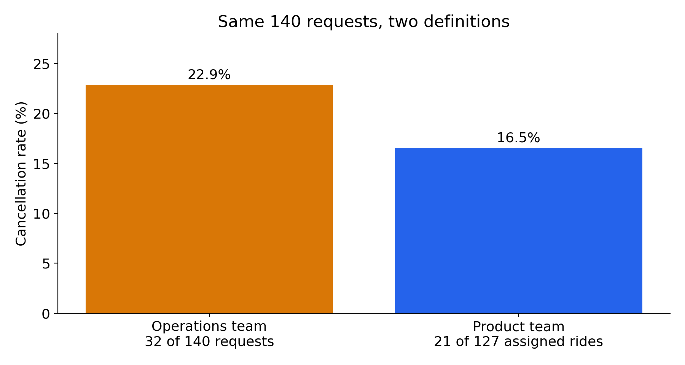
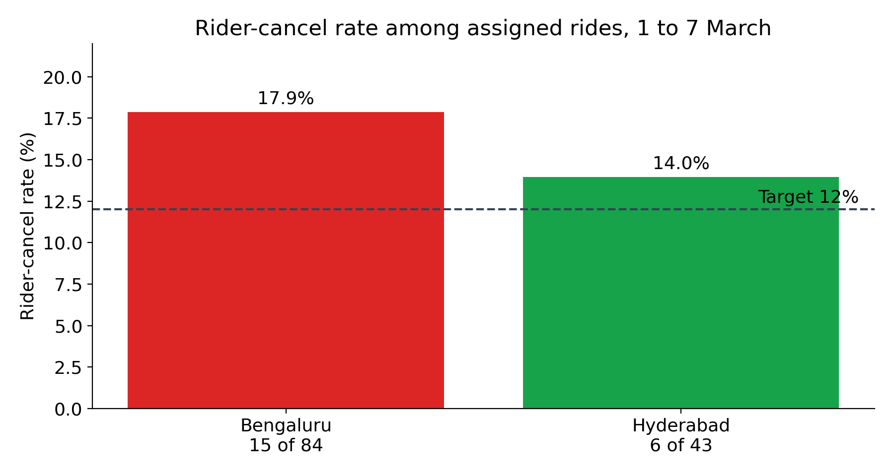

# Lecture Script: Analytics Workflow with Metrics and KPIs

---

## Agenda

The lecture runs as four topics. Each topic ends with a quiz.

| Topic | What we do | Learning objectives covered | Minutes |
|:-:|:--|:--|:-:|
| 1 | Follow one request through the stages | Describe the stages of an analytics workflow from business question to communicated insight | 20 |
| 2 | Turn a vague request into a question | Rewrite a vague business request as a question the data can answer | 25 |
| 3 | Separate a metric from a KPI, and define the metric | Classify a measure as a metric or a KPI by whether it tracks a stated business objective Write a metric definition stating numerator, denominator, population and time window | 35 |
| 4 | Test a proposed KPI | Evaluate a proposed KPI against being measurable, attributable and timely | 25 |
| — | Closing: Outcome & Summary | | 15 |
| | **Total** | | **120** |

> **🎯 Instructor Note** Pace: spend the time on the metric definition in Topic 3. Keep the stage list in Topic 1 short, because learners will use it again in every later session.
> No software is needed. The numbers come from `data/ride_requests.csv` (140 rows). Share the tables on screen. Learners can open the CSV in a sheet if they want to check a count.

---

## Scenario

**An email from the city head.** A Rapido-style bike-taxi app has one email waiting for the analyst on Monday 9 March 2026.

> *"Hi, cancellations are hurting us in Bengaluru. Make rides better this month and tell me how we are doing. – Meera, City Head"*

The analyst has one file: 140 ride requests from 1 to 7 March 2026 in Bengaluru and Hyderabad, each with a status, a pickup wait and a fare.

| Status | Requests |
|:--|:-:|
| Completed | 95 |
| Cancelled by rider | 21 |
| Cancelled by driver | 11 |
| No driver found | 13 |
| **All requests** | **140** |

> **🎯 Instructor Note** Rapido is only the setting. Do not claim it uses this data or these definitions. The 140 requests are invented for teaching.

---

## Problem Statement

Two teams answered Meera's email. The operations team said the cancellation rate was 22.9 percent. The product team said it was 16.5 percent. Both used the same 140 requests. Meera asked, "Which one is right?" Nobody could say, because neither team had written down what they counted. A third person proposed "customer happiness" as the number to track, and nobody could say how to measure it. The month ended with three reports and no decision.

> **How do we go from a vague email to a clear question, a written measure and a number that Meera can track?**

> **🎯 Instructor Note** Poll: "The same 140 requests give two cancellation rates, 22.9 percent and 16.5 percent. Can both be right?" Options: yes, no, or one team made an arithmetic error. Give learners 30 seconds to respond in chat. Reveal the answer in the Closing.

---

## What We Will Use

You already know how to count and group rows with SQL, and you will soon do the same in a spreadsheet. Today we decide what to count and why, before any tool is opened. The tool is a notebook, a pen and your judgement.

| Topic | Tools | In one line |
|:-:|:--|:--|
| 1 | The five-stage workflow | Place each piece of work in a stage |
| 2 | A question template | Rewrite a request with who, what, where and when |
| 3 | A definition template | Write numerator, denominator, population and time window |
| 4 | A three-test check | Test a KPI for measurable, attributable and timely |

---

## How: Walking Through Meera's Email

---

## Topic 1: Follow one request through the stages `20 min`

> **Meera's email has no data in it. What does an analyst do between "read the email" and "send an answer"?**

### Example: The five stages

> **What are the stages of an analytics workflow, and what does each one produce?**

An **analytics workflow** is the path from a business question to an insight that people act on. It has five stages. Each stage hands something to the next.

| Stage | What happens | It produces | At the bike-taxi app |
|:-:|:--|:--|:--|
| 1. Ask | Turn the request into a question | A clear question | "Which city and hour have the highest rider-cancel rate?" |
| 2. Get | Collect the data that can answer it | A raw dataset | The file of 140 requests |
| 3. Prepare | Check and clean the data | A tidy table | Remove blank statuses, confirm 140 unique request ids |
| 4. Analyse | Count, group and compare | Numbers | Cancel rate by city and hour |
| 5. Communicate | Explain what it means and what to do | An insight with a next step | "Bengaluru peak hours lose 1 in 5 assigned rides. Test a rider-fee prompt." |

**Predict before you read on: What will happen?**

> **🎯 Instructor Note** Give learners 30 seconds to respond in chat. Ask which stage the two teams skipped. Expected: Stage 1. They answered without agreeing on the question.

> **Result** The two teams jumped to Stage 4 with different questions. Each stage has a clear output, so a skipped stage shows up as a mismatch later.

### Extending it: Place a piece of work in a stage

> **An analyst checks that all 140 request ids are different. Which stage is this?**

> **🎯 Instructor Note** Ask for a prediction. Expected: Stage 3, Prepare. Checking and cleaning belongs there.

> **Result** Checking ids is Prepare. It protects every number that comes after it.

### Quiz 1

**Question:** In which stage does an analyst decide what the question is?

**Options:**
- A) Prepare
- B) Ask
- C) Analyse
- D) Communicate

**Correct Answer:** B

**Explanation:**
- **A)** Prepare is about checking and cleaning the data.
- **B)** Ask is Stage 1. The business request becomes a clear question.
- **C)** Analyse counts and compares. It needs the question first.
- **D)** Communicate comes last, with the insight and a next step.

---

## Topic 2: Turn a vague request into a question `25 min`

> **"Make rides better" cannot be answered with a table. How do we make the request answerable?**

### Example: Four questions to ask the request

> **What turns Meera's email into a question that the data can answer?**

A question the data can answer says **what** to measure, **for whom or where**, **when**, and **compared with what**. Meera wrote none of these.

| Vague phrase in the email | Question to ask | Answer chosen with Meera |
|:--|:--|:--|
| "cancellations are hurting us" | Which cancellations? | Cancelled by rider, after a driver was assigned |
| "in Bengaluru" | Where, and compared with what? | Bengaluru against Hyderabad |
| "this month" | Which dates? | 1 to 7 March for the first look |
| "make rides better" | Better in what way? | Fewer wasted driver trips |

**Predict before you read on: What will happen?**

> **🎯 Instructor Note** Ask learners to write the final question in chat before showing it. Expected: close to the question below.

The rewritten question:

> **"Between 1 and 7 March 2026, what share of rides with an assigned driver was cancelled by the rider, in Bengaluru and in Hyderabad?"**

> **Result** The question names the measure (rider cancels), the group (rides with an assigned driver), the places (two cities) and the dates. Anyone can now answer it with the 140 requests.

### Extending it: Rewrite another request

> **The marketing head writes, "Are our discounts working?" How would you make this answerable?**

> **🎯 Instructor Note** Take 3 to 5 answers in chat. Strong answers name a measure, a group and a time window, for example: "Did riders who got the Rs 20 coupon in March book more rides in the next 7 days than riders without one?"

> **Result** A usable question names the measure, the group, the window and the comparison. "Working" had none of them.

### Quiz 2

**Question:** Which request is a question the data can answer?

**Options:**
- A) "Make rides better"
- B) "Are we doing well in Bengaluru?"
- C) "Improve the app"
- D) "What share of Bengaluru rides with an assigned driver was cancelled by the rider between 1 and 7 March?"

**Correct Answer:** D

**Explanation:**
- **A)** "Better" has no measure, group or dates.
- **B)** "Doing well" has no measure or window.
- **C)** "Improve" has no measure, group or dates.
- **D)** It names the measure, the group, the place and the dates.

---

## Topic 3: Separate a metric from a KPI, and define the metric `35 min`

> **Meera's two teams both said "cancellation rate". Which measure should she track, and what exactly should be counted?**

### Example: Metric or KPI?

> **Which of these measures are metrics, and which is a KPI?**

A **metric** is any number you can measure, such as requests or average fare. A **KPI** (key performance indicator) is a metric that tracks a stated business objective, usually with a target. The objective for March is: **cut wasted driver trips in Bengaluru**.

| Measure | Value (1 to 7 March) | Tracks the stated objective? | Label |
|:--|:-:|:-:|:--|
| Total ride requests | 140 | No | Metric |
| Average fare of completed rides | Rs 99.47 | No | Metric |
| Rider-cancel rate in Bengaluru, with a target of 12 percent or less | 17.9 percent | Yes | KPI |

**Predict before you read on: What will happen?**

> **🎯 Instructor Note** Ask which measure would change if the objective changed to "earn more per ride". Expected: average fare would become the KPI. The same number can be a metric or a KPI depending on the objective.

> **Result** The label depends on the objective, not on the number. Every KPI is a metric, and most metrics are not KPIs.

### Example: Write the metric definition

> **Why did two teams get 22.9 percent and 16.5 percent from the same 140 requests?**

A written metric definition states four things: the **numerator** (what is counted on top), the **denominator** (what it is divided by), the **population** (which rows are in scope) and the **time window**. The two teams chose different numerators and denominators.

| | Operations team | Product team |
|:--|:--|:--|
| Numerator | All cancellations, rider and driver: 21 + 11 = 32 | Rider cancellations only: 21 |
| Denominator | All requests: 140 | Rides with an assigned driver: 140 − 13 = 127 |
| Population | Both cities | Both cities |
| Time window | 1 to 7 March 2026 | 1 to 7 March 2026 |
| Result | 32 ÷ 140 = 22.9 percent | 21 ÷ 127 = 16.5 percent |

$$\boxed{\text{Rider-cancel rate} = \frac{\text{rides cancelled by the rider}}{\text{rides with an assigned driver}} \times 100}$$

> **Result** Both numbers are correct for what each team counted. They answer different questions. A written definition removes the argument.

### Extending it: Define it for Bengaluru

> **What is the KPI value for Bengaluru alone, and how does it compare with Hyderabad?**

> **🎯 Instructor Note** Ask for a prediction. Expected: Bengaluru is higher than Hyderabad.

| Population | Numerator | Denominator | Rate |
|:--|:-:|:-:|:-:|
| Bengaluru | 15 | 84 | 17.9 percent |
| Hyderabad | 6 | 43 | 14.0 percent |

> **Result** Bengaluru's rider-cancel rate is 17.9 percent. That is 15 of 84 assigned rides, above the target of 12 percent. The definition holds with only the population changed.

> **Common mistake** Dividing by all requests when the objective is about rides that already had a driver. Pick the denominator that matches the objective.

### Quiz 3

**Question:** Which measure is a KPI for the objective "cut wasted driver trips in Bengaluru"?

**Options:**
- A) Rider-cancel rate in Bengaluru, with a target of 12 percent or less
- B) Total ride requests
- C) Average fare of completed rides
- D) Number of app downloads

**Correct Answer:** A

**Explanation:**
- **A)** It tracks the objective and has a target.
- **B)** Total requests is a metric, and it does not track the objective.
- **C)** Average fare is a metric about money, not wasted trips.
- **D)** Downloads track growth, not wasted driver trips.

---

## Topic 4: Test a proposed KPI `25 min`

> **Meera's colleagues propose four KPIs. How do we decide which one is a good KPI?**

### Example: Three tests

> **What three tests should a KPI pass?**

A good KPI is **measurable** (it has a formula and data you can get), **attributable** (the team can influence it, and the number reflects their actions) and **timely** (it is ready soon enough to act on).

| Proposed KPI | Measurable? | Attributable? | Timely? | Verdict |
|:--|:-:|:-:|:-:|:--|
| "Customer happiness" | No. No formula or data | Unclear | Unclear | Reject. Define it first |
| App store rating | Yes | No. Many causes | Slow. Moves over weeks | Reject as the KPI. Keep as a metric |
| Bengaluru rider-cancel rate, weekly | Yes. 15 of 84 | Yes. Ops can change prompts and fees | Yes. Ready the next day | Accept |
| Driver monthly earnings | Yes | Partly | Slow. Monthly | Weak. Use as a support metric |

**Predict before you read on: What will happen?**

> **🎯 Instructor Note** Give learners 30 seconds to respond in chat. Ask which test the app store rating fails. Expected: attributable, and timely as well.

> **Result** Only the weekly rider-cancel rate passes all three tests. The others fail at least one.

### Extending it: Fix a failed KPI

> **"Customer happiness" failed the measurable test. What could we measure instead?**

> **🎯 Instructor Note** Take 3 to 5 answers in chat. Good answers add a formula, for example: "Share of completed rides rated 4 or 5 stars within 24 hours."

> **Result** A vague goal becomes measurable when you add a formula and a data source, such as the share of completed rides rated 4 or 5 stars in 24 hours.

### Quiz 4

**Question:** A KPI is ready only at the end of each quarter. Which test does it fail?

**Options:**
- A) Measurable
- B) Attributable
- C) Timely
- D) None. It passes all three

**Correct Answer:** C

**Explanation:**
- **A)** Being measurable depends on a formula and data. Both can exist.
- **B)** Attributable asks whether the team's actions move the number.
- **C)** A number that arrives once a quarter comes too late to act on weekly problems.
- **D)** Being late is a failure of the timely test.

---

## Closing: Outcome & Summary `15 min`

Back to Meera's email. We can now answer it in one message.

> **1. What is the question, and where does it sit in the workflow?**

The question is the one from Topic 2, written at Stage 1: "Between 1 and 7 March 2026, what share of rides with an assigned driver was cancelled by the rider?" The file is Stage 2 and the id check is Stage 3 (Topic 1).

> **2. What is the KPI, written down?**

| Part | Definition |
|:--|:--|
| Name | Rider-cancel rate, Bengaluru |
| Numerator | Rides cancelled by the rider |
| Denominator | Rides with an assigned driver |
| Population | Bengaluru requests |
| Time window | Weekly, starting 1 March 2026 |
| First value | 15 ÷ 84 = 17.9 percent |
| Target | 12 percent or less |

### Outcome

| | Before | After |
|:--|:-:|:-:|
| Request | "Make rides better" | A question with a measure, group and dates |
| Cancellation rate | Two numbers, 22.9 and 16.5 percent | One written definition, 17.9 percent for Bengaluru |
| KPI proposed | "Customer happiness" | Rider-cancel rate with a target of 12 percent |
| Tests | None | Measurable, attributable and timely |

> **Therefore,** follow the five stages, turn the request into a question, write the metric with numerator, denominator, population and window, and check the KPI against three tests. Meera now has one number, one target and one definition.

> **🎯 Instructor Note** Reveal the poll: yes, both are right for what they counted. They counted different things, which is why a written definition matters. Link back to the table in Topic 3.

### Summary

| Learning objective | Takeaway |
|:--|:--|
| Analytics workflow stages | Ask, get, prepare, analyse and communicate, each with its own output |
| Vague request to question | Name the measure, the group, the dates and the comparison |
| Metric or KPI | A KPI is a metric that tracks a stated objective, with a target |
| Metric definition | Numerator, denominator, population and time window, written down |
| Evaluate a KPI | Measurable, attributable and timely |
| **Practical value** | One written definition and one tested KPI end arguments about numbers |

---

# Launch the Feedback Poll

> **🎯 Instructor Note** Reminder: launch the feedback poll now to collect learner feedback.
