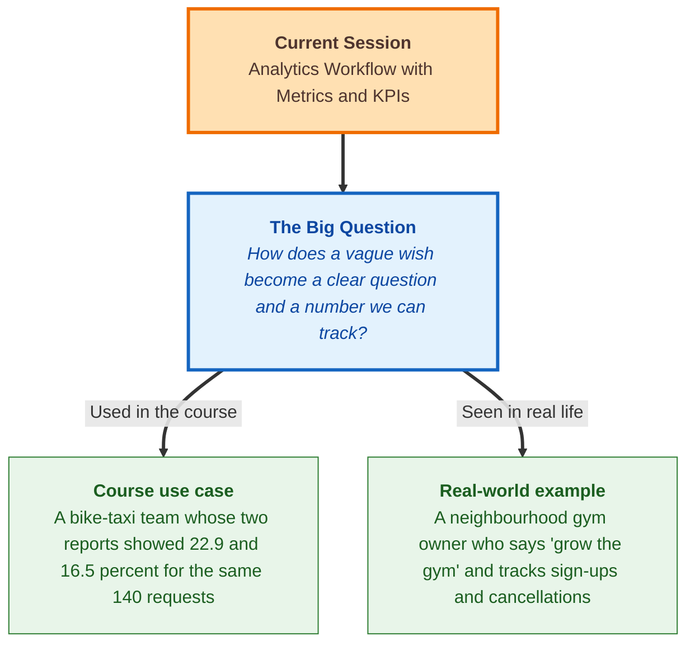

## Analytics Workflow with Metrics and KPIs

### Mental Map

---

### What You'll Learn

Have you ever wondered how a gym owner knows whether the gym is growing or only busier?

By the end of this session, you will be able to:

- **Name** the 5 steps from a question to a message the owner can act on.
- **Describe** how 'grow the gym' becomes a question with a place, a group and a week.
- **Classify** sign-ups and cancel rate as a plain count or a number tied to a goal.
- **Calculate** the cancel rate for the week: 9 cancels out of 60 members who joined.
- **Write** the top, the bottom, the group and the dates for that cancel rate.
- **Judge** whether 'happy members' is a fair number to track.

> **Topics you will meet:** analytics workflow, vague request to question, metric vs KPI, metric definition, check a KPI.
>
> Join the session to learn each of these in detail.

---

### Why You Are Learning This Topic

Dhruv owns a small gym. On Monday he tells his helper, Grow the gym. The helper sends two numbers. One says 15 percent of members cancel. The other says 9 percent. Both use the same notebook. Dhruv does not know which one to believe.

A **metric** means any number you can measure, such as the count of members who joined this week.

In this course, you will write down what each number counts and test it before anyone trusts it.

> **Think about it:** How can two honest helpers read one notebook and report two different rates?

---

### Gym Notebook Puzzle

Here is Dhruv's notebook for one week.

| Item | Count |
|:----------:|:----------:|
| Members who joined | 60 |
| Members who cancelled in week 1 | 9 |
| Members who never came after joining | 6 |
| Total check-ins | 240 |

**What you want to happen:**

- Dhruv gets one clear question from the wish.
- Each rate has a written rule for the top and the bottom.
- Dhruv tracks one number tied to a goal.

> **Wonder about this:**
>
> - Should the cancel rate use all members or only those who joined this week?
> - Is 'happy members' something the notebook can count?

---

### Think It Through

There is no wrong first try. Keep your guesses for the session.

**1. Dhruv says grow the gym. Name two details he must add before you can count anything.**
Hint: Think about where, who and when.

**2. 9 members cancelled out of 60 who joined. What is the cancel rate in percent?**
Hint: Divide 9 by 60, then multiply by 100.

**3. Total check-ins is a count. What would turn it into a number tied to a goal?**
Hint: Think about what the owner wants to improve.

---

### One Question to Carry Into the Session

> **What must be written down before two people can report the same number?**
>
> Which line in Dhruv's notebook would you define first?
