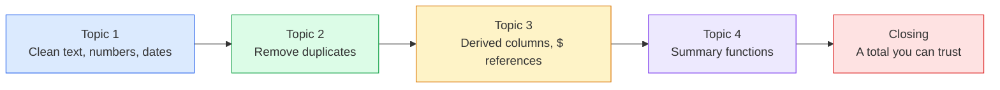
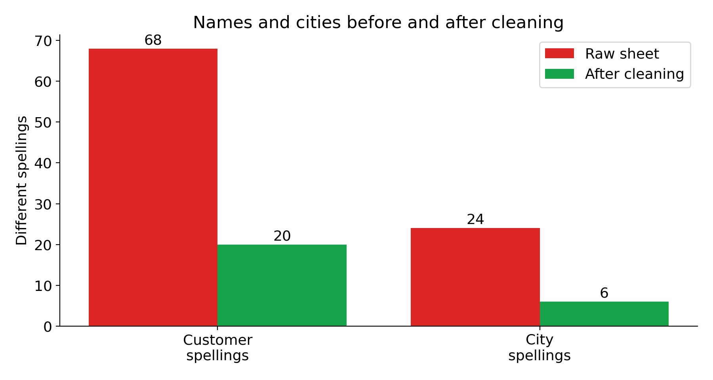
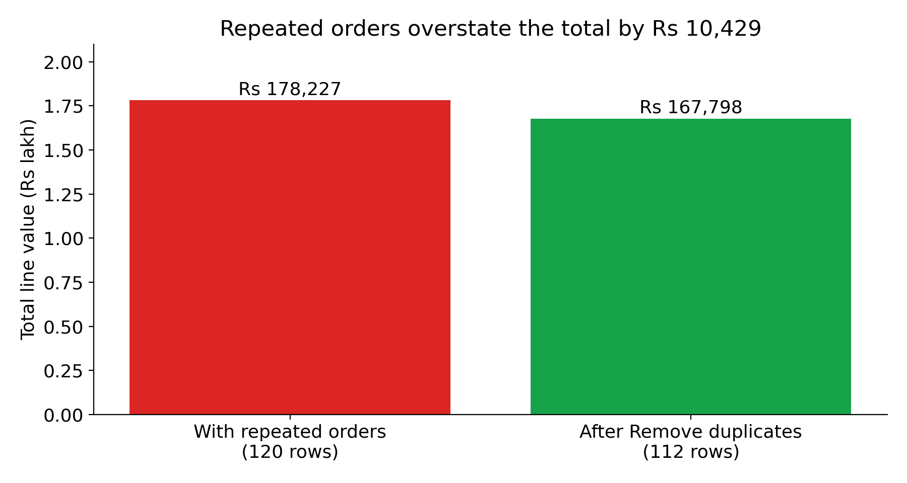

# <font color='#1d4ed8'>Lecture Script: Spreadsheet Formulas and Data Cleaning (Google Sheets)</font>

---

## <font color='blue'>Agenda</font>

The lecture runs as four topics. Each topic ends with a quiz.

| Topic | What we do | Learning objectives covered | Minutes |
|:-:|:--|:--|:-:|
| 1 | Clean the text, then turn text into numbers and dates | Clean a text column using TRIM, PROPER and SUBSTITUTE<br>Convert text-formatted numbers and dates into real numeric and date values | 35 |
| 2 | Remove the repeated orders | Remove duplicate rows from a spreadsheet table using a stated key | 20 |
| 3 | Build new columns that copy down correctly | Write a formula that computes a derived column from other cells in a row<br>Apply absolute and relative references so a formula copies correctly across a range | 30 |
| 4 | Summarise a column | Compute summary values for a column using SUM, AVERAGE, COUNT, MIN and MAX | 20 |
| — | Closing: Outcome & Summary | | 15 |
| | **Total** | | **120** |

> <font color="red">**🎯 Instructor Note**</font> Pace: spend the time on text-to-number conversion in Topic 1 and on the copy-down in Topic 3. Keep the summary functions in Topic 4 short, because learners know the idea of a sum or an average.
> Load `data/orders_raw.csv` into a new Google Sheet with File, Import, and **untick "Convert text to numbers, dates and formulas"**. All cells then arrive as text, like a real export.

---

## <font color='blue'>Scenario</font>

A Nykaa-style beauty store exports its orders from 1 to 15 March 2026 to a sheet. The sales lead wants one total and one tidy table by Friday.

| Column | Holds | What the export looks like |
|:-:|:--|:--|
| A | `order_id` | N1035 |
| B | `customer` | `"  RAHUL MENON "`, `"neha gupta  "` |
| C | `city` | `"chennai  "`, `" MUMBAI "` |
| D | `product` | Matte Lipstick |
| E | `qty` | `"4 "` (a trailing space) |
| F | `unit_price` | `"Rs 1,499"` |
| G | `order_date` | `"13-03-2026"` |

The sheet has 120 rows below the header, in rows 2 to 121.

> <font color="red">**🎯 Instructor Note**</font> Nykaa is only the setting. Do not claim it exports data like this. The 120 orders are invented for teaching. The tax rate used in Topic 3 is an assumed 18 percent for this exercise.

---

## <font color='blue'>Problem Statement</font>

The sales lead typed `=SUM(F2:F121)` on the price column and got 0. The same sheet counted 8 orders twice, so the total of line values came to Rs 1,78,227 and not the correct Rs 1,67,798. The customer column held 68 different spellings for 20 real customers, and the city column held 24 spellings for 6 cities. A report built on this sheet would have shown a wrong total, a wrong customer count and six cities split into 24.

> <font color='purple'>**How do we clean the text, turn text into numbers and dates, remove repeated orders, build correct columns and summarise the result, so that every number on the report can be trusted?**</font>

> <font color="red">**🎯 Instructor Note**</font> Poll: "In the raw sheet, what does `=SUM(F2:F121)` return, when each cell holds text such as `Rs 1,499`?" Options: the total of the prices, 0, or an error. Give learners 30 seconds to respond in chat. Reveal the answer in the Closing.

---

## <font color='blue'>What We Will Use</font>

Last time you decided what to measure and wrote a definition. Now you build the numbers in Google Sheets. You will also reuse what you know from SQL: cleaning text, `COUNT`, `SUM` and `AVG` on columns.

| Topic | Tools | In one line |
|:-:|:--|:--|
| 1 | `TRIM`, `PROPER`, `SUBSTITUTE`, `VALUE`, `DATE` | Fix spaces and case, strip `Rs` and commas, build real numbers and dates |
| 2 | Data, Data cleanup, Remove duplicates | Keep one row per `order_id` |
| 3 | A row formula, `$` references | Add columns that copy down correctly |
| 4 | `SUM`, `AVERAGE`, `COUNT`, `MIN`, `MAX` | Get the summary numbers |

---

## <font color='blue'>How: Walking Through the Order Sheet</font>



---

## <font color='blue'>Topic 1: Clean the text, then turn text into numbers and dates</font> `35 min`

> <font color='purple'>**Why does the price column add up to 0, and why are there 24 spellings for 6 cities?**</font>

### <font color='green'>Example: Clean a name with TRIM, PROPER and SUBSTITUTE</font>

> <font color='purple'>**How do we turn `"  RAHUL MENON "` into `Rahul Menon`?**</font>

Three text functions do the work. `TRIM` removes extra spaces at the start, at the end and between words. `PROPER` writes each word with a capital first letter and small letters after it. `SUBSTITUTE(text, old, new)` replaces one piece of text with another. In Google Sheets, a formula is written in a cell and starts with `=`.

**Predict before you type the formula: What will happen?**

> <font color="red">**🎯 Instructor Note**</font> Expected: row 4 gives `Rahul Menon`. Ask what `TRIM` alone would leave: the case stays `RAHUL MENON`.

In cell H1 write the heading `customer_clean`. In H4 write:

```text
=PROPER(TRIM(B4))
```

**Output**

```text
Rahul Menon
```

#### <font color='#c2410c'>Code Explanation</font>

- **`TRIM(B4)`** `"  RAHUL MENON "` becomes `"RAHUL MENON"`. The spaces at both ends are gone.
- **`PROPER(...)`** `"RAHUL MENON"` becomes `"Rahul Menon"`.

> <font color='green'>**Result**</font> Two functions, one inside the other, clean spaces and case. Copy the formula down the column and every name is tidy.

### <font color='green'>Extending it: A space that TRIM cannot see</font>

> <font color='purple'>**Row 2 holds `Neha Gupta`, but `=TRIM(B2)="Neha Gupta"` says FALSE. Why?**</font>

> <font color="red">**🎯 Instructor Note**</font> Ask for a prediction. Expected: row 2 holds a non-breaking space between the words. It looks like a space and `TRIM` leaves it alone. 11 customer cells in the file have one.

```text
=TRIM(B2)="Neha Gupta"
=SUBSTITUTE(B2,CHAR(160)," ")="Neha Gupta"
```

**Output**

```text
FALSE
TRUE
```

> <font color='green'>**Result**</font> The character with code 160 is a non-breaking space. `SUBSTITUTE(B2, CHAR(160), " ")` swaps it for a normal space first. The full cleaner is `=PROPER(TRIM(SUBSTITUTE(B2,CHAR(160)," ")))`. Use it for the customer column in H and, with column C, for the city column in I.

<p align="center"></p>

### <font color='green'>Example: Turn text into real numbers</font>

> <font color='purple'>**How do we turn the text `Rs 1,499` into the number 1499?**</font>

A **real number** can be added. A text that looks like a number cannot. `SUBSTITUTE` strips `Rs ` and the comma, then `VALUE` turns the remaining text into a number.

**Predict before you type the formula: What will happen?**

> <font color="red">**🎯 Instructor Note**</font> Expected: 1499 in K4. Ask learners what `=VALUE(F4)` would give on its own: an error, because `Rs` is not a number.

In K1 write `price_num`. In K4 write:

```text
=VALUE(SUBSTITUTE(SUBSTITUTE(F4,"Rs ",""),",",""))
```

**Output**

```text
1499
```

For the quantity, `"4 "` has a trailing space. In J4 (heading `qty_num`):

```text
=VALUE(TRIM(E4))
```

**Output**

```text
4
```

#### <font color='#c2410c'>Code Explanation</font>

- **Inner `SUBSTITUTE`** replaces `"Rs "` with nothing, giving `"1,499"`.
- **Outer `SUBSTITUTE`** replaces `","` with nothing, giving `"1499"`.
- **`VALUE`** turns the text `"1499"` into the number 1499.
- **`TRIM` in J4** removes the trailing space, so `VALUE` accepts `"4"`.

> <font color='green'>**Result**</font> K4 holds the number 1499 and J4 holds the number 4. Numbers are now ready for arithmetic.

### <font color='green'>Extending it: Turn text into a real date</font>

> <font color='purple'>**How do we turn the text `13-03-2026` into a date?**</font>

> <font color="red">**🎯 Instructor Note**</font> Ask for a prediction. The text is day-month-year. `DATE(year, month, day)` builds a real date. Taking the parts by position does not depend on the sheet's locale.

In L1 write `order_date_real`. In L4 write:

```text
=DATE(VALUE(RIGHT(G4,4)), VALUE(MID(G4,4,2)), VALUE(LEFT(G4,2)))
```

**Output**

```text
2026-03-13
```

#### <font color='#c2410c'>Code Explanation</font>

- **`RIGHT(G4,4)`** takes the last 4 characters: `2026`.
- **`MID(G4,4,2)`** starts at character 4 and takes 2: `03`.
- **`LEFT(G4,2)`** takes the first 2 characters: `13`.
- **`DATE(...)`** builds a real date from year, month and day. Format the column as Date.

> <font color='green'>**Result**</font> L4 is now a real date, so it sorts and subtracts correctly. The text `13-03-2026` could not do that.

### <font color='purple'>Quiz 1</font>

**Question:** Which formula turns the text `Rs 1,299` in F2 into the number 1299?

**Options:**
- A) `=VALUE(F2)`
- B) `=TRIM(F2)`
- C) `=VALUE(SUBSTITUTE(SUBSTITUTE(F2,"Rs ",""),",",""))`
- D) `=PROPER(F2)`

**Correct Answer:** C

**Explanation:**
- **A)** `VALUE` on `Rs 1,299` fails, because the letters `Rs` are not part of a number.
- **B)** `TRIM` only removes spaces. The text `Rs 1,299` stays text.
- **C)** It strips `Rs ` and the comma, then converts the rest to a number.
- **D)** `PROPER` changes capital letters. The result is still text.

---

## <font color='blue'>Topic 2: Remove the repeated orders</font> `20 min`

> <font color='purple'>**The same order appears twice in 8 places. How do we keep one row per order?**</font>

### <font color='green'>Example: Remove duplicates with a stated key</font>

> <font color='purple'>**How do we keep the first row of each `order_id` and drop the rest?**</font>

A **key** is the column, or columns, that make a row unique. Here the key is `order_id`: two rows with the same `order_id` are the same order. Sheets compares only the columns you tick.

**Predict before you run it: What will happen?**

> <font color="red">**🎯 Instructor Note**</font> Expected: 8 rows removed, and 112 rows remain. Sheets keeps the first row it finds. Make a copy of the sheet first, so the original rows stay safe.

Steps in Google Sheets:

```text
Select columns A to L
Data > Data cleanup > Remove duplicates
Tick "Data has header row"
Untick all columns except A (order_id)
Click "Remove duplicates"
```

**Output**

```text
8 duplicate rows are removed. 112 unique rows remain (rows 2 to 113).
```

> <font color='green'>**Result**</font> 120 rows become 112, one per order. Orders such as N1006 and N1015 now appear once. The old data rows 2 to 121 are now rows 2 to 113.

<p align="center"></p>

### <font color='green'>Extending it: Pick the wrong key</font>

> <font color='purple'>**What if we tick only the cleaned customer column as the key?**</font>

> <font color="red">**🎯 Instructor Note**</font> Ask for a prediction. Expected: only 20 rows remain, one per customer. The key decides what "the same" means, so the wrong key deletes real orders.

> <font color='green'>**Result**</font> With `customer_clean` as the key, the sheet keeps 20 rows, one per customer, and drops 92 genuine orders. The key must identify a single order, and `order_id` does.

> <font color='#b45309'>**Common mistake**</font> Ticking every column. A repeated order with a different spelling in column B is then not seen as a duplicate. Use the key.

### <font color='purple'>Quiz 2</font>

**Question:** You remove duplicates with only the customer column ticked. What happens?

**Options:**
- A) Orders from repeat customers are removed too
- B) Only exact copies of an order are removed
- C) Nothing is removed
- D) The order ids are rewritten

**Correct Answer:** A

**Explanation:**
- **A)** Rows with the same customer count as duplicates, so a customer's second and later orders are deleted.
- **B)** That would need the order id as the key.
- **C)** Rows that share a customer are removed.
- **D)** The tool deletes rows. It does not rewrite values.

---

## <font color='blue'>Topic 3: Build new columns that copy down correctly</font> `30 min`

> <font color='purple'>**The sales lead wants the value of each order line and the tax on it. How do we write the formula once and fill 112 rows?**</font>

### <font color='green'>Example: A derived column</font>

> <font color='purple'>**What is the line value of order N1013, with 4 units at Rs 1,499?**</font>

A **derived column** is a new column computed from other cells in the same row. Line value is $\text{line value} = \text{qty} \times \text{unit price}$.

$$\boxed{\text{line value} = \text{qty\_num} \times \text{price\_num}}$$

**Predict before you type the formula: What will happen?**

> <font color="red">**🎯 Instructor Note**</font> Expected: $4 \times 1499 = 5996$.

In M1 write `line_value`. In M4 write:

```text
=J4*K4
```

**Output**

```text
5996
```

> <font color='green'>**Result**</font> Order N1013 is worth Rs 5,996. Double-click the fill handle and the formula copies down to every row, with `J4*K4` becoming `J5*K5` and so on.

### <font color='green'>Extending it: One tax rate in one cell</font>

> <font color='purple'>**How do we apply one tax rate, stored in P1, to every row?**</font>

A **relative reference** such as `M4` moves when you copy the formula down. An **absolute reference** such as `$P$1` is locked with dollar signs and stays on P1. In O1 write `Tax rate` and in P1 write `0.18`, an assumed rate for this exercise. In N4 write:

```text
=M4*$P$1
```

**Predict before you copy it: What will happen?**

> <font color="red">**🎯 Instructor Note**</font> Expected: 1079.28 in N4, because $5996 \times 0.18 = 1079.28$. After copying down, N5 reads `=M5*$P$1`.

**Output**

```text
1079.28
```

Now see what happens without the dollar signs. Suppose N4 had been written `=M4*P1` and you copy it to N5:

```text
=M5*P2
```

**Output**

```text
0
```

> <font color='green'>**Result**</font> With `$P$1` the rate is locked on P1 for every row. With `P1` the reference slides down to P2, which is empty, and the tax becomes 0 on every row after the first.

> <font color='#b45309'>**Common mistake**</font> Typing the rate inside every formula, such as `=M4*0.18`. When the rate changes you must edit 112 formulas. Keep it in one cell and lock it with `$`.

### <font color='purple'>Quiz 3</font>

**Question:** N4 holds `=M4*$P$1`. You copy it down to N5. What does N5 hold?

**Options:**
- A) `=M4*$P$1`
- B) `=M5*P2`
- C) `=M5*$P$2`
- D) `=M5*$P$1`

**Correct Answer:** D

**Explanation:**
- **A)** `M4` is relative, so it moves to `M5` when copied down.
- **B)** `P1` has dollar signs, so it does not slide to `P2`.
- **C)** Both the column and the row of `$P$1` are locked, so the row stays 1.
- **D)** `M4` becomes `M5` and `$P$1` stays `$P$1`.

---

## <font color='blue'>Topic 4: Summarise a column</font> `20 min`

> <font color='purple'>**The sheet is clean. What are the five numbers the sales lead asked for?**</font>

### <font color='green'>Example: SUM, AVERAGE, COUNT, MIN and MAX</font>

> <font color='purple'>**What are the total, the average price, the count, the lowest and the highest?**</font>

Five functions summarise a range. `SUM` adds the numbers, `AVERAGE` gives their mean, `COUNT` counts cells that hold numbers, and `MIN` and `MAX` give the smallest and largest. All five skip cells that hold text.

**Predict before you type them: What will happen?**

> <font color="red">**🎯 Instructor Note**</font> Expected: total line value 167,798 from 112 rows. `MIN` is 0 because 2 orders (N1021 and N1078) are free gift items priced Rs 0.

```text
=SUM(M2:M113)
=AVERAGE(K2:K113)
=COUNT(K2:K113)
=MIN(K2:K113)
=MAX(K2:K113)
```

**Output**

```text
167798
670.89
112
0
1499
```

#### <font color='#c2410c'>Code Explanation</font>

- **`SUM(M2:M113)`** adds the 112 line values: Rs 1,67,798.
- **`AVERAGE(K2:K113)`** is 75,140 divided by 112, which is 670.89. The 2 free gifts pull it down.
- **`COUNT(K2:K113)`** counts 112 numbers, one per order.
- **`MIN` and `MAX`** give 0 (the free gifts) and 1499 (the dearest item).

> <font color='green'>**Result**</font> The sales lead gets Rs 1,67,798 as the total over 112 orders. A price of 0 shows that free gifts are inside the list.

### <font color='green'>Extending it: Why COUNT said 0</font>

> <font color='purple'>**On the raw sheet, what do `COUNT` and `COUNTA` return for the 120 price cells?**</font>

> <font color="red">**🎯 Instructor Note**</font> Ask for a prediction. `COUNT` counts only numbers. `COUNTA` counts any cell that is not empty. The raw prices are text.

```text
=COUNT(F2:F121)
=COUNTA(F2:F121)
=SUM(F2:F121)
```

**Output**

```text
0
120
0
```

> <font color='green'>**Result**</font> `COUNT` and `SUM` see no numbers, because every raw price is text. `COUNTA` sees 120 cells that are not empty. That is how you detect text-numbers: `COUNT` is lower than `COUNTA`.

### <font color='purple'>Quiz 4</font>

**Question:** What does `=COUNT(F2:F121)` return when all 120 cells hold text such as `Rs 1,499`?

**Options:**
- A) 120
- B) 0
- C) 8
- D) 112

**Correct Answer:** B

**Explanation:**
- **A)** 120 is what `COUNTA` returns. `COUNT` counts only numbers.
- **B)** The cells hold text, so `COUNT` finds no numbers.
- **C)** 8 is the count of duplicate rows, which has nothing to do with `COUNT`.
- **D)** 112 is the count of unique orders. `COUNT` of text cells is 0.

---

## <font color='blue'>Closing: Outcome & Summary</font> `15 min`

Back to the sales lead's sheet. We can now give a trusted answer.

> <font color='purple'>**1. Why did the raw total come out as 0, and what fixed it?**</font>

The prices were text (Topic 1), so `SUM` skipped them. `VALUE` and `SUBSTITUTE` made real numbers. `COUNT` below `COUNTA` flags the problem (Topic 4).

> <font color='purple'>**2. Which total is correct, and how many orders are behind it?**</font>

After removing duplicates by `order_id` (Topic 2) and building `line_value` with `qty_num × price_num` (Topic 3), the total is Rs 1,67,798 over 112 orders (Topic 4).

### <font color='green'>Outcome</font>

| | Raw sheet | Cleaned sheet |
|:--|:-:|:-:|
| Rows | 120 | 112 |
| `SUM` of prices | 0 | 75,140 |
| Total line value | Rs 1,78,227 (with repeated orders) | Rs 1,67,798 |
| Customer spellings | 68 | 20 |
| City spellings | 24 | 6 |
| Dates | Text | Real dates |

> <font color='green'>**Therefore,**</font> clean the text first, convert text to real numbers and dates, remove duplicates with a stated key, build derived columns with locked references, and then summarise. The total of Rs 1,67,798 is the number the sales lead can send.

> <font color="red">**🎯 Instructor Note**</font> Reveal the poll: 0. `SUM` skips text, so the raw price column adds up to 0.

### <font color='green'>Summary</font>

| Learning objective | Takeaway |
|:--|:--|
| Clean text | `PROPER(TRIM(SUBSTITUTE(...)))` fixes case, spaces and non-breaking spaces |
| Text to numbers and dates | `VALUE` with `SUBSTITUTE` for numbers, and `DATE` with `RIGHT`, `MID`, `LEFT` for dates |
| Remove duplicates | Tick only the key column, here `order_id` |
| Derived column | A row formula such as `=J4*K4` copies down with relative references |
| Absolute and relative references | `$P$1` stays locked, `M4` moves with the row |
| Summary functions | `SUM`, `AVERAGE`, `COUNT`, `MIN` and `MAX` skip text, so `COUNT` below `COUNTA` flags text-numbers |
| **Practical value** | A sheet you clean once gives totals that match the real orders |

---

# <font color='red'>Launch the Feedback Poll</font>

> <font color="red">**🎯 Instructor Note**</font> Reminder: launch the feedback poll now to collect learner feedback.
