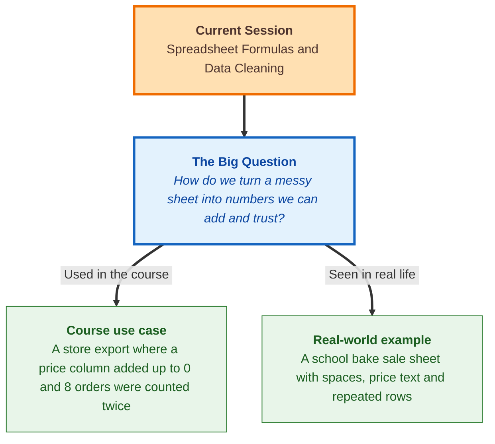

## Spreadsheet Formulas and Data Cleaning

### Mental Map

---

### What You'll Learn

Have you ever wondered why a sheet adds up to 0 when every cell looks like a number?

By the end of this session, you will be able to:

- **Identify** the 3 cells in the bake sale sheet that look like numbers and act like text.
- **Explain** why 'Rs 15' cannot be added until the letters are removed.
- **Apply** a clean-up so ' SAMOSA ' and 'samosa' match.
- **Calculate** the sale value for each row and the total for the day.
- **Check** which row is a repeat and should be kept once.
- **Design** one formula that works when copied down 30 rows.

> **Topics you will meet:** formulas, absolute vs relative references, SUM AVERAGE COUNT MIN and MAX, TRIM PROPER and SUBSTITUTE, text to numbers and dates, remove duplicates.
>
> Join the session to learn each of these in detail.

---

### Why You Are Learning This Topic

Tara runs the school bake sale. She types each sale into a sheet. At the end she adds the price column and gets 0. One sale is listed twice. Two item names differ only by capital letters and spaces. The treasurer asks for the day's total, and Tara cannot give it.

A **formula** means a rule you type in a cell that works out a value from other cells.

In this course, you will clean a sheet first and then build formulas on it.

> **Think about it:** Why does a column of prices add up to 0?

---

### Bake Sale Puzzle

Here are 4 rows from Tara's sheet.

| Sale | Item | Qty | Price |
|:----------:|:----------:|:----------:|:----------:|
| 1 | ' SAMOSA ' | 2 | Rs 15 |
| 2 | 'samosa' | 3 | Rs 15 |
| 3 | 'Brownie' | 1 | Rs 40 |
| 3 | 'Brownie' | 1 | Rs 40 |

**What you want to happen:**

- Both samosa rows carry the same clean name.
- Each price becomes a number.
- The repeated brownie sale counts once.

> **Wonder about this:**
>
> - Does the day's total change if row 4 stays?
> - What should happen to the letters Rs in the price?

---

### Think It Through

There is no wrong first try. Keep your guesses for the session.

**1. Row 1 is 2 samosas at Rs 15. What is the sale value?**
Hint: Multiply the quantity by the price.

**2. Row 4 repeats row 3. What does the day's total look like if both stay?**
Hint: Add both brownie rows.

**3. Tara copies a formula down 30 rows, and one cell must stay fixed. Which cell would that be?**
Hint: Think of a number that every row uses.

---

### One Question to Carry Into the Session

> **What must we fix in a sheet before any formula can be trusted?**
>
> Which row in Tara's sheet would you fix first?
