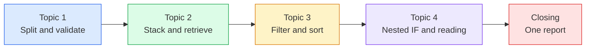
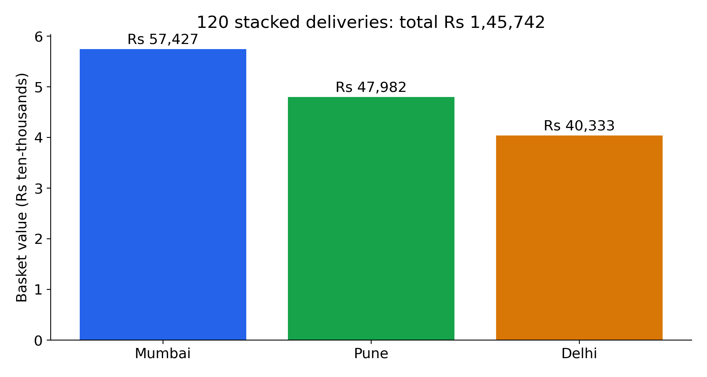
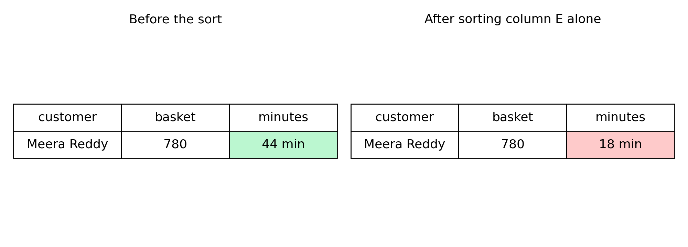
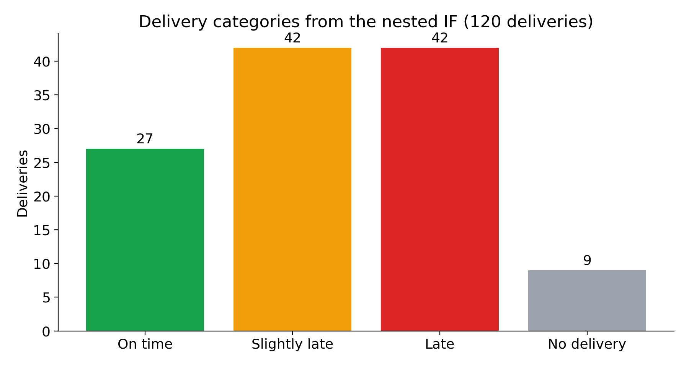

# <font color='#1d4ed8'>Lecture Script: Structuring and Validating Data Across Sheets (Google Sheets)</font>

---

## <font color='blue'>Agenda</font>

The lecture runs as four topics. Each topic ends with a quiz.

| Topic | What we do | Learning objectives covered | Minutes |
|:-:|:--|:--|:-:|
| 1 | Split a name column and lock the status column | Extract parts of a combined column into separate columns<br>Configure a data-validation dropdown that constrains what can be entered in a column | 30 |
| 2 | Bring three city sheets into one | Construct one table by stacking rows from several sheets that share the same columns<br>Retrieve data from another sheet or workbook into the working sheet | 25 |
| 3 | Filter and sort without scrambling rows | Filter and sort a table on multiple criteria without breaking row alignment | 20 |
| 4 | Label each delivery, then read a formula you did not write | Write a nested IF formula that assigns a category from a numeric value<br>Interpret an unfamiliar nested formula, naming what it returns | 30 |
| — | Closing: Outcome & Summary | | 15 |
| | **Total** | | **120** |

> <font color="red">**🎯 Instructor Note**</font> Pace: spend the time on stacking in Topic 2 and on the nested IF in Topic 4. Keep the dropdown in Topic 1 to one clear setting, "Reject the input".
> Import `data/mumbai.csv`, `data/delhi.csv`, `data/pune.csv` and `data/targets.csv` as four tabs named Mumbai, Delhi, Pune and Targets in one Google Sheet. Add a fifth tab named All.

---

## <font color='blue'>Scenario</font>

A BigBasket-style grocery app keeps one delivery log tab per city. Each tab has the same columns. The operations head wants one report of late deliveries across the three cities.

| Tab | Rows | Columns |
|:--|:-:|:--|
| Mumbai | 40 | city, delivery_id, customer, basket_value, delivery_minutes, status |
| Delhi | 40 | same |
| Pune | 40 | same |
| Targets | 2 | on_time_limit = 30 minutes, late_limit = 45 minutes |

> <font color="red">**🎯 Instructor Note**</font> BigBasket is only the setting. Do not claim it keeps its logs like this. The 120 deliveries are invented for teaching. A cancelled delivery has a blank `delivery_minutes`.

---

## <font color='blue'>Problem Statement</font>

The operations head received three separate tabs, so she had no single count of late deliveries. An analyst copied the three tabs into one by hand and missed 2 rows. Then the analyst sorted only the delivery-minutes column, and the minutes no longer matched the customers. Meera Reddy, who waited 44 minutes, suddenly showed 18. Another analyst typed a status as "Delivred", which no filter could find. The late flag was typed by hand and treated a cancelled delivery, which has no minutes, as "On time".

> <font color='purple'>**How do we split and lock the columns, combine three tabs into one, filter and sort safely, and label every delivery with a formula that we can read and trust?**</font>

> <font color="red">**🎯 Instructor Note**</font> Poll: "In a sheet, a delivery has a blank minutes cell. The formula `=IF(E9<=30,"On time","Late")` is used. What does it return?" Options: Late, On time, or an error. Give learners 30 seconds to respond in chat. Reveal the answer in the Closing.

---

## <font color='blue'>What We Will Use</font>

Last time you cleaned text, removed duplicates and used `$` references in Google Sheets. Today the same sheet skills are used across tabs.

| Topic | Tools | In one line |
|:-:|:--|:--|
| 1 | `SPLIT`, `LEFT`, `FIND`, `MID`, Data validation | Cut a combined cell into parts, and allow only listed values |
| 2 | `={Tab1!range; Tab2!range}`, `Targets!B2`, `IMPORTRANGE` | Stack tabs, and pull a cell from another tab or workbook |
| 3 | Filter, Sort range, `FILTER`, `SORT` | Show only some rows and order them, keeping each row together |
| 4 | `IF`, nested `IF` | Give each row a label from a number |

---

## <font color='blue'>How: Walking Through the Delivery Report</font>



---

## <font color='blue'>Topic 1: Split a name column and lock the status column</font> `30 min`

> <font color='purple'>**The customer column holds a first name and a last name in one cell. How do we get two columns, and how do we stop typos in the status column?**</font>

### <font color='green'>Example: Split a combined column</font>

> <font color='purple'>**How do we turn `Meera Reddy` into `Meera` and `Reddy` in two cells?**</font>

`SPLIT(text, delimiter)` cuts a text at every delimiter and puts each part in its own cell, going right. The delimiter here is one space. In the Mumbai tab, write `first_name` in G1 and, in G2:

```text
=SPLIT(C2," ")
```

**Predict before you press Enter: What will happen?**

> <font color="red">**🎯 Instructor Note**</font> Expected: `Meera` in G2 and `Reddy` spills into H2. The cells to the right must be empty.

**Output**

```text
G2: Meera    H2: Reddy
```

#### <font color='#c2410c'>Code Explanation</font>

- **`C2`** is the text to cut: `Meera Reddy`.
- **`" "`** is the delimiter, a single space.
- **Result** The formula sits in G2 and fills H2 by itself. This is called a spill.

> <font color='green'>**Result**</font> One formula gives two columns. Copy it down to row 41 and every customer is split.

### <font color='green'>Extending it: A name with three parts</font>

> <font color='purple'>**What does `SPLIT` do with `Anil Kumar Rao` in row 8?**</font>

> <font color="red">**🎯 Instructor Note**</font> Ask for a prediction. Expected: three cells, which breaks a two-column layout. 4 of the 120 names have 3 parts.

```text
=SPLIT(C8," ")
=LEFT(C8,FIND(" ",C8)-1)
=MID(C8,FIND(" ",C8)+1,100)
```

**Output**

```text
G8: Anil    H8: Kumar    I8: Rao
Anil
Kumar Rao
```

> <font color='green'>**Result**</font> `SPLIT` gives 3 cells. To always get two, cut at the first space only. `FIND(" ",C8)` is the position of the first space. `LEFT` takes the text before it and `MID` takes the rest.

> <font color='#b45309'>**Common mistake**</font> Leaving data to the right of a `SPLIT` formula. The spill is blocked and the cell shows a `#REF!` error. Keep the cells to the right empty.

### <font color='green'>Example: A dropdown that rejects typos</font>

> <font color='purple'>**How do we make the status column accept only Delivered, Cancelled or Returned?**</font>

**Data validation** limits what a cell accepts. A **dropdown** lists the allowed values. Setting "Reject the input" refuses anything else.

**Predict before you type "Delivred": What will happen?**

> <font color="red">**🎯 Instructor Note**</font> Expected: Sheets refuses the entry. With "Show a warning", it would accept the typo and flag it.

Steps:

```text
Select F2:F41
Data > Data validation > Add rule
Criteria: Dropdown, items Delivered, Cancelled, Returned
Advanced options: If the data is invalid, Reject the input
Click Done
```

> <font color='green'>**Result**</font> A cell in F2:F41 now shows an arrow with 3 choices. A typed "Delivred" is refused. Every status can be found by a filter.

### <font color='purple'>Quiz 1</font>

**Question:** Which setting makes a dropdown refuse a typed value such as "Delivred"?

**Options:**
- A) Show a warning when the data is invalid
- B) Reject the input when the data is invalid
- C) Delete the rule
- D) Apply the rule to the header row only

**Correct Answer:** B

**Explanation:**
- **A)** A warning still accepts the typo and only marks it.
- **B)** "Reject the input" blocks any value that is not on the list.
- **C)** Deleting the rule allows every value again.
- **D)** The rule must cover the data cells, F2:F41, not the header.

---

## <font color='blue'>Topic 2: Bring three city sheets into one</font> `25 min`

> <font color='purple'>**Three tabs, 120 deliveries. How do we get them into one table without copying by hand?**</font>

### <font color='green'>Example: Stack the tabs</font>

> <font color='purple'>**How do we put Mumbai, Delhi and Pune under each other in the All tab?**</font>

Because the three tabs share the same six columns, we can stack them. A semicolon inside curly brackets puts one range under the next. In the All tab, type the headings in A1:F1 and, in A2:

```text
={Mumbai!A2:F41; Delhi!A2:F41; Pune!A2:F41}
```

**Predict before you press Enter: What will happen?**

> <font color="red">**🎯 Instructor Note**</font> Expected: 120 rows, from row 2 to row 121. Mumbai fills rows 2 to 41, Delhi rows 42 to 81 and Pune rows 82 to 121.

**Output**

```text
All!A2:F121 holds 120 rows
=SUM(D2:D121) gives 145742
Mumbai 57427, Delhi 40333, Pune 47982
```

#### <font color='#c2410c'>Code Explanation</font>

- **`Mumbai!A2:F41`** is a range on another tab. The tab name, an exclamation mark, then the cells.
- **`;`** inside `{ }` stacks the next range under the first. A comma would put it beside.
- **`D2:D121`** is the `basket_value` column of the stacked table.

<p align="center"></p>

> <font color='green'>**Result**</font> The three tabs become one table of 120 rows with a total basket value of Rs 1,45,742. If a tab changes, the stacked table updates by itself.

### <font color='green'>Extending it: Retrieve one cell from another tab or workbook</font>

> <font color='purple'>**How do we read the on-time limit from the Targets tab, so that nobody types 30 into a formula?**</font>

> <font color="red">**🎯 Instructor Note**</font> Ask for a prediction. A reference to another tab uses the tab name and an exclamation mark. For another workbook use `IMPORTRANGE`. It needs the workbook link, and the first use asks to allow access. It is not run in this script, because it depends on a link.

```text
=Targets!B2
=Targets!B3
=IMPORTRANGE("link to the other workbook", "Targets!B2")
```

**Output**

```text
30
45
```

> <font color='green'>**Result**</font> `Targets!B2` brings in 30 and `Targets!B3` brings in 45. The third formula does the same from another workbook once you paste its link and allow access. Keep the limits in one place and read them everywhere.

### <font color='purple'>Quiz 2</font>

**Question:** Which formula stacks the Mumbai, Delhi and Pune ranges (each A2:F41) into one table?

**Options:**
- A) `=Mumbai!A2:F41 + Delhi!A2:F41 + Pune!A2:F41`
- B) `=SUM(Mumbai!A2:F41, Delhi!A2:F41, Pune!A2:F41)`
- C) `={Mumbai!A2:F41, Delhi!A2:F41, Pune!A2:F41}`
- D) `={Mumbai!A2:F41; Delhi!A2:F41; Pune!A2:F41}`

**Correct Answer:** D

**Explanation:**
- **A)** `+` tries to add the cells, which does not stack rows.
- **B)** `SUM` gives one number.
- **C)** Commas place the ranges side by side, giving 18 columns.
- **D)** Semicolons place each range under the previous one, giving 120 rows.

---

## <font color='blue'>Topic 3: Filter and sort without scrambling rows</font> `20 min`

> <font color='purple'>**The operations head wants the Pune deliveries that took more than 45 minutes, longest first. How do we show them and keep each customer with their own minutes?**</font>

### <font color='green'>Example: Filter on three criteria, then sort</font>

> <font color='purple'>**Which delivered Pune orders took more than 45 minutes, longest first, with the larger basket first on ties?**</font>

`FILTER(range, condition1, condition2, ...)` keeps the rows where every condition is true. `SORT(range, column, ascending, column2, ascending2)` orders them, moving whole rows together. The column numbers count inside the range: here minutes is column 5 and basket value is column 4.

**Predict before you press Enter: What will happen?**

> <font color="red">**🎯 Instructor Note**</font> Expected: 12 rows. Four orders share the longest time of 75 minutes, so the basket value decides their order.

In a new tab, in A1, write:

```text
=SORT(FILTER(All!A2:F121, All!A2:A121="Pune", All!F2:F121="Delivered", All!E2:E121>45), 5, FALSE, 4, FALSE)
```

**Output**

```text
Pune  P020  Nikhil Khan     2750  75  Delivered
Pune  P019  Meera Bose      1890  75  Delivered
Pune  P007  Anil Kumar Rao  1180  75  Delivered
(12 rows in all)
```

#### <font color='#c2410c'>Code Explanation</font>

- **Three `All!` conditions** The city must be Pune, the status must be Delivered, and the minutes must be above 45. All three must be true.
- **`5, FALSE`** sorts by column 5 (minutes), descending.
- **`4, FALSE`** breaks ties by column 4 (basket value), descending.

> <font color='green'>**Result**</font> The longest Pune delivery is P020 at 75 minutes, with a basket of Rs 2,750. Each row moves as a whole, so every customer stays with their own minutes.

### <font color='green'>Extending it: Sort one column and break the rows</font>

> <font color='purple'>**What happens if we select only column E (E2:E121) and sort it A to Z?**</font>

> <font color="red">**🎯 Instructor Note**</font> Ask for a prediction. Expected: E2 becomes 18, the smallest minutes. Meera Reddy is still in row 2 with a basket of Rs 780, but now shows 18 minutes and not 44.

| | Before the sort | After sorting column E alone |
|:--|:--|:--|
| Row 2 | Meera Reddy, 780, 44 minutes | Meera Reddy, 780, **18** minutes |

<p align="center"></p>

> <font color='green'>**Result**</font> Sorting one column moves only that column. Names and baskets stay, so rows no longer belong together. Use `Data > Sort range` on the whole table with "Data has header row", or use a filter, or use `SORT` on the full range.

> <font color='#b45309'>**Common mistake**</font> Selecting a single column and clicking the A to Z sort. Sort the whole table, never one column.

### <font color='purple'>Quiz 3</font>

**Question:** You select only column E (the minutes) and sort it A to Z. What is the problem?

**Options:**
- A) The minutes no longer match the customer in each row
- B) The customer names are sorted too
- C) The header row is deleted
- D) Nothing changes, because the other columns follow automatically

**Correct Answer:** A

**Explanation:**
- **A)** Only column E moves, so every row shows another delivery's minutes.
- **B)** The other columns stay where they are. They are not sorted.
- **C)** The header is not deleted, unless you included it in the selection by mistake.
- **D)** Columns follow only if the whole table is part of the sort.

---

## <font color='blue'>Topic 4: Label each delivery, then read a formula you did not write</font> `30 min`

> <font color='purple'>**Each row needs a label from its minutes: On time, Slightly late or Late. How do we write one formula that gives all three?**</font>

### <font color='green'>Example: IF and nested IF</font>

> <font color='purple'>**How do we assign a category from a number?**</font>

`IF(test, value_if_true, value_if_false)` picks one of two results. When a result is itself another `IF`, the formulas are **nested**. The first true test wins, like `CASE WHEN` in SQL. We read the limits from the Targets tab with `$` locks, and we add a first test for a blank cell.

**Predict before you press Enter: What will happen?**

> <font color="red">**🎯 Instructor Note**</font> Expected for rows 2 to 6 (M001 to M005): Slightly late, On time, Slightly late, Slightly late, Late. The boundaries are inclusive: 30 is On time and 45 is Slightly late.

In the All tab, in G1 write `category`. In G2 write:

```text
=IF(E2="","No delivery",IF(E2<=Targets!$B$2,"On time",IF(E2<=Targets!$B$3,"Slightly late","Late")))
```

**Output**

```text
Row 2 (44 min):  Slightly late
Row 3 (30 min):  On time
Row 4 (31 min):  Slightly late
Row 5 (45 min):  Slightly late
Row 6 (46 min):  Late
Row 8 (blank):   No delivery
```

#### <font color='#c2410c'>Logic Explanation</font>

- **`E2=""`** is true when the minutes cell is blank, so cancelled deliveries get `No delivery` first.
- **`E2<=Targets!$B$2`** is true up to 30 minutes, so the label is `On time`.
- **`E2<=Targets!$B$3`** is true from 31 to 45 minutes, so the label is `Slightly late`.
- **Last result** Anything above 45 falls to `Late`.

> <font color='green'>**Result**</font> Over the 120 deliveries, 27 are On time, 42 are Slightly late, 42 are Late and 9 have No delivery.

<p align="center"></p>

> <font color='#b45309'>**Common mistake**</font> Leaving out the blank test. A blank cell counts as 0 in a comparison, so `E2<=30` is true, and a cancelled delivery is labelled `On time`. Without the blank test, On time would show 36 and not 27.

### <font color='green'>Example: Read a nested formula you did not write</font>

> <font color='purple'>**A colleague left this formula in column H. What does it return?**</font>

Read a nested `IF` from the outside in. Each `IF` is one question. Say what happens when the answer is yes, and what happens when it is no.

**Predict before you read the answer: What will happen?**

> <font color="red">**🎯 Instructor Note**</font> Give learners 1 minute to write the sentence in chat. Expected: cancelled orders get a Refund. Others over 45 minutes get a call if the basket is above 1,500, else a coupon. Everything else gets No action.

```text
=IF(F2="Cancelled","Refund",IF(E2>45,IF(D2>1500,"Call customer","Send coupon"),"No action"))
```

**Output**

```text
Over all 120 deliveries:
No action 69, Send coupon 27, Call customer 15, Refund 9
```

#### <font color='#c2410c'>Logic Explanation</font>

- **First `IF`** If the status is Cancelled, return `Refund`.
- **Second `IF`** Otherwise, if the minutes are above 45, go inside the next `IF`.
- **Inner `IF`** Above 45 minutes with a basket above Rs 1,500 gives `Call customer`. Otherwise `Send coupon`.
- **Last result** Everything else is `No action`.

> <font color='green'>**Result**</font> The formula gives each delivery one action: 9 refunds, 15 calls, 27 coupons and 69 with no action. Naming the three questions in order is the way to read any nested formula.

### <font color='purple'>Quiz 4</font>

**Question:** E9 is blank. What does `=IF(E9<=30,"On time",IF(E9<=45,"Slightly late","Late"))` return?

**Options:**
- A) Late
- B) No delivery
- C) On time
- D) An error

**Correct Answer:** C

**Explanation:**
- **A)** `Late` needs the minutes above 45, and a blank is not above 45.
- **B)** That label appears only if the formula tests for a blank first.
- **C)** A blank counts as 0 in a comparison, so `E9<=30` is true.
- **D)** The formula is valid, so there is no error. The result is wrong, which is worse.

---

## <font color='blue'>Closing: Outcome & Summary</font> `15 min`

Back to the operations head. We now have one report she can trust.

> <font color='purple'>**1. How do we get one table, with clean names and a locked status?**</font>

Stack the three tabs into All with `={Mumbai!A2:F41; Delhi!A2:F41; Pune!A2:F41}` (Topic 2). Split the customer column, and lock the status with a dropdown set to Reject (Topic 1).

> <font color='purple'>**2. Which deliveries need action, and in what order?**</font>

Filter and sort the whole table, never one column (Topic 3), and label each row with the nested `IF` that reads the limits from Targets (Topics 2 and 4).

### <font color='green'>Outcome</font>

| | Before | After |
|:--|:-:|:-:|
| Rows in one table | 118 (2 missed by hand) | 120, by formula |
| Status entries | Typos possible | Dropdown, typos rejected |
| Sort | One column, rows scrambled | Whole table, rows together |
| Late label | Typed by hand | Nested `IF` from the Targets tab |
| Cancelled deliveries | Labelled On time | No delivery (9) |

> <font color='green'>**Therefore,**</font> split combined cells, restrict entries with a dropdown, stack tabs by formula, filter and sort the whole table, and label rows with a nested `IF` that tests for blanks first. Read any nested formula one question at a time.

> <font color="red">**🎯 Instructor Note**</font> Reveal the poll: On time. A blank counts as 0, so `E9<=30` is true. This is why the nested `IF` in Topic 4 tests for a blank first.

### <font color='green'>Summary</font>

| Learning objective | Takeaway |
|:--|:--|
| Extract parts of a combined column | `SPLIT` for equal parts, or `LEFT`, `FIND` and `MID` to cut at the first space |
| Data-validation dropdown | A list of allowed values with "Reject the input" |
| Filter and sort on multiple criteria | Work on the whole table so rows stay together |
| Retrieve data from another sheet or workbook | `Tab!Cell` for a tab, `IMPORTRANGE` for another workbook |
| Stack sheets into one table | `={A!range; B!range; C!range}` with semicolons |
| Nested IF | The first true test wins, and a blank test goes first |
| Interpret a nested formula | Read it one `IF` at a time, outside in |
| **Practical value** | One tidy table from many tabs gives one report that holds up |

---

# <font color='red'>Launch the Feedback Poll</font>

> <font color="red">**🎯 Instructor Note**</font> Reminder: launch the feedback poll now to collect learner feedback.
