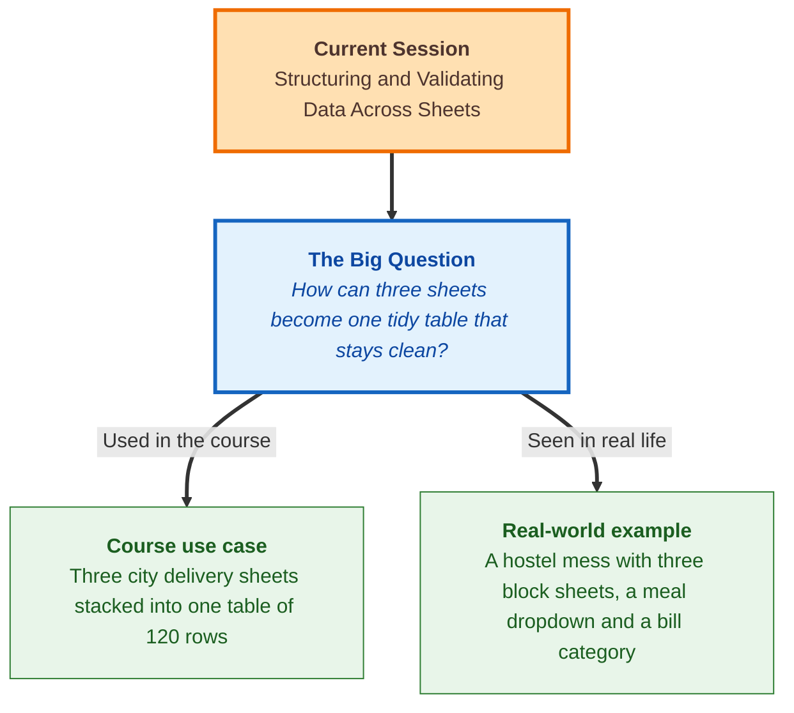

## Structuring and Validating Data Across Sheets

### Mental Map

---

### What You'll Learn

Have you ever wondered how three hostel blocks can send one combined meal list without mistakes?

By the end of this session, you will be able to:

- **List** the 3 block sheets and the columns they share.
- **Explain** why a meal dropdown stops the typo 'Vegg' from entering.
- **Classify** each bill as Low, Medium or High with a rule on the amount.
- **Compare** a sheet sorted by one column with a sheet sorted as whole rows.
- **Interpret** a formula that gives Refund, Call or None.
- **Build** one combined table from the three block sheets.

> **Topics you will meet:** split a column, dropdown validation, filter and sort, consolidate from other sheets, stack sheets into one table, IF function, nested IF formula, reading an unfamiliar nested formula.
>
> Join the session to learn each of these in detail.

---

### Why You Are Learning This Topic

Kiran runs the hostel mess. Block A, Block B and Block C each keep a sheet. Names sit in one cell, such as Asha Rao. A student typed Vegg as a meal. Someone sorted only the bill column, and the bills slid away from the names. Kiran needs one clean list by Friday.

A **dropdown** means a cell that accepts only the values on a list.

In this course, you will combine tabs, lock entries and label rows with one formula.

> **Think about it:** What happens to a bill when only its column is sorted?

---

### Hostel Mess Puzzle

Here are 3 rows from Block A.

| Name | Meal | Bill |
|:----------:|:----------:|:----------:|
| Asha Rao | Veg | Rs 1,400 |
| Bilal Khan | Non-veg | Rs 2,300 |
| Chitra Iyer | Vegg | Rs 2,800 |

**What you want to happen:**

- The meal column accepts only Veg, Non-veg or Jain.
- Each bill gets a label: Low, Medium or High.
- The three block sheets join into one list.

> **Wonder about this:**
>
> - Which row would a dropdown have blocked?
> - What should a blank bill be labelled?

---

### Think It Through

There is no wrong first try. Keep your guesses for the session.

**1. Low is up to Rs 1,500 and Medium is up to Rs 2,500. Which label does Rs 2,300 get?**
Hint: Check the first limit, then the next.

**2. Names and bills are sorted as separate columns. What goes wrong?**
Hint: Think about which cells stay together.

**3. Three sheets have the same 3 columns. How do you place Block B under Block A?**
Hint: Think of stacking rows, not columns.

---

### One Question to Carry Into the Session

> **How can three sheets and three typists keep one list intact?**
>
> Which column in the mess sheet would you lock first?
