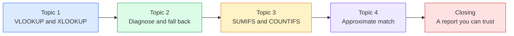
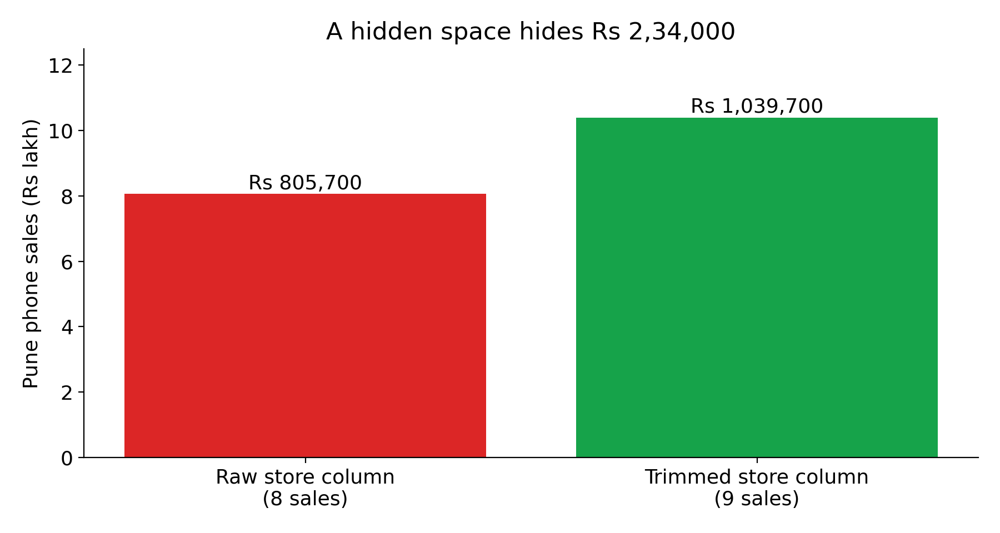
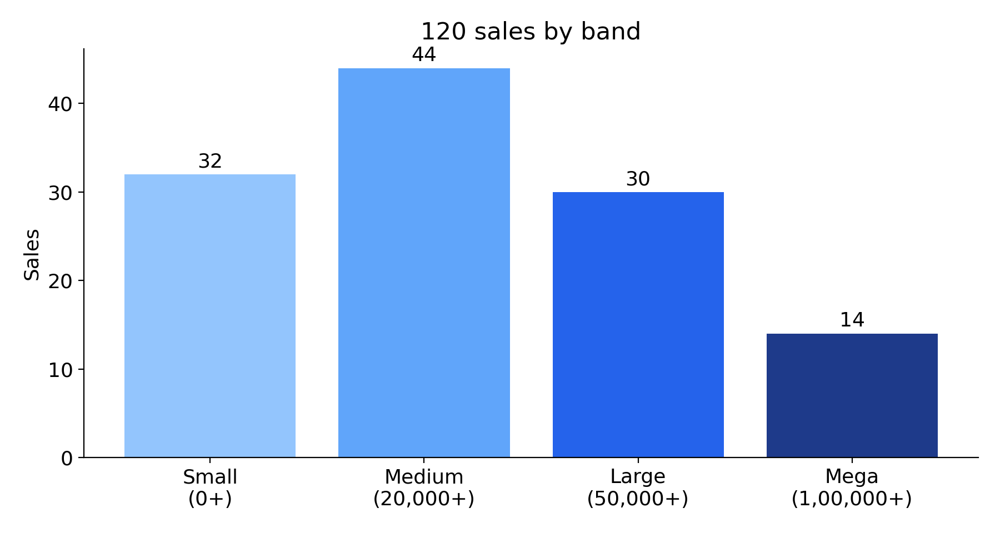

# <font color='#1d4ed8'>Lecture Script: Lookup Functions and Conditional Aggregation (Google Sheets)</font>

---

## <font color='blue'>Agenda</font>

The lecture runs as four topics. Each topic ends with a quiz.

| Topic | What we do | Learning objectives covered | Minutes |
|:-:|:--|:--|:-:|
| 1 | Bring product names into the sales tab | Write a VLOOKUP that returns a value from another table on an exact match<br>Write an XLOOKUP that returns a value with an explicit not-found result | 30 |
| 2 | Find out why a lookup says #N/A, and show a readable message | Diagnose a lookup returning #N/A caused by trailing spaces or a type mismatch<br>Write a formula wrapped in IFERROR or IFNA that returns a readable fallback | 25 |
| 3 | Total and count with several conditions | Write a conditional aggregation using SUMIFS or COUNTIFS over multiple criteria | 30 |
| 4 | Assign a band from a threshold table | Write an approximate-match lookup that assigns a band from a threshold table | 20 |
| — | Closing: Outcome & Summary | | 15 |
| | **Total** | | **120** |

> <font color="red">**🎯 Instructor Note**</font> Pace: spend the time on the #N/A diagnosis in Topic 2 and on `SUMIFS` in Topic 3. Keep `VLOOKUP` and `XLOOKUP` to one example each, because learners meet them again in the dashboard session.
> Import `data/sales.csv`, `data/products.csv`, `data/stores.csv` and `data/bands.csv` as four tabs named sales, products, stores and bands in one Google Sheet. Keep "Convert text to numbers, dates and formulas" **ticked**, so the SKUs arrive as numbers.

---

## <font color='blue'>Scenario</font>

A Croma-style electronics chain exports 120 sales from March 2026. The sales head wants product names, store managers, totals by store and category, and a size band for every sale.

| Tab | Rows | Key columns |
|:--|:-:|:--|
| sales | 120 | A sale_id, B sku, C store, D qty, E amount_rs |
| products | 10 | A sku, B product_name, C category, D mrp_rs |
| stores | 4 | A store, B manager, C monthly_target_rs |
| bands | 4 | A from_amount_rs, B band (0 Small, 20,000 Medium, 50,000 Large, 1,00,000 Mega) |

> <font color="red">**🎯 Instructor Note**</font> Croma is only the setting. Do not claim it uses these tabs or prices. The 120 sales, 10 products and 4 stores are invented for teaching. Three sales carry SKU 2199, which is not in the products tab. Nine store names have a trailing space.

---

## <font color='blue'>Problem Statement</font>

The sales head built her report with lookups and got three surprises. The manager column showed `#N/A` in 9 rows, although every store was in the stores tab. The product-name column showed `#N/A` for 3 sales, and nobody knew whether that was a bug. The "Pune phone sales" total was Rs 8,05,700, and the true figure was Rs 10,39,700, because 3 Pune rows had a hidden space. And a hand-typed "size" label put a Rs 50,000 sale in the wrong band.

> <font color='purple'>**How do we fetch data from another table, find out why a lookup fails, show a clear message instead of an error, add up with several conditions, and assign bands from a threshold table?**</font>

> <font color="red">**🎯 Instructor Note**</font> Poll: "A `VLOOKUP` with exact match looks for `Chennai ` (with a trailing space), and the table holds `Chennai`. What does it return?" Options: the manager's name, `#N/A`, or a blank. Give learners 30 seconds to respond in chat. Reveal the answer in the Closing.

---

## <font color='blue'>What We Will Use</font>

Last time you stacked tabs, wrote nested `IF` formulas and read limits from another tab with `Tab!Cell`. Today you fetch whole rows by a key, and you use `TRIM` and `VALUE` again from the cleaning session.

| Topic | Tools | In one line |
|:-:|:--|:--|
| 1 | `VLOOKUP`, `XLOOKUP` | Fetch a value from another table by a key |
| 2 | `LEN`, `TRIM`, `ISNUMBER`, `VALUE`, `IFNA`, `IFERROR` | Find the cause of `#N/A` and show a fallback |
| 3 | `SUMIFS`, `COUNTIFS` | Add or count rows that meet several conditions |
| 4 | `VLOOKUP` with `TRUE`, `XLOOKUP` with `-1` | Pick the band whose threshold a number has passed |

---

## <font color='blue'>How: Walking Through the Sales Report</font>



---

## <font color='blue'>Topic 1: Bring product names into the sales tab</font> `30 min`

> <font color='purple'>**The sales tab has only SKU numbers. The names sit in the products tab. How do we bring them across without typing?**</font>

### <font color='green'>Example: VLOOKUP on an exact match</font>

> <font color='purple'>**What is the product name of the SKU in row 2?**</font>

`VLOOKUP(key, table, column_number, FALSE)` takes the key, finds it in the first column of the table, and returns the value from the column number you give. `FALSE` asks for an exact match. In the sales tab, write `product_name` in F1 and in F2:

```text
=VLOOKUP(B2, products!$A$2:$D$11, 2, FALSE)
```

**Predict before you press Enter: What will happen?**

> <font color="red">**🎯 Instructor Note**</font> Expected: row 2 has SKU 2104, so the result is `Phone Lite`. Ask why `$` signs are used. Expected: the table must stay fixed when the formula is copied down.

**Output**

```text
Row 2 (SKU 2104): Phone Lite
Row 3 (SKU 2105): Laptop 15
Row 13 (SKU 2199): #N/A
```

#### <font color='#c2410c'>Code Explanation</font>

- **`B2`** is the key: the SKU in this row.
- **`products!$A$2:$D$11`** is the table. The key is searched in its first column (column A). The `$` locks the range.
- **`2`** returns from the second column of the table, `product_name`.
- **`FALSE`** means exact match only.

> <font color='green'>**Result**</font> Copy the formula down. 117 rows show a product name and 3 rows show `#N/A`: S012, S048 and S089, which carry SKU 2199.

### <font color='green'>Example: XLOOKUP with a not-found result</font>

> <font color='purple'>**How do we get the name and the category, and show a clear word when the SKU is missing?**</font>

`XLOOKUP(key, lookup_range, return_range, not_found)` looks in one range and returns from another. It needs no column number, and its fourth part is the text to show when nothing is found. In G1 write `category` and in G2:

```text
=XLOOKUP(B2, products!$A$2:$A$11, products!$C$2:$C$11, "Not in catalogue")
```

**Predict before you press Enter: What will happen?**

> <font color="red">**🎯 Instructor Note**</font> Expected: `Phone` in row 2, `Computing` in row 3 and `Not in catalogue` in row 13.

**Output**

```text
Row 2:  Phone
Row 3:  Computing
Row 13: Not in catalogue
```

> <font color='green'>**Result**</font> `XLOOKUP` returns the category and shows `Not in catalogue` for the 3 sales of SKU 2199. If someone inserts a column in the products tab, `XLOOKUP` still works. A `VLOOKUP` column number would now point to the wrong column.

> <font color='#b45309'>**Common mistake**</font> Using `TRUE` or leaving out the last part of `VLOOKUP`. The match becomes approximate and can return a wrong product without any error.

### <font color='purple'>Quiz 1</font>

**Question:** Which formula returns the text "Not in catalogue" when the SKU in B2 is missing from the products tab?

**Options:**
- A) `=VLOOKUP(B2, products!$A$2:$D$11, 2, TRUE)`
- B) `=XLOOKUP(B2, products!$A$2:$A$11, products!$C$2:$C$11)`
- C) `=XLOOKUP(B2, products!$A$2:$A$11, products!$C$2:$C$11, "Not in catalogue")`
- D) `=VLOOKUP(B2, products!$A$2:$D$11, 2)`

**Correct Answer:** C

**Explanation:**
- **A)** `TRUE` asks for an approximate match, and there is no text for a missing SKU.
- **B)** Without the fourth part, a missing SKU gives `#N/A`.
- **C)** The fourth part is the text shown when nothing is found.
- **D)** Without `FALSE` the match is approximate, and a missing SKU is not named.

---

## <font color='blue'>Topic 2: Find out why a lookup says #N/A, and show a readable message</font> `25 min`

> <font color='purple'>**The manager column shows `#N/A` in 9 rows, though every store is in the stores tab. What is wrong?**</font>

### <font color='green'>Example: Diagnose a trailing space</font>

> <font color='purple'>**Why does row 5, store `Chennai `, find no manager?**</font>

`#N/A` means "not available": the key was not found. A lookup compares text exactly, so a hidden trailing space makes `Chennai ` different from `Chennai`. In H1 write `manager` and in H5 write:

```text
=VLOOKUP(C5, stores!$A$2:$B$5, 2, FALSE)
```

**Predict before you press Enter: What will happen?**

> <font color="red">**🎯 Instructor Note**</font> Expected: `#N/A`. Ask learners how to see a trailing space. Expected: compare the length of the text with and without spaces.

**Output**

```text
#N/A
```

Check the length of the key and its trimmed version:

```text
=LEN(C5)
=LEN(TRIM(C5))
```

**Output**

```text
8
7
```

Now trim the key inside the lookup:

```text
=VLOOKUP(TRIM(C5), stores!$A$2:$B$5, 2, FALSE)
```

**Output**

```text
Ravi Kumar
```

> <font color='green'>**Result**</font> `Chennai ` has 8 characters and `Chennai` has 7. The hidden space was the whole problem. With `TRIM` inside the lookup, all 9 `#N/A` cells in column H turn into manager names.

### <font color='green'>Extending it: A type mismatch</font>

> <font color='purple'>**What if the key is the text "2104", and the products tab holds the number 2104?**</font>

> <font color="red">**🎯 Instructor Note**</font> Ask for a prediction. Expected: `#N/A`, since text and number are different types, even though both look like 2104.

```text
=VLOOKUP("2104", products!$A$2:$D$11, 2, FALSE)
=ISNUMBER("2104")
=VLOOKUP(VALUE("2104"), products!$A$2:$D$11, 2, FALSE)
```

**Output**

```text
#N/A
FALSE
Phone Lite
```

> <font color='green'>**Result**</font> A number and a text that looks like a number are not equal. `ISNUMBER` shows FALSE for the text. `VALUE` turns it into a number and the lookup works.

### <font color='green'>Extending it: Show a readable fallback</font>

> <font color='purple'>**What should the sales head see when a store really is missing?**</font>

`IFNA(formula, fallback)` shows the fallback only when the formula gives `#N/A`. `IFERROR(formula, fallback)` does the same for every kind of error.

> <font color="red">**🎯 Instructor Note**</font> Ask for a prediction. A store named `Goa` is not in the stores tab. Expected: `Store not found`. Prefer `IFNA` here. `IFERROR` would also hide a mistake such as a wrong range.

```text
=IFNA(VLOOKUP(TRIM(C5), stores!$A$2:$B$5, 2, FALSE), "Store not found")
=IFNA(VLOOKUP("Goa", stores!$A$2:$B$5, 2, FALSE), "Store not found")
```

**Output**

```text
Ravi Kumar
Store not found
```

> <font color='green'>**Result**</font> A found store shows the manager, and a missing store shows `Store not found`. The report stays readable and the real gaps are visible.

> <font color='#b45309'>**Common mistake**</font> Wrapping every lookup in `IFERROR(..., "")` to hide errors. A blank hides the cause. Find the cause first, then add a fallback.

### <font color='purple'>Quiz 2</font>

**Question:** `=VLOOKUP(C5, stores!$A$2:$B$5, 2, FALSE)` gives `#N/A` for `Chennai ` (with a trailing space). What is the best fix?

**Options:**
- A) `=VLOOKUP(TRIM(C5), stores!$A$2:$B$5, 2, FALSE)`
- B) Change `FALSE` to `TRUE`
- C) Sort the stores tab
- D) `=IFERROR(VLOOKUP(C5, stores!$A$2:$B$5, 2, FALSE), "")`

**Correct Answer:** A

**Explanation:**
- **A)** `TRIM` removes the trailing space, so the key matches `Chennai`.
- **B)** `TRUE` makes the match approximate. It can return a wrong manager.
- **C)** Sorting does not change the hidden space.
- **D)** It hides the error and leaves the cause in place.

---

## <font color='blue'>Topic 3: Total and count with several conditions</font> `30 min`

> <font color='purple'>**The sales head asks, "How much did Pune sell in the Phone category?" That is a total with two conditions. How do we get it?**</font>

### <font color='green'>Example: SUMIFS over two criteria</font>

> <font color='purple'>**What is the total amount for Pune in the Phone category?**</font>

`SUMIFS(sum_range, criteria_range1, criterion1, criteria_range2, criterion2, ...)` adds the amounts of rows where all conditions are true. Put the cleaned store name in column J first. In J1 write `store_clean` and in J2 `=TRIM(C2)`, then copy down.

**Predict before you press Enter: What will happen?**

> <font color="red">**🎯 Instructor Note**</font> Expected: the raw column gives a lower figure, because 3 Pune rows have a trailing space. Ask learners to guess which is bigger.

```text
=SUMIFS(E2:E121, C2:C121, "Pune", G2:G121, "Phone")
=SUMIFS(E2:E121, J2:J121, "Pune", G2:G121, "Phone")
```

**Output**

```text
805700
1039700
```

#### <font color='#c2410c'>Code Explanation</font>

- **`E2:E121`** is the range that is added: `amount_rs`.
- **`C2:C121, "Pune"`** is the first condition. The raw store column misses the rows that read `Pune `.
- **`G2:G121, "Phone"`** is the second condition: category Phone.
- **`J2:J121`** is the trimmed store, so all 9 Pune phone sales match.

> <font color='green'>**Result**</font> The raw version gives Rs 8,05,700 over 8 sales. The cleaned version gives Rs 10,39,700 over 9 sales. The missing Rs 2,34,000 was one sale with a trailing space.

<p align="center"></p>

### <font color='green'>Extending it: COUNTIFS and a number condition</font>

> <font color='purple'>**How many Delhi sales were Rs 50,000 or more, and what do they add up to?**</font>

> <font color="red">**🎯 Instructor Note**</font> Ask for a prediction. A condition on a number is written inside quotes with the operator: `">=50000"`. Expected: 8 sales.

```text
=COUNTIFS(J2:J121, "Delhi", E2:E121, ">=50000")
=SUMIFS(E2:E121, J2:J121, "Delhi", E2:E121, ">=50000")
```

**Output**

```text
8
608100
```

> <font color='green'>**Result**</font> Delhi had 8 big sales worth Rs 6,08,100. `COUNTIFS` counts rows and `SUMIFS` adds the amounts, with the same conditions.

> <font color='#b45309'>**Common mistake**</font> Putting the sum range after the conditions, as in the old `SUMIF`. In `SUMIFS` the range to add comes first.

### <font color='purple'>Quiz 3</font>

**Question:** Which formula gives the total amount for Pune in the Phone category, using the cleaned store column J and category column G?

**Options:**
- A) `=SUMIF(J2:J121, "Pune", G2:G121, "Phone")`
- B) `=SUMIFS(J2:J121, "Pune", G2:G121, "Phone", E2:E121)`
- C) `=COUNTIFS(J2:J121, "Pune", G2:G121, "Phone")`
- D) `=SUMIFS(E2:E121, J2:J121, "Pune", G2:G121, "Phone")`

**Correct Answer:** D

**Explanation:**
- **A)** `SUMIF` takes one condition. This call is not valid.
- **B)** The range to add must come first, not last.
- **C)** `COUNTIFS` counts the sales. It does not add the amounts.
- **D)** The amount range comes first, then each condition range with its condition.

---

## <font color='blue'>Topic 4: Assign a band from a threshold table</font> `20 min`

> <font color='purple'>**Every sale needs a size band: Small, Medium, Large or Mega. The bands start at 0, 20,000, 50,000 and 1,00,000. How do we pick the right one without a long `IF`?**</font>

### <font color='green'>Example: Approximate match</font>

> <font color='purple'>**Which band does each sale fall into?**</font>

An **approximate match** finds the largest threshold that is less than or equal to the number. For `VLOOKUP`, the last argument is `TRUE`. The first column of the bands table must be sorted from small to large. In I1 write `band` and in I2:

```text
=VLOOKUP(E2, bands!$A$2:$B$5, 2, TRUE)
```

`XLOOKUP` does the same with a match mode of `-1`, which means "exact match or the next smaller":

```text
=XLOOKUP(E2, bands!$A$2:$A$5, bands!$B$2:$B$5, "", -1)
```

**Predict before you press Enter: What will happen?**

> <font color="red">**🎯 Instructor Note**</font> Expected: S030 has exactly Rs 50,000 and falls in Large. S031 has exactly Rs 20,000 and falls in Medium. A threshold belongs to its own band.

**Output**

```text
S001 (13,775):  Small
S002 (62,700):  Large
S004 (46,800):  Medium
S030 (50,000):  Large
S031 (20,000):  Medium
```

#### <font color='#c2410c'>Logic Explanation</font>

- **Rs 13,775** has passed 0 and not 20,000, so the band is Small.
- **Rs 46,800** has passed 20,000 and not 50,000, so the band is Medium.
- **Rs 50,000** has reached the 50,000 threshold, so the band is Large.
- **Rs 62,700** has passed 50,000 and not 1,00,000, so the band is Large.

> <font color='green'>**Result**</font> Over the 120 sales the bands count as Small 32, Medium 44, Large 30 and Mega 14. One short formula replaced a long `IF`, and the thresholds live in the bands tab.

<p align="center"></p>

> <font color='#b45309'>**Common mistake**</font> Using `FALSE` here. An exact match looks for 13,775 in the bands table, does not find it and gives `#N/A`. Banding needs `TRUE`, or the `-1` mode of `XLOOKUP`, and a sorted table.

### <font color='purple'>Quiz 4</font>

**Question:** The bands table has 0 Small, 20,000 Medium, 50,000 Large and 1,00,000 Mega. What does `=VLOOKUP(50000, bands!$A$2:$B$5, 2, TRUE)` return?

**Options:**
- A) Medium
- B) Large
- C) Mega
- D) #N/A

**Correct Answer:** B

**Explanation:**
- **A)** Medium is the band for amounts from 20,000 up to 49,999.
- **B)** 50,000 has reached the 50,000 threshold, so it belongs to Large.
- **C)** Mega starts only at 1,00,000.
- **D)** An approximate match finds the largest threshold not above 50,000, so there is no error.

---

## <font color='blue'>Closing: Outcome & Summary</font> `15 min`

Back to the sales head's report. All four surprises now have an answer.

> <font color='purple'>**1. Why did 9 managers and 3 product names fail, and what did we do about each?**</font>

The 9 manager lookups failed because of a trailing space, found with `LEN` and fixed with `TRIM` (Topic 2). The 3 product names failed because SKU 2199 is not in the products tab. `XLOOKUP` now says `Not in catalogue` (Topic 1), and `IFNA` shows `Store not found` for a missing store (Topic 2).

> <font color='purple'>**2. What are the right totals, and how is each sale banded?**</font>

Pune phone sales are Rs 10,39,700 with the trimmed store column (Topic 3). Delhi had 8 sales of Rs 50,000 or more, worth Rs 6,08,100 (Topic 3). The bands tab gives each sale a band, with 32 Small, 44 Medium, 30 Large and 14 Mega (Topic 4).

### <font color='green'>Outcome</font>

| | Before | After |
|:--|:-:|:-:|
| Manager lookups | 9 `#N/A` | 0, after `TRIM` |
| Product-name gaps | 3 `#N/A`, cause unknown | 3 labelled `Not in catalogue` |
| Pune phone sales | Rs 8,05,700 | Rs 10,39,700 |
| Size band | Typed by hand | One `VLOOKUP` from the bands tab |

> <font color='green'>**Therefore,**</font> a lookup fails when the key is not an exact match, so check spaces and types before you add a fallback. Use `XLOOKUP` with a not-found text, `IFNA` for readable gaps, `SUMIFS` and `COUNTIFS` for totals with several conditions, and an approximate match for bands.

> <font color="red">**🎯 Instructor Note**</font> Reveal the poll: `#N/A`. With an exact match, `Chennai ` and `Chennai` are different texts. Show `LEN` once more if needed.

### <font color='green'>Summary</font>

| Learning objective | Takeaway |
|:--|:--|
| VLOOKUP exact match | Key, table, column number and `FALSE`. The key is searched in the first column |
| XLOOKUP with not-found result | Lookup range, return range and a not-found text, with no column number |
| Diagnose `#N/A` | Check hidden spaces with `LEN` and `TRIM`, and types with `ISNUMBER` and `VALUE` |
| IFNA and IFERROR | `IFNA` shows a fallback only for `#N/A`. `IFERROR` hides every error |
| SUMIFS and COUNTIFS | The range to add comes first, then each condition range and condition |
| Approximate-match band | `TRUE` or `-1` on a sorted threshold table gives the band that a number has reached |
| **Practical value** | Reports built on lookups show clear messages and totals that match the data |

---

# <font color='red'>Launch the Feedback Poll</font>

> <font color="red">**🎯 Instructor Note**</font> Reminder: launch the feedback poll now to collect learner feedback.
