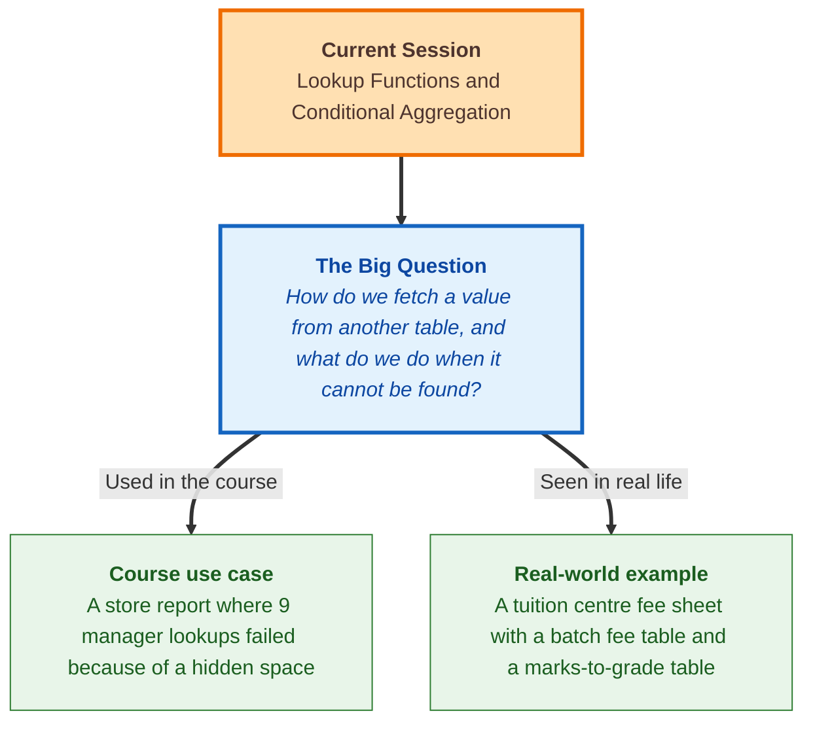

## Lookup Functions and Conditional Aggregation

### Mental Map

---

### What You'll Learn

Have you ever wondered how a tuition centre finds each student's fee from a batch code?

By the end of this session, you will be able to:

- **Name** the batch code that links a student to the fee table.
- **Explain** why 'B2 ' with a space finds no fee.
- **Examine** a fee lookup that shows #N/A for the student of batch 'B2 '.
- **Calculate** the total fee collected for batch B2 in March.
- **Determine** the grade for marks of 74 using the grade table.
- **Write** a message that appears when a batch code is missing.

> **Topics you will meet:** VLOOKUP, XLOOKUP, fixing #N/A in lookups, IFERROR, SUMIFS and COUNTIFS, banding with a lookup.
>
> Join the session to learn each of these in detail.

---

### Why You Are Learning This Topic

Nisha manages a tuition centre. A fee table lists each batch code and its fee. Her student sheet lists a batch code for each student. For 5 students the fee shows #N/A. The codes look the same. One code has a space after it. Nisha also needs a grade for each student from their marks.

A **lookup** means finding a value in one table by matching a key from another table.

In this course, you will fetch values by key and check why a lookup fails.

> **Think about it:** Why does a code that looks the same find no fee?

---

### Tuition Centre Puzzle

Here are the two small tables.

| Batch | Fee | | Marks from | Grade |
|:----------:|:----------:|:----------:|:----------:|:----------:|
| B1 | Rs 1,200 | | 0 | C |
| B2 | Rs 1,500 | | 50 | B |
| B3 | Rs 1,800 | | 70 | A |

**What you want to happen:**

- Each student gets the fee of their batch.
- A missing batch shows a clear message.
- Marks of 74 get a grade without a long rule.

> **Wonder about this:**
>
> - Why would 'B2' and 'B2 ' not match?
> - Which grade does a mark of exactly 70 get?

---

### Think It Through

There is no wrong first try. Keep your guesses for the session.

**1. A student is in batch B3. What fee should the lookup return?**
Hint: Find B3 in the first table.

**2. Marks of 74 fall between 70 and the next limit. Which grade is it?**
Hint: Pick the highest limit that 74 has reached.

**3. Two students pay in March for batch B2 at Rs 1,500 each. What is the total?**
Hint: Multiply the fee by the count.

---

### One Question to Carry Into the Session

> **What can go wrong when two tables should match and look the same?**
>
> Which key in Nisha's sheet would you check first for a hidden space?
