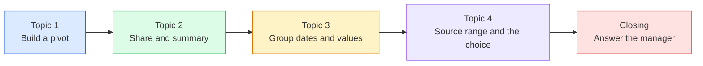
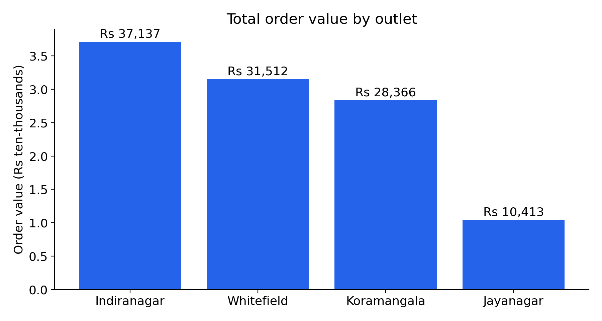
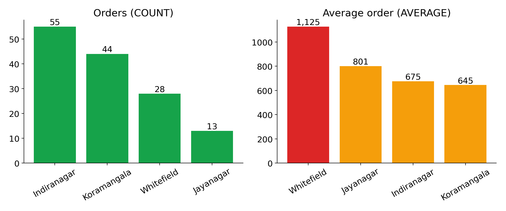
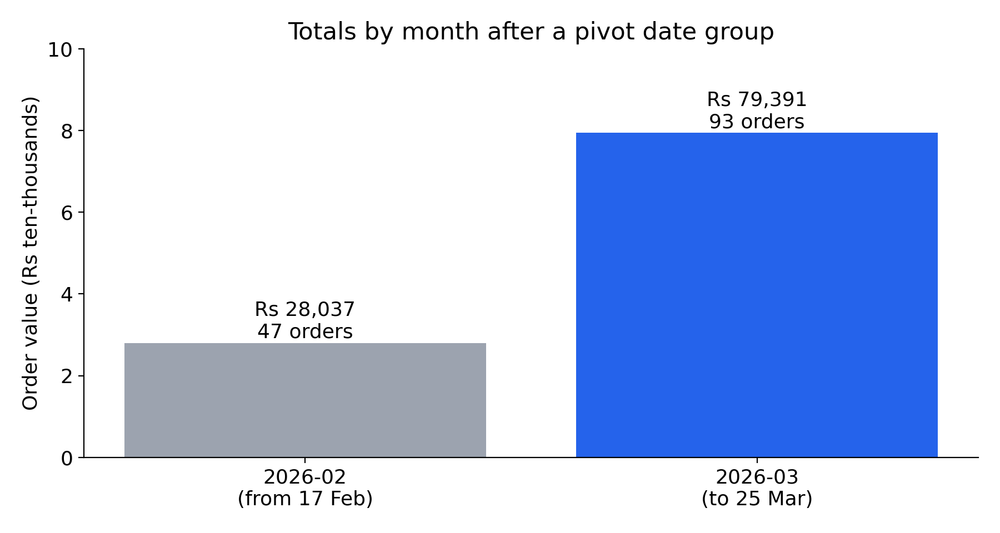

# <font color='#1d4ed8'>Lecture Script: Pivot Tables and Analysis (Google Sheets)</font>

---

## <font color='blue'>Agenda</font>

The lecture runs as four topics. Each topic ends with a quiz.

| Topic | What we do | Learning objectives covered | Minutes |
|:-:|:--|:--|:-:|
| 1 | Build a pivot table of sales by outlet and channel | Build a pivot table that aggregates a measure by one or more categories | 30 |
| 2 | Show a share, and change the summary | Configure a pivot value field to show a percentage of total or a different summary function | 25 |
| 3 | Group dates and values | Aggregate pivot rows into date periods or numeric bins using grouping | 25 |
| 4 | Keep the pivot current, and choose pivot or lookup | Explain why a pivot table does not reflect newly added source rows until it is refreshed<br>Select between a lookup formula and a pivot table, justifying by whether the output is per-row or summarised | 25 |
| — | Closing: Outcome & Summary | | 15 |
| | **Total** | | **120** |

> <font color="red">**🎯 Instructor Note**</font> Pace: spend the time on building and reading the first pivot in Topic 1, and on the outlier in Topic 2. Keep the numeric bins in Topic 3 short.
> Import `data/pizza_orders.csv` into a Google Sheet with "Convert text to numbers, dates and formulas" **ticked**, so `order_date` becomes a real date.

---

## <font color='blue'>Scenario</font>

A Domino's India-style pizza chain has 4 outlets in one city. The area manager sends one question on Monday 30 March 2026: **"Which outlet sells the most, and what share of our sales is that?"**

| Column | Holds |
|:--|:--|
| order_id | D001 to D140 |
| order_date | 17 February to 25 March 2026 |
| outlet | Indiranagar, Koramangala, Whitefield, Jayanagar |
| channel | App, Phone, Walk-in |
| category | Pizza, Sides, Drinks, Dessert |
| order_value | Rupees |

> <font color="red">**🎯 Instructor Note**</font> Domino's India is only the setting. Do not claim it keeps data like this. The 140 orders are invented for teaching, with one Rs 8,500 catering order in Whitefield.

---

## <font color='blue'>Problem Statement</font>

An analyst answered the manager with four separate formulas, one per outlet, and an average order value. The average said Whitefield was best, at Rs 1,125 an order, compared with Rs 675 in Indiranagar. But one single catering order of Rs 8,500 had lifted that average. Next week the analyst added 2 days of new orders under the data, and the summary did not change. The manager could not tell which outlet sold the most, or what share each held.

> <font color='purple'>**How do we summarise 140 orders in one table, show shares, group by month, keep the table current, and decide between a pivot table and a lookup?**</font>

> <font color="red">**🎯 Instructor Note**</font> Poll: "A pivot table uses the source range A1:F141. You type a new order in row 142. Does the pivot total change?" Options: yes at once, no, or it shows an error. Give learners 30 seconds to respond in chat. Reveal the answer in the Closing.

---

## <font color='blue'>What We Will Use</font>

Last time you used `SUMIFS` to total with conditions. A pivot table does the same job for every category at once, with no formulas.

| Topic | Tools | In one line |
|:-:|:--|:--|
| 1 | Insert, Pivot table | Drag a column into Rows, Columns and Values |
| 2 | Summarize by, Show as | Change the summary, or show a percentage of the total |
| 3 | Pivot date group, grouping of numbers | Roll dates into months and values into bins |
| 4 | Edit range, `XLOOKUP` | Keep the source range current, and choose between pivot and lookup |

---

## <font color='blue'>How: Walking Through the Outlet Question</font>



---

## <font color='blue'>Topic 1: Build a pivot table of sales by outlet and channel</font> `30 min`

> <font color='purple'>**One table, 140 rows. How do we get one line per outlet, without writing a formula for each?**</font>

### <font color='green'>Example: Total order value by outlet</font>

> <font color='purple'>**How much did each outlet sell?**</font>

A **pivot table** summarises rows into groups. You choose what to group by (Rows), what to spread across (Columns) and what to add up (Values). Steps:

```text
Select A1:F141
Insert > Pivot table > New sheet > Create
Rows: Add > outlet, Order Descending, Sort by SUM of order_value
Values: Add > order_value, Summarize by SUM
```

**Predict before you build it: What will happen?**

> <font color="red">**🎯 Instructor Note**</font> Expected: 4 rows plus a Grand Total of 107,428. Indiranagar is first. Ask which outlet will be last: Jayanagar.

**Output**

```text
outlet         SUM of order_value
Indiranagar    37,137
Whitefield     31,512
Koramangala    28,366
Jayanagar      10,413
Grand Total    107,428
```

#### <font color='#c2410c'>Code Explanation</font>

- **Rows: outlet** gives one row for each outlet.
- **Values: order_value, SUM** adds the order values of each outlet's rows.
- **Grand Total** adds the four outlets. It equals the sum of the whole column.

> <font color='green'>**Result**</font> Indiranagar sells the most, with Rs 37,137. The four outlets add up to Rs 1,07,428. The sort order is yours to choose in the pivot editor, under Sort by.

<p align="center"></p>

### <font color='green'>Extending it: Add a second category</font>

> <font color='purple'>**How does each outlet's total split across App, Phone and Walk-in?**</font>

> <font color="red">**🎯 Instructor Note**</font> Ask for a prediction. Add `channel` under Columns. Expected: App is the largest channel in every outlet except Whitefield, where Phone is nearly as large.

**Output**

```text
outlet         App      Phone    Walk-in   Grand Total
Indiranagar    19,881   6,224    11,032    37,137
Jayanagar      8,434    585      1,394     10,413
Koramangala    19,246   3,673    5,447     28,366
Whitefield     13,634   12,431   5,447     31,512
Grand Total    61,195   22,913   23,320    107,428
```

> <font color='green'>**Result**</font> The App brings Rs 61,195 of the Rs 1,07,428. Whitefield's Phone total of Rs 12,431 stands out: it holds the Rs 8,500 catering order.

### <font color='purple'>Quiz 1</font>

**Question:** In a pivot table, Rows is `outlet` and Values is the SUM of `order_value`. What does each row show?

**Options:**
- A) One order
- B) The number of orders in an outlet
- C) The average order of an outlet
- D) The total order value of one outlet

**Correct Answer:** D

**Explanation:**
- **A)** A pivot table summarises rows. It does not list each order.
- **B)** That would be the summary `COUNT`, not `SUM`.
- **C)** That would be the summary `AVERAGE`, not `SUM`.
- **D)** `SUM` adds the order values of all rows for that outlet.

---

## <font color='blue'>Topic 2: Show a share, and change the summary</font> `25 min`

> <font color='purple'>**The manager asked for a share. And the average said Whitefield was best. How do we get both from the pivot?**</font>

### <font color='green'>Example: Percentage of the grand total</font>

> <font color='purple'>**What share of all sales does each outlet hold?**</font>

In the pivot editor, under the Values field, open **Show as** and choose **% of grand total**. The values change from rupees to shares. The share is $\dfrac{\text{outlet total}}{\text{grand total}}\times 100$.

**Predict before you change it: What will happen?**

> <font color="red">**🎯 Instructor Note**</font> Expected: the four shares add up to 100 percent. Indiranagar is $37{,}137 \div 107{,}428 = 34.6\%$.

**Output**

```text
outlet         % of grand total
Indiranagar    34.6%
Whitefield     29.3%
Koramangala    26.4%
Jayanagar      9.7%
Grand Total    100.0%
```

> <font color='green'>**Result**</font> Indiranagar holds 34.6 percent of sales, and Jayanagar 9.7 percent. The manager's question is answered.

### <font color='green'>Extending it: A different summary function</font>

> <font color='purple'>**What do COUNT and AVERAGE say about each outlet?**</font>

Add `order_value` as a Values field twice more. Set one to **COUNT** and one to **AVERAGE** (Summarize by), and set Show as back to Default.

> <font color="red">**🎯 Instructor Note**</font> Ask for a prediction. Expected: Whitefield has the highest average and the second-lowest count. One Rs 8,500 order lifted its average.

**Output**

```text
outlet         COUNT   AVERAGE
Indiranagar    55      675.22
Whitefield     28      1,125.43
Koramangala    44      644.68
Jayanagar      13      801.00
```

<p align="center"></p>

> <font color='green'>**Result**</font> Whitefield's average of Rs 1,125.43 comes from 28 orders and one Rs 8,500 order. Without that order, its average is Rs 852.30. Read an average together with the count.

> <font color='#b45309'>**Common mistake**</font> Reading an average as typical when one large value is in the group. Show COUNT next to AVERAGE and look for the outlier.

### <font color='purple'>Quiz 2</font>

**Question:** Whitefield's average order is Rs 1,125, but it has only 28 orders and one order of Rs 8,500. Which statement is correct?

**Options:**
- A) Whitefield has the most customers
- B) The one large order raised the average, so read the average with the count
- C) The pivot table has an error
- D) The average is always the most reliable summary

**Correct Answer:** B

**Explanation:**
- **A)** Whitefield has 28 orders, fewer than Indiranagar's 55 and Koramangala's 44.
- **B)** One Rs 8,500 order lifts the average. Without it the average is Rs 852.30.
- **C)** The pivot is correct. It reports what the data holds.
- **D)** An average is sensitive to a single large value.

---

## <font color='blue'>Topic 3: Group dates and values</font> `25 min`

> <font color='purple'>**The manager now asks, "How did February compare with March?" The pivot has 37 separate dates. How do we roll them into months?**</font>

### <font color='green'>Example: Group dates by month</font>

> <font color='purple'>**How much was sold in February and in March?**</font>

Put `order_date` in Rows. Right-click a date in the pivot and choose **Create pivot date group**, then **Year-Month**. The 37 dates become 2 months. (Choose **Day of week** to compare Mondays with Sundays.)

**Predict before you group: What will happen?**

> <font color="red">**🎯 Instructor Note**</font> Expected: 2 rows, 2026-02 and 2026-03. The data starts on 17 February, so February holds only 12 days of orders.

**Output**

```text
order_date (Year-Month)   SUM of order_value   COUNT of order_id
2026-02                   28,037               47
2026-03                   79,391               93
Grand Total               107,428              140
```

> <font color='green'>**Result**</font> March has Rs 79,391 over 93 orders and February has Rs 28,037 over 47. The March figure is not "growth", because February holds only 12 days of data.

<p align="center"></p>

### <font color='green'>Extending it: Group values into bins</font>

> <font color='purple'>**How many orders are small, medium and large?**</font>

The same idea works for numbers. Put `order_value` in Rows and group it into bins of width 200. Count orders per bin.

> <font color="red">**🎯 Instructor Note**</font> Check the menu on your own account first. In recent versions of Sheets, right-click a number in the pivot and use the grouping option for numbers. If your menu differs, make a helper column with the approximate-match lookup from last session and pivot on that. Expected counts are in the table below.

**Output**

```text
Order value     COUNT of order_id
0 to 199        33
200 to 399      29
400 to 599      21
600 and above   57
Grand Total     140
```

> <font color='green'>**Result**</font> 57 of the 140 orders are Rs 600 or more, and 33 are under Rs 200. Bins turn a long list of values into a shape.

### <font color='purple'>Quiz 3</font>

**Question:** The pivot has 37 order dates in Rows. Which action gives one row for February and one for March?

**Options:**
- A) Sort the dates A to Z
- B) Change the summary to COUNT
- C) Create a pivot date group by Year-Month
- D) Add `channel` to Columns

**Correct Answer:** C

**Explanation:**
- **A)** Sorting changes the order, not the number of rows.
- **B)** COUNT changes the summary. There would still be 37 date rows.
- **C)** A date group by Year-Month rolls the dates into months.
- **D)** Adding Columns splits the table further. It does not group dates.

---

## <font color='blue'>Topic 4: Keep the pivot current, and choose pivot or lookup</font> `25 min`

> <font color='purple'>**Two days of new orders were added, and the pivot stayed the same. And a colleague asks, "Should I use a lookup or a pivot?" What is the answer to each?**</font>

### <font color='green'>Example: The source range</font>

> <font color='purple'>**Why does a new row 142 not appear in the pivot?**</font>

A pivot table reads a **source range**, here `A1:F141`. In Google Sheets, a pivot updates by itself when cells inside that range change. A row added below the range is outside what it reads, so it is left out until the range is extended. (In Excel, the same gap is closed by clicking Refresh.) Add a new order in row 142: `D141, 2026-03-26, Indiranagar, App, Pizza, 1200`.

**Predict before you extend the range: What will happen?**

> <font color="red">**🎯 Instructor Note**</font> Expected: the Grand Total stays 107,428 until the range changes. Then it becomes 108,628.

**Output**

```text
Before extending the range:  Grand Total 107,428
In the pivot editor: Data range > A1:F142
After extending the range:   Grand Total 108,628   (Indiranagar 38,337)
```

> <font color='green'>**Result**</font> The new order is counted only after the range includes row 142. To avoid this, give the pivot whole columns, such as `A:F`, as its range.

> <font color='#b45309'>**Common mistake**</font> Trusting a pivot after adding data below its range. Check the Grand Total against `=SUM(F:F)` on the source.

### <font color='green'>Extending it: Lookup or pivot?</font>

> <font color='purple'>**Which tool answers each of these requests?**</font>

> <font color="red">**🎯 Instructor Note**</font> Take answers in chat before showing the table. The rule: if the answer has one result per source row, use a lookup. If it has one result per group, use a pivot.

| Request | Output | Tool | Why |
|:--|:--|:--|:--|
| Show each order with its outlet manager's name | 140 rows, one per order | Lookup (`XLOOKUP`) | Each row gets its own value |
| Total sales per outlet | 4 rows, one per outlet | Pivot table | The rows are summarised into groups |
| Look up the manager of one outlet | 1 value | Lookup | A single fetch by key |
| Sales per outlet per month | 8 cells | Pivot table | Two groupings, summarised |

> <font color='green'>**Result**</font> A lookup adds a value to every row. A pivot collapses many rows into a few. Choose by the shape of the output.

### <font color='purple'>Quiz 4</font>

**Question:** The pivot source range is `A1:F141`. You type a new order in row 142. What happens to the pivot's Grand Total?

**Options:**
- A) It stays the same, because row 142 is outside the source range
- B) It rises at once, because the pivot always reads the whole sheet
- C) It shows an error
- D) It doubles

**Correct Answer:** A

**Explanation:**
- **A)** The pivot reads only `A1:F141`. The range must be extended to include row 142.
- **B)** The pivot reads its own range, not the whole sheet.
- **C)** No error appears. The new row is simply not read.
- **D)** Nothing is counted twice.

---

## <font color='blue'>Closing: Outcome & Summary</font> `15 min`

Back to the area manager's question. We can answer it with a single table.

> <font color='purple'>**1. Which outlet sells the most, and what share is that?**</font>

Indiranagar sells the most, Rs 37,137, which is 34.6 percent of the total (Topics 1 and 2). Whitefield's higher average comes from one Rs 8,500 order, so the manager should read it with the count of 28 orders (Topic 2).

> <font color='purple'>**2. How do the months compare, and how do we keep the answer current?**</font>

March sold Rs 79,391 against February's Rs 28,037, but February holds only 12 days (Topic 3). Set the pivot's range to whole columns, so new orders appear (Topic 4).

### <font color='green'>Outcome</font>

| | Before | After |
|:--|:-:|:-:|
| Method | Four formulas and an average | One pivot table |
| Top outlet | Whitefield (by average Rs 1,125) | Indiranagar (by total Rs 37,137, 34.6 percent) |
| Months | Not shown | 2 rows by date group |
| New rows | Missed | Counted, with the range extended |

> <font color='green'>**Therefore,**</font> use a pivot table to summarise rows into groups, show shares with Show as, group dates and values, and keep the source range current. Use a lookup when each row needs its own value.

> <font color="red">**🎯 Instructor Note**</font> Reveal the poll: no, the total stays at 107,428 until the range is extended. Link it to the Common mistake in Topic 4.

### <font color='green'>Summary</font>

| Learning objective | Takeaway |
|:--|:--|
| Build a pivot table | Rows, Columns and Values give one table from many rows |
| Percentage and summary function | Show as % of grand total, and Summarize by SUM, COUNT or AVERAGE |
| Grouping | A date group rolls dates into months, and bins roll values into bands |
| Source range | A pivot reads its range only, so extend it or use whole columns |
| Lookup or pivot | A lookup gives one value per row, and a pivot gives one row per group |
| **Practical value** | One pivot answers "which and how much" for the whole table |

---

# <font color='red'>Launch the Feedback Poll</font>

> <font color="red">**🎯 Instructor Note**</font> Reminder: launch the feedback poll now to collect learner feedback.
