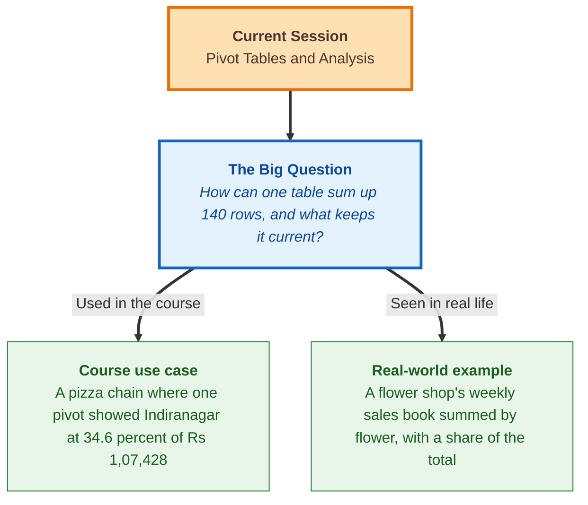

## Pivot Tables and Analysis

### Mental Map

---

### What You'll Learn

Have you ever wondered how a flower seller knows which flower earns the most without adding by hand?

By the end of this session, you will be able to:

- **Summarise** the week's sales by flower in one small table.
- **Calculate** the share of the total for each flower.
- **Compare** a sum with an average when one big order is in the group.
- **Explain** why a sale added below the table is missing from its totals.
- **Determine** when you need a summary table and when you need a value on every row.
- **Plan** a monthly view of the same sales book.

> **Topics you will meet:** build a pivot table, percent of total, group by date or number, pivot refresh and source range, lookup or pivot.
>
> Join the session to learn each of these in detail.

---

### Why You Are Learning This Topic

Geeta sells flowers. She notes every sale in a book: the flower, the day and the money. At the end of the week she wants the total for each flower. She adds by hand and takes an hour. A friend shows a summary table that does it in a second. On Saturday Geeta adds one more sale below the table, and the totals do not change.

A **pivot table** means a summary table that groups rows and adds them up for you.

In this course, you will summarise rows into groups and check the total against the source.

> **Think about it:** Why did the totals stay the same after Geeta added a new sale?

---

### Flower Book Puzzle

Here is part of Geeta's sales book.

| Flower | Day | Money |
|:----------:|:----------:|:----------:|
| Rose | Monday | Rs 300 |
| Jasmine | Monday | Rs 150 |
| Rose | Tuesday | Rs 450 |
| Marigold | Tuesday | Rs 100 |

**What you want to happen:**

- One line per flower with its total.
- Each flower's share of the week's money.
- The new Saturday sale appears in the totals.

> **Wonder about this:**
>
> - What is the share of roses if the four rows are the whole week?
> - What would a wedding order of Rs 8,000 do to an average?

---

### Think It Through

There is no wrong first try. Keep your guesses for the session.

**1. The four rows add up to Rs 1,000. What share of the money did roses bring?**
Hint: Add the two rose rows first.

**2. Which is easier to read for a week of 300 sales: the book or a summary by flower?**
Hint: Think about the count of lines you must read.

**3. Geeta wants the same book grouped by month. What would she group?**
Hint: Look at the Day column.

---

### One Question to Carry Into the Session

> **How can we sum a long list of rows and be sure no row was missed?**
>
> Which total in Geeta's summary would you check against the book first?
