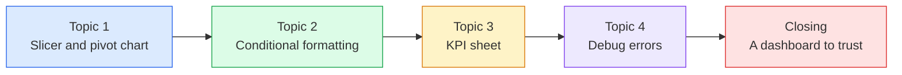
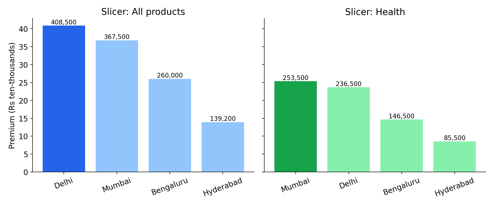
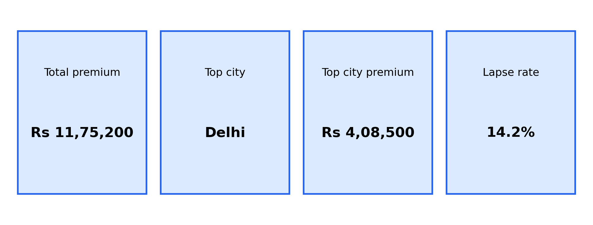

# <font color='#1d4ed8'>Lecture Script: Slicers and Spreadsheet Dashboards (Google Sheets)</font>

---

## <font color='blue'>Agenda</font>

The lecture runs as four topics. Each topic ends with a quiz.

| Topic | What we do | Learning objectives covered | Minutes |
|:-:|:--|:--|:-:|
| 1 | Filter a pivot with a slicer and chart it | Configure a slicer so a pivot table filters interactively<br>Build a pivot chart linked to a pivot table so it updates with the pivot | 30 |
| 2 | Highlight the rows that need a call | Apply conditional formatting that highlights rows meeting a stated rule | 20 |
| 3 | Build the KPI sheet | Build a KPI dashboard sheet driven by pivots and lookup formulas | 30 |
| 4 | Fix three broken formulas | Debug a formula returning #VALUE!, #DIV/0! or a circular reference | 25 |
| — | Closing: Outcome & Summary | | 15 |
| | **Total** | | **120** |

> <font color="red">**🎯 Instructor Note**</font> Pace: spend the time on the KPI sheet in Topic 3 and on the three error types in Topic 4. Keep the conditional formatting to one rule that learners can type from memory.
> Import `data/policies.csv` into a tab named policies, with "Convert text to numbers, dates and formulas" **ticked**. Build one pivot (Rows: city, Values: SUM of premium_rs) in a tab named pivot_city. Add a tab named dashboard.

---

## <font color='blue'>Scenario</font>

A PolicyBazaar-style insurance marketplace has 120 policies sold from January to March 2026. The head of sales wants **one dashboard sheet** that she can filter by product.

| What the dashboard must show | Where it comes from |
|:--|:--|
| Total premium | The pivot by city |
| Top city and its premium | The pivot by city, read with a lookup |
| Lapse rate | The policies tab |
| Policies that lapsed or are pending | Highlighted in the policies tab |
| A chart of premium by city | The pivot |

> <font color="red">**🎯 Instructor Note**</font> PolicyBazaar is only the setting. Do not claim it keeps data like this. The 120 policies are invented for teaching. One pending policy, P042, has the text `NA` in `premium_rs`. No policy is of the product Travel.

---

## <font color='blue'>Problem Statement</font>

The head of sales opened last month's dashboard and found three problems. The product filter changed the chart but not the "total premium" cell, so the two disagreed. The lapse-rate cell for a new product, Travel, showed `#DIV/0!`. The tax column showed `#VALUE!` on one row, and a "grand total" typed into its own range showed a circular error. She could not tell which numbers to trust, so she stopped using the sheet.

> <font color='purple'>**How do we build a dashboard that filters together, highlights what matters, reads from pivots, and shows no broken cells?**</font>

> <font color="red">**🎯 Instructor Note**</font> Poll: "A slicer is set to Health. A cell holds `=SUM(policies!E2:E121)`. Does its value change?" Options: yes, it drops to the Health total, no, it stays the same, or it shows an error. Give learners 30 seconds to respond in chat. Reveal the answer in the Closing.

---

## <font color='blue'>What We Will Use</font>

Last time you built pivot tables, grouped them and chose between a pivot and a lookup. Today you connect them to controls, formatting and a summary sheet, using the lookups, `IF` and `COUNTIFS` from earlier sessions.

| Topic | Tools | In one line |
|:-:|:--|:--|
| 1 | Data, Add a slicer; Insert, Chart | Filter a pivot with a button, and chart it |
| 2 | Format, Conditional formatting | Colour the rows that meet a rule |
| 3 | `SUM`, `MAX`, `XLOOKUP`, `COUNTIFS` on pivot cells | Show key numbers on one sheet |
| 4 | `IF`, `ISNUMBER`, error messages | Find the cause of `#DIV/0!`, `#VALUE!` and circular errors |

---

## <font color='blue'>How: Walking Through the Dashboard</font>



---

## <font color='blue'>Topic 1: Filter a pivot with a slicer and chart it</font> `30 min`

> <font color='purple'>**The head of sales wants to click "Health" and see only Health. How do we add a button for that?**</font>

### <font color='green'>Example: A slicer on the product column</font>

> <font color='purple'>**What does the pivot show when we pick Health?**</font>

A **slicer** is a filter control that sits on the sheet. It filters the source data, so every pivot and chart built on that data follows it. The pivot `pivot_city` has Rows: `city` and Values: SUM of `premium_rs`.

```text
Data > Add a slicer
Data range: policies!A1:G121
Column: product
Pick "Health" in the slicer
```

**Predict before you pick Health: What will happen?**

> <font color="red">**🎯 Instructor Note**</font> Expected: the pivot shrinks to Health policies only. Total 7,22,000 over 55 policies. The city order may change, as Mumbai takes the top.

**Output**

```text
Without the slicer          With the slicer on Health
city         SUM premium    city         SUM premium
Delhi        408,500        Mumbai       253,500
Mumbai       367,500        Delhi        236,500
Bengaluru    260,000        Bengaluru    146,500
Hyderabad    139,200        Hyderabad    85,500
Grand Total  1,175,200      Grand Total  722,000
```

> <font color='green'>**Result**</font> Choosing Health in the slicer filters the data, and the pivot recalculates. Health premium is Rs 7,22,000 and Mumbai, not Delhi, leads.

### <font color='green'>Extending it: A chart linked to the pivot</font>

> <font color='purple'>**How do we make a chart that changes when the slicer changes?**</font>

Select the pivot `A1:B5` and use **Insert > Chart**, choosing a column chart. The chart reads the pivot, so it moves whenever the pivot moves.

> <font color="red">**🎯 Instructor Note**</font> Ask for a prediction. Pick Health, then All. Expected: the Delhi bar is the tallest with All, and Mumbai is the tallest with Health.

<p align="center"></p>

> <font color='green'>**Result**</font> One slicer click changes both the pivot and the chart. The chart never needs editing, because it is linked to the pivot and not to typed numbers.

> <font color='#b45309'>**Common mistake**</font> Building a chart from copied numbers. A chart made from pasted values does not follow the slicer.

### <font color='purple'>Quiz 1</font>

**Question:** The pivot chart is linked to the pivot. What happens to the chart when you pick Health in the slicer?

**Options:**
- A) It updates to show Health only
- B) It stays the same, because charts never change
- C) It is deleted
- D) It shows an error

**Correct Answer:** A

**Explanation:**
- **A)** The slicer filters the data, the pivot recalculates, and the chart follows the pivot.
- **B)** A chart built from a pivot updates when the pivot updates.
- **C)** Nothing is deleted by a slicer.
- **D)** The chart is valid, so there is no error.

---

## <font color='blue'>Topic 2: Highlight the rows that need a call</font> `20 min`

> <font color='purple'>**The sales team has to phone customers whose policy lapsed. Out of 120 rows, which ones are they?**</font>

### <font color='green'>Example: Conditional formatting with a custom formula</font>

> <font color='purple'>**How do we colour every lapsed policy?**</font>

**Conditional formatting** changes the look of a cell when a rule is true. A rule with a **custom formula** can colour the whole row. The `$` before the column locks the test to column F, while the row number moves.

```text
Select A2:G121
Format > Conditional formatting
Format cells if: Custom formula is
=$F2="Lapsed"
Formatting style: light red fill > Done
```

**Predict before you click Done: What will happen?**

> <font color="red">**🎯 Instructor Note**</font> Expected: 17 rows turn red, one for each lapsed policy. The test is made for row 2 and Sheets adjusts the row number for each row below.

**Output**

```text
17 of the 120 rows are filled red (every row whose status in column F is Lapsed)
```

#### <font color='#c2410c'>Code Explanation</font>

- **`$F`** locks the column, so every cell of the row looks at the status in column F.
- **`2`** has no `$`, so it moves down: row 3 tests `$F3`, and so on.
- **`="Lapsed"`** is the stated rule: the status must read Lapsed.

> <font color='green'>**Result**</font> 17 whole rows are red, and a salesperson can scan the sheet and call. The red rows hold Rs 1,86,400 of premium that is at risk.

### <font color='green'>Extending it: A second rule</font>

> <font color='purple'>**How do we also mark the 13 pending policies in yellow?**</font>

> <font color="red">**🎯 Instructor Note**</font> Ask for a prediction. Click "Add another rule". Expected: 13 rows turn yellow, including P042, which has `NA` as its premium.

```text
=$F2="Pending"
```

**Output**

```text
13 rows are filled yellow
```

> <font color='green'>**Result**</font> Red marks lapsed and yellow marks pending, so the sheet shows two action lists at a glance.

> <font color='#b45309'>**Common mistake**</font> Writing `=F2="Lapsed"` with no `$`. The column then moves too, and only column A is tested correctly. The rest of the row is not coloured as intended.

### <font color='purple'>Quiz 2</font>

**Question:** Which custom formula colours a whole row in A2:G121 when the status in column F is `Lapsed`?

**Options:**
- A) `=F2="Lapsed"`
- B) `=$F$2="Lapsed"`
- C) `=$F2="Lapsed"`
- D) `="Lapsed"`

**Correct Answer:** C

**Explanation:**
- **A)** Without `$`, the column moves as the rule is applied across the row, so it tests the wrong columns.
- **B)** Locking both column and row tests only F2 for every row.
- **C)** The column is locked to F and the row moves, so each row tests its own status.
- **D)** This is only a text, not a test of any cell.

---

## <font color='blue'>Topic 3: Build the KPI sheet</font> `30 min`

> <font color='purple'>**The head of sales wants key numbers in one place, and they should follow the slicer. Where do the numbers come from?**</font>

### <font color='green'>Example: KPIs that read the pivot</font>

> <font color='purple'>**What are the total premium and the top city?**</font>

In the dashboard tab, write the KPIs so that they read the **pivot cells** (`pivot_city!B2:B5` for premiums and `A2:A5` for cities). A KPI that reads the pivot follows the slicer. `MAX` finds the biggest premium, and `XLOOKUP` fetches the city next to it, as in the lookup session.

| Cell | Label | Formula |
|:-:|:--|:--|
| B2 | Total premium | `=SUM(pivot_city!B2:B5)` |
| B3 | Top city | `=XLOOKUP(MAX(pivot_city!B2:B5), pivot_city!B2:B5, pivot_city!A2:A5)` |
| B4 | Top city premium | `=MAX(pivot_city!B2:B5)` |
| B5 | Lapse rate | `=COUNTIFS(policies!F2:F121,"Lapsed")/COUNTA(policies!A2:A121)` |

**Predict before you pick Health: What will happen?**

> <font color="red">**🎯 Instructor Note**</font> Expected: B2 to B4 change with the slicer, and B5 does not, since it reads the policies tab. Ask learners which cells follow the slicer.

**Output**

```text
                   All products    Slicer on Health
B2 Total premium   1,175,200       722,000
B3 Top city        Delhi           Mumbai
B4 Top premium     408,500         253,500
B5 Lapse rate      14.2%           14.2%
```

#### <font color='#c2410c'>Code Explanation</font>

- **B2** adds the four pivot values, so it equals the pivot's Grand Total.
- **B3** `MAX` finds 4,08,500, and `XLOOKUP` returns the city in the same position: Delhi.
- **B5** counts the 17 `Lapsed` rows and divides by the 120 policies: $\dfrac{17}{120}=14.2\%$.

<p align="center"></p>

> <font color='green'>**Result**</font> The total and the top city follow the slicer, because they read the pivot. The lapse rate reads the policies tab, so it stays at 14.2 percent. A dashboard should say which numbers follow the filter.

> <font color='#b45309'>**Common mistake**</font> Using `=SUM(policies!E2:E121)` for the total. A slicer hides rows, but `SUM` still adds the hidden rows. The cell stays at Rs 11,75,200 while the chart shows Health only.

### <font color='green'>Extending it: A product table</font>

> <font color='purple'>**Can the dashboard show policies, lapsed and lapse rate for each product?**</font>

> <font color="red">**🎯 Instructor Note**</font> Ask for a prediction. Type the four product names in A8:A11. Use `COUNTIFS` for B and C and a division for D. Expected: Travel breaks the division.

| Cell | Formula |
|:-:|:--|
| B8 | `=COUNTIFS(policies!C2:C121, A8)` |
| C8 | `=COUNTIFS(policies!C2:C121, A8, policies!F2:F121, "Lapsed")` |
| D8 | `=C8/B8` |

**Output**

```text
product   policies   lapsed   rate
Health    55         9        16.4%
Term      27         4        14.8%
Motor     38         4        10.5%
Travel    0          0        #DIV/0!
```

> <font color='green'>**Result**</font> Three products show a rate, and Travel shows `#DIV/0!`. Topic 4 fixes it.

### <font color='purple'>Quiz 3</font>

**Question:** The top-city KPI must follow the slicer. Which formula does that?

**Options:**
- A) `=XLOOKUP(MAX(policies!E2:E121), policies!E2:E121, policies!D2:D121)`
- B) `=XLOOKUP(MAX(pivot_city!B2:B5), pivot_city!B2:B5, pivot_city!A2:A5)`
- C) `="Delhi"`
- D) `=COUNTIFS(policies!D2:D121, "Delhi")`

**Correct Answer:** B

**Explanation:**
- **A)** It reads the policies tab, and it returns the city of the single biggest policy, not the top city.
- **B)** It reads the pivot, which follows the slicer, and returns the city next to the biggest total.
- **C)** A typed word never changes.
- **D)** It counts Delhi policies. It does not find the top city.

---

## <font color='blue'>Topic 4: Fix three broken formulas</font> `25 min`

> <font color='purple'>**The dashboard shows three error types. What does each one mean, and how do we fix it?**</font>

### <font color='green'>Example: #DIV/0!</font>

> <font color='purple'>**Why does Travel show `#DIV/0!`?**</font>

`#DIV/0!` means a division by zero. Travel has 0 policies, so $\dfrac{0}{0}$ cannot be worked out. The fix is to test the divisor first with `IF`, as in the nested-`IF` session.

**Predict before you type the fix: What will happen?**

> <font color="red">**🎯 Instructor Note**</font> Expected: `n/a` for Travel and the same rates for the other products.

```text
=IF(B11=0, "n/a", C11/B11)
```

**Output**

```text
n/a
```

> <font color='green'>**Result**</font> The cell now says `n/a` for Travel. Use a word that says why the cell is empty, and not `0%`, which would claim that no policy lapsed.

### <font color='green'>Example: #VALUE!</font>

> <font color='purple'>**Why does the tax column break on row 43?**</font>

`#VALUE!` means a formula received a value of the wrong type. Row 43 (policy P042) holds the text `NA` in `premium_rs`. A formula that multiplies text fails, whereas `SUM` skips text. Suppose column H holds the premium plus an assumed 18 percent tax. In H2, the formula is `=E2*1.18` and gives 18290 for policy P001, premium 15,500.

```text
=E43*1.18
=IF(ISNUMBER(E43), E43*1.18, "")
```

**Output**

```text
#VALUE!
(blank)
```

> <font color='green'>**Result**</font> The first formula fails on `NA`. The second checks `ISNUMBER` first and leaves the cell blank when the premium is not a number. Rows with a number still give the tax, for example 18290 for P001.

### <font color='green'>Example: A circular reference</font>

> <font color='purple'>**Why does a total typed inside its own range fail?**</font>

A **circular reference** is a formula that depends on its own cell. Suppose B2 to B6 hold five premiums and B7 is meant to be their total. If B7 holds `=SUM(B2:B7)`, the range includes B7, so B7 needs B7 to be worked out first.

```text
=SUM(B2:B7)    typed in B7
=SUM(B2:B6)    typed in B7
```

**Output**

```text
Error: Circular dependency detected
The total of B2 to B6
```

> <font color='green'>**Result**</font> The first formula includes its own cell, so Sheets cannot finish it and reports the circular dependency. The second sums only the five cells above, so it works. Keep a total outside the range it adds.

### <font color='purple'>Quiz 4</font>

**Question:** C11 holds 0 and B11 holds 0. The formula `=C11/B11` shows `#DIV/0!`. What is the best fix?

**Options:**
- A) `=IFERROR(C11/B11, 0)`, because 0 percent looks tidy
- B) Delete column B
- C) Type 0 over the formula
- D) `=IF(B11=0, "n/a", C11/B11)`

**Correct Answer:** D

**Explanation:**
- **A)** It hides the error and shows 0 percent, which claims that no Travel policy lapsed.
- **B)** Deleting the column breaks every other formula that uses it.
- **C)** Typing a number over a formula removes the calculation for good.
- **D)** It tests the divisor first and says `n/a` when there is nothing to divide by.

---

## <font color='blue'>Closing: Outcome & Summary</font> `15 min`

Back to the head of sales. The dashboard now filters together and shows no errors.

> <font color='purple'>**1. Which cells follow the slicer, and which do not?**</font>

The pivot, the chart, the total premium, the top city and its premium follow the slicer (Topics 1 and 3). The lapse rate reads the policies tab, so it stays at 14.2 percent (Topic 3). Lapsed rows (17) are red and pending rows (13) are yellow (Topic 2).

> <font color='purple'>**2. Which errors were fixed, and how?**</font>

`#DIV/0!` was fixed with `IF(B11=0, "n/a", ...)`. `#VALUE!` was fixed with `IF(ISNUMBER(E43), ..., "")`. The circular total was fixed by summing only the cells above it (Topic 4).

### <font color='green'>Outcome</font>

| | Before | After |
|:--|:-:|:-:|
| Filter | Chart moved, total did not | Pivot, chart, total and top city move together |
| Lapsed policies | Hidden in 120 rows | 17 red rows, 13 yellow rows |
| Travel lapse rate | `#DIV/0!` | `n/a` |
| Tax on P042 | `#VALUE!` | Blank |
| Grand total | Circular error | Sum of the cells above |

> <font color='green'>**Therefore,**</font> build the dashboard on pivots and lookups, attach a slicer to the data, colour the rows that need action, and test divisors and types before you divide or multiply. Say which numbers follow the filter.

> <font color="red">**🎯 Instructor Note**</font> Reveal the poll: no, it stays at 11,75,200. A slicer hides rows, but `SUM` still adds hidden rows. A KPI that must follow the slicer reads the pivot.

### <font color='green'>Summary</font>

| Learning objective | Takeaway |
|:--|:--|
| Slicer | A button that filters the source data, so linked pivots and charts follow |
| Pivot chart | Built from the pivot cells, so it updates when the pivot changes |
| Conditional formatting | A custom formula such as `=$F2="Lapsed"` colours whole rows |
| KPI dashboard | KPIs read pivot cells with `SUM`, `MAX` and `XLOOKUP` so they follow the slicer |
| Debug errors | `#DIV/0!` needs a divisor test, `#VALUE!` a type test and a circular reference a range that excludes its own cell |
| **Practical value** | A dashboard that filters together and shows no errors is one that managers will use |

---

# <font color='red'>Launch the Feedback Poll</font>

> <font color="red">**🎯 Instructor Note**</font> Reminder: launch the feedback poll now to collect learner feedback.
