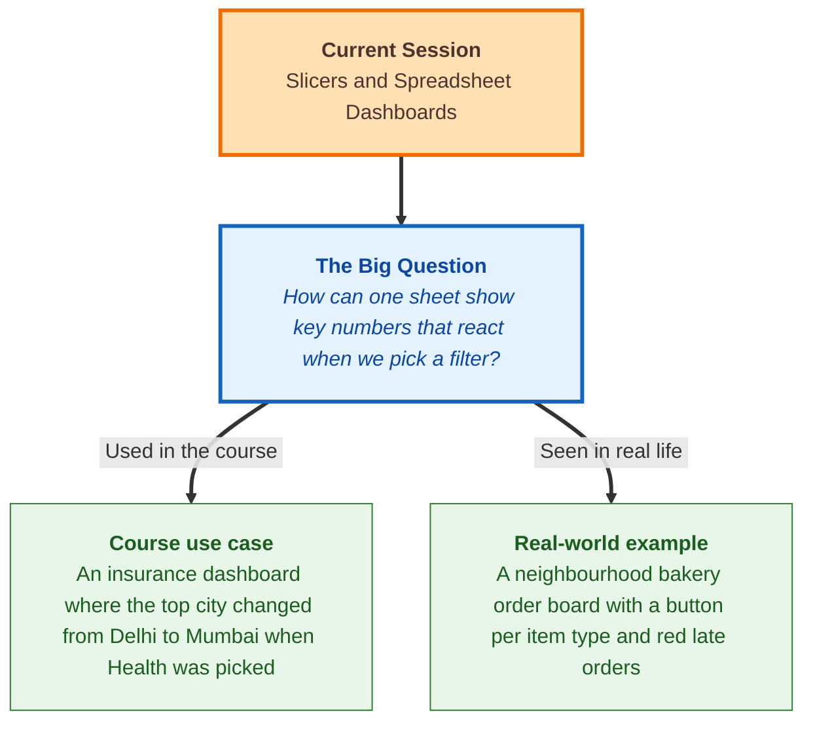

## Slicers and Spreadsheet Dashboards

### Mental Map

---

### What You'll Learn

Have you ever wondered how a bakery board can change from all orders to cakes only with one tap?

By the end of this session, you will be able to:

- **List** the 3 key numbers the bakery owner wants on one sheet.
- **Describe** what a filter button does to a summary table and its chart.
- **Interpret** a red row on the order board.
- **Examine** why one total ignores the button while another follows it.
- **Build** a rule that colours every late order.
- **Check** a cell that shows a broken value.

> **Topics you will meet:** slicer, pivot chart, conditional formatting (flag rows), KPI dashboard (key numbers on one sheet), fixing #VALUE! #DIV/0! and circular references.
>
> Join the session to learn each of these in detail.

---

### Why You Are Learning This Topic

Rekha runs a bakery. She keeps one order sheet for cakes, bread and cookies. She wants a board that shows total money, the top item and late orders. She taps a button for cakes. The chart changes, but the total does not. One cell shows an error because there were no cookie orders.

A **dashboard** means one sheet that shows the key numbers of a business at a glance.

In this course, you will build a sheet whose numbers move together and show no broken cells.

> **Think about it:** Why did the chart change when Rekha tapped Cakes, while the total stayed the same?

---

### Bakery Board Puzzle

Here are 4 orders from Rekha's sheet.

| Order | Item | Money | Status |
|:----------:|:----------:|:----------:|:----------:|
| 1 | Cake | Rs 900 | Delivered |
| 2 | Bread | Rs 120 | Late |
| 3 | Cake | Rs 1,100 | Delivered |
| 4 | Cookies | Rs 0 | Late |

**What you want to happen:**

- Every late order is coloured red.
- The total and the chart both follow the button.
- A missing item shows 'n/a' and not an error.

> **Wonder about this:**
>
> - What does a rate of money per order show when there are 0 orders?
> - Which numbers should follow the button?

---

### Think It Through

There is no wrong first try. Keep your guesses for the session.

**1. Which orders in the table are late?**
Hint: Read the Status column.

**2. The total for Cakes alone is how much?**
Hint: Add the two cake rows.

**3. The rate for cookies divides by 0 orders. What should the cell say?**
Hint: Choose a word that says why there is no number.

---

### One Question to Carry Into the Session

> **Which numbers on a dashboard must move when we pick a filter?**
>
> Which cell on Rekha's board would you test first for a broken value?
