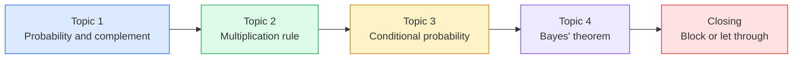
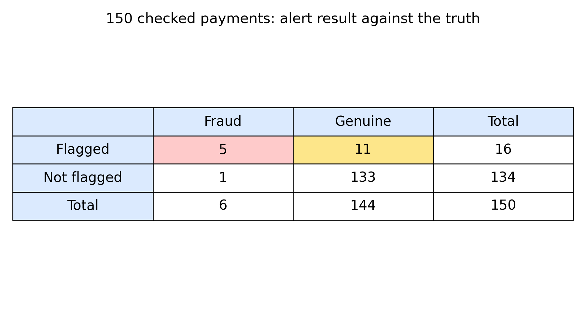
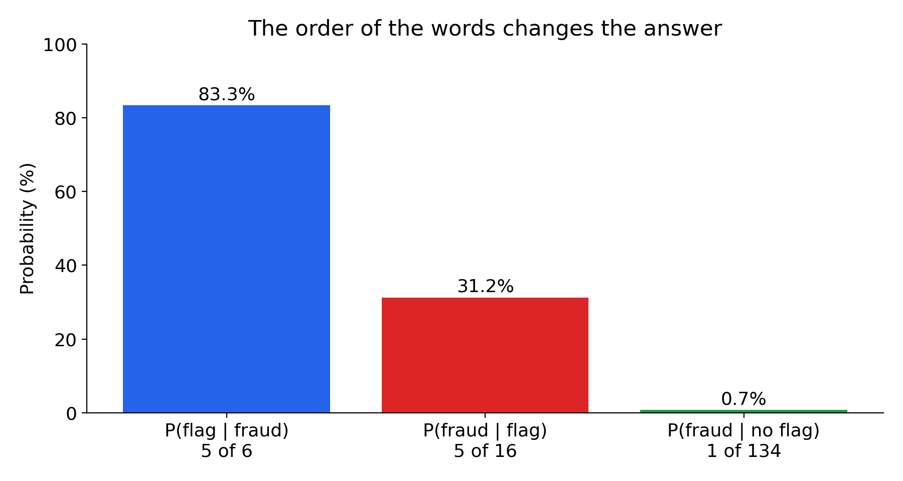
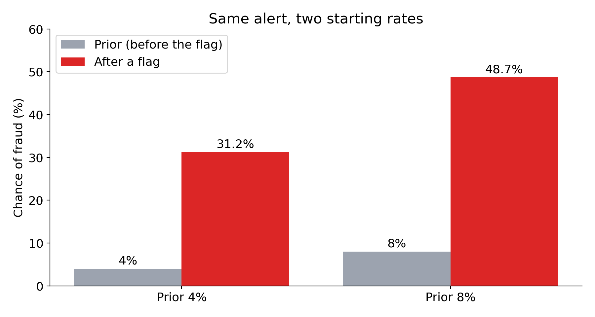

# <font color='#1d4ed8'>Lecture Script: Conditional Probability and Bayes' Theorem (Google Sheets)</font>

---

## <font color='blue'>Agenda</font>

The lecture runs as four topics. Each topic ends with a quiz.

| Topic | What we do | Learning objectives covered | Minutes |
|:-:|:--|:--|:-:|
| 1 | Count how often an alert fires | Compute the probability of an event and of its complement | 25 |
| 2 | Pick two payments for an audit | Apply the multiplication rule to independent and dependent events | 25 |
| 3 | Ask "given a flag, how likely is fraud?" | Compute a conditional probability from a two-way table | 30 |
| 4 | Update the chance of fraud after a flag | Apply Bayes' theorem to update a probability given a test result | 25 |
| — | Closing: Outcome & Summary | | 15 |
| | **Total** | | **120** |

> <font color="red">**🎯 Instructor Note**</font> Pace: spend the time on conditional probability in Topic 3 and on Bayes' theorem in Topic 4. Keep the complement in Topic 1 quick.
> Learners type the 4-number table into a new Google Sheet. `data/alert_log.csv` (150 rows) is the log the table summarises, for the mentor to check. `data/alert_summary.csv` holds the table.

---

## <font color='blue'>Scenario</font>

**A payment flagged on screen.** A Paytm-style wallet app runs a fraud alert on every payment. A sample of 150 payments from one day was checked by hand afterwards.

| | Fraud | Genuine | Total |
|:--|:-:|:-:|:-:|
| **Flagged** | 5 | 11 | 16 |
| **Not flagged** | 1 | 133 | 134 |
| **Total** | 6 | 144 | 150 |

An analyst's phone shows: **"Payment flagged: Rs 4,999 to a new payee."** Should the app block it?

> <font color="red">**🎯 Instructor Note**</font> Paytm is only the setting. Do not claim it uses this alert or these numbers. The 150 payments are invented for teaching.

---

## <font color='blue'>Problem Statement</font>

The team knew that the alert catches 5 of the 6 frauds, about 83 percent. They concluded that a flagged payment is about 83 percent likely to be fraud, and they proposed to block every flagged payment. In the sample, only 5 of the 16 flagged payments were fraud. The other 11 were genuine customers who would have been blocked. The team had mixed up two different questions: "if it is fraud, is it flagged?" and "if it is flagged, is it fraud?".

> <font color='purple'>**How likely is fraud once a payment is flagged, and how do we update a probability when a test result comes in?**</font>

> <font color="red">**🎯 Instructor Note**</font> Poll: "The alert catches 5 of 6 frauds. A payment is flagged. Is it about 83 percent likely to be fraud?" Options: yes, no, or it depends on how common fraud is. Give learners 30 seconds to respond in chat. Reveal the answer in the Closing.

---

## <font color='blue'>What We Will Use</font>

Last session you built formulas in Google Sheets, with `SUM`, relative and absolute references. Today the same skills calculate probabilities. The key terms and formulas are below.

| Term | Meaning | Formula |
|:--|:--|:--|
| Probability of an event $A$ | How likely $A$ is, from 0 to 1 | $P(A)=\dfrac{\text{cases of }A}{\text{all cases}}$ |
| Complement | The event "not $A$" | $P(\text{not }A)=1-P(A)$ |
| Multiplication rule | Chance that $A$ and $B$ both happen | $P(A\text{ and }B)=P(A)\times P(B\mid A)$ |
| Independent events | One does not change the chance of the other | $P(A\text{ and }B)=P(A)\times P(B)$ |
| Conditional probability | Chance of $A$ given that $B$ happened | $P(A\mid B)=\dfrac{P(A\text{ and }B)}{P(B)}$ |
| Bayes' theorem | Update the chance of $A$ after seeing $B$ | $P(A\mid B)=\dfrac{P(B\mid A)\,P(A)}{P(B)}$ |

---

## <font color='blue'>How: Walking Through the Flagged Payment</font>



---

## <font color='blue'>Topic 1: Count how often an alert fires</font> `25 min`

> <font color='purple'>**Out of 150 payments, how many get a flag, and how many do not?**</font>

### <font color='green'>Example: Probability and its complement</font>

> <font color='purple'>**What is the probability that a random payment is flagged, and the probability that it is not?**</font>

Type the table in a new sheet: headings in row 1, `Flagged` in A2, `Not flagged` in A3, `Total` in A4. Put 5 and 11 in B2 and C2, and 1 and 133 in B3 and C3. Add totals with `=B2+C2` in D2, and so on down to D4 (150).

The probability that a payment is flagged is $P(\text{flagged})=\dfrac{16}{150}$. The complement is the event "not flagged". The two events cover everything, so their probabilities add to 1.

$$\boxed{P(\text{not }A) = 1 - P(A)}$$

**Predict before you type the formula: What will happen?**

> <font color="red">**🎯 Instructor Note**</font> Expected: $P(\text{flagged})\approx 0.1067$ and its complement $\approx 0.8933$. Ask learners to say it as a percent: about 10.7 percent and 89.3 percent.

In F2 and F3 write:

```text
=D2/D4
=1-D2/D4
```

**Output**

```text
0.1067
0.8933
```

#### <font color='#c2410c'>Code Explanation</font>

- **`=D2/D4`** divides the 16 flagged payments by all 150: $\frac{16}{150}=0.1067$.
- **`=1-D2/D4`** subtracts that from 1: $1-0.1067=0.8933$, which equals $\frac{134}{150}$.

> <font color='green'>**Result**</font> About 10.7 percent of payments are flagged, and 89.3 percent are not. The two numbers add to 1.

<p align="center"></p>

### <font color='green'>Extending it: The probability of fraud</font>

> <font color='purple'>**What is the probability that a random payment is fraud, and genuine?**</font>

> <font color="red">**🎯 Instructor Note**</font> Ask for a prediction. Expected: $P(\text{fraud})=\frac{6}{150}=0.04$, so $P(\text{genuine})=0.96$. This 4 percent is the prior that returns in Topic 4.

```text
=B4/D4
=1-B4/D4
```

**Output**

```text
0.04
0.96
```

> <font color='green'>**Result**</font> Fraud is rare: 4 percent of payments. The complement, genuine, is 96 percent.

### <font color='purple'>Quiz 1</font>

**Question:** The probability that a payment is flagged is $\frac{16}{150}$. What is the probability that it is not flagged?

**Options:**
- A) $\frac{16}{150}$
- B) $\frac{134}{150}$
- C) $\frac{1}{16}$
- D) $\frac{150}{134}$

**Correct Answer:** B

**Explanation:**
- **A)** That is the probability of being flagged, not the complement.
- **B)** $1-\frac{16}{150}=\frac{134}{150}\approx 0.893$.
- **C)** $\frac{1}{16}$ has no link to the table.
- **D)** A probability can never be above 1, and $\frac{150}{134}>1$.

---

## <font color='blue'>Topic 2: Pick two payments for an audit</font> `25 min`

> <font color='purple'>**The auditor picks 2 of the 16 flagged payments at random. What is the chance that both are genuine?**</font>

### <font color='green'>Example: Dependent events</font>

> <font color='purple'>**What is the probability that both audited payments are genuine, if the first one is set aside before the second pick?**</font>

Among the 16 flagged payments, 11 are genuine. After the first pick, the pool changes. If the first payment was genuine, 10 genuine payments remain among 15. So the second event **depends** on the first. The multiplication rule uses the changed chance, $P(B\mid A)$.

$$\boxed{P(A\text{ and }B)=P(A)\times P(B\mid A)}$$

$$P(\text{both genuine})=\frac{11}{16}\times\frac{10}{15}=0.4583$$

**Predict before you type the formula: What will happen?**

> <font color="red">**🎯 Instructor Note**</font> Expected: about 0.458. Ask learners whether it should be higher or lower than $\left(\frac{11}{16}\right)^2$. Expected: lower, because the pool of genuine payments shrinks.

In F5 write:

```text
=(C2/D2)*((C2-1)/(D2-1))
```

**Output**

```text
0.4583
```

> <font color='green'>**Result**</font> The chance that both picks are genuine is 45.8 percent. The second factor, 10 of 15, already reflects what the first pick did.

### <font color='green'>Extending it: Independent events</font>

> <font color='purple'>**What if the auditor puts the first payment back before the second pick?**</font>

> <font color="red">**🎯 Instructor Note**</font> Ask for a prediction. With replacement the pool is the same each time, so the events are independent. Expected: 0.4727, a little higher than 0.4583.

When events are **independent**, the first pick does not change the second, so $P(B\mid A)=P(B)$ and the rule becomes $P(A\text{ and }B)=P(A)\times P(B)$.

```text
=(C2/D2)^2
```

**Output**

```text
0.4727
```

> <font color='green'>**Result**</font> With replacement the chance is 47.3 percent, against 45.8 percent without. The only change is whether the first pick alters the pool.

> <font color='#b45309'>**Common mistake**</font> Multiplying $\frac{11}{16}\times\frac{11}{16}$ when the first payment is not put back. The second pool is smaller, so the factor is $\frac{10}{15}$.

### <font color='purple'>Quiz 2</font>

**Question:** Two flagged payments are picked without putting the first back. 11 of the 16 are genuine. What is $P(\text{both genuine})$?

**Options:**
- A) $\frac{11}{16}\times\frac{11}{16}$
- B) $\frac{11}{16}+\frac{10}{15}$
- C) $\frac{11}{16}\times\frac{11}{15}$
- D) $\frac{11}{16}\times\frac{10}{15}$

**Correct Answer:** D

**Explanation:**
- **A)** That is the with-replacement answer, for independent picks.
- **B)** Probabilities of "and" are multiplied, not added.
- **C)** After one genuine payment is removed, 10 genuine payments remain, not 11.
- **D)** The first factor is $\frac{11}{16}$ and the second, after one genuine payment is out, is $\frac{10}{15}$.

---

## <font color='blue'>Topic 3: Ask "given a flag, how likely is fraud?"</font> `30 min`

> <font color='purple'>**The team said the alert is 83 percent accurate. What does the table say once we know a payment is flagged?**</font>

### <font color='green'>Example: Conditional probability from the table</font>

> <font color='purple'>**What is the probability that a payment is fraud, given that it is flagged?**</font>

A **conditional probability** $P(A\mid B)$ is the chance of $A$ once we know $B$ happened. We shrink the world to the cases where $B$ is true. Given "flagged", only the 16 flagged payments count, and 5 of them are fraud.

$$\boxed{P(\text{fraud}\mid\text{flagged})=\frac{P(\text{fraud and flagged})}{P(\text{flagged})}=\frac{5}{16}}$$

**Predict before you type the formula: What will happen?**

> <font color="red">**🎯 Instructor Note**</font> Expected: 0.3125. Ask learners how it compares with the 83 percent in the team's claim. Expected: far lower.

In F6 write:

```text
=B2/D2
```

**Output**

```text
0.3125
```

> <font color='green'>**Result**</font> Given a flag, the chance of fraud is 31.25 percent. About 2 flagged payments in 3 are genuine.

### <font color='green'>Extending it: Turn the question around</font>

> <font color='purple'>**What is the probability that a payment is flagged, given that it is fraud? And fraud, given that it is not flagged?**</font>

> <font color="red">**🎯 Instructor Note**</font> Ask for a prediction. Expected: 0.8333 and 0.0075. The first is the 83 percent the team quoted. It answers a different question.

```text
=B2/B4
=B3/D3
```

**Output**

```text
0.8333
0.0075
```

<p align="center"></p>

> <font color='green'>**Result**</font> $P(\text{flagged}\mid\text{fraud})=\frac{5}{6}=83.3\%$. And $P(\text{fraud}\mid\text{not flagged})=\frac{1}{134}=0.75\%$. The order of the words changes the answer.

> <font color='#b45309'>**Common mistake**</font> Treating $P(A\mid B)$ and $P(B\mid A)$ as the same number. The team did this with 83.3 percent and 31.25 percent.

### <font color='purple'>Quiz 3</font>

**Question:** Using the table, what is $P(\text{fraud}\mid\text{flagged})$?

**Options:**
- A) $\frac{5}{16}$
- B) $\frac{5}{6}$
- C) $\frac{5}{150}$
- D) $\frac{11}{16}$

**Correct Answer:** A

**Explanation:**
- **A)** Given a flag, 16 payments count and 5 are fraud: $\frac{5}{16}$.
- **B)** That is $P(\text{flagged}\mid\text{fraud})$. It starts from the 6 frauds.
- **C)** That is $P(\text{fraud and flagged})$ over all 150, not conditional on a flag.
- **D)** That is $P(\text{genuine}\mid\text{flagged})$.

---

## <font color='blue'>Topic 4: Update the chance of fraud after a flag</font> `25 min`

> <font color='purple'>**Before any alert, the chance of fraud is 4 percent. The alert fires. How does that number change, and how can we work it out without the table?**</font>

### <font color='green'>Example: Bayes' theorem</font>

> <font color='purple'>**How do we update a 4 percent chance of fraud after a flag?**</font>

**Bayes' theorem** updates a starting probability (the **prior**) when a test result arrives. It needs three numbers: the prior $P(F)$, the hit rate $P(\text{flag}\mid F)$, and the false-alarm rate $P(\text{flag}\mid \text{genuine})$. Writing $F$ for fraud:

$$\boxed{P(F\mid\text{flag})=\frac{P(\text{flag}\mid F)\,P(F)}{P(\text{flag}\mid F)\,P(F)+P(\text{flag}\mid \text{genuine})\,P(\text{genuine})}}$$

From the table: $P(F)=0.04$, $P(\text{flag}\mid F)=\frac{5}{6}=0.8333$, $P(\text{flag}\mid\text{genuine})=\frac{11}{144}=0.0764$.

**Predict before you type the formula: What will happen?**

> <font color="red">**🎯 Instructor Note**</font> Expected: 0.3125, the same value that Topic 3 found from the table. Bayes' theorem reaches it from the rates.

In cells H1 to H3 put the prior, the hit rate and the false-alarm rate:

```text
H1: 0.04
H2: =B2/B4
H3: =C2/C4
```

In H4 write the update:

```text
=H2*H1/(H2*H1+H3*(1-H1))
```

**Output**

```text
0.3125
```

#### <font color='#c2410c'>Code Explanation</font>

- **`H2*H1`** is hit rate times prior: $0.8333\times0.04=0.0333$, the share of all payments that are fraud and flagged.
- **`H3*(1-H1)`** is false-alarm rate times genuine share: $0.0764\times0.96=0.0733$, the share that are genuine and flagged.
- **The division** is the fraud part over all flagged: $\frac{0.0333}{0.0333+0.0733}=0.3125$.

> <font color='green'>**Result**</font> A flag moves the chance of fraud from 4 percent to 31.25 percent. It is a big rise, and it is still less than one in three.

### <font color='green'>Extending it: What if fraud were more common?</font>

> <font color='purple'>**Change the prior to 0.08. What is the chance of fraud after a flag?**</font>

> <font color="red">**🎯 Instructor Note**</font> Ask for a prediction. Expected: it rises to about 0.4868. The same alert is more convincing when fraud is more common.

Change H1 to `0.08`. H4 recalculates.

**Output**

```text
0.4868
```

<p align="center"></p>

> <font color='green'>**Result**</font> With a prior of 8 percent the chance after a flag is 48.7 percent. The alert did not change, but the starting rate did. A test result must always be read with the base rate.

### <font color='purple'>Quiz 4</font>

**Question:** Which three numbers does Bayes' theorem need to update the chance of fraud after a flag?

**Options:**
- A) Only the hit rate $P(\text{flag}\mid F)$
- B) Only the prior $P(F)$
- C) The prior, the hit rate and the false-alarm rate
- D) Only the total number of payments

**Correct Answer:** C

**Explanation:**
- **A)** The hit rate alone ignores how rare fraud is and how often genuine payments are flagged.
- **B)** The prior alone does not use the test result.
- **C)** The prior $P(F)$, the hit rate and the false-alarm rate give the updated probability.
- **D)** A total count gives neither the rates nor the prior.

---

## <font color='blue'>Closing: Outcome & Summary</font> `15 min`

Back to the flagged payment on screen. We can now decide.

> <font color='purple'>**1. How likely is fraud, if the payment is flagged?**</font>

Fraud is 4 percent of payments (Topic 1). The alert catches 5 of 6 frauds, but flags 11 of 144 genuine payments. Given a flag, fraud is $\frac{5}{16}=31.25\%$ (Topic 3). Bayes' theorem reaches the same number from the three rates (Topic 4).

> <font color='purple'>**2. How many genuine customers would "block all flagged" hurt, and what could the audit do instead?**</font>

Blocking every flagged payment would stop 11 genuine customers for every 5 frauds. Choosing 2 flagged payments for review without putting the first back gives a 45.8 percent chance that both are genuine (Topic 2), so a review step is worth its cost.

### <font color='green'>Outcome</font>

| Question | Number | Topic |
|:--|:-:|:-:|
| $P(\text{flagged})$ | 10.7 percent | 1 |
| $P(\text{fraud})$, the prior | 4 percent | 1 |
| $P(\text{both genuine})$ in 2 picks, no replacement | 45.8 percent | 2 |
| $P(\text{flagged}\mid\text{fraud})$ | 83.3 percent | 3 |
| $P(\text{fraud}\mid\text{flagged})$ | 31.25 percent | 3 and 4 |

> <font color='green'>**Therefore,**</font> a flag raises the chance of fraud from 4 percent to 31.25 percent, and no further. Do not block every flagged payment. Add a review step, and read any test result with its base rate.

> <font color="red">**🎯 Instructor Note**</font> Reveal the poll: no. The alert catches about 83 percent of frauds, but only about 31 percent of flagged payments are fraud. It depends on how common fraud is.

### <font color='green'>Summary</font>

| Learning objective | Takeaway |
|:--|:--|
| Probability and complement | $P(A)=\text{cases of }A\div\text{all cases}$, and $P(\text{not }A)=1-P(A)$ |
| Multiplication rule | $P(A\text{ and }B)=P(A)\times P(B\mid A)$, and for independent events $P(A)\times P(B)$ |
| Conditional probability | Shrink the table to the given case: $P(\text{fraud}\mid\text{flagged})=\frac{5}{16}$ |
| Bayes' theorem | Prior, hit rate and false-alarm rate give the updated probability |
| **Practical value** | You can read an alert or a test result without mixing up "if fraud, flagged" and "if flagged, fraud" |

---

# <font color='red'>Launch the Feedback Poll</font>

> <font color="red">**🎯 Instructor Note**</font> Reminder: launch the feedback poll now to collect learner feedback.
