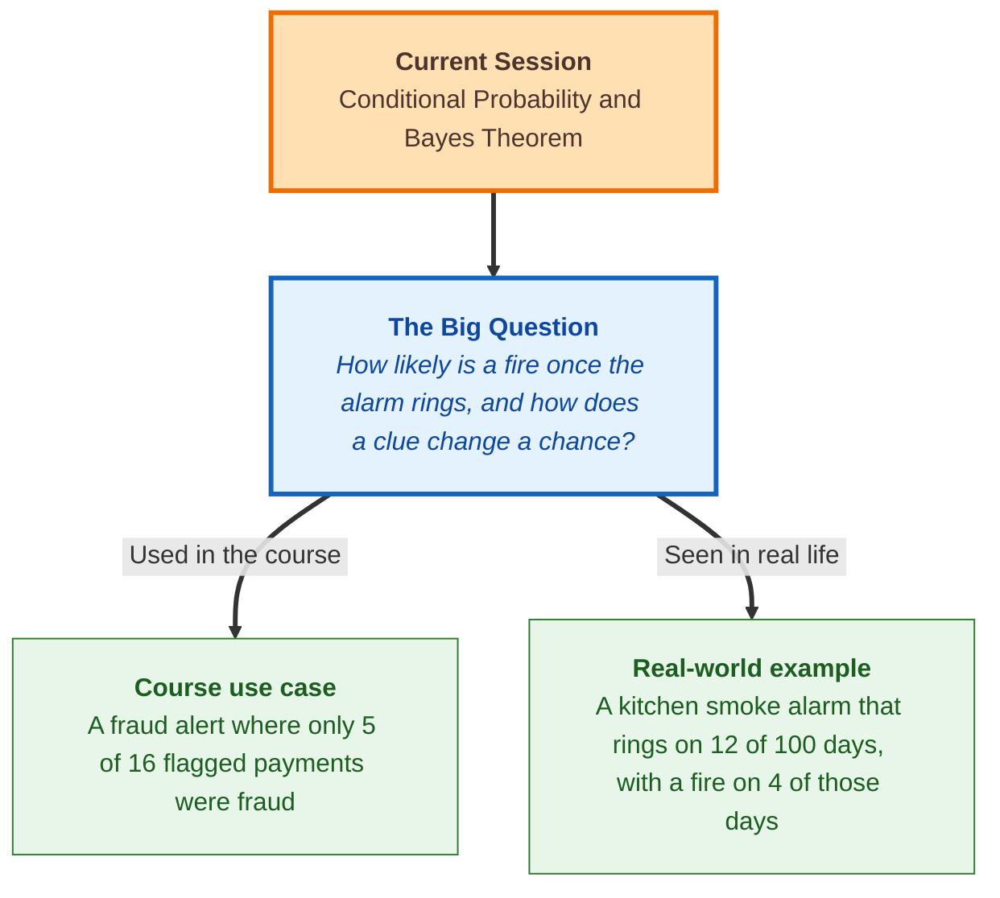

## Conditional Probability and Bayes Theorem

### Mental Map

---

### What You'll Learn

Have you ever wondered how often a ringing smoke alarm means a real fire?

By the end of this session, you will be able to:

- **Calculate** the chance that the alarm rings on a random day, and the chance that it stays quiet.
- **Apply** the multiplication rule to two alarms in a row.
- **Determine** the chance of a fire on a day when the alarm rings.
- **Compare** the chance of an alarm given a fire with the chance of a fire given an alarm.
- **Solve** for the new chance of fire after the alarm, using the rate of fires.
- **Judge** whether a ringing alarm should make the family leave at once.

> **Topics you will meet:** probability and complement, multiplication rule, conditional probability, Bayes theorem.
>
> Join the session to learn each of these in detail.

---

### Why You Are Learning This Topic

The Rao family has a smoke alarm in the kitchen. Over 100 cooking days it rang on 12 days. A real fire started on 4 days. The alarm rang on 3 of those 4 fire days. One evening the alarm rings. Mrs. Rao asks how likely it is that there is a fire.

A **probability** means how likely an event is, written from 0 to 1.

In this course, you will read an alert together with how common the problem is.

> **Think about it:** If the alarm caught 3 of 4 fires, does a ring mean a 75 percent fire chance?

---

### Kitchen Alarm Puzzle

Here are the counts for 100 cooking days.

| | Fire | No fire |
|:----------:|:----------:|:----------:|
| Alarm rang | 3 | 9 |
| Alarm quiet | 1 | 87 |

**What you want to happen:**

- The family knows the chance that the alarm rings.
- The family knows the chance of a fire when it rings.
- The family does not mix up the two chances.

> **Wonder about this:**
>
> - Is an alarm given a fire the same chance as a fire given an alarm?
> - What changes if fires become twice as common?

---

### Think It Through

There is no wrong first try. Keep your guesses for the session.

**1. The alarm rang on 12 of 100 days. What is the chance that it stays quiet?**
Hint: Subtract from 1.

**2. On days when the alarm rang, what was the count of fire days?**
Hint: Look at the first row of the table.

**3. Which chance is larger: alarm given fire, or fire given alarm?**
Hint: Compare 3 out of 4 with 3 out of 12.

---

### One Question to Carry Into the Session

> **Does a warning that is right most of the time make a fire likely?**
>
> Which count in the table matters most for Mrs. Rao tonight?
