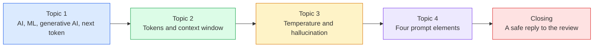
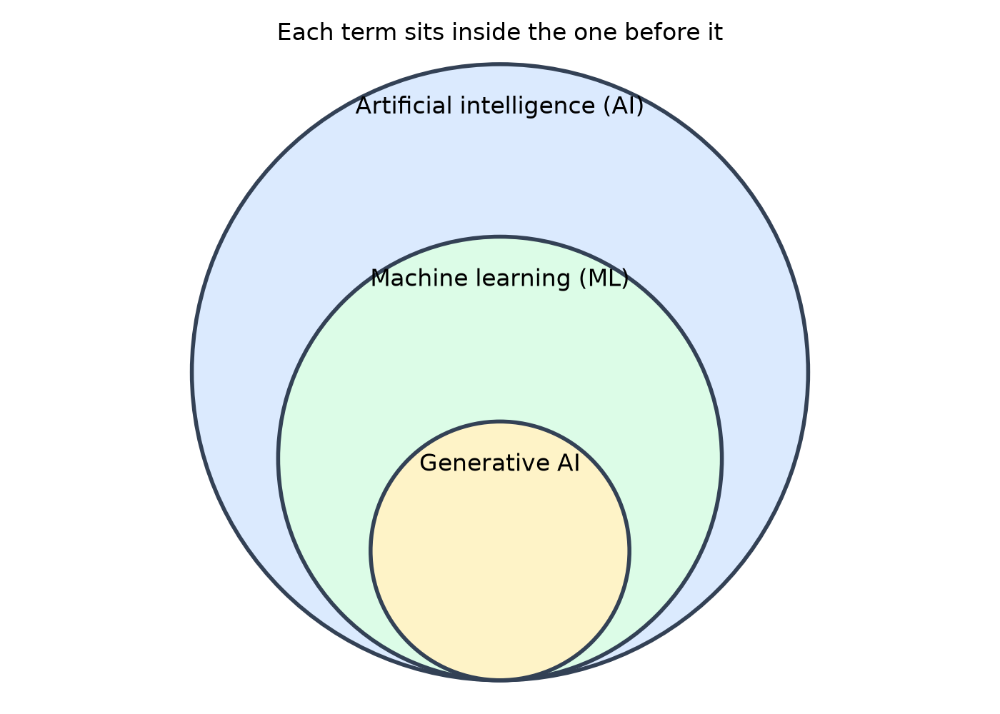
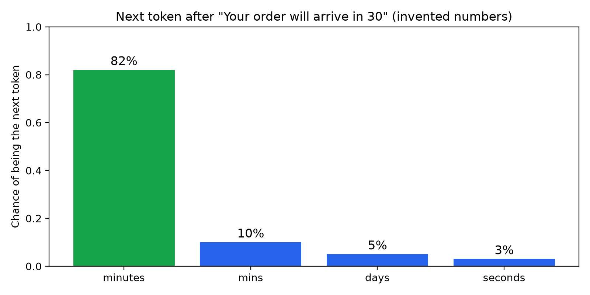
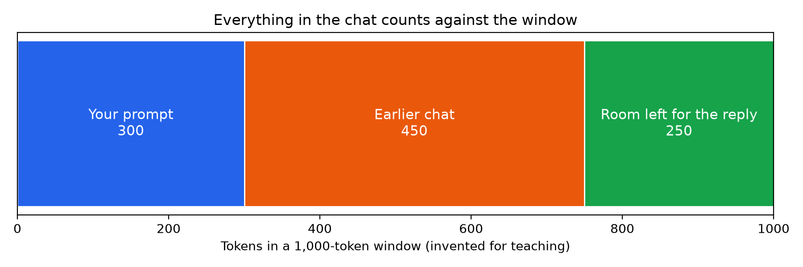
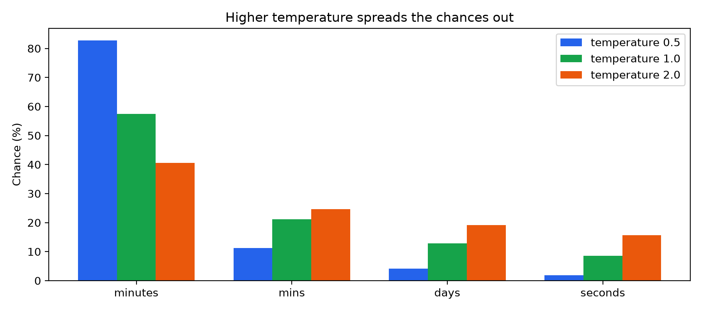

# Lecture Script: How AI and LLMs Work with Prompts

---

## Agenda

The lecture runs as four topics. Each topic ends with a quiz.

| Topic | What we do | Learning objectives covered | Minutes |
|:-:|:--|:--|:-:|
| 1 | Place AI, ML and generative AI, then see how a reply is built | Compare AI, machine learning and generative AI by what each term covers Describe next-token prediction as the mechanism that produces an LLM response | 25 |
| 2 | See how text is cut up and how much fits | Describe how a tokenizer splits text into subword tokens Explain what a context window limits and what counts against it | 25 |
| 3 | Understand why answers vary and why some are wrong | Predict how raising temperature changes the variability of an output Explain why a model can produce fluent text that is factually wrong | 30 |
| 4 | Write a prompt that gives a usable reply | State the four elements of a well-formed prompt: task, context, format and constraints | 25 |
| — | Closing: Outcome & Summary | | 15 |
| | **Total** | | **120** |

> **🎯 Instructor Note** Pace: Topic 1 is quick. Spend the extra minutes on hallucination in Topic 3 and on the live prompt rewrite in Topic 4.
> Learners need one free chat tool open: ChatGPT, Claude or Gemini. Numbers in tables and charts are invented for teaching. Model replies are never pasted here, because they change on every run. Run each live step and read the real reply.

---

## Scenario

Anita owns a small restaurant that sells on a Swiggy-style food app. A customer leaves a 2-star review: "Food came cold and the packaging leaked." Anita is tired. She opens a free chat tool and types, "Reply to this review."

The tool writes a warm, polished reply. It also says, "Use the coupon code COLD50 for 50% off your next order," and "As per our 24-hour refund policy, we will refund you." Anita has no coupon called COLD50 and no 24-hour refund policy. She posts the reply anyway.

> **🎯 Instructor Note** The company is only the setting. Do not claim it works this way. The restaurant, the review and the reply are invented for teaching.

---

## Problem Statement

The next morning the customer writes back: "Please apply COLD50 and refund me under your 24-hour policy." Anita has no coupon and no policy. She either gives away 50% of a new order or has to admit the reply was wrong. Either way, the customer is now angrier than before.

> **Why did a fluent, friendly reply contain facts Anita never gave, and how do we write a prompt that stops it?**

> **🎯 Instructor Note** Poll: "When an AI tool states a coupon code, is that code looked up from a list?" Options: yes or no. Give learners 30 seconds to respond in chat. Reveal the answer in the Closing.

---

## What We Will Use

One free chat tool: ChatGPT, Claude or Gemini. Today you read how it works and then write prompts in it.

| Topic | Ideas | In one line |
|:-:|:--|:--|
| 1 | AI, ML, generative AI, next-token prediction | An LLM builds a reply one piece at a time by choosing a likely next piece |
| 2 | Token, tokenizer, context window | Text is cut into pieces, and a chat has a fixed amount of room for them |
| 3 | Temperature, hallucination | Randomness changes the variety of replies, and fluent text can still be false |
| 4 | Prompt: task, context, format, constraints | Four parts that make a reply specific and checkable |

---

## How: Walking Through Anita's Review Reply

---

## Topic 1: Place AI, ML and generative AI, then see how a reply is built `25 min`

> **What kind of thing did Anita just talk to?**

### Example: Three terms, three sizes

> **How are AI, machine learning and generative AI related?**

| Term | What it covers | Anita's world |
|:--|:--|:--|
| Artificial intelligence (AI) | Any computer system that does a task that normally needs human thinking | A route planner picking the fastest delivery path |
| Machine learning (ML) | AI that learns its rules from examples instead of being given them | A model that learns from past orders which ones arrive late |
| Generative AI | ML that creates new content: text, images, audio or code | The chat tool that wrote the review reply |

A **large language model (LLM)** is a generative AI model trained on huge amounts of text to work with language. ChatGPT, Claude and Gemini are chat tools built on LLMs.

#### Logic Explanation

- Every ML system is AI, but not every AI system uses ML. A fixed rule such as "if the order is over Rs 499, show free delivery" is AI-style automation with no learning.
- Every generative AI model is ML, but not every ML model generates content. The late-order model above only predicts.

> **Result** AI is the widest term, ML sits inside it, and generative AI sits inside ML.

### Extending it: How the reply is built

> **How did the tool write a whole reply?**

An LLM does not look up an answer. It predicts the next **token**, a small piece of text, then the next, one at a time. At each position it scores many possible next tokens and picks one.

> **🎯 Instructor Note** Ask learners to guess the most likely next word after "Your order will arrive in 30". Expected: "minutes". The chances below are invented for teaching.

| Prompt so far | Next token | Chance |
|:--|:-:|:-:|
| Your order will arrive in 30 | minutes | $82\%$ |
| | mins | $10\%$ |
| | days | $5\%$ |
| | seconds | $3\%$ |

The chances add up to $82\% + 10\% + 5\% + 3\% = 100\%$.

> **Result** A reply is a chain of likely next tokens. Nothing in the chain checks whether a coupon exists.

> **Common mistake** Thinking the tool searches a database of answers. Fix: remember that it continues text with likely tokens.

### Quiz 1

**Question:** Which statement about the three terms is correct?

**Options:**
- A) Machine learning is wider than AI
- B) Generative AI is wider than machine learning
- C) AI and generative AI mean the same thing
- D) Generative AI is a kind of machine learning, which is a kind of AI

**Correct Answer:** D

**Explanation:**
- **A)** AI is the widest term. ML sits inside it.
- **B)** Generative AI sits inside ML, so it is narrower.
- **C)** Generative AI creates new content. AI also covers fixed rules and prediction-only tools.
- **D)** Correct. The three terms nest from widest to narrowest.

---

## Topic 2: See how text is cut up and how much fits `25 min`

> **The tool read Anita's review. What did it actually read?**

### Example: Tokens are pieces, not words

> **How does a tokenizer split text?**

A **tokenizer** cuts text into tokens. A token can be a whole word, part of a word, a space plus a word, or a punctuation mark. Rare or long words are often split into subword pieces.

> **🎯 Instructor Note** The split below is one possible split for teaching. Real tokenizers differ between tools, so counts differ too. Do not quote it as a real count.

| Text | One possible split |
|:--|:--|
| food | food |
| unbelievable | un / believ / able |
| packaging | pack / aging |

> **Result** Common words are often one token. Long or rare words are split into smaller pieces that the model has seen before.

#### Logic Explanation

- The model works with tokens, not letters or words. This is why a tool can struggle to count the letters in a word.
- Tokens are why length limits and usage limits are measured in tokens, not words.

### Extending it: The context window

> **How much can the tool hold in mind at once?**

The **context window** is the most tokens a model can use at one time. Your prompt, the earlier messages in the chat, and the model's own reply all count against it.

Suppose a window of 1,000 tokens (invented for teaching), a prompt of 300 tokens and an earlier chat of 450 tokens.

$$\boxed{ \text{room for reply} = \text{window} - \text{prompt} - \text{earlier chat} }$$

$$1000 - 300 - 450 = 250 \text{ tokens}$$

> **Result** Only 250 tokens remain for the reply. If the reply needs more, the tool must stop or drop earlier text.

> **🎯 Instructor Note** Ask learners: "If Anita pastes 5 more reviews into the same chat, what happens to the room for the reply?" Expected: it shrinks.

### Quiz 2

**Question:** What counts against the context window?

**Options:**
- A) Your prompt, the earlier messages and the model's reply
- B) Only your latest prompt
- C) Only the model's reply
- D) Only the number of words in the first message

**Correct Answer:** A

**Explanation:**
- **A)** Correct. Everything in the chat that the model must read or write counts.
- **B)** Earlier messages and the reply count too.
- **C)** Your prompt and the earlier chat use the window as well.
- **D)** The window is measured in tokens, not words, and covers the whole chat.

---

## Topic 3: Understand why answers vary and why some are wrong `30 min`

> **Anita asked once and got one reply. Would the tool say the same thing again, and can she trust it?**

### Example: Temperature changes the spread

> **What happens to the chances when temperature goes up?**

**Temperature** is a setting that controls how random the choice of the next token is. A low temperature makes the top choice win more often. A high temperature gives lower choices a better chance.

> **🎯 Instructor Note** Most free chat tools do not show a temperature setting. The table is the same four tokens at three temperatures, worked out from the same internal scores. Ask for a prediction first: at a higher temperature, does "minutes" go up or down?

| Next token | Temperature 0.5 | Temperature 1.0 | Temperature 2.0 |
|:--|:-:|:-:|:-:|
| minutes | $82.8\%$ | $57.5\%$ | $40.6\%$ |
| mins | $11.2\%$ | $21.1\%$ | $24.6\%$ |
| days | $4.1\%$ | $12.8\%$ | $19.2\%$ |
| seconds | $1.9\%$ | $8.6\%$ | $15.7\%$ |

> **Result** Raising temperature lowers the top choice's chance and raises the others. Replies become more varied.

#### Logic Explanation

- At 0.5 the top token holds $82.8\%$. Repeated runs give nearly the same text.
- At 2.0 the top token holds $40.6\%$. Repeated runs differ more.

### Extending it: Live check, ask twice

> **Do two runs of the same prompt give the same reply?**

> **🎯 Instructor Note** Ask learners to type "Write a one-line apology for a cold meal" in their chat tool, then use Regenerate or open a new chat and repeat. Give learners 30 seconds to respond in chat with whether the two lines matched. Expected: they usually differ in wording.

> **Result** The same prompt can give different wording, because each token is chosen with some randomness.

### Extending it: Fluent but false

> **Why did the tool invent COLD50 and a 24-hour policy?**

A **hallucination** is fluent text that is not true. The model predicts tokens that sound right. It has no check for truth, and Anita never told it her real offers. A coupon code that looks plausible is a likely next token.

> **🎯 Instructor Note** Live check: ask the tool, "What is the coupon code on my restaurant's profile?" with no other context. Read the reply. If it names a code, ask learners where the tool could have found it. Expected: nowhere.

> **Common mistake** Treating a confident tone as proof. Fix: check every code, number, name and policy against your own records.

### Quiz 3

**Question:** Anita lowers the temperature and asks the same question 5 times. What is most likely?

**Options:**
- A) Each reply is completely different
- B) Each reply is guaranteed to be true
- C) The replies are more alike than at a high temperature
- D) The tool stops giving replies

**Correct Answer:** C

**Explanation:**
- **A)** That is more likely at a high temperature, not a low one.
- **B)** Temperature controls variety, not truth. A repeated false claim is still false.
- **C)** Correct. A low temperature favours the top choice, so replies repeat more.
- **D)** Temperature does not stop replies.

---

## Topic 4: Write a prompt that gives a usable reply `25 min`

> **If the tool predicts from what it is given, what should Anita give it?**

### Example: Rewrite "Reply to this review."

> **Which four parts make Anita's prompt specific?**

A well-formed prompt has four elements.

| Element | What it says | Anita's version |
|:--|:--|:--|
| Task | What to do | Write a reply to this 2-star review |
| Context | Facts the tool cannot know | Our restaurant is a small family kitchen. The meal arrived cold. We have no coupon and no refund policy, but we can offer to remake the order |
| Format | What the output looks like | 3 sentences, polite, first person |
| Constraints | Limits and things to avoid | Do not mention coupons, refunds or prices. Do not invent facts |

> **🎯 Instructor Note** Learners paste the four-part prompt into their tool and compare it with "Reply to this review." Ask whether the new reply mentions a coupon or refund. Expected: it should not, but read the reply and check.

> **Result** The context gave the tool real facts. The constraints told it which facts not to make up.

#### Logic Explanation

- **Task** answers "what do I do". **Context** answers "what do I need to know". **Format** answers "what should it look like". **Constraints** answer "what must I avoid".
- A short prompt still counts when all four are present.

### Extending it: Find the missing element

> **"Write a reply to this review. Keep it short." Which elements are present?**

> **🎯 Instructor Note** Expected: task (write a reply) and one constraint or format hint (short). Missing: context and a clear format.

> **Result** Naming what is missing tells you what to add.

### Quiz 4

**Question:** "Do not mention coupons or refunds" is which prompt element?

**Options:**
- A) Task
- B) Constraints
- C) Format
- D) Context

**Correct Answer:** B

**Explanation:**
- **A)** The task says what to do, such as write a reply.
- **B)** Correct. A constraint limits what the tool may say or do.
- **C)** Format describes the shape of the output, such as 3 sentences.
- **D)** Context supplies facts, such as "we can remake the order".

---

## Closing: Outcome & Summary `15 min`

Back to Anita. We answer the Problem Statement using each topic once.

> **1. What did Anita talk to? (Topic 1)**

A generative AI chat tool built on an LLM. It predicts the next token. It does not look facts up.

> **2. What did it read? (Topic 2)**

Tokens from her short prompt. Her prompt had no facts about her offers, so it filled the gaps.

> **3. Why was the reply fluent but false? (Topic 3)**

It chose likely-sounding tokens, and a coupon code sounds likely. Temperature only changes the variety, not the truth.

> **4. What prompt would have prevented it? (Topic 4)**

One with task, context, format and constraints, as built in Topic 4.

### Outcome

| | "Reply to this review." | Four-element prompt |
|:--|:-:|:-:|
| Facts supplied | None | Real facts about her kitchen |
| Invented coupon risk | High | Lower, and she still checks |
| Length and tone set | No | Yes |

> **Therefore,** Anita's reply went wrong because the tool continued text with likely tokens and she gave it no facts. A prompt with task, context, format and constraints reduces the gaps. She must still read the reply and check every fact before posting.

> **🎯 Instructor Note** Reveal the poll: no. The tool does not look a coupon code up. It predicts tokens that look like one.

### Summary

| Learning objective | Takeaway |
|:--|:--|
| AI, ML, generative AI | AI is widest, ML sits inside it, generative AI sits inside ML |
| Next-token prediction | A reply is built one likely token at a time |
| Tokenizer | Text is cut into word and subword pieces |
| Context window | Prompt, earlier chat and reply all count against it |
| Temperature | Higher temperature spreads the chances and varies the replies |
| Hallucination | Fluent text can be false, so check facts |
| Four prompt elements | Task, context, format and constraints |
| **Practical value** | A clear four-part prompt and a quick fact check make AI replies safe to use at work |

---

# Launch the Feedback Poll

> **🎯 Instructor Note** Reminder: launch the feedback poll now to collect learner feedback.
