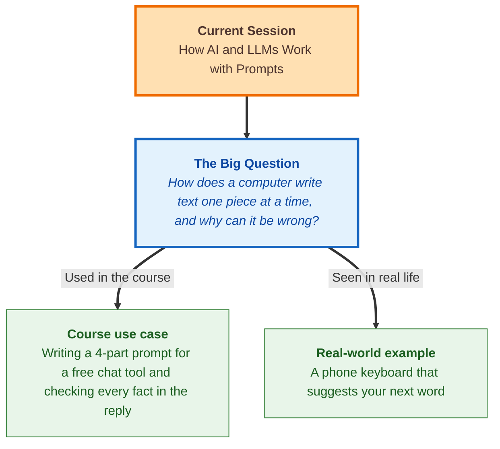

## How AI and LLMs Work with Prompts

### Mental Map

---

### What You'll Learn

Have you ever wondered how your phone keyboard guesses the next word before you type it?

By the end of this session, you will be able to:

- **Name** three ideas about smart computers, from the widest to the narrowest.
- **Describe** how a keyboard builds a message one small piece at a time.
- **Explain** why a keyboard can only keep the last few words in mind.
- **Predict** how turning up the randomness changes the 3 suggestions you see.
- **Justify** why a confident suggestion can still be wrong.
- **Write** a 4-part message that gives a helper the job, the facts, the shape and the limits.

> **Topics you will meet:** AI vs ML vs GenAI, next-token prediction, tokens, context window, temperature, hallucination, four elements of a prompt.
>
> Join the session to learn each of these in detail.

---

### Why You Are Learning This Topic

You type "Order 3 cups of" in a message to your friend. Your phone shows 3 words: "tea", "coffee" and "chai".

You tap one. The phone shows 3 new words. You never typed a full sentence, yet the full message appears.

A **token** means a small piece of text, such as a short word or part of a long word.

Your keyboard guesses the next piece each time. Chat tools in this course do the same job, on a much larger scale.

> **Think about it:** If the keyboard has never seen your friend's name, what might it suggest instead?

---

### The Phone Keyboard Puzzle

Here are the words you have typed and what the keyboard shows.

| Words typed so far | Suggestion 1 | Suggestion 2 | Suggestion 3 |
|:----------:|:----------:|:----------:|:----------:|
| Order 3 cups of | tea | coffee | chai |
| See you at | 5 | the | home |
| Happy birthday | to | my | dear |

**What you want to happen:**

- The suggestions match what you mean to say.
- Each new word fits the words before it.
- The keyboard never invents a fact, such as a wrong phone number.

> **Wonder about this:**
>
> - Would the same words give the same 3 suggestions if you typed them again tomorrow?
> - What would happen if you typed a long message and the keyboard forgot the start?

---

### Think It Through

There is no wrong first try. Keep your guesses for the session.

**1. You type "Order 3 cups of". Why might "tea" be shown before "wheels"?**
Hint: Think about which words usually follow those 4 words.

**2. You ask a friend, "Write something." What 4 details would help them write what you want?**
Hint: Think about the job, the facts, the shape and the limits.

**3. The keyboard suggests your friend's name with full confidence, but spells it wrong. Does confidence prove it is right?**
Hint: Ask how the keyboard picked the name.

---

### One Question to Carry Into the Session

> **How can a tool write smooth text that is still wrong?**
>
> Which of your last 3 messages would you re-read before sending, and why?
