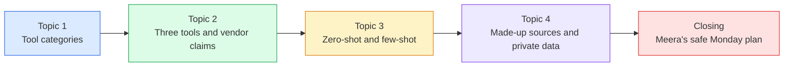
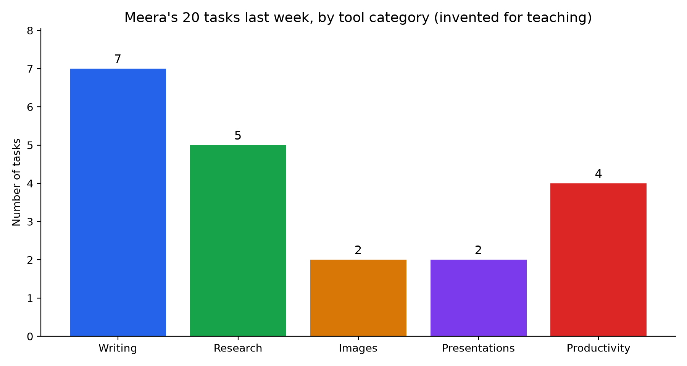
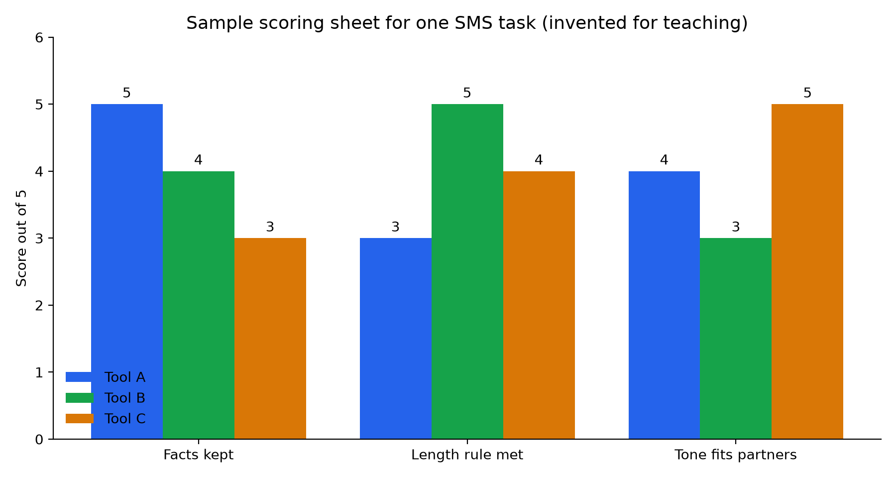
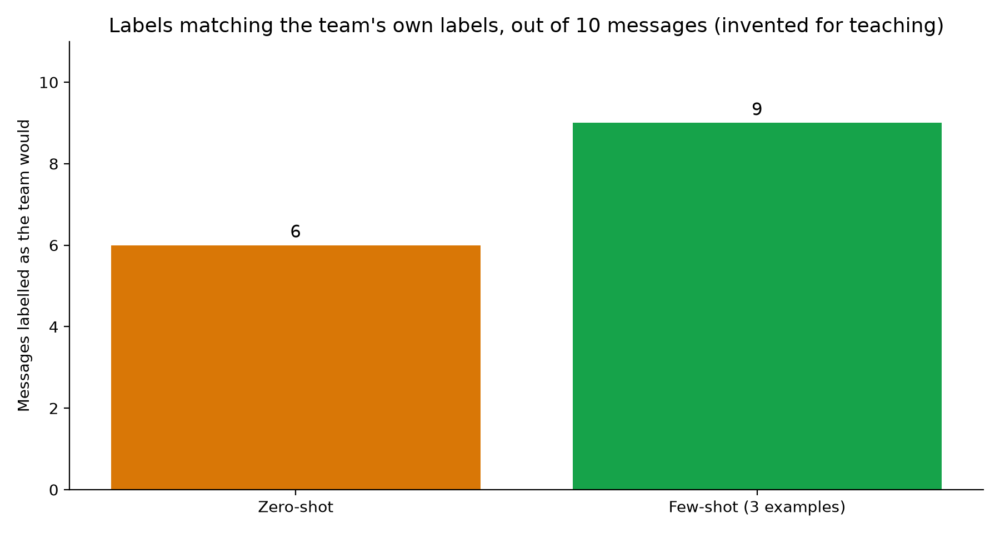
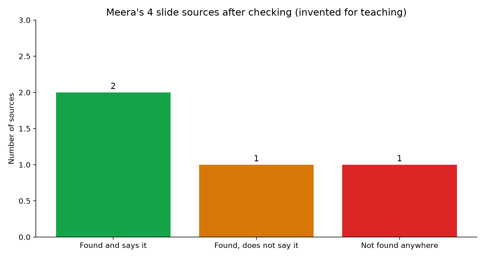

# <font color='#1d4ed8'>Lecture Script: Your AI Toolkit: What to Use When</font>

---

## <font color='blue'>Agenda</font>

The lecture runs as four topics. Each topic ends with a quiz.

| Topic | What we do | Learning objectives covered | Minutes |
|:-:|:--|:--|:-:|
| 1 | Sort work tasks into tool categories | Classify a work task into the AI tool category that suits it: writing, research, images, presentations or productivity | 25 |
| 2 | Run one task in three tools and test vendor claims | Compare the output of one task run through three AI tools and name the trade-off of each<br>Classify an AI vendor's claim as backed by verifiable evidence or as an unverifiable superlative | 30 |
| 3 | Ask with and without examples | Compare zero-shot and few-shot prompting by the task types each suits | 25 |
| 4 | Catch a made-up answer and protect private data | Analyze a generated answer to identify hallucinated entities and citations<br>Identify information unsafe to paste into a public AI chatbot | 25 |
| — | Closing: Outcome & Summary | | 15 |
| | **Total** | | **120** |

> <font color="red">**🎯 Instructor Note**</font> Pace: keep Topic 1 quick. Spend the extra minutes on the three-tool comparison in Topic 2 and on the source check in Topic 4.
> Learners need free accounts for ChatGPT, Claude, Gemini, Perplexity and Notion (with the Notion AI trial). Replies are never pasted here, because they change on every run. Run each live step and read the real reply.

---

## <font color='blue'>Scenario</font>

**One week, one person, many tools.** Meera works in operations at an Urban Company-style home-services app. On Monday morning she has five tasks, and last week she did 20 tasks in total.

| # | Monday task |
|:-:|:--|
| 1 | Write a 3-line SMS reminding service partners about Saturday's training |
| 2 | Find what rival apps charge for a basic AC service |
| 3 | Make a poster picture for the partner meetup |
| 4 | Build a 5-slide update for the city manager |
| 5 | Turn Friday's call notes into a task list |

> <font color="red">**🎯 Instructor Note**</font> The company is only the setting. Do not claim it works this way. Meera, the vendors, the tools labelled A, B and C, and every number are invented for teaching. Today is a Monday in October 2026.

---

## <font color='blue'>Problem Statement</font>

Meera opens one chat tool and uses it for all five tasks. For the research task she pastes a sheet of 120 partner names, phone numbers and bank account numbers, so the tool can "find patterns". She picks that tool because a vendor page says "India's best AI assistant". On slide 3 she cites a report the tool named. Her manager asks for the link, and the report does not exist.

Last session you saw that a model predicts the next token, can state false facts fluently, and answers better to a four-part prompt. Today we choose the tool for each task, test what it says, and protect private data.

> <font color='purple'>**How does Meera pick the right AI tool for each task, check what it tells her, and keep private data out of it?**</font>

> <font color="red">**🎯 Instructor Note**</font> Poll: "Is it safe to paste partners' bank account numbers into a public chatbot?" Options: yes or no. Give learners 30 seconds to respond in chat. Reveal the answer in the Closing.

---

## <font color='blue'>What We Will Use</font>

Five free tools, each opened for a different job. On every tool, read the current screen, because menus and limits change.

| Topic | Tools | In one line |
|:-:|:--|:--|
| 1 | Tool categories, Notion AI | Match a task to writing, research, images, presentations or productivity |
| 2 | ChatGPT, Claude, Gemini | Run one prompt in three tools and score the replies |
| 3 | One chat tool | Ask with no examples, then with 3 examples |
| 4 | Perplexity and a web search | Check a named source and decide what is safe to paste |

---

## <font color='blue'>How: Walking Through Meera's Monday</font>



---

## <font color='blue'>Topic 1: Sort work tasks into tool categories</font> `25 min`

> <font color='purple'>**Meera used one tool for five different jobs. Which job belongs to which kind of tool?**</font>

### <font color='green'>Example: Five tasks, five categories</font>

> <font color='purple'>**What does each of Monday's tasks produce, and which category fits that output?**</font>

Ask what the finished task looks like. Text to send is writing. Facts from the web are research. A picture is images. A slide set is presentations. A page that organises your own notes is productivity.

> <font color="red">**🎯 Instructor Note**</font> Cover the last two columns. Ask learners to name the category for each task in chat first. Expected: they agree on tasks 1, 3 and 4, and split on task 2.

| # | Task | Output you need | Category |
|:-:|:--|:--|:--|
| 1 | 3-line SMS to partners | Short text | Writing |
| 2 | Rival prices for an AC service | Facts with sources | Research |
| 3 | Meetup poster picture | An image | Images |
| 4 | 5-slide manager update | A slide set | Presentations |
| 5 | Call notes to a task list | A tidy page of tasks | Productivity (for example Notion AI) |

<p align="center"></p>

#### <font color='#c2410c'>Logic Explanation</font>

- The category follows the output, not the tool's brand. Many tools now do more than one category, so name the output first.
- Her 20 tasks last week split as $7 + 5 + 2 + 2 + 4 = 20$. Writing is the largest share at $\frac{7}{20} = 35\%$.

> <font color='green'>**Result**</font> Five tasks map to five categories. Choosing the category first tells Meera what to open.

### <font color='green'>Extending it: Notion AI on the call notes</font>

> <font color='purple'>**Where do Friday's call notes become a task list?**</font>

> <font color="red">**🎯 Instructor Note**</font> Live step: learners open a Notion page, paste 5 invented call-note lines, and ask Notion AI for a task list. Read the real result on screen. Check whether every task has an owner.

> <font color='green'>**Result**</font> Productivity tools work on text you already keep. Check that no task or owner was added that the notes never mentioned.

### <font color='green'>Extending it: A task that spans two categories</font>

> <font color='purple'>**The city manager wants the 5-slide update to include a rival-price table. Which categories are involved?**</font>

> <font color="red">**🎯 Instructor Note**</font> Ask for a prediction in chat. Expected: research first (the prices), then presentations (the slides).

> <font color='green'>**Result**</font> Big tasks are often a chain: research gives facts, then presentations lays them out.

> <font color='#b45309'>**Common mistake**</font> Using an image or slide tool to find facts. Fix: collect and check the facts first, then pass them on.

### <font color='purple'>Quiz 1</font>

**Question:** Meera needs the latest rival prices with sources she can open. Which category fits best?

**Options:**
- A) Images
- B) Research
- C) Presentations
- D) Productivity

**Correct Answer:** B

**Explanation:**
- **A)** Images produce pictures, not sourced facts.
- **B)** Correct. Research tools are built to find facts and show where they came from.
- **C)** Presentations lay out content you already have.
- **D)** Productivity tools organise your own notes and tasks.

---

## <font color='blue'>Topic 2: Run one task in three tools and test vendor claims</font> `30 min`

> <font color='purple'>**Meera has the right category. Do ChatGPT, Claude and Gemini give the same SMS, and how do we judge them fairly?**</font>

### <font color='green'>Example: One prompt, three tools</font>

> <font color='purple'>**How do we compare three replies without just picking the one we like?**</font>

Use one prompt, copied exactly, in all three tools. Score each reply against three checks you decide before you read.

```
Write a 3-line SMS for service partners.
Facts: training is on Saturday at 10 am, at the Indiranagar hub.
Keep it under 160 characters. Do not add any other facts.
```

> <font color="red">**🎯 Instructor Note**</font> Learners run this in three tools and score each reply 0 to 5 on facts kept, length rule met and tone. Count characters with a free counter. The chart is a sample sheet, not a result.

| Check | Question to ask | Tool A | Tool B | Tool C |
|:--|:--|:-:|:-:|:-:|
| Facts kept | Are day, time and place all there, with nothing added? | learner fills | learner fills | learner fills |
| Length rule met | Is it under 160 characters? | learner fills | learner fills | learner fills |
| Tone fits partners | Is it polite and plain? | learner fills | learner fills | learner fills |

<p align="center"></p>

#### <font color='#c2410c'>Logic Explanation</font>

- In the sample sheet, each tool totals $5 + 3 + 4 = 12$, $4 + 5 + 3 = 12$ and $3 + 4 + 5 = 12$. The totals tie, so the totals alone hide the difference.
- A trade-off is one sentence: "Tool A kept every fact but ran over the length limit." Write one sentence per tool.

> <font color='green'>**Result**</font> A fair comparison uses the same prompt, checks fixed in advance, and one trade-off sentence per tool.

### <font color='green'>Extending it: Is the vendor's claim evidence or a superlative?</font>

> <font color='purple'>**A vendor page says "India's best AI assistant". Can Meera test that?**</font>

A **verifiable claim** names something you can check: a test, a number, a date and where it was published. An **unverifiable superlative** uses words like best or fastest with nothing to check.

> <font color="red">**🎯 Instructor Note**</font> Read each claim aloud and ask for "evidence" or "superlative" in chat. The four vendor claims are invented for teaching. Expected: 1 and 3 are superlatives, 2 and 4 are checkable.

| # | Claim on a vendor page | Class |
|:-:|:--|:--|
| 1 | "India's best AI assistant" | Unverifiable superlative |
| 2 | "Cut email drafting from 12 to 8 minutes in a 40-person study; method published at the link" | Backed by verifiable evidence |
| 3 | "Trusted by millions" | Unverifiable superlative |
| 4 | "Scored 82% on a named public test, run in March 2026, results page linked" | Backed by verifiable evidence |

> <font color='green'>**Result**</font> A claim you can trace to a test, number, date and source is evidence. A claim you cannot trace is marketing.

> <font color='#b45309'>**Common mistake**</font> Treating a specific number as proof. Fix: ask where the number was measured and whether you can open that source.

### <font color='purple'>Quiz 2</font>

**Question:** Which vendor claim is backed by verifiable evidence?

**Options:**
- A) "The world's fastest AI"
- B) "Used by millions of happy users"
- C) "The smartest tool ever built"
- D) "Reduced report time from 30 to 20 minutes in a 25-person study, method published at the link"

**Correct Answer:** D

**Explanation:**
- **A)** "Fastest" gives no test, number or source.
- **B)** "Millions" and "happy" cannot be traced to a source.
- **C)** "Smartest" is a superlative with nothing to check.
- **D)** Correct. It names a number, a group size and a published method you can open.

---

## <font color='blue'>Topic 3: Ask with and without examples</font> `25 min`

> <font color='purple'>**Meera's tool gave three different replies to the same prompt. Can she steer the style by showing it examples?**</font>

### <font color='green'>Example: Zero-shot first</font>

> <font color='purple'>**What happens when she asks with no examples?**</font>

A **zero-shot** prompt gives the task and no examples. A **few-shot** prompt adds 2 to 3 worked examples. Meera wants each partner message labelled Training, Payment or App issue.

```
Label this partner message as Training, Payment or App issue:
"I finished 6 jobs but my payout shows only 4."
```

> <font color="red">**🎯 Instructor Note**</font> Learners run it live in one tool and read the real reply. Ask what label they expect. Expected: Payment. Check whether the reply adds words beyond the label.

> <font color='green'>**Result**</font> For a clear task like this one, zero-shot often works. Check the reply's shape, not only its label.

### <font color='green'>Extending it: Few-shot with three examples</font>

> <font color='purple'>**How do examples fix the shape of the reply?**</font>

```
Label each message with one word only.
"My app crashes at login." -> App issue
"When is the AC repair class?" -> Training
"Payout is 2 days late." -> Payment
"I finished 6 jobs but my payout shows only 4." ->
```

> <font color="red">**🎯 Instructor Note**</font> Learners run this in the same tool. The examples set the format: one word after the arrow. Compare with the zero-shot reply in chat.

<p align="center"></p>

#### <font color='#c2410c'>Logic Explanation</font>

- The chart is an invented illustration for teaching. It is not a measured result for any tool.
- Zero-shot suits common tasks that one sentence describes: summarise, translate, fix grammar. Few-shot suits tasks with your own labels, format or tone that are hard to describe.
- Use examples that cover every label. Three examples of the same label push the tool towards that label.

> <font color='green'>**Result**</font> Examples teach the label set and the reply shape. Zero-shot is faster to write. Few-shot is steadier for custom tasks.

### <font color='green'>Extending it: A task that needs no examples</font>

> <font color='purple'>**Does "Translate 'Training moved to Sunday' into Hindi" need examples?**</font>

> <font color="red">**🎯 Instructor Note**</font> Expected: no. Translation is common and needs no custom label. Ask a Hindi reader in the group to check the reply.

> <font color='green'>**Result**</font> Skip examples when the task is common and the format is free. Add them when the format or labels are yours.

### <font color='purple'>Quiz 3</font>

**Question:** A team wants every reply to use its own 4 internal ticket labels. Which approach suits this task?

**Options:**
- A) Few-shot, with one example for each of the 4 labels
- B) Zero-shot, because examples slow the tool down
- C) Few-shot, with 3 examples that all use the same label
- D) Neither, because tools cannot follow labels

**Correct Answer:** A

**Explanation:**
- **A)** Correct. Custom labels are hard to describe, and one example per label shows the pattern.
- **B)** A slightly longer prompt is a small cost for a steadier format.
- **C)** Examples that all carry one label push the tool towards that label.
- **D)** Tools follow shown labels well. You still check each reply.

---

## <font color='blue'>Topic 4: Catch a made-up answer and protect private data</font> `25 min`

> <font color='purple'>**Meera trusted a report name the tool gave her. How does she check a source, and what should she never have pasted?**</font>

### <font color='green'>Example: Check four sources</font>

> <font color='purple'>**Which of the tool's sources are real?**</font>

A **hallucinated entity** is a name, report or link the tool made up and stated as fact. Check each source in 3 questions: does it exist, does it say this, does the number match?

> <font color="red">**🎯 Instructor Note**</font> Live step: ask the tool for "4 reports on AC servicing prices in India, with links". Learners search each exact title and fill the table. The counts in the chart are invented for teaching.

| Source the tool named | Exists? | Says this? | Verdict |
|:--|:-:|:-:|:--|
| Source 1 | learner fills | learner fills | learner fills |
| Source 2 | learner fills | learner fills | learner fills |
| Source 3 | learner fills | learner fills | learner fills |
| Source 4 | learner fills | learner fills | learner fills |

<p align="center"></p>

#### <font color='#c2410c'>Logic Explanation</font>

- In the invented check, $2 + 1 + 1 = 4$ sources. Only $\frac{2}{4} = 50\%$ are safe to keep on the slide.
- A real title with a wrong claim is still a problem. A made-up author or link is a hallucinated entity.

> <font color='green'>**Result**</font> Search the exact title, open the page and read the line. Remove any source that fails.

### <font color='green'>Extending it: What never to paste</font>

> <font color='purple'>**Which parts of Meera's sheet should never go into a public chatbot?**</font>

> <font color="red">**🎯 Instructor Note**</font> Ask learners to mark each row safe or unsafe in chat. Add "check your company's rules and the tool's privacy settings" to every answer.

| What Meera wants to paste | Safe to paste? | Why |
|:--|:-:|:--|
| 120 partners' bank account numbers | No | Financial identity data |
| Partners' names with phone numbers | No | Personal data of real people |
| A password or API key | No | Gives access to your accounts |
| Internal price plans not yet announced | No | Company secret |
| 5 invented sample rows with fake names | Yes | Contains no real person or secret |
| A public rival price page's text | Yes | Already public |

> <font color='green'>**Result**</font> Paste only public text, or invented and anonymised samples. Real people's data and company secrets stay out.

> <font color='#b45309'>**Common mistake**</font> Thinking that deleting the chat afterwards makes it safe. Fix: do not paste it, because you cannot control where it went.

### <font color='purple'>Quiz 4</font>

**Question:** Which item is unsafe to paste into a public AI chatbot?

**Options:**
- A) A paragraph from a public news article
- B) Five invented sample rows with fake names
- C) A sheet of customers' names and phone numbers
- D) A question about how to write a polite email

**Correct Answer:** C

**Explanation:**
- **A)** Public text carries no private data.
- **B)** Invented rows contain no real person.
- **C)** Correct. Real names with phone numbers are personal data and stay out.
- **D)** A general question holds no private data.

---

## <font color='blue'>Closing: Outcome & Summary</font> `15 min`

Back to Meera. We answer the Problem Statement using each topic once.

> <font color='purple'>**1. Which tool for which task? (Topic 1)**</font>

Name the output first: SMS is writing, rival prices are research, the poster is images, the update is presentations, and the call notes are productivity.

> <font color='purple'>**2. How does she compare tools and read vendor pages? (Topic 2)**</font>

Run one prompt in three tools, score against fixed checks, and write a trade-off sentence for each. Treat "best" with no source as marketing.

> <font color='purple'>**3. How does she steer the style? (Topic 3)**</font>

Use zero-shot for common tasks. Use few-shot, with one example per label, for her own labels or format.

> <font color='purple'>**4. How does she stay safe? (Topic 4)**</font>

Search every named source before it reaches a slide, and keep bank numbers, phone numbers and passwords out of the chat.

### <font color='green'>Outcome</font>

| | Meera's Monday as it went | Meera's Monday with the checks |
|:--|:-:|:-:|
| Tool choice | One tool for all 5 tasks | Category chosen from the output |
| Vendor claim | "Best AI" believed | Asked for a test, number and source |
| Source on slide 3 | Not opened | Searched and read |
| Partner data | 120 bank accounts pasted | Invented sample rows only |

> <font color='green'>**Therefore,**</font> Meera should match each task to its category, compare tools with one prompt and fixed checks, add examples when the format is her own, search every source before use, and never paste real personal or financial data.

> <font color="red">**🎯 Instructor Note**</font> Reveal the poll: no. Bank account numbers are financial data and stay out of a public chatbot.

### <font color='green'>Summary</font>

| Learning objective | Takeaway |
|:--|:--|
| Tool categories | The output decides the category: writing, research, images, presentations or productivity |
| Compare three tools | Same prompt, fixed checks, one trade-off sentence per tool |
| Vendor claims | Evidence names a test, number, date and source. A superlative names none |
| Zero-shot and few-shot | Zero-shot for common tasks, few-shot for your own labels or format |
| Hallucinated sources | Search each named source, open it and read the line |
| Unsafe information | Real personal data, bank numbers, passwords and secrets never go in |
| **Practical value** | You can pick a tool in seconds, test its claims, and keep your company and colleagues safe |

---

# <font color='red'>Launch the Feedback Poll</font>

> <font color="red">**🎯 Instructor Note**</font> Reminder: launch the feedback poll now to collect learner feedback.
