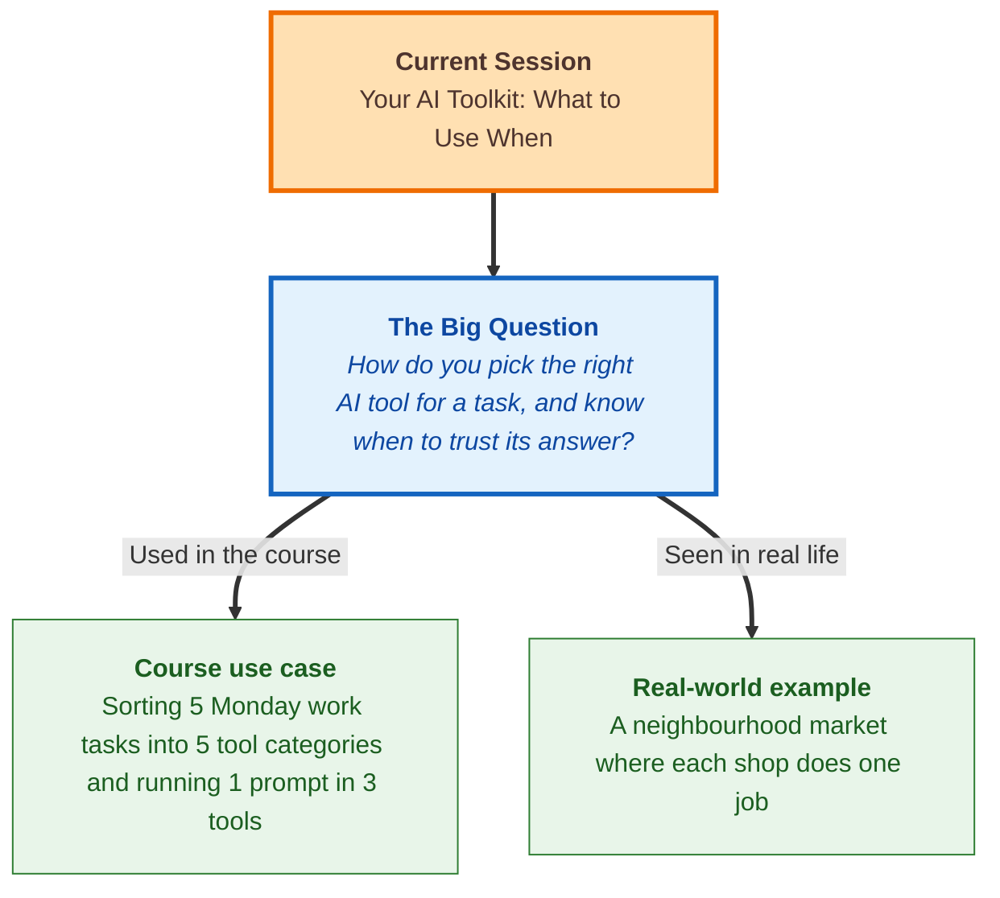

## Your AI Toolkit: What to Use When

### Mental Map

---

### What You'll Learn

Have you ever wondered how you know which shop in the market to visit for a torn shirt?

By the end of this session, you will be able to:

- **Identify** which of 3 shared items, such as your phone PIN, you should never hand to a shopkeeper.
- **Classify** 5 errands by the shop type that suits each one.
- **Differentiate** a signboard that gives proof from a signboard that only boasts.
- **Compare** what 3 tailors do with the same torn shirt, and name each one's trade-off.
- **Examine** a stranger's directions to find a shop that does not exist.
- **Judge** when to give a shopkeeper no sample and when to show 2 samples.

> **Topics you will meet:** Tool categories, task matching, four-tool comparison, vendor claims, zero-shot and few-shot, hallucinations, unsafe data.
>
> Join the session to learn each of these in detail.

---

### Why You Are Learning This Topic

On Saturday you walk through your market with 5 errands. A vegetable seller, a tailor and a cobbler each do one job.

You would never ask the cobbler to hem trousers. You also check a shop before you trust it.

A **prompt** means the instruction you type into an AI tool. Each AI tool is like a shop, because each one suits certain jobs.

In this course you will use free AI tools every week.

> **Think about it:** If a signboard says "Best tailor in town", what would make you believe it?

---

### The Market Errands Puzzle

Here are your 4 errands for Saturday and the shops that might help.

| Errand | Shop 1 | Shop 2 | Shop 3 |
|:----------:|:----------:|:----------:|:----------:|
| Hem a torn shirt | Tailor | Cobbler | Grocer |
| Fix a sandal strap | Cobbler | Tailor | Florist |
| Buy 2 kg of tomatoes | Grocer | Tailor | Cobbler |
| Print a birthday photo | Photo studio | Grocer | Tailor |

**What you want to happen:**

- Each errand goes to the shop that fits it.
- You trust a shop for a reason, not a loud signboard.
- You never hand over private details.

> **Wonder about this:**
>
> - Would 3 tailors stitch the same shirt in the same way?
> - What would you do if a stranger sent you to a shop that is not there?

---

### Think It Through

There is no wrong first try. Keep your guesses for the session.

**1. A signboard reads "Number 1 in the whole city". A second reads "Open since 1998, 40 reviews posted on the wall". Which one can you check?**
Hint: Look for something you can count or visit.

**2. You tell a tailor "make it look like my old shirt". Would 2 sample hems on the counter change the result?**
Hint: Think about words versus showing.

**3. A stranger says the best tailor is in "Rose Lane, shop 14". You walk there and find a wall. What should you do before asking him again?**
Hint: Think about how you could have checked first.

---

### One Question to Carry Into the Session

> **How do you choose a helper for a job and check its work before you rely on it?**
>
> Which of your own details would you never hand to a new helper?
