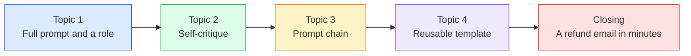
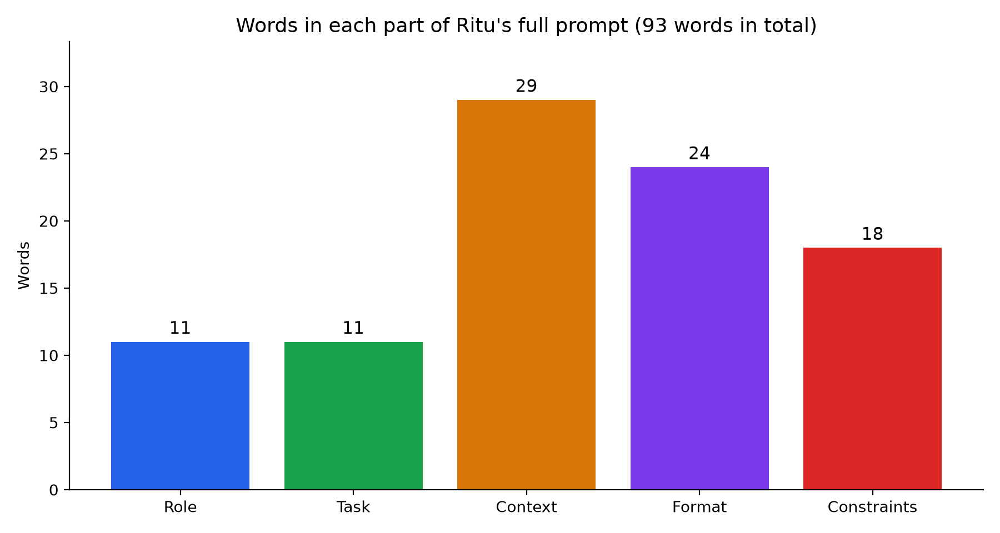
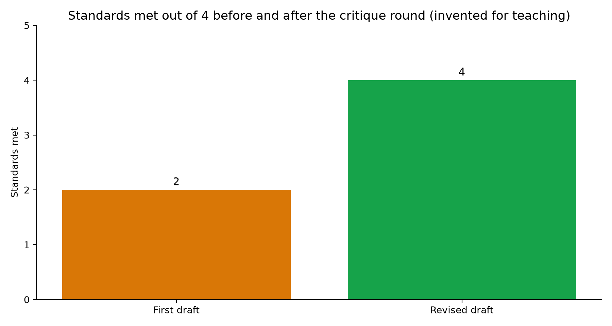
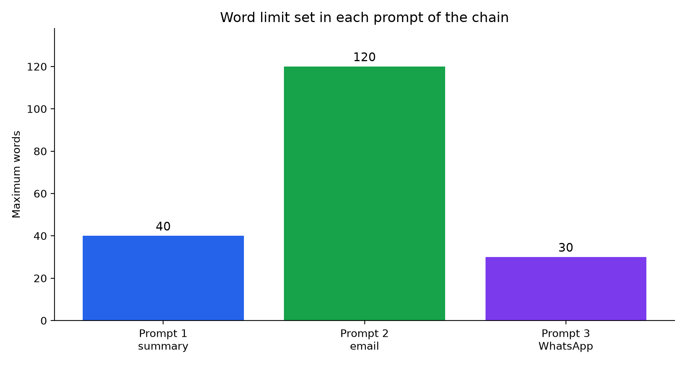
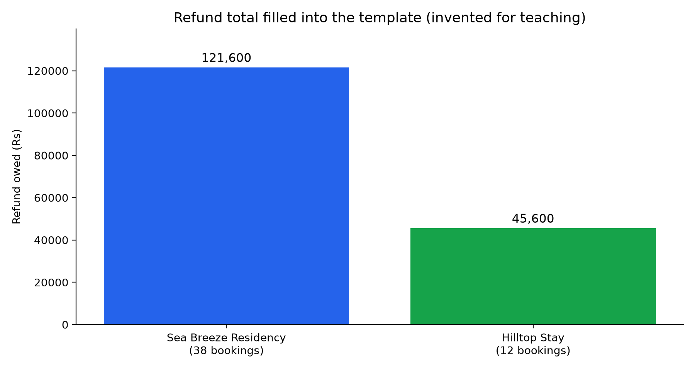

# <font color='#1d4ed8'>Lecture Script: Prompt Chaining with Critique and Personas</font>

---

## <font color='blue'>Agenda</font>

The lecture runs as four topics. Each topic ends with a quiz.

| Topic | What we do | Learning objectives covered | Minutes |
|:-:|:--|:--|:-:|
| 1 | Write the full prompt and give it a role | State the four elements of a well-formed prompt: task, context, format and constraints<br>Apply role prompting to set the vocabulary and depth of an answer | 30 |
| 2 | Ask the tool to check its own draft | Apply self-correction by asking the model to critique and revise its own output | 25 |
| 3 | Chain prompts so one output feeds the next | Apply prompt chaining so one prompt's output becomes the next prompt's input | 25 |
| 4 | Turn the recipe into a reusable template | Build a reusable prompt template with named placeholders for the variable inputs | 25 |
| — | Closing: Outcome & Summary | | 15 |
| | **Total** | | **120** |

> <font color="red">**🎯 Instructor Note**</font> Pace: Topic 1 revisits the four elements quickly, then spends its time on roles. Keep the most minutes for the live critique round in Topic 2.
> Learners need one free chat tool open: ChatGPT, Claude or Gemini. Replies are never pasted here, because they change on every run. Run each live step and read the real reply.

---

## <font color='blue'>Scenario</font>

**One risk, one deadline.** Ritu works in partner operations at a MakeMyTrip-style travel app. A hotel partner has not paid refunds on 38 cancelled bookings. Each customer is waiting, and Ritu must send the hotel an email today.

She types: "Write an email to the hotel about refunds."

> <font color="red">**🎯 Instructor Note**</font> The company is only the setting. Do not claim it works this way. The hotels, bookings, refund amounts and dates are invented for teaching. Today is Monday, 19 October 2026.

---

## <font color='blue'>Problem Statement</font>

The tool writes a polite, long email that says "kindly look into pending refunds". It names no count, no amount and no date. The hotel replies two days later: "Which refunds? By when?" The 38 customers wait another week, and three of them complain publicly.

You already know that a good prompt has a task, context, format and constraints. Today we sharpen that prompt, make the tool check itself, link prompts into a chain, and save the recipe for next time.

> <font color='purple'>**How does Ritu get a precise email on the first try, improve it with a check, and reuse the recipe for the next hotel?**</font>

> <font color="red">**🎯 Instructor Note**</font> Poll: "If you ask a tool 'is this draft good?', will it always find the real problems?" Options: yes or no. Give learners 30 seconds to respond in chat. Reveal the answer in the Closing.

---

## <font color='blue'>What We Will Use</font>

One free chat tool and a plain text note for your template. Today is about how you write the prompt, not about a new tool.

| Topic | Ideas | In one line |
|:-:|:--|:--|
| 1 | Four elements, role prompting | Give the job, facts, shape, limits and a persona |
| 2 | Self-critique | Name the standard, then ask for a check and a revision |
| 3 | Prompt chaining | Paste the output of one prompt into the next |
| 4 | Prompt template | Fixed wording plus named placeholders for what changes |

---

## <font color='blue'>How: Walking Through Ritu's Refund Email</font>



---

## <font color='blue'>Topic 1: Write the full prompt and give it a role</font> `30 min`

> <font color='purple'>**Ritu's prompt had 8 words. What is missing, and who should the tool pretend to be?**</font>

### <font color='green'>Example: From 8 words to a full prompt</font>

> <font color='purple'>**Which four parts turn "Write an email to the hotel about refunds." into a usable prompt?**</font>

You met the four elements before: **task** (what to do), **context** (facts the tool cannot know), **format** (the shape of the output) and **constraints** (limits and things to avoid). Ritu fills each one.

| Element | Ritu's wording | Words |
|:--|:--|:-:|
| Task | Write an email to a hotel owner asking for pending refunds. | 11 |
| Context | The hotel, Sea Breeze Residency, owes refunds on 38 cancelled bookings from 1 to 15 October 2026. The average refund is Rs 3,200, so the total is Rs 1,21,600. | 29 |
| Format | Start with a subject line. Put the ask in the first sentence. Use 3 short bullets for the details. Keep it under 120 words. | 24 |
| Constraints | Be polite and do not blame. Ask for payment by 28 October 2026. Do not invent booking IDs. | 18 |

The total refund is $38 \times 3200 = 121{,}600$ rupees.

> <font color="red">**🎯 Instructor Note**</font> Learners paste the four rows into their tool as one prompt and run it live. Read the real email and tick off count, amount, date and ask-in-first-line. Missing items mean the prompt needs a fix.

<p align="center"></p>

#### <font color='#c2410c'>Logic Explanation</font>

- Context is the longest part, with 29 words. It holds the facts that the tool cannot guess.
- The task, format and constraints, with $11 + 24 + 18 = 53$ words, shape the output so it is checkable.

> <font color='green'>**Result**</font> A 93-word prompt replaces an 8-word one. Count, amount and date now come from Ritu, not from the tool's imagination.

### <font color='green'>Extending it: Add a role</font>

> <font color='purple'>**Does it matter who the tool pretends to be?**</font>

**Role prompting** starts the prompt with a persona, such as "You are a senior partner-relations manager at a travel booking app." The persona shapes vocabulary (word choice) and depth (how much detail).

> <font color="red">**🎯 Instructor Note**</font> Learners run the same four-part prompt twice with different roles and compare. Ask for the first-line words in chat. Expected: the manager role uses terms like "settlement", the trainee role uses plain words.

| Role line | What to compare |
|:--|:--|
| "You are a senior partner-relations manager." | Vocabulary: formal business terms? Depth: more detail on dates and amounts? |
| "You are a trainee who writes plain English for a school leaver." | Vocabulary: short common words? Depth: fewer details? |

> <font color='green'>**Result**</font> The role changes the voice and depth, not the facts. Check that the count, amount and date stayed correct in both emails.

> <font color='#b45309'>**Common mistake**</font> Using a role to replace context. Fix: the role sets the voice, and the context still supplies the facts.

### <font color='purple'>Quiz 1</font>

**Question:** Which line from Ritu's prompt is the role?

**Options:**
- A) Write an email to a hotel owner asking for pending refunds.
- B) The hotel owes refunds on 38 cancelled bookings.
- C) Keep it under 120 words.
- D) You are a senior partner-relations manager at a travel booking app.

**Correct Answer:** D

**Explanation:**
- **A)** This is the task: what to do.
- **B)** This is context: a fact the tool cannot know.
- **C)** This is format: the length and shape of the output.
- **D)** Correct. A role names who the tool should act as and sets voice and depth.

---

## <font color='blue'>Topic 2: Ask the tool to check its own draft</font> `25 min`

> <font color='purple'>**The email now has numbers. How does Ritu catch what is still wrong before she sends it?**</font>

### <font color='green'>Example: Critique against a standard</font>

> <font color='purple'>**What must Ritu tell the tool so that its critique is useful?**</font>

**Self-correction** means asking the model to critique its own draft and then revise it. A critique needs a standard. Without one, the tool often answers "this looks good".

```
Here is your draft email. Check it against these 4 standards:
1. The ask is in the first sentence.
2. It names 38 bookings, Rs 1,21,600 and 28 October 2026.
3. It does not blame the hotel.
4. It is under 120 words.
List each standard as met or not met, then write a revised email.
```

> <font color="red">**🎯 Instructor Note**</font> Learners paste Topic 1's email under this prompt and run it live. Read the verdicts and check each yourself, for example by counting words. Expected: the tool may call a failed standard "met".

<p align="center"></p>

#### <font color='#c2410c'>Logic Explanation</font>

- The chart is an invented illustration of one round, not a measured result. First draft $2$ of $4$ standards met, revised draft $4$ of $4$.
- The four standards are the same four things you would check by hand. You still check the revision yourself.

> <font color='green'>**Result**</font> A named standard turns "is this good?" into four yes-or-no checks. The revision is better only if you verify the checks.

### <font color='green'>Extending it: Change the standard</font>

> <font color='purple'>**What if Ritu cares most about tone for a long-time partner hotel?**</font>

> <font color="red">**🎯 Instructor Note**</font> Ask learners to replace standard 3 with "Reads as warm to a 10-year partner" and run again. Expected: the tool critiques tone, but tone is subjective, so learners decide.

> <font color='green'>**Result**</font> The critique follows whatever standard you write. Choose standards you can check.

> <font color='#b45309'>**Common mistake**</font> Trusting "all four standards met". Fix: count the words and find the date yourself.

### <font color='purple'>Quiz 2</font>

**Question:** Why does Ritu list four standards in the critique prompt?

**Options:**
- A) So the tool writes a longer email
- B) So the critique has something specific to check against
- C) So she never has to read the email again
- D) So the tool can look the standards up online

**Correct Answer:** B

**Explanation:**
- **A)** The standards set what to check, not the length of the email.
- **B)** Correct. A named standard turns a vague opinion into specific checks.
- **C)** The tool can be wrong, so Ritu still reads the revision.
- **D)** The standards are written in the prompt. Nothing is looked up.

---

## <font color='blue'>Topic 3: Chain prompts so one output feeds the next</font> `25 min`

> <font color='purple'>**Ritu's refund list is 6 messy lines from a spreadsheet. Can one prompt do everything, or should she split the job?**</font>

### <font color='green'>Example: A three-prompt chain</font>

> <font color='purple'>**How does the output of one prompt become the next prompt's input?**</font>

**Prompt chaining** splits a job into small prompts. You copy the output of prompt 1 into prompt 2, and so on. Each prompt has one clear job and its own check.

| Prompt | Input | Job | Limit | Output goes to |
|:-:|:--|:--|:-:|:--|
| 1 | 6 raw refund lines | Summarise the case: count, amount, dates | 40 words | Prompt 2 |
| 2 | Prompt 1's summary | Write the email in Topic 1's format | 120 words | Prompt 3 |
| 3 | Prompt 2's email | Make a WhatsApp version of the ask | 30 words | Ritu sends it |

Prompt 1 receives these 6 raw lines, all invented for teaching.

```
SBR-01 | Meena R | Rs 3,100 | cancelled 2 Oct | refund not received
SBR-02 | Kabir S | Rs 3,400 | cancelled 4 Oct | refund not received
SBR-03 | Latha P | Rs 2,900 | cancelled 7 Oct | refund not received
SBR-04 | Imran Q | Rs 3,300 | cancelled 8 Oct | refund not received
SBR-05 | Divya T | Rs 3,000 | cancelled 11 Oct | refund not received
SBR-06 | Joseph M | Rs 3,500 | cancelled 14 Oct | refund not received
```

> <font color="red">**🎯 Instructor Note**</font> Learners paste the 6 lines into prompt 1. Read each output and fix errors before pasting it forward. An error in prompt 1 spreads to prompt 3.

<p align="center"></p>

#### <font color='#c2410c'>Logic Explanation</font>

- Prompt 1 limits the summary to 40 words, so prompt 2 receives only the facts that matter.
- If prompt 1 gets the amount wrong, the email and the WhatsApp message repeat the error. Check at each link.

> <font color='green'>**Result**</font> A chain gives you three small outputs to check instead of one big one. The checks happen between the links.

### <font color='green'>Extending it: Add a critique link</font>

> <font color='purple'>**Where does Topic 2's critique fit in the chain?**</font>

> <font color="red">**🎯 Instructor Note**</font> Ask for a prediction in chat. Expected: between prompt 2 and prompt 3, so the WhatsApp message is made from a checked email.

> <font color='green'>**Result**</font> The chain becomes summary, email, critique and revision, then WhatsApp. Each output is checked before it moves on.

> <font color='#b45309'>**Common mistake**</font> Asking for the whole chain in one giant prompt. Fix: run one link at a time so you can inspect each output.

### <font color='purple'>Quiz 3</font>

**Question:** What makes a set of prompts a chain?

**Options:**
- A) The output of one prompt is used as the input to the next
- B) All prompts are sent in the same minute
- C) Every prompt uses the same role line
- D) Each prompt is longer than the one before

**Correct Answer:** A

**Explanation:**
- **A)** Correct. Chaining means the output of one prompt feeds the next.
- **B)** Timing does not matter. The link between outputs and inputs does.
- **C)** Roles can differ across links, or be the same. Neither makes a chain.
- **D)** Length is unrelated to chaining.

---

## <font color='blue'>Topic 4: Turn the recipe into a reusable template</font> `25 min`

> <font color='purple'>**Next week another hotel owes refunds. Does Ritu start from zero?**</font>

### <font color='green'>Example: Mark what changes</font>

> <font color='purple'>**Which words stay the same, and which words change for every hotel?**</font>

A **prompt template** is a saved prompt with named **placeholders** in curly braces where the changing inputs go. Ritu replaces each placeholder before sending.

```
You are a senior partner-relations manager at a travel booking app.
Write an email to the owner of {HOTEL} asking for pending refunds.
{HOTEL} owes refunds on {COUNT} cancelled bookings. The total is Rs {TOTAL}.
Start with a subject line. Put the ask in the first sentence.
Use 3 short bullets. Keep it under 120 words.
Be polite and do not blame. Ask for payment by {DEADLINE}. Do not invent booking IDs.
```

> <font color="red">**🎯 Instructor Note**</font> Ask learners to name the four placeholders in chat. Expected: HOTEL, COUNT, TOTAL and DEADLINE. Everything else is fixed wording.

#### <font color='#c2410c'>Logic Explanation</font>

- Name each placeholder in capitals so you cannot miss it before you send.
- Fixed lines hold the role, format and constraints. Placeholders hold only what changes.

> <font color='green'>**Result**</font> One template now covers every hotel. Four values change, and the other lines stay fixed.

### <font color='green'>Extending it: Fill it for two hotels</font>

> <font color='purple'>**What do the placeholders hold for Sea Breeze Residency and for Hilltop Stay?**</font>

| Placeholder | Sea Breeze Residency | Hilltop Stay |
|:--|:--|:--|
| {HOTEL} | Sea Breeze Residency | Hilltop Stay |
| {COUNT} | 38 | 12 |
| {TOTAL} | 1,21,600 | 45,600 |
| {DEADLINE} | 28 October 2026 | 30 October 2026 |

The totals follow from the averages: $38 \times 3200 = 121{,}600$ and $12 \times 3800 = 45{,}600$.

<p align="center"></p>

> <font color="red">**🎯 Instructor Note**</font> Learners fill the template for both hotels and run it live. Check that no placeholder braces remain in the pasted prompt.

> <font color='green'>**Result**</font> Two correct prompts take a minute each, because Ritu only types four values.

> <font color='#b45309'>**Common mistake**</font> Leaving a placeholder such as {DEADLINE} unfilled. Fix: search the prompt for curly braces before you send.

### <font color='purple'>Quiz 4</font>

**Question:** In a prompt template, what do named placeholders mark?

**Options:**
- A) The parts of the prompt the tool must ignore
- B) The parts that the tool will write for you
- C) The inputs that change each time you reuse the template
- D) The role line that must never change

**Correct Answer:** C

**Explanation:**
- **A)** The tool reads the whole prompt. Placeholders are replaced before sending.
- **B)** You fill placeholders yourself, before the tool sees the prompt.
- **C)** Correct. Placeholders hold the inputs that vary, such as the hotel name and deadline.
- **D)** The role line is usually fixed wording, not a placeholder.

---

## <font color='blue'>Closing: Outcome & Summary</font> `15 min`

Back to Ritu. We answer the Problem Statement using each topic once.

> <font color='purple'>**1. How does she get a precise email first time? (Topic 1)**</font>

She writes all four elements and adds a role line. The count, amount and date come from her context, and the role sets the voice.

> <font color='purple'>**2. How does she improve it? (Topic 2)**</font>

She names four standards and asks the tool to check and revise. She then verifies the checks herself.

> <font color='purple'>**3. How does she handle the messy refund list? (Topic 3)**</font>

She chains three prompts: summary, email, WhatsApp. She checks each output before it moves on.

> <font color='purple'>**4. How does she reuse it? (Topic 4)**</font>

She saves the recipe with four placeholders and fills them for each hotel.

### <font color='green'>Outcome</font>

| | "Write an email to the hotel about refunds." | Ritu's chain and template |
|:--|:-:|:-:|
| Prompt length | 8 words | 93 words, reused |
| Count, amount, date in the email | Missing | Supplied by Ritu |
| Checked before sending | No | Yes, by a named standard and by Ritu |
| Next hotel | Start from zero | Fill 4 placeholders |

> <font color='green'>**Therefore,**</font> Ritu should write all four elements with a role, ask the tool to critique against named standards, chain small prompts with a check between links, and save the result as a template. She still reads and verifies the final email.

> <font color="red">**🎯 Instructor Note**</font> Reveal the poll: no. A tool can say "looks good" about a draft that fails a standard, so you check the standards yourself.

### <font color='green'>Summary</font>

| Learning objective | Takeaway |
|:--|:--|
| Four elements | Task, context, format and constraints make a prompt specific |
| Role prompting | A persona sets vocabulary and depth, not facts |
| Self-correction | Name the standards, ask for critique and revision, then verify |
| Prompt chaining | One prompt's output is the next prompt's input, with a check between links |
| Prompt template | Fixed wording plus named placeholders for the inputs that change |
| **Practical value** | You can turn a repeated work task into a saved recipe that gives checkable output in minutes |

---

# <font color='red'>Launch the Feedback Poll</font>

> <font color="red">**🎯 Instructor Note**</font> Reminder: launch the feedback poll now to collect learner feedback.
