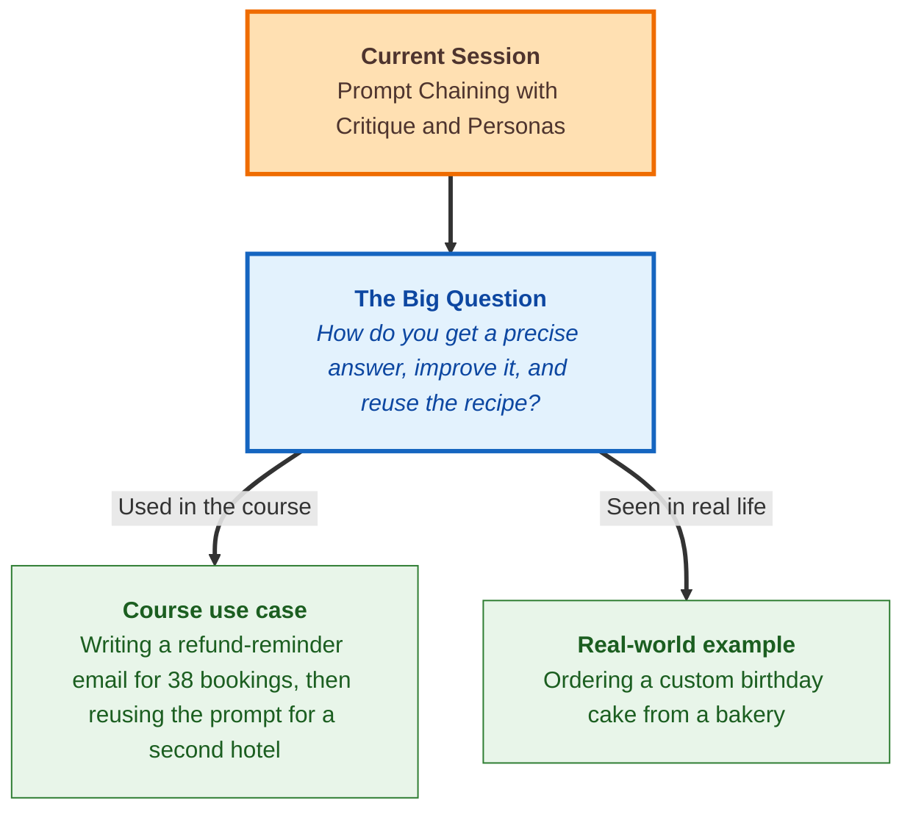

## Prompt Chaining with Critique and Personas

### Mental Map

---

### What You'll Learn

Have you ever wondered why a baker gets your cake order right when you write it on a form?

By the end of this session, you will be able to:

- **List** the 4 details every cake order needs: the job, the facts, the shape and the limits.
- **Demonstrate** how telling the baker to act as a pastry chef changes the words in the reply.
- **Apply** a check, such as "does the slip show 2 kg and Friday 5 pm?", to the baker's order slip.
- **Trace** how a design sketch becomes a price, and the price becomes a pickup message.
- **Design** an order form with blanks that you reuse for a 1 kg or a 3 kg cake.

> **Topics you will meet:** Full prompt, role prompting, self-critique, prompt chaining, reusable templates.
>
> Join the session to learn each of these in detail.

---

### Why You Are Learning This Topic

Your cousin's birthday is on Friday. You call a bakery and say, "I want a cake."

The baker asks 6 questions: the flavour, the weight, the date, the message, the budget and the allergies. You answer, and the order is clean.

A **prompt** means the instruction you give an AI tool. A vague prompt gets the same 6 questions back, or a wrong guess.

In this course you will write prompts that leave no questions open.

> **Think about it:** What would the baker make if you only said "a cake"?

---

### The Birthday Cake Puzzle

Here is the order for your cousin's cake.

| Detail | Your order |
|:----------:|:----------:|
| Flavour | Mango |
| Weight | 2 kg |
| Message on top | Happy Birthday Tara |
| Pickup | Friday, 5 pm |
| Budget | Rs 1,800 |

**What you want to happen:**

- The baker writes down all 5 details without asking again.
- The baker checks the slip against your list before baking.
- Next month you reuse the same form for a 1 kg cake.

> **Wonder about this:**
>
> - Would the baker bake differently if you said "you are a pastry chef who loves mangoes"?
> - If the baker writes the price on the slip, can that price feed your pickup message?

---

### Think It Through

There is no wrong first try. Keep your guesses for the session.

**1. You hand over the slip. Which 2 checks would you ask the baker to check before baking?**
Hint: Compare the slip with your 5 details.

**2. The price goes up from Rs 1,800 to Rs 2,200 after a design change. What do you do with the next message?**
Hint: One answer feeds the next question.

**3. Which 2 details of your order stay the same next month, and which 2 change?**
Hint: Weight and date are likely to change.

---

### One Question to Carry Into the Session

> **How can one carefully written order be checked, chained and reused?**
>
> Which of your own weekly tasks would you turn into a fill-in-the-blank form?
