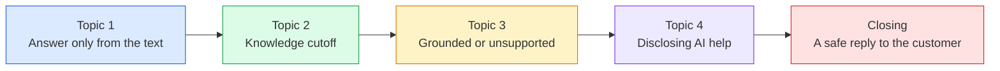
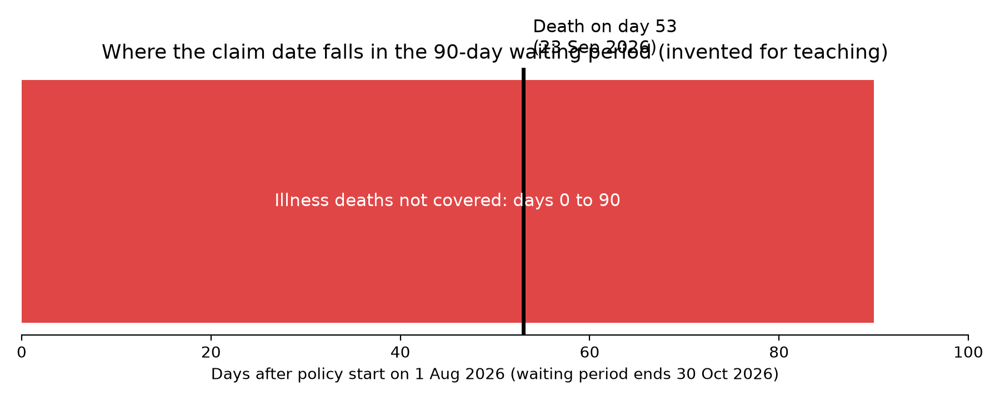
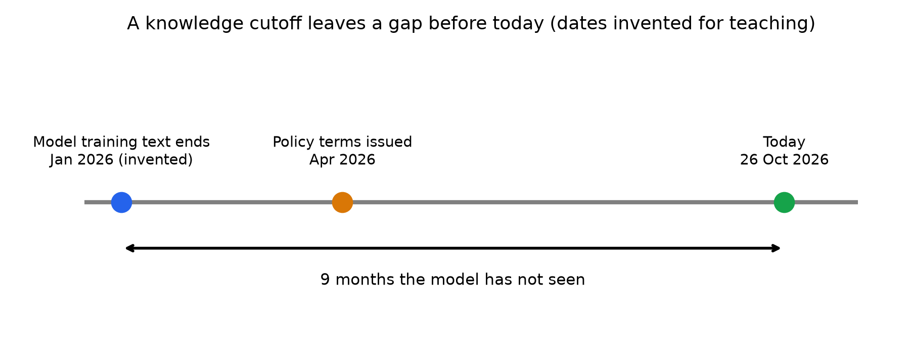
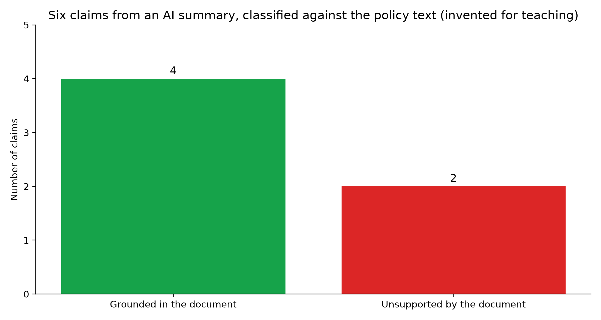
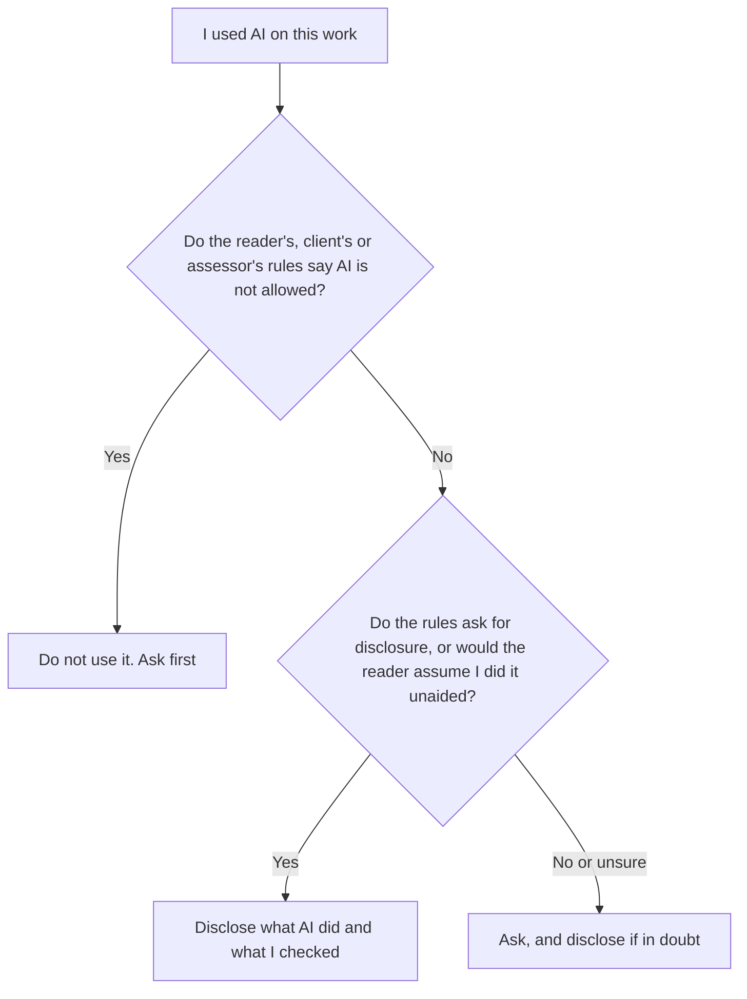

# <font color='#1d4ed8'>Lecture Script: AI for Documents and Research</font>

---

## <font color='blue'>Agenda</font>

The lecture runs as four topics. Each topic ends with a quiz.

| Topic | What we do | Learning objectives covered | Minutes |
|:-:|:--|:--|:-:|
| 1 | Summarise a document and answer only from it | Write a prompt that instructs the model to answer only from supplied reference text | 30 |
| 2 | See why a tool can be out of date | Describe a model's knowledge cutoff and its effect on recent-fact questions | 25 |
| 3 | Check each claim against the source | Classify a generated claim as grounded in or unsupported by the provided context | 30 |
| 4 | Decide when to tell the reader about AI help | State when the use of AI assistance must be disclosed to a reader, client or assessor | 20 |
| — | Closing: Outcome & Summary | | 15 |
| | **Total** | | **120** |

> <font color="red">**🎯 Instructor Note**</font> Pace: Topic 1 and Topic 3 carry the most practice. Keep Topic 4 to a short discussion with the decision flow.
> Learners need one free chat tool open: ChatGPT, Claude or Gemini. File upload limits change, so pasting the text always works. Replies are never pasted here. Run each live step and read the real reply.

---

## <font color='blue'>Scenario</font>

**Two answers to one customer question.** Farhan works on the claims desk at an LIC-style life insurer. A customer's relative died of an illness on 23 September 2026. The policy started on 1 August 2026. The customer asks, "Is this covered?"

| | What happened |
|:--|:--|
| Without checking | Farhan asks a chat tool, "Are illness deaths covered in the first months of a term plan?" and passes on a general answer |
| With the document | The policy's own terms say illness deaths in the first 90 days are not covered |

> <font color="red">**🎯 Instructor Note**</font> The company is only the setting. Do not claim it works this way. The insurer, the "SureShield Term Plan" terms, the dates and the claims are invented for teaching. Today is Monday, 26 October 2026.

---

## <font color='blue'>Problem Statement</font>

Farhan trusts the tool's general answer and tells the customer that the claim will be paid. The policy terms say otherwise, so the claim is refused two weeks later. The customer feels cheated, and the insurer must now explain why its own desk gave the wrong answer.

> <font color='purple'>**How should Farhan make a tool answer only from the policy text, know when the tool may be out of date, check each claim against the source, and tell readers about the AI help?**</font>

> <font color="red">**🎯 Instructor Note**</font> Poll: "If a tool answers a question about your document, is the answer always taken from your document?" Options: yes or no. Give learners 30 seconds to respond in chat. Reveal the answer in the Closing.

---

## <font color='blue'>What We Will Use</font>

One free chat tool and a short invented policy document. Today you paste the document in, ask questions about it and check the answers.

| Topic | Tools | In one line |
|:-:|:--|:--|
| 1 | Chat tool, document text | Summarise a document and tell the tool to answer only from it |
| 2 | Chat tool, a fresh chat | Ask without the document and see the cutoff gap |
| 3 | Chat tool, the document | Match each claim to a clause, or mark it unsupported |
| 4 | A short disclosure line | Say what AI did and what you checked |

---

## <font color='blue'>How: Walking Through Farhan's Policy Question</font>



---

## <font color='blue'>Topic 1: Summarise a document and answer only from it</font> `30 min`

> <font color='purple'>**Farhan has the policy terms in front of him. How does he make the tool use them and nothing else?**</font>

### <font color='green'>Example: Summarise the terms</font>

> <font color='purple'>**What does the tool say when we give it the document?**</font>

Here are the six clauses, invented for teaching. Learners paste them into the chat tool, or save them as a text file and attach it.

```
SureShield Term Plan, key terms (invented for teaching)
1. Waiting period: death from illness within 90 days of the start date is not covered. Accidental death is covered from day 1.
2. Sum assured: Rs 25,00,000.
3. Grace period: 15 days for monthly premiums, 30 days for yearly premiums.
4. Free-look: cancel within 15 days of receiving the policy and get the premium back.
5. Revival: a lapsed policy can be revived within 2 years of the first unpaid premium.
6. Suicide exclusion: not covered within 12 months of the start date.
```

Prompt: "Summarise these terms in 6 bullets, one per clause."

> <font color="red">**🎯 Instructor Note**</font> Learners run this live and read the reply against the six clauses. Ask whether any bullet adds a fact that is not above. Expected: a good summary adds none.

> <font color='green'>**Result**</font> A summary of a short document is a safe first task. Compare each bullet with its clause.

### <font color='green'>Extending it: A grounded question</font>

> <font color='purple'>**How does Farhan ask the customer's question so the tool cannot use outside knowledge?**</font>

A **grounded prompt** supplies the reference text and tells the tool to answer only from it, with a fixed reply when the answer is missing.

```
Answer only from the text between the triple quotes.
If the answer is not in the text, reply exactly: Not in the document.
Name the clause number you used.
"""(paste the six clauses here)"""
Question: The policy started on 1 August 2026. Is a death from illness on
23 September 2026 covered?
```

The gap between the dates is 53 days, which is inside the 90-day waiting period.

> <font color="red">**🎯 Instructor Note**</font> Learners run this live. Expected: not covered, clause 1. Then ask "What is the premium tax rate?" Expected: "Not in the document."

<p align="center"></p>

#### <font color='#c2410c'>Logic Explanation</font>

- Line 1 limits the source. Line 2 gives the tool a fixed way to say "no answer", so it does not guess.
- Line 3 asks for the clause number, which gives you something to verify.
- Day 53 is under the 90 days of clause 1, so the illness death is not covered.

> <font color='green'>**Result**</font> A grounded prompt has three parts: only this text, a fixed "not found" reply, and a clause reference you can check.

> <font color='#b45309'>**Common mistake**</font> Pasting the document but asking an open question. Fix: add the "answer only from the text" line every time.

### <font color='purple'>Quiz 1</font>

**Question:** Which prompt makes the tool answer from the supplied text?

**Options:**
- A) "Tell me about term plans."
- B) "Summarise this and add anything useful you know."
- C) "Answer only from the text below. If it is not there, reply 'Not in the document.'"
- D) "Answer quickly and politely."

**Correct Answer:** C

**Explanation:**
- **A)** An open question invites general knowledge, not the document.
- **B)** "Add anything useful you know" allows facts from outside the text.
- **C)** Correct. It limits the source and gives a fixed reply for missing answers.
- **D)** Speed and politeness do not limit the source.

---

## <font color='blue'>Topic 2: See why a tool can be out of date</font> `25 min`

> <font color='purple'>**The grounded prompt worked. What happens when Farhan asks the same tool a question with no document?**</font>

### <font color='green'>Example: Ask without the document</font>

> <font color='purple'>**What does the tool know about something that happened after its training?**</font>

A **knowledge cutoff** is the date after which a model's training text has nothing. The model does not know events or documents that came later, unless the tool also searches the web.

> <font color="red">**🎯 Instructor Note**</font> Live step in a new chat with no document. Ask: "What is your knowledge cutoff?" and "What changed in the SureShield Term Plan terms issued in April 2026?" Read the replies. The plan is invented, so any detail the tool gives is made up.

<p align="center"></p>

#### <font color='#c2410c'>Logic Explanation</font>

- From January to October 2026 is $10 - 1 = 9$ months. Anything published in that gap is unknown to a model with this invented cutoff.
- A tool with web search may find newer pages. Check whether search was used, and open the sources it shows.

> <font color='green'>**Result**</font> A model can be confident about old facts and silent or wrong about recent ones. Treat any recent fact from memory as unchecked.

### <font color='green'>Extending it: Fix it with the document</font>

> <font color='purple'>**Does pasting the April 2026 terms fix the cutoff problem?**</font>

> <font color="red">**🎯 Instructor Note**</font> Learners repeat the question with the six clauses pasted and the grounded rule from Topic 1. Expected: the answer now comes from the text, and gaps are "Not in the document".

> <font color='green'>**Result**</font> Supplying the current text moves the answer from memory to your source. You still check it.

> <font color='#b45309'>**Common mistake**</font> Asking a recent-fact question and trusting a fluent reply. Fix: ask for the source, or supply the document.

### <font color='purple'>Quiz 2</font>

**Question:** A model's training text ends in January 2026. What is the effect on a question about a rule issued in April 2026?

**Options:**
- A) The model may not know the rule and may answer from older knowledge
- B) The model always says "I do not know"
- C) The model knows every rule issued before today
- D) The model's answer is always correct if it sounds sure

**Correct Answer:** A

**Explanation:**
- **A)** Correct. Anything after the cutoff is not in the training text, so a reply may be old or invented.
- **B)** Models often answer anyway, so you cannot rely on a refusal.
- **C)** Only text before the cutoff can be learned.
- **D)** A confident tone does not prove accuracy.

---

## <font color='blue'>Topic 3: Check each claim against the source</font> `30 min`

> <font color='purple'>**The tool wrote a customer summary. How does Farhan find which sentences he can send?**</font>

### <font color='green'>Example: Six claims, six verdicts</font>

> <font color='purple'>**Which claims are grounded in the clauses, and which are unsupported?**</font>

A claim is **grounded** when a clause in the supplied text says it. It is **unsupported** when no clause says it, or a clause says something different.

> <font color="red">**🎯 Instructor Note**</font> The six claims are invented for teaching. Cover the last two columns, ask learners to classify in chat, then reveal. Expected: claim 3 is the tricky one, because it twists a real number.

| # | Claim in the summary | Clause | Verdict |
|:-:|:--|:-:|:--|
| 1 | Illness deaths in the first 90 days are not covered | 1 | Grounded |
| 2 | The sum assured is Rs 25,00,000 | 2 | Grounded |
| 3 | Monthly premiums get a 30-day grace period | 3 says 15 days | Unsupported |
| 4 | Pre-existing diseases are covered after 2 years | none | Unsupported |
| 5 | The policy can be cancelled within 15 days of receipt for a premium refund | 4 | Grounded |
| 6 | A lapsed policy can be revived within 2 years of the first unpaid premium | 5 | Grounded |

<p align="center"></p>

#### <font color='#c2410c'>Logic Explanation</font>

- Four of six claims are grounded, so $\frac{4}{6} \approx 67\%$ are safe to send. Two are unsupported and must be removed or fixed.
- For each claim, ask: which clause says this, and does it say exactly this?

> <font color='green'>**Result**</font> Claims 1, 2, 5 and 6 are grounded. Claims 3 and 4 are unsupported.

### <font color='green'>Extending it: Ask the tool for clause numbers, then verify</font>

> <font color='purple'>**Can the tool do the clause-matching for Farhan?**</font>

> <font color="red">**🎯 Instructor Note**</font> Live step: ask the tool to tag each claim with a clause and a quoted phrase. Learners search the document for each quote. Expected: some quotes may not exist, so verify.

> <font color='green'>**Result**</font> A tool's tag is a lead, not proof. Search the document for the quoted words yourself.

> <font color='#b45309'>**Common mistake**</font> Trusting a claim because it is close to a real number. Fix: compare the exact number, 15 against 30.

### <font color='purple'>Quiz 3</font>

**Question:** A summary says, "The grace period is 30 days for monthly premiums." Clause 3 says 15 days for monthly premiums. How do you classify it?

**Options:**
- A) Grounded, because a grace period is mentioned
- B) Grounded, because 30 days appears in clause 3
- C) Grounded, because the tool sounded sure
- D) Unsupported, because the clause gives a different number for monthly premiums

**Correct Answer:** D

**Explanation:**
- **A)** The topic matches, but the number does not.
- **B)** 30 days belongs to yearly premiums, not monthly.
- **C)** Tone is not evidence.
- **D)** Correct. A claim that conflicts with the source is unsupported.

---

## <font color='blue'>Topic 4: Decide when to tell the reader about AI help</font> `20 min`

> <font color='purple'>**Farhan's note to the customer was drafted with AI. Does the reader need to know?**</font>

### <font color='green'>Example: A disclosure rule of thumb</font>

> <font color='purple'>**When must the use of AI assistance be disclosed?**</font>

Disclose when a rule asks for it, or when the reader would assume the work was done without AI and AI shaped its content. Where AI is not allowed, disclosing does not make using it allowed.



> <font color="red">**🎯 Instructor Note**</font> Rules differ by employer, client and school. Tell learners to read their own policy, because this lecture gives a rule of thumb, not legal advice.

| Situation | Action |
|:--|:--|
| A college assignment says "declare any AI use" | Disclose |
| A client contract asks for tools used in a report | Disclose |
| An assessor says AI is not allowed | Do not use it |
| AI summarised 5 sources for a published note | Disclose, and say what you verified |
| AI only checked the spelling of a message to a colleague | No rule asks, so usually no disclosure. Follow your workplace policy |

A short disclosure line: "Drafted with help from a chat tool. I checked every clause number and figure against the policy text."

> <font color='green'>**Result**</font> Disclose when a rule asks or when the reader would otherwise be misled. State what the tool did and what you checked.

### <font color='purple'>Quiz 4</font>

**Question:** A client's contract asks for any AI tools used on a report. Farhan used a chat tool for the first draft. What should he do?

**Options:**
- A) Say nothing, because he edited the draft
- B) Disclose the use, and state what he verified
- C) Delete the tool name so the report looks clean
- D) Disclose only if the client asks in person

**Correct Answer:** B

**Explanation:**
- **A)** Editing does not remove the duty. The contract asks for disclosure.
- **B)** Correct. The contract asks, so he discloses and states his checks.
- **C)** Hiding the use breaks the contract.
- **D)** The duty comes from the contract, not from a later question.

---

## <font color='blue'>Closing: Outcome & Summary</font> `15 min`

Back to Farhan. We answer the Problem Statement using each topic once.

> <font color='purple'>**1. How does he make the tool answer from the policy? (Topic 1)**</font>

He pastes the six clauses and adds three lines: only from this text, a fixed "Not in the document" reply, and the clause number.

> <font color='purple'>**2. Why can he not trust the tool's memory? (Topic 2)**</font>

The tool's training text ends at its cutoff, so newer terms are missing or invented. Supplying the current text fixes that.

> <font color='purple'>**3. How does he check the summary? (Topic 3)**</font>

He matches each claim to a clause. Four of six claims are grounded. Two are unsupported and are removed.

> <font color='purple'>**4. What does he tell the reader? (Topic 4)**</font>

He follows the rules of the reader and discloses AI help, with what he checked.

### <font color='green'>Outcome</font>

| | General tool answer | Grounded and checked answer |
|:--|:-:|:-:|
| Source | The tool's memory | The six policy clauses |
| Illness death on day 53 | Said "covered" | Not covered, clause 1 |
| Unsupported claims in the summary | Unknown | 2 found and removed |
| Reader told about AI help | No | Yes, with checks stated |

> <font color='green'>**Therefore,**</font> Farhan should paste the policy and tell the tool to answer only from it, treat memory as possibly old, match every claim to a clause, and disclose the AI help. The customer gets the right answer, with its clause, the first time.

> <font color="red">**🎯 Instructor Note**</font> Reveal the poll: no. A tool can still use outside knowledge, which is why we add the "only from the text" line and check the clauses.

### <font color='green'>Summary</font>

| Learning objective | Takeaway |
|:--|:--|
| Answer only from supplied text | Limit the source, set a fixed "not found" reply, ask for the clause |
| Knowledge cutoff | Training text ends on a date, so recent facts may be missing or invented |
| Grounded or unsupported | A claim is grounded only when a clause says exactly that |
| Disclosure | Disclose when a rule asks or the reader would assume no AI help, and state your checks |
| **Practical value** | You can use AI on real documents and still stand behind every sentence you send |

---

# <font color='red'>Launch the Feedback Poll</font>

> <font color="red">**🎯 Instructor Note**</font> Reminder: launch the feedback poll now to collect learner feedback.
