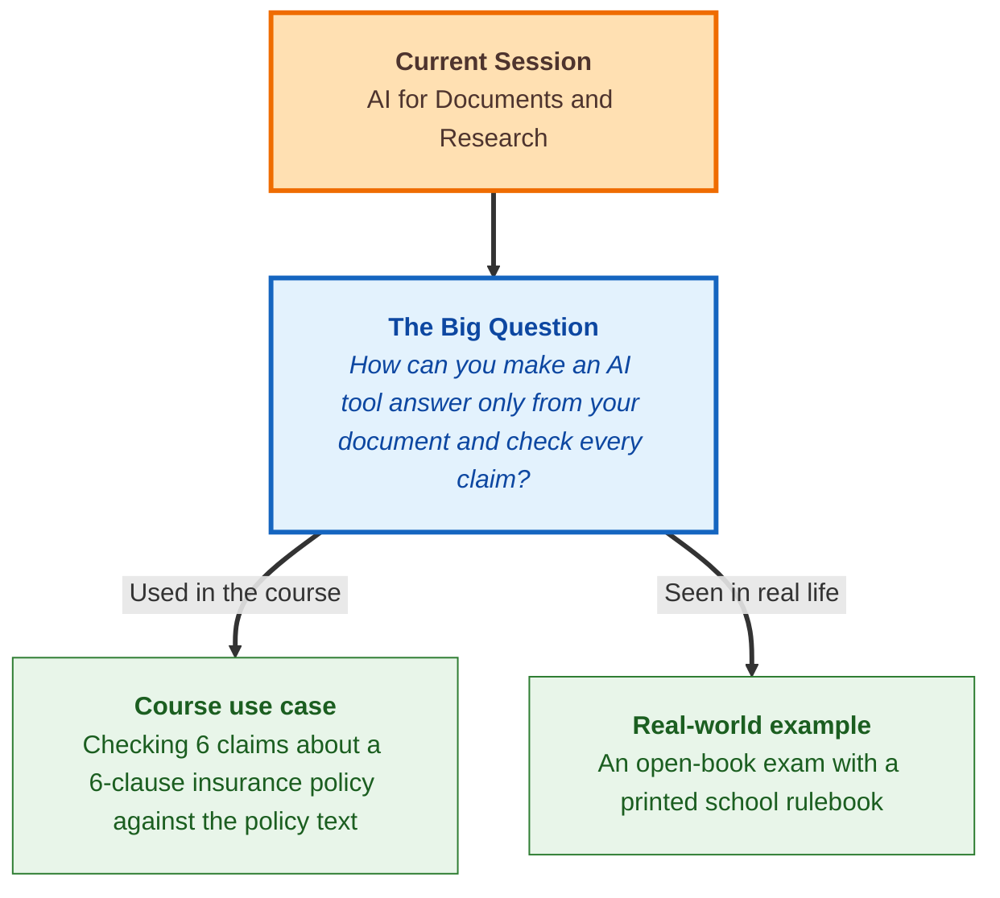

## AI for Documents and Research

### Mental Map

---

### What You'll Learn

Have you ever wondered how an open-book exam stops you from answering with whatever you half remember?

By the end of this session, you will be able to:

- **Identify** when you must tell the examiner that you had help.
- **Describe** why a rulebook printed in 2019 can give a wrong answer about 2026.
- **Classify** 3 answers as backed by the rulebook page or not backed by it.
- **Write** an instruction that tells a helper to answer only from page 4.

> **Topics you will meet:** Uploading and summarising a document, grounding, knowledge cutoff, fact-checking, disclosing AI help.
>
> Join the session to learn each of these in detail.

---

### Why You Are Learning This Topic

Your school allows an open-book exam. You bring the library rulebook, printed in 2019.

One question asks for the late fine per day. You remember a notice about Rs 5. The book says Rs 2.

Which answer should you write? The exam says: use the book, and say where you found it.

A **source** means the document an answer comes from. In this course you will make AI tools answer from a source you supply.

> **Think about it:** What could go wrong if you answer from memory instead of the page?

---

### The Library Rulebook Puzzle

Here are 3 rules, as printed in 2019 and as shown on the school notice board in 2026.

| Rule | Printed rulebook (2019) | Notice board (2026) |
|:----------:|:----------:|:----------:|
| Loan period | 14 days | 10 days |
| Late fine per day | Rs 2 | Rs 5 |
| Books per student | 3 | 3 |

**What you want to happen:**

- Every answer comes from the page you were told to use.
- You notice when the book is out of date.
- You tell the examiner how you found each answer.

> **Wonder about this:**
>
> - If a friend whispers "the fine is Rs 5", is that answer backed by the page?
> - How would the examiner know that you used the book rather than guessing?

---

### Think It Through

There is no wrong first try. Keep your guesses for the session.

**1. The book says 14 days and the notice says 10. Which answer fits the question "According to the book"?**
Hint: Read the question word by word.

**2. A friend says, "Books per student is 5." Is that backed by the page?**
Hint: Look at the third row of the table.

**3. You used a tutor's notes to write 2 answers. Should the examiner be told?**
Hint: Think about what the exam rules ask.

---

### One Question to Carry Into the Session

> **How do you know an answer comes from the page and not from memory?**
>
> When would you tell a reader that you had help?
