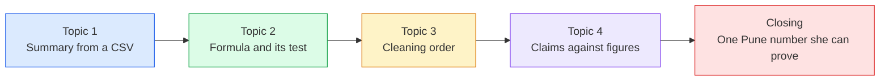
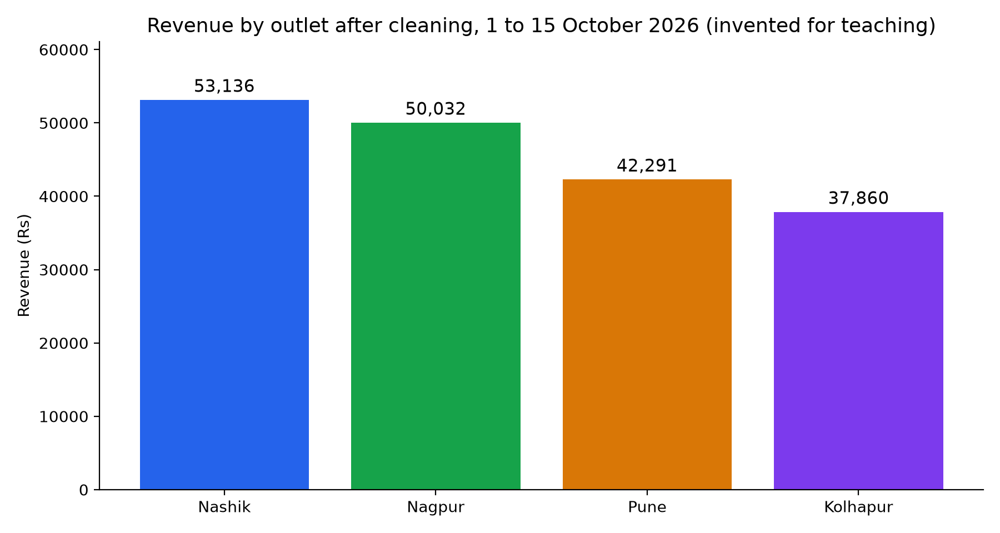
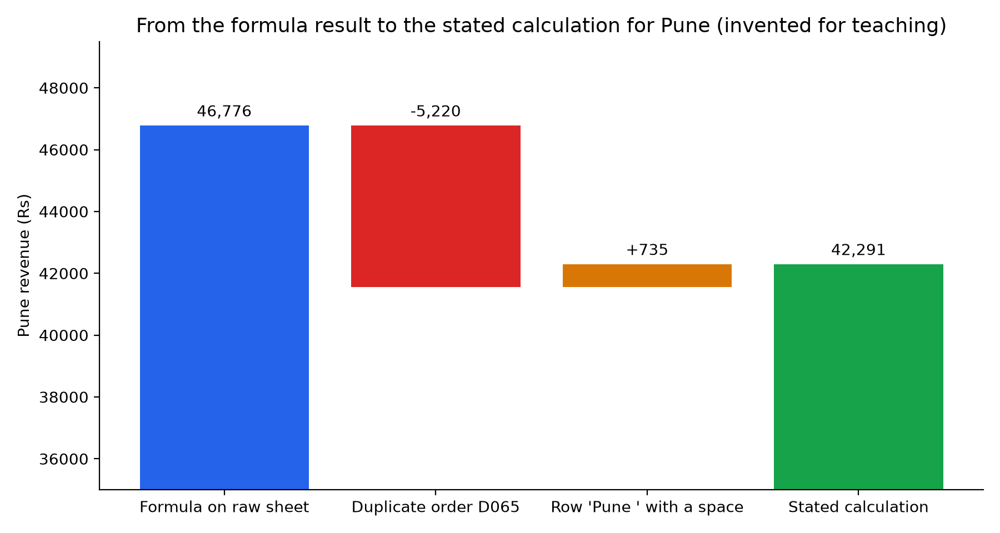
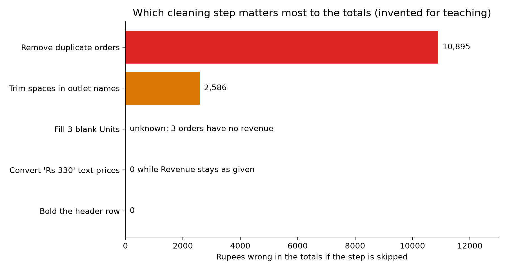
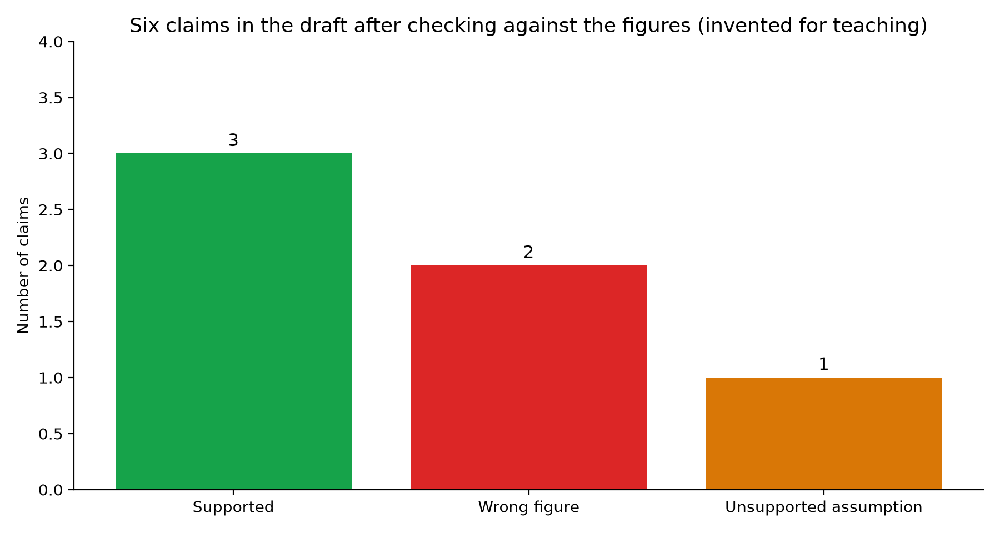

# <font color='#1d4ed8'>Lecture Script: AI for Spreadsheets and Data</font>

---

## <font color='blue'>Agenda</font>

The lecture runs as four topics. Each topic ends with a quiz.

| Topic | What we do | Learning objectives covered | Minutes |
|:-:|:--|:--|:-:|
| 1 | Summarise a CSV file in a chat tool | Write a prompt that returns a stated summary from a CSV attached in a chat tool | 25 |
| 2 | Get a formula from the tool and test it | Write a prompt that produces a spreadsheet formula for a stated calculation<br>Validate an AI-suggested spreadsheet formula against the stated calculation before using it | 30 |
| 3 | Rank the steps of a cleaning plan | Prioritize the steps in an AI-generated data-cleaning plan by which would break downstream calculations if skipped | 25 |
| 4 | Check a written analysis against the figures | Validate every claim or assumption in a written analysis, draft or forecast against its source facts or figures | 25 |
| — | Closing: Outcome & Summary | | 15 |
| | **Total** | | **120** |

> <font color="red">**🎯 Instructor Note**</font> Pace: Topic 2 carries the most practice, with the test rows and the real sheet. Keep Topic 3 to one ranking activity.
> Learners need ChatGPT or Gemini open, and Google Sheets. Share `data/dairy_sales.csv` before the session. Replies are never pasted here. Run each live step and read the real reply.

---

## <font color='blue'>Scenario</font>

Tanvi is a sales analyst at an Amul-style dairy. Her manager wants one number by 5 pm: the Pune outlet's revenue for 1 to 15 October 2026. The sheet has 120 rows from four outlets: Pune, Nashik, Nagpur and Kolhapur.

She asks a chat tool for a formula and pastes it in. The sheet shows Rs 46,776. Her manager's own check says about Rs 42,000. Tanvi has 20 minutes to find out which number is right.

> <font color="red">**🎯 Instructor Note**</font> The company is only the setting. Do not claim it works this way. The outlets, orders, prices and every rupee figure come from an invented file made for teaching. Today is Monday, 26 October 2026.

---

## <font color='blue'>Problem Statement</font>

Tanvi sent Rs 46,776 to her manager without testing the formula. The manager used it in a budget note. Two days later the regional head spots that outlet totals do not add up to the grand total. The note is withdrawn, and the team loses a day.

You already know that a tool can be fluent and wrong, and that answers must be checked against the source. Today we apply that to a spreadsheet.

> <font color='purple'>**How does Tanvi get a summary and a formula from a chat tool, clean the data in the right order, and prove every figure before it goes to her manager?**</font>

> <font color="red">**🎯 Instructor Note**</font> Poll: "If a formula returns a number without an error, is the number right?" Options: yes or no. Give learners 30 seconds to respond in chat. Reveal the answer in the Closing.

---

## <font color='blue'>What We Will Use</font>

A free chat tool, Google Sheets and one invented CSV file of 120 rows. A CSV is a plain-text table file: one row per line, with commas between the columns.

| Topic | Tools | In one line |
|:-:|:--|:--|
| 1 | Chat tool, CSV file | Ask for a stated summary and make the tool show what it read |
| 2 | Chat tool, Google Sheets | Ask for a formula, test it on 5 known rows, then on the real sheet |
| 3 | Chat tool | Rank cleaning steps by what breaks the totals if skipped |
| 4 | Google Sheets, a facts table | Check every claim in a draft against the figures |

---

## <font color='blue'>How: Walking Through Tanvi's Pune Number</font>



---

## <font color='blue'>Topic 1: Summarise a CSV file in a chat tool</font> `25 min`

> <font color='purple'>**Tanvi has a 120-row file. How does she ask the tool for a summary she can verify?**</font>

### <font color='green'>Example: A stated summary with proof of reading</font>

> <font color='purple'>**What must the prompt say so the reply can be checked?**</font>

The file has 7 columns: OrderID, Date, Outlet, Product, Units, UnitPrice and Revenue. The first rows look like this.

```
OrderID,Date,Outlet,Product,Units,UnitPrice,Revenue
D001,2026-10-11,Kolhapur,Ghee 500 ml,3,330,990
D002,2026-10-06,Kolhapur,Toned Milk 500 ml,37,27,999
D003,2026-10-03,Pune,Curd 400 g,9,35,315
```

A good summary prompt states the file, the calculation, the columns, and proof of reading.

```
Use only the attached CSV.
Give a table of total Revenue and number of orders for each Outlet.
Then tell me: how many rows you read, which columns you used,
and any rows you could not use.
```

> <font color="red">**🎯 Instructor Note**</font> Learners attach the CSV (check the tool's current screen for upload) and run it live. If upload is blocked, paste the first 30 rows. Expected: the row count should be 120. A different count means the tool did not read it all.

<p align="center"></p>

#### <font color='#c2410c'>Logic Explanation</font>

- "Use only the attached CSV" keeps outside guesses away, like the "answer only from the text" rule you used for documents.
- "How many rows you read" tests the reply. The real file has 120 rows.
- The chart shows revenue after cleaning, which is the answer key. Its four bars add up to $53136 + 50032 + 42291 + 37860 = 183{,}319$ rupees.

> <font color='green'>**Result**</font> A stated summary names the calculation, the columns and a row count. A reply that skips the row count cannot be trusted.

### <font color='green'>Extending it: What the file really contains</font>

> <font color='purple'>**Does the tool mention anything odd about the file?**</font>

> <font color="red">**🎯 Instructor Note**</font> Compare the tool's "rows you could not use" with this list. Expected: it may miss some items. The file was built with these on purpose.

| Fact about `dairy_sales.csv` | Value |
|:--|:-:|
| Rows | 120 |
| Different OrderIDs | 116 (4 orders appear twice) |
| Spellings of outlet names | 9 (for example "Pune", "Pune " with a space, "PUNE") |
| Rows with blank Units and blank Revenue | 3 |
| Rows where UnitPrice is text such as "Rs 330" | 3 |

> <font color='green'>**Result**</font> The file has four problems the first summary did not have to mention. Keep this table, because Topic 2 and Topic 3 depend on it.

> <font color='#b45309'>**Common mistake**</font> Accepting outlet totals without a row count. Fix: always ask what was read and what was left out.

### <font color='purple'>Quiz 1</font>

**Question:** Which line makes a CSV summary easiest to check?

**Options:**
- A) "Summarise the file nicely."
- B) "Tell me how many rows you read and which columns you used."
- C) "Make the summary as short as possible."
- D) "Add your own estimate where data is missing."

**Correct Answer:** B

**Explanation:**
- **A)** "Nicely" gives you nothing to compare with the file.
- **B)** Correct. A row count and the columns used give you two facts to verify.
- **C)** Length does not help you check the figures.
- **D)** Estimates add numbers that are not in the file.

---

## <font color='blue'>Topic 2: Get a formula from the tool and test it</font> `30 min`

> <font color='purple'>**The summary table is a one-off. How does Tanvi get a formula that stays live in the sheet?**</font>

### <font color='green'>Example: Ask for the Pune total, then test it on 5 known rows</font>

> <font color='purple'>**What must a formula request say, and how do we test the formula before using it?**</font>

A formula request names the sheet layout, the stated calculation and the cell range.

```
Google Sheets. Column C is Outlet, column G is Revenue, rows 2 to 121.
Write a formula for the total Revenue where Outlet is Pune.
Explain each part in one line.
```

A correct answer has this shape. Learners compare the tool's formula with it.

```
=SUMIF(C2:C121,"Pune",G2:G121)
```

Test it first on 5 test rows where you know the answer by hand. Put them in rows 2 to 6 (invented for teaching).

| Row | Outlet | Revenue |
|:-:|:--|:-:|
| Row 2 | Pune | 1,000 |
| Row 3 | Nashik | 500 |
| Row 4 | Pune | 250 |
| Row 5 | Nagpur | 300 |
| Row 6 | Pune | 150 |

By hand, Pune is $1000 + 250 + 150 = 1{,}400$. On these rows the formula should return 1,400.

> <font color="red">**🎯 Instructor Note**</font> Learners paste the tool's formula, adjust the range to rows 2 to 6 and read the result. Expected: 1,400. If it differs, check the column letters and the range before blaming the tool.

#### <font color='#c2410c'>Logic Explanation</font>

- `SUMIF` adds the cells in the third part (Revenue) where the first part (Outlet) matches the second part ("Pune").
- If the tool had used `C2:C5` as the range, it would miss row 6 and return $1000 + 250 = 1{,}250$. A hand test catches it.

> <font color='green'>**Result**</font> The formula passes on the test rows. Now it can be tried on the real sheet.

### <font color='green'>Extending it: Run it on the real sheet</font>

> <font color='purple'>**Does the formula give the stated calculation on all 120 rows?**</font>

> <font color="red">**🎯 Instructor Note**</font> Learners paste the CSV into a sheet and use the formula on rows 2 to 121. Expected: 46,776. The answer key says 42,291. Ask learners why before revealing.

<p align="center"></p>

#### <font color='#c2410c'>Logic Explanation</font>

- Order D065 is a Pune order that appears twice. The second copy adds Rs 5,220 that should not be there.
- Order D051 has the outlet "Pune " with a space. The formula does not match it, so Rs 735 is left out.
- $46776 - 5220 + 735 = 42{,}291$.

> <font color='green'>**Result**</font> The formula is correct and the stated calculation is still not met, because the data has problems. Test on real data too.

### <font color='green'>Extending it: A lookup formula</font>

> <font color='purple'>**How do we ask for the unit price of Paneer 200 g from a price list, and test it?**</font>

Learners type a price list into J2 to K6: product in J, price in K, in this order: Toned Milk 500 ml 27, Curd 400 g 35, Paneer 200 g 90, Ghee 500 ml 330, Butter 100 g 58.

```
=VLOOKUP("Paneer 200 g",J2:K6,2,FALSE)
```

> <font color="red">**🎯 Instructor Note**</font> Learners ask the tool for this lookup and compare. Check the last argument. Expected result: 90. Without FALSE, Sheets looks for an approximate match, which expects a sorted list.

> <font color='green'>**Result**</font> Test the lookup on 2 products whose prices you know. A formula that returns 90 for Paneer passes.

> <font color='#b45309'>**Common mistake**</font> Not checking which column the tool assumed. Fix: read the column letters in the formula against the header row.

### <font color='purple'>Quiz 2</font>

**Question:** On 5 test rows the formula returns 1,250, but Pune should total 1,400. What should you do?

**Options:**
- A) Accept it, because the formula looks right
- B) Ask the tool to say it is correct
- C) Type 1,400 over the result
- D) Compare the formula's ranges and columns with the stated calculation

**Correct Answer:** D

**Explanation:**
- **A)** A formula that looks right can still miss a row.
- **B)** The tool saying "correct" is not a test.
- **C)** Overwriting hides the fault. The sheet will break on the next row.
- **D)** Correct. The range most likely stops one row short, and checking it finds the fault.

---

## <font color='blue'>Topic 3: Rank the steps of a cleaning plan</font> `25 min`

> <font color='purple'>**The formula was right and the number was wrong. Which data problems should Tanvi fix first?**</font>

### <font color='green'>Example: Rank five steps</font>

> <font color='purple'>**Which cleaning steps would break the totals if skipped, and in what order?**</font>

Tanvi asks the tool for a cleaning plan. It lists five steps in this order (invented for teaching). Learners rank them from most to least harmful to skip.

| Step in the plan | If skipped |
|:--|:--|
| A. Bold the header row | ? |
| B. Remove duplicate OrderIDs | ? |
| C. Trim spaces in Outlet names | ? |
| D. Get the 3 blank Units from the source | ? |
| E. Convert "Rs 330" text prices to numbers | ? |

> <font color="red">**🎯 Instructor Note**</font> Learners rank in chat first. Expected order: B, C, D, E, A. Ask for the reason for each, using the amounts in the chart.

<p align="center"></p>

#### <font color='#c2410c'>Logic Explanation</font>

- **B** Duplicates add Rs 10,895 to the grand total. Every total and chart built on top of it is too high.
- **C** Three rows with a space in the outlet name hold Rs 2,586. Outlet totals add up to $194214 - 2586 = 191{,}628$, which is less than the grand total of 194,214. That gap is a totals-do-not-reconcile warning.
- **D** Three orders have no revenue. The total is understated by an amount you cannot know until you ask the source.
- **E** Text prices only matter if you recalculate Units times UnitPrice. The Revenue column is already filled, so skipping it changes no total today.
- **A** Bold text changes no number.

> <font color='green'>**Result**</font> Fix first what changes the most totals and what other steps depend on. Cosmetic steps come last.

> <font color='#b45309'>**Common mistake**</font> Following the tool's order without asking what each step protects. Fix: for each step, ask which total goes wrong if you skip it.

### <font color='purple'>Quiz 3</font>

**Question:** Which cleaning step should come first?

**Options:**
- A) Remove duplicate orders, because they add Rs 10,895 to every total
- B) Bold the header row
- C) Rename the file
- D) Colour the outlet names

**Correct Answer:** A

**Explanation:**
- **A)** Correct. Duplicates inflate the grand total and every outlet total built on it.
- **B)** Formatting changes no figure.
- **C)** A file name does not touch any calculation.
- **D)** Colour changes the look, not the numbers.

---

## <font color='blue'>Topic 4: Check a written analysis against the figures</font> `25 min`

> <font color='purple'>**The data is clean. Tanvi's tool now writes a short analysis for her manager. Which sentences can she keep?**</font>

### <font color='green'>Example: Six claims against a facts table</font>

> <font color='purple'>**How do we check each claim, including a forecast?**</font>

Here is the draft (invented for teaching). The facts table below comes from the cleaned data.

```
1. Nashik was the top outlet with Rs 53,136.
2. Total revenue was Rs 1,83,319 from 116 orders.
3. Ghee brought the most revenue.
4. Pune had 29 orders.
5. Sales grew from about Rs 10,345 a day (days 1 to 7) to Rs 13,863 a day (days 8 to 15).
6. The next 15 days will bring Rs 3.7 lakh.
```

| Fact from the cleaned data | Value |
|:--|:-:|
| Revenue: Nashik, Nagpur, Pune, Kolhapur | 53,136; 50,032; 42,291; 37,860 |
| Revenue: Butter, Ghee, Paneer, Curd, Toned Milk | 45,588; 43,890; 43,110; 30,940; 19,791 |
| Orders: Pune | 30 |
| Orders with revenue / orders listed | 113 / 116 |
| Revenue days 1 to 7, days 8 to 15 | 72,416; 110,903 |

> <font color="red">**🎯 Instructor Note**</font> Learners mark each claim supported, wrong or an unsupported assumption, then reveal. Expected: 1, 2 and 5 supported; 3 and 4 wrong; 6 an assumption.

<p align="center"></p>

#### <font color='#c2410c'>Logic Explanation</font>

- **1** Nashik at 53,136 is the highest of the four outlets. Supported.
- **2** The sum is right for the 113 orders that have revenue. Three of the 116 orders have blank Units. Supported, with that caveat added.
- **3** Butter at 45,588 beats Ghee at 43,890. Wrong.
- **4** Pune has 30 orders after cleaning. The tool counted 29 by matching only the exact word "Pune". Wrong.
- **5** $\frac{72416}{7} \approx 10{,}345$ and $\frac{110903}{8} \approx 13{,}863$ rupees a day. Supported.
- **6** No figure gives 3.7 lakh. If the days 8 to 15 rate holds, $13863 \times 15 \approx 207{,}943$ rupees, about 2.08 lakh, and that itself assumes the rate stays flat. Unsupported.

> <font color='green'>**Result**</font> Three claims stand, two have wrong figures and one is an unsupported assumption. Fix or remove the three before sending.

### <font color='green'>Extending it: Ask the tool to show its source for each claim</font>

> <font color='purple'>**Can the tool point to the cell range behind each claim?**</font>

> <font color="red">**🎯 Instructor Note**</font> Learners ask for the formula or filter behind each claim, then rerun it in Sheets. Expected: some references are wrong. A reference you can rerun is a lead, not proof.

> <font color='green'>**Result**</font> Rerun each figure in the sheet yourself. Do not accept "I calculated this" from the tool.

> <font color='#b45309'>**Common mistake**</font> Treating a forecast as a fact. Fix: write the assumption next to it, such as "if the days 8 to 15 rate holds".

### <font color='purple'>Quiz 4</font>

**Question:** A draft says "The next 15 days will bring Rs 3.7 lakh." Which response is right?

**Options:**
- A) Keep it, because forecasts cannot be checked
- B) Keep it, because sales are growing
- C) Mark it unsupported, because no figure gives 3.7 lakh and the recent rate gives about 2.08 lakh
- D) Round it down to Rs 3 lakh

**Correct Answer:** C

**Explanation:**
- **A)** A forecast can be checked against the rate it assumes.
- **B)** Growth in the past does not give that number.
- **C)** Correct. The figure matches no source, and the recent daily rate over 15 days gives about 2.08 lakh.
- **D)** A new round number has no source either.

---

## <font color='blue'>Closing: Outcome & Summary</font> `15 min`

Back to Tanvi. We answer the Problem Statement using each topic once.

> <font color='purple'>**1. How does she get a summary she can verify? (Topic 1)**</font>

She names the file, the calculation and the columns, and asks for the row count. The file has 120 rows.

> <font color='purple'>**2. How does she get a formula she can trust? (Topic 2)**</font>

She tests `=SUMIF(C2:C121,"Pune",G2:G121)` on 5 test rows first, where Pune must be 1,400. On the real sheet it returns 46,776, and the stated calculation is 42,291.

> <font color='purple'>**3. Why was the number wrong, and what comes first? (Topic 3)**</font>

Duplicates add Rs 5,220 to Pune, and one row is missed for a trailing space. Remove duplicates first, then trim names, then chase the blank Units.

> <font color='purple'>**4. What does she send? (Topic 4)**</font>

Only claims that match the facts table. Claims 3 and 4 are fixed, and claim 6 gets its assumption written next to it.

### <font color='green'>Outcome</font>

| | Formula pasted without a test | Tested, cleaned and checked |
|:--|:-:|:-:|
| Pune revenue sent | Rs 46,776 | Rs 42,291 |
| Outlet totals add up to the grand total | No, gap of Rs 2,586 | Yes after cleaning |
| Top product named | Ghee (wrong) | Butter |
| Forecast | Rs 3.7 lakh, no source | About Rs 2.08 lakh if the recent rate holds |

> <font color='green'>**Therefore,**</font> Tanvi should ask for a stated summary with a row count, test every formula on rows she can add by hand, clean duplicates and spaces before totals, and check every claim against the figures. A formula that returns a number without an error is not yet a right number.

> <font color="red">**🎯 Instructor Note**</font> Reveal the poll: no. A formula can run without an error and still answer the wrong question, as the Pune total showed.

### <font color='green'>Summary</font>

| Learning objective | Takeaway |
|:--|:--|
| Summary from a CSV | Name the file, the calculation and the columns, and ask for the row count |
| Formula prompt | State the layout, the calculation and the range, and ask for an explanation |
| Validate a formula | Test it on rows you can add by hand, then on the real sheet |
| Prioritise cleaning steps | Fix what changes the most totals first, and cosmetics last |
| Validate claims and assumptions | Match every claim to a figure and write the assumption beside a forecast |
| **Practical value** | You can use AI to speed up spreadsheet work and still send numbers you can prove |

---

# <font color='red'>Launch the Feedback Poll</font>

> <font color="red">**🎯 Instructor Note**</font> Reminder: launch the feedback poll now to collect learner feedback.
