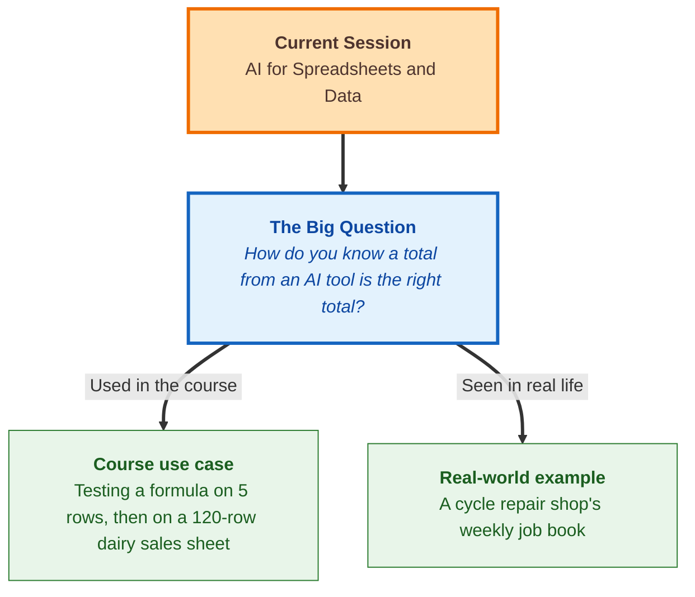

## AI for Spreadsheets and Data

### Mental Map

---

### What You'll Learn

Have you ever wondered why two people adding the same job-book page can reach two different totals?

By the end of this session, you will be able to:

- **Summarise** a week of repair jobs in 2 lines, using only the job-book page.
- **Calculate** the total puncture repairs done, and test your sum on 3 rows first.
- **Examine** 3 messy entries to find which one changes the weekly total the most.
- **Check** 5 sentences in a helper's note against the numbers on the page.
- **Write** a clear request that asks a helper for a total and says how you will test it.

> **Topics you will meet:** CSV summaries, lookup and SUMIF formulas, cleaning plans, checking formulas, checking claims.
>
> Join the session to learn each of these in detail.

---

### Why You Are Learning This Topic

A cycle repair shop keeps a job book. On Friday the owner adds up the puncture repairs done that week.

His helper adds the same page and gets a different total. One entry was written twice, and one number was written as a word.

A **formula** means a rule in a spreadsheet cell that works out a number from other cells. A formula can run without an error and still give a wrong total.

In this course you will ask AI tools for formulas, then prove them.

> **Think about it:** How would you decide which of the two totals is right?

---

### The Repair Shop Puzzle

Here is one week of the job book.

| Day | Job | Count | Price per job |
|:----------:|:----------:|:----------:|:----------:|
| Monday | Puncture repair | 20 | Rs 30 |
| Monday | Puncture repair | 20 | Rs 30 |
| Tuesday | Chain oiling | ten | Rs 20 |
| Wednesday | Puncture repair | 15 | Rs 30 |
| Thursday | Chain oiling | 30 | Rs 20 |

**What you want to happen:**

- The puncture total matches the jobs the shop finished.
- You know which messy entry to fix first.
- You can say why a helper's total is right or wrong.

> **Wonder about this:**
>
> - Is the second Monday row a real sale or a copy?
> - What would a sum do with the word "ten"?

---

### Think It Through

There is no wrong first try. Keep your guesses for the session.

**1. Add the puncture repairs twice: once with the second Monday row and once without. Which total do you trust?**
Hint: Ask whether two identical rows can be two real sales.

**2. A helper says, "Chain oiling earned Rs 150." What would you check on the page?**
Hint: Multiply the count by the price for each oiling row.

**3. You can fix only one messy entry before 5 pm. Which one, and why?**
Hint: Pick the entry that moves the weekly total most.

---

### One Question to Carry Into the Session

> **What would you test on 3 rows before you trust a total on 300 rows?**
>
> Which entry in your own records could be counted twice?
