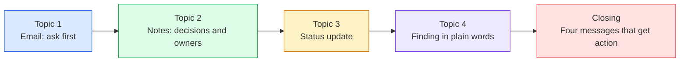
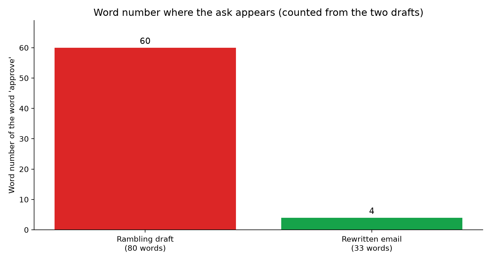
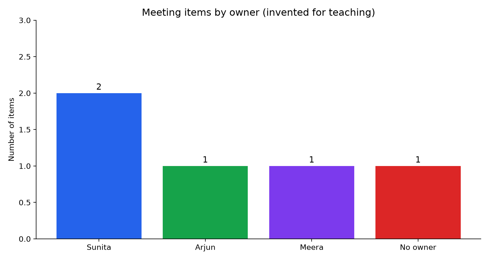
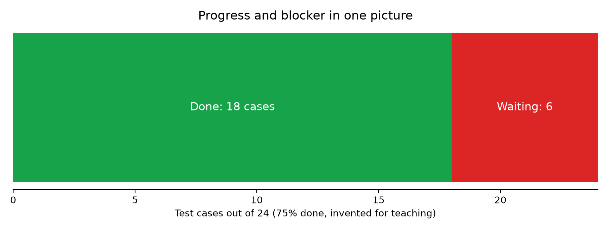
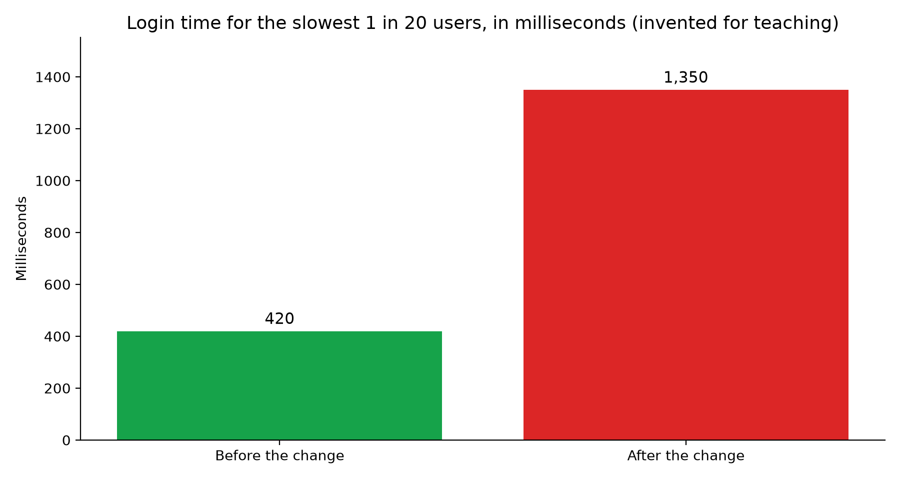

# <font color='#1d4ed8'>Lecture Script: AI for Writing and Meeting Communication</font>

---

## <font color='blue'>Agenda</font>

The lecture runs as four topics. Each topic ends with a quiz.

| Topic | What we do | Learning objectives covered | Minutes |
|:-:|:--|:--|:-:|
| 1 | Turn a rambling draft into an email that leads with the ask | Write an email that states the ask in the first line and the supporting detail below | 30 |
| 2 | Turn messy meeting notes into decisions, owners and next steps | Write meeting notes recording each decision taken, its owner and the next step | 30 |
| 3 | Write a status update with progress, blockers and help needed | Write a status update stating progress, blockers and the help needed | 25 |
| 4 | Rewrite a technical finding for a reader who must act | Rewrite a technical finding in language a non-specialist reader can act on | 20 |
| — | Closing: Outcome & Summary | | 15 |
| | **Total** | | **120** |

> <font color="red">**🎯 Instructor Note**</font> Pace: Topic 1 and Topic 2 carry the most practice. Keep Topic 4 short, with one live rewrite.
> Learners need one free chat tool and a Notion page (Notion AI trial, if the account offers it). Replies are never pasted here. Run each live step and read the real reply.

---

## <font color='blue'>Scenario</font>

**One week, four messages.** Rohan leads a team at an Infosys-style IT services company. His week has four writing jobs, all about the same release on 20 November.

| Job | What Rohan must write | Who reads it |
|:--|:--|:--|
| Email | Ask for one extra test server | Sunita, the delivery head |
| Notes | Record Monday's team meeting | The whole team |
| Status | Report on the test plan | Sunita and the client |
| Finding | Explain why logins got slower | A client manager with no technical background |

> <font color="red">**🎯 Instructor Note**</font> The company is only the setting. Do not claim it works this way. The people, the server, the costs and the timings are invented for teaching. Today is Monday, 26 October 2026.

---

## <font color='blue'>Problem Statement</font>

Rohan asks a chat tool for help with all four jobs and sends what comes back. The email buries the ask in the last paragraph, so Sunita replies a day late. The meeting notes have no owners, so two tasks are forgotten. The status update says "going well", and the client manager cannot tell what is blocked.

You have already used the four prompt elements, grounded prompts and checks against a source. Today we use them for everyday writing.

> <font color='purple'>**How does Rohan use a tool to write an email, notes, a status update and a plain-language finding that each get an action from the reader?**</font>

> <font color="red">**🎯 Instructor Note**</font> Poll: "Where should the ask go in an email: first line or last paragraph?" Options: first line or last paragraph. Give learners 30 seconds to respond in chat. Reveal the answer in the Closing.

---

## <font color='blue'>What We Will Use</font>

A free chat tool for drafting and a Notion page for the action list. You supply the facts and check every line.

| Topic | Tools | In one line |
|:-:|:--|:--|
| 1 | Chat tool | Rewrite a rambling draft with the ask first |
| 2 | Chat tool, Notion AI | Turn raw notes into decisions, owners and next steps, then an action list |
| 3 | Chat tool | Fit progress, blockers and help needed into one short update |
| 4 | Chat tool | Rewrite a technical number for a non-specialist |

---

## <font color='blue'>How: Walking Through Rohan's Four Messages</font>



---

## <font color='blue'>Topic 1: Turn a rambling draft into an email that leads with the ask</font> `30 min`

> <font color='purple'>**Sunita has 40 emails a day. How does Rohan make hers impossible to miss?**</font>

### <font color='green'>Example: Find the ask in the rambling draft</font>

> <font color='purple'>**Where is the ask in Rohan's first draft?**</font>

Here is Rohan's first draft, written by him (invented for teaching).

```
Hi Sunita, hope you are well. So I was thinking about the test server and
how last week we had that issue with the build, and Arjun said we might
look at it, and anyway the release is on 20 November and our tests take a
long time on the shared server. I was wondering if you could possibly
approve one extra test server from 2 to 15 November, which would cost
about Rs 18,000. Let me know. Thanks, Rohan
```

> <font color="red">**🎯 Instructor Note**</font> Ask learners to find the ask in chat. Expected: "approve one extra test server from 2 to 15 November". Count the words with them.

<p align="center"></p>

#### <font color='#c2410c'>Logic Explanation</font>

- The draft has 80 words. The ask starts at word 60, after the weather and an old build issue.
- A reader who stops after one line never sees it. The rewrite brings the ask to word 4 of 33.

> <font color='green'>**Result**</font> An email works when the first line holds the ask and the lines below hold the support.

### <font color='green'>Extending it: Prompt the tool to restructure it</font>

> <font color='purple'>**What do we tell the tool so it keeps every fact and changes only the shape?**</font>

```
Rewrite this email.
Line 1: the ask, in one sentence. Below it: 3 bullets for why, release date, cost.
Keep every date and number exactly. Add no new facts. Under 40 words.
(paste the draft here)
```

> <font color="red">**🎯 Instructor Note**</font> Learners run this live and read the reply. Check line 1 holds the ask, then check "2 to 15 November", "20 November" and "Rs 18,000" are unchanged. Remove any fact the tool added.

A rewrite that meets the prompt looks like this (written by hand, 33 words).

```
Sunita, could you approve one extra test server from 2 to 15 November?
Why: our tests take a long time on the shared server.
Release: 20 November.
Cost: about Rs 18,000.
Thanks, Rohan
```

> <font color='green'>**Result**</font> Same facts, new order. The ask is in line 1, and the three details follow in short lines.

### <font color='green'>Extending it: Make a dense draft sound like you</font>

> <font color='purple'>**A tool's draft is often formal and long. How does Rohan make it his own?**</font>

> <font color="red">**🎯 Instructor Note**</font> Ask learners to cut filler words and swap formal words for plain ones from their own speech. Example: "I would like to request your kind approval" becomes "Could you approve".

> <font color='green'>**Result**</font> Read the email aloud. If you would never say a sentence, rewrite it in your words.

> <font color='#b45309'>**Common mistake**</font> Sending the tool's draft unread. Fix: read every line, compare facts with your own notes, and fix the voice.

### <font color='purple'>Quiz 1</font>

**Question:** Which email opening states the ask in the first line?

**Options:**
- A) "Hope you are well. Last week we had a build issue."
- B) "I was thinking about the test server for a while."
- C) "Could you approve one extra test server from 2 to 15 November?"
- D) "Please read the details below carefully."

**Correct Answer:** C

**Explanation:**
- **A)** Greetings and background come before any request.
- **B)** It introduces a topic but asks nothing.
- **C)** Correct. The reader knows the action, the item and the dates in one line.
- **D)** It points to the body but does not state the ask.

---

## <font color='blue'>Topic 2: Turn messy meeting notes into decisions, owners and next steps</font> `30 min`

> <font color='purple'>**Sunita agreed to the server in Monday's meeting. How does Rohan record who does what?**</font>

### <font color='green'>Example: Raw notes to a decision table</font>

> <font color='purple'>**What three things must every decision in the notes carry?**</font>

Good meeting notes record each decision taken, its owner and the next step. Here are Rohan's raw notes from Monday (invented for teaching).

```
Test server first. Sunita will sign off the extra server if the cost stays
under Rs 20,000. Arjun sends her the quote tomorrow. Meera asked about the
login slowdown. Arjun thinks it is the cache setting. Agreed to switch it
back on Thursday, Arjun does it. Release stays 20 November, Sunita
confirmed. Meera updates the test plan by Friday and shares it with the
team. Training for new joiners came up. Parked until December.
```

> <font color="red">**🎯 Instructor Note**</font> Learners paste the raw notes with a prompt asking for a table of Decision, Owner and Next step. Check the reply against the answer table below, because a tool can add or drop an owner.

| Decision | Owner | Next step |
|:--|:--|:--|
| Approve one extra test server if cost is under Rs 20,000 | Sunita | Arjun sends the quote tomorrow, then Sunita approves |
| Switch the cache setting back on | Arjun | Make the change on Thursday |
| Release date stays 20 November | Sunita | None, confirmed |
| Update the test plan | Meera | Share it with the team by Friday |
| Training for new joiners | No owner | Parked until December |

<p align="center"></p>

#### <font color='#c2410c'>Logic Explanation</font>

- Four decisions have an owner. The training item is parked and has no owner, so the notes should say so.
- The chart counts the five rows: $2 + 1 + 1 + 1 = 5$ items.
- Do not let the tool guess an owner. If the raw notes do not name one, write "No owner".

> <font color='green'>**Result**</font> A decision table shows who does what next. An item with no owner is flagged, not hidden.

### <font color='green'>Extending it: Turn the table into an action list in Notion</font>

> <font color='purple'>**How does Rohan keep the next steps where the team can tick them off?**</font>

> <font color="red">**🎯 Instructor Note**</font> Live step: learners paste the notes into a Notion page and ask Notion AI for an action list with an owner and a day. Check the current Notion screen for the menu. Verify each owner and day against the table.

> <font color='green'>**Result**</font> An action list has one line per next step, with the owner and the day. Compare it with the table before sharing.

> <font color='#b45309'>**Common mistake**</font> Letting the tool fill a missing owner or date. Fix: write "No owner" and ask the meeting.

### <font color='purple'>Quiz 2</font>

**Question:** Which line records a decision correctly?

**Options:**
- A) Arjun switches the cache setting back on, Thursday.
- B) We talked about the cache.
- C) The cache setting is a problem.
- D) Arjun is worried about the cache.

**Correct Answer:** A

**Explanation:**
- **A)** Correct. It states the action, the owner and the day.
- **B)** It records a topic, not a decision.
- **C)** It records an opinion with no owner or step.
- **D)** It records a feeling, not an action.

---

## <font color='blue'>Topic 3: Write a status update with progress, blockers and help needed</font> `25 min`

> <font color='purple'>**The client wants a weekly update. What does Rohan say so that nobody asks a follow-up?**</font>

### <font color='green'>Example: Three headings, three facts</font>

> <font color='purple'>**What goes under progress, blockers and help needed?**</font>

Rohan's scrappy notes (invented for teaching): "18 of 24 test cases done. 6 left but they all need the extra test server. The shared one is fully booked. Need Sunita to approve the extra server."

```
Progress: 18 of 24 test cases are done (75%).
Blocker: the 6 remaining cases need the extra test server. The shared server is booked.
Help needed: Sunita to approve the extra server (about Rs 18,000).
```

> <font color="red">**🎯 Instructor Note**</font> Learners paste the scrappy notes with a prompt: "Write a status update under three headings: Progress, Blockers, Help needed. Keep the numbers." Check the numbers against the notes.

<p align="center"></p>

#### <font color='#c2410c'>Logic Explanation</font>

- The progress is $\frac{18}{24} = 75\%$, with $24 - 18 = 6$ cases left.
- The blocker explains why the 6 cases are not done. The help needed says exactly what the reader must do.

> <font color='green'>**Result**</font> The update gives a number, a reason and a request. "Going well" gives none of the three.

### <font color='green'>Extending it: Spot the weak line</font>

> <font color='purple'>**Which of these lines is a blocker, and which is only a worry?**</font>

> <font color="red">**🎯 Instructor Note**</font> Read "Some tests might be slow" and "The 6 remaining tests cannot run until the extra server exists". Expected: the second is a blocker. The first is a worry with no fact.

> <font color='green'>**Result**</font> A blocker names what is stopped and what it needs. A worry names neither.

> <font color='#b45309'>**Common mistake**</font> Writing "need support" with no detail. Fix: say who must do what, and by when.

### <font color='purple'>Quiz 3</font>

**Question:** Which line is a useful "help needed"?

**Options:**
- A) "Things are a bit hard."
- B) "We may need help at some point."
- C) "Please keep an eye on us."
- D) "Sunita to approve the extra test server."

**Correct Answer:** D

**Explanation:**
- **A)** It names no request.
- **B)** It names no person and no action.
- **C)** It asks for attention, not a decision.
- **D)** Correct. It names who does what.

---

## <font color='blue'>Topic 4: Rewrite a technical finding for a reader who must act</font> `20 min`

> <font color='purple'>**Arjun found why logins got slower. How does Rohan tell a client manager who has no technical background?**</font>

### <font color='green'>Example: From a technical line to plain words</font>

> <font color='purple'>**What must the rewrite keep, and what must it drop?**</font>

Arjun's finding (invented for teaching): "After the cache TTL was set to 0, p95 login latency rose from 420 ms to 1,350 ms."

```
Since Monday, the slowest 1 in 20 logins takes about 1.35 seconds or more.
It used to take about 0.4 seconds, so it is about 3 times slower.
Cause: the setting that saves recent answers was switched off.
Action: please approve switching it back on on Thursday.
```

> <font color="red">**🎯 Instructor Note**</font> Learners rewrite with a prompt: "Explain for a client manager with no technical background. Keep the numbers, say the cause and the action." Check that the ratio is right: $1350 \div 420 \approx 3.2$.

<p align="center"></p>

#### <font color='#c2410c'>Logic Explanation</font>

- The 95th percentile (p95) means 95 in 100 logins are faster than this time. So the slowest 1 in 20 takes at least that long.
- $\frac{1350}{420} \approx 3.2$, so "about 3 times slower" is fair. Milliseconds become seconds: $1350 \text{ ms} = 1.35$ seconds.
- A reader who can act needs the effect, the cause and the request. Jargon such as TTL and p95 is dropped.

> <font color='green'>**Result**</font> The client manager learns what changed, how much and what to approve, without needing a technical word.

### <font color='purple'>Quiz 4</font>

**Question:** Which rewrite helps a non-specialist act?

**Options:**
- A) "p95 latency regressed after TTL 0."
- B) "The slowest 1 in 20 logins is about 3 times slower since the setting was switched off. Please approve switching it back on Thursday."
- C) "Logins are fine."
- D) "There may be some performance concerns."

**Correct Answer:** B

**Explanation:**
- **A)** It keeps the jargon, so the reader cannot act.
- **B)** Correct. It gives the effect, the size, the cause and the request in plain words.
- **C)** It hides the problem and the request.
- **D)** It is vague and names no action.

---

## <font color='blue'>Closing: Outcome & Summary</font> `15 min`

Back to Rohan. We answer the Problem Statement using each topic once.

> <font color='purple'>**1. How does the email get a reply? (Topic 1)**</font>

The ask moves from word 60 to word 4. The details follow in three short lines, and Rohan checks every date and number.

> <font color='purple'>**2. How do the notes prevent forgotten work? (Topic 2)**</font>

Each decision has an owner and a next step. The item with no owner is shown, and the next steps go into a Notion action list.

> <font color='purple'>**3. How does the status update help the client? (Topic 3)**</font>

It states 75% progress, the blocker that stops 6 cases, and the help needed from Sunita.

> <font color='purple'>**4. How does the finding reach a non-specialist? (Topic 4)**</font>

It says the slowest 1 in 20 logins is about 3 times slower, why, and what to approve.

### <font color='green'>Outcome</font>

| | Tool draft sent unread | Written, checked and rewritten |
|:--|:-:|:-:|
| Where the ask sits in the email | Word 60 of 80 | Word 4 of 33 |
| Items with an owner in the notes | Not stated | 4 of 5, with 1 flagged |
| Status update | "Going well" | 75% done, 6 blocked, help named |
| Finding for the client | "p95 latency regressed" | About 3 times slower, with the action |

> <font color='green'>**Therefore,**</font> Rohan should put the ask first, record decisions with owners and next steps, state progress, blockers and help needed, and rewrite findings in plain words. He supplies the facts and checks the tool's text before sending.

> <font color="red">**🎯 Instructor Note**</font> Reveal the poll: first line. Readers act on what they see first, so the ask leads.

### <font color='green'>Summary</font>

| Learning objective | Takeaway |
|:--|:--|
| Email | The ask goes in the first line, with support in short lines below |
| Meeting notes | Every decision carries an owner and a next step |
| Status update | Progress with a number, blockers with a reason, help with a name |
| Technical finding | Effect, cause and action in plain words, with the numbers kept |
| **Practical value** | You can use AI to draft work messages faster, and still send text that is correct and in your voice |

---

# <font color='red'>Launch the Feedback Poll</font>

> <font color="red">**🎯 Instructor Note**</font> Reminder: launch the feedback poll now to collect learner feedback.
