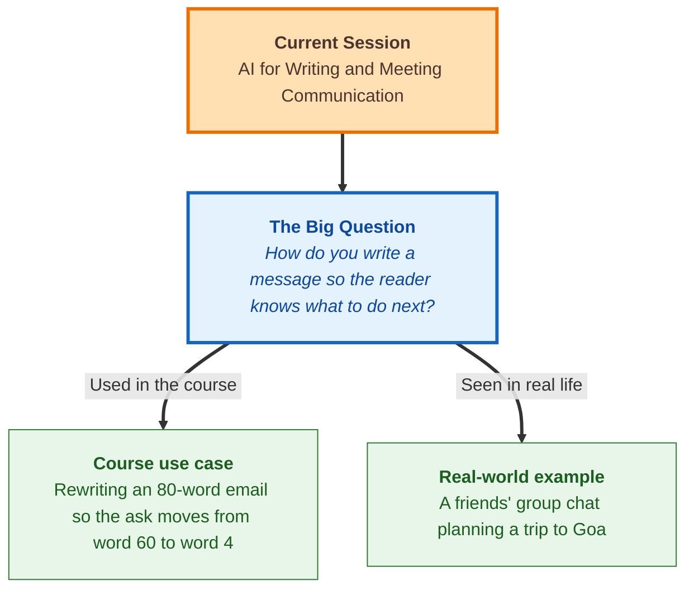

## AI for Writing and Meeting Communication

### Mental Map

---

### What You'll Learn

Have you ever wondered why one group-chat message gets a reply in a minute and another gets none?

By the end of this session, you will be able to:

- **Identify** the single request hidden inside a long message to your Goa group.
- **Explain** why a mechanic's note about "wheel alignment" needs new words for your friends.
- **Write** a first line that asks the group to pay Rs 2,500 by Friday.
- **Plan** a short note that lists each decision, its owner and the next step.
- **Build** a 3-line update on payments: done, stuck, and help needed.

> **Topics you will meet:** Emails that lead with the ask, meeting notes, status updates, plain-language rewrites, action lists in Notion.
>
> Join the session to learn each of these in detail.

---

### Why You Are Learning This Topic

Five friends plan a Goa trip. Ravi writes a 10-line message about hotels, trains and weather.

Buried in line 8 is the only request: "Please send Rs 2,500 by Friday." Nobody replies for two days.

A **status update** means a short report of what is done, what is stuck and what you need. Clear messages save days.

In this course you will ask AI tools to help you write, and you will check what they write.

> **Think about it:** If you read only the first line of Ravi's message, what would you do?

---

### The Goa Trip Puzzle

Here is where the planning stands.

| Task | Owner | Due |
|:----------:|:----------:|:----------:|
| Book the hotel | Ravi | Wednesday |
| Collect Rs 2,500 from each friend | Asha | Friday |
| Book train tickets | Imran | Thursday |
| Plan the car service | Nobody yet | Not set |

**What you want to happen:**

- Each friend knows the one thing to do after reading.
- Each decision has a name beside it.
- The mechanic's technical note becomes plain words.

> **Wonder about this:**
>
> - What happens to the car service when it has no owner?
> - How would you tell friends "3 of 5 have paid" so they know what to do?

---

### Think It Through

There is no wrong first try. Keep your guesses for the session.

**1. Ravi's message is 10 lines long. Which single sentence should move to line 1?**
Hint: Look for the sentence that asks for money or action.

**2. After the call, you write "We talked about the hotel." What 2 details are missing?**
Hint: Think about who and what next.

**3. The mechanic writes "front-left tyre at 1.6 bar". How would you explain it to a friend who never drives?**
Hint: Say what it means and what to do.

---

### One Question to Carry Into the Session

> **What does the reader need to know in the first 10 words?**
>
> Which message of yours last week had its request buried?
