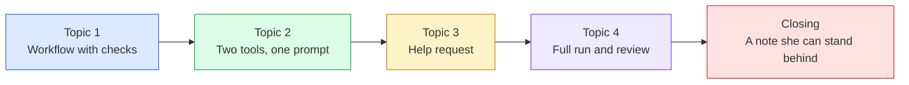
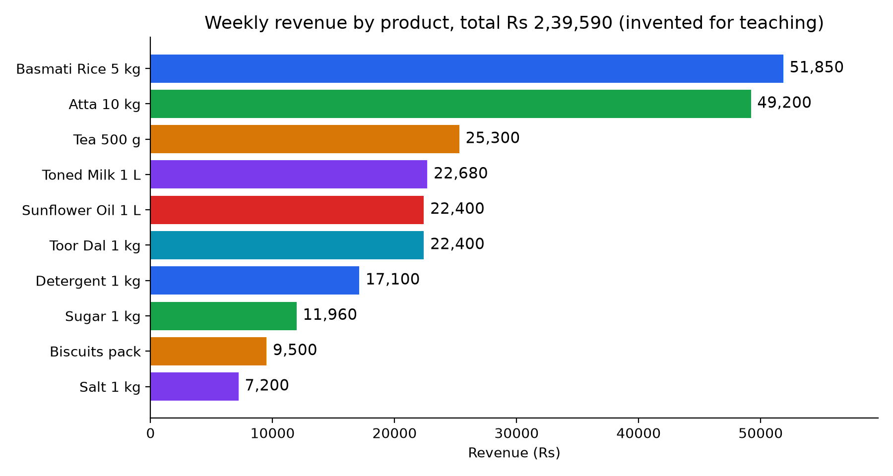
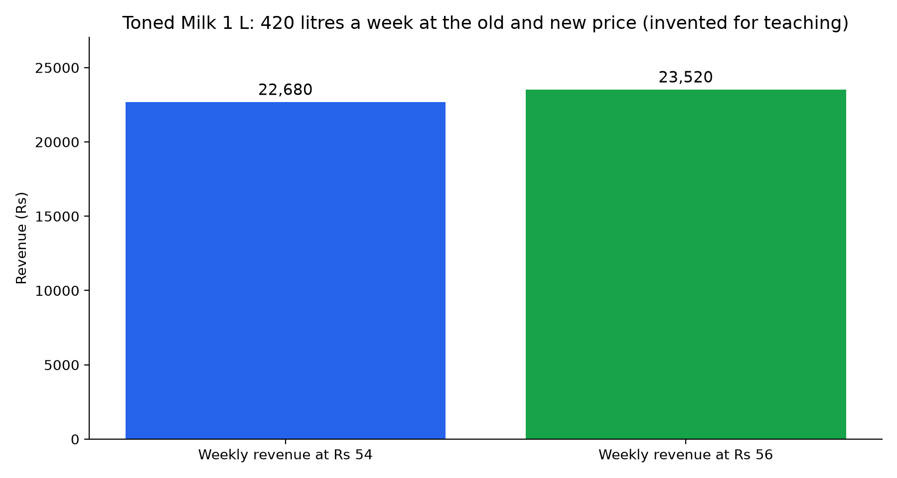
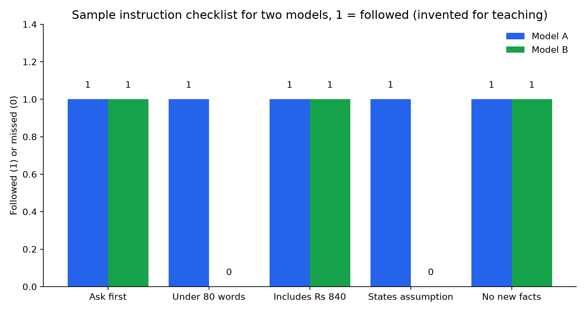
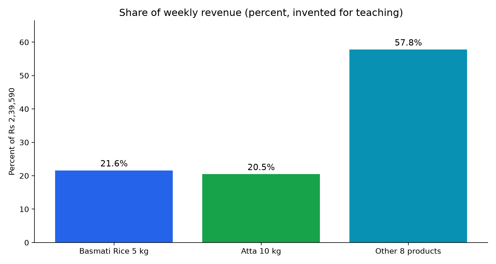

# <font color='#1d4ed8'>Lecture Script: Applied Mini-Project: A Day's Work With AI</font>

---

## <font color='blue'>Agenda</font>

The lecture runs as four topics. Each topic ends with a quiz.

| Topic | What we do | Learning objectives covered | Minutes |
|:-:|:--|:--|:-:|
| 1 | Plan the day as ordered steps with a check after each | Design a multi-step generative AI workflow for an analysis or reporting task with a validation check after each step | 30 |
| 2 | Run one prompt in two tools and find the gaps | Compare one prompt's output across two models to identify model-specific instruction gaps | 25 |
| 3 | Ask for help the right way | Write a help request stating what was attempted, what was expected and what happened | 25 |
| 4 | Run the whole day and review it | The three objectives above, applied together in one run | 25 |
| — | Closing: Outcome & Summary | | 15 |
| | **Total** | | **120** |

> <font color="red">**🎯 Instructor Note**</font> Pace: Topic 1 is the longest, because learners run three tasks. Topic 4 is a guided run, so keep it moving.
> Learners need two free chat tools open (for example ChatGPT and Gemini). Replies are never pasted here. Run each live step and read the real reply.

---

## <font color='blue'>Scenario</font>

**Kavya's Friday, hour by hour.** Kavya is an assistant manager at a DMart-style supermarket.

- **9:30** A supplier circular arrives. She must act on it.
- **11:00** The weekly sales table for 10 products is due to her manager.
- **15:00** She must send the manager a short note that joins the two.

She decides to use a chat tool for all three jobs and asks, "Can I trust the result at each step?"

> <font color="red">**🎯 Instructor Note**</font> The company is only the setting. Do not claim it works this way. The supermarket, the circular, the products, the prices and every number are invented for teaching. Today is Friday, 30 October 2026.

---

## <font color='blue'>Problem Statement</font>

Kavya pastes the circular and the table into one chat, asks for "a report", and sends the result at 15:00. The report quotes the wrong delivery days and a total that is Rs 10,000 too high. The manager acts on it, and the store misses the delivery day for fresh milk.

You have used grounded prompts, formula checks and clear writing. Today you join them into one workflow and check it step by step.

> <font color='purple'>**How does Kavya break her day into steps with a check after each one, compare two tools, and ask for help when a tool cannot finish?**</font>

> <font color="red">**🎯 Instructor Note**</font> Poll: "Is it enough to check only the final report?" Options: yes or no. Give learners 30 seconds to respond in chat. Reveal the answer in the Closing.

---

## <font color='blue'>What We Will Use</font>

Two free chat tools, a pasted circular and a pasted table. You supply the inputs and do the checks.

| Topic | Tools | In one line |
|:-:|:--|:--|
| 1 | One chat tool | Run a document, a spreadsheet and a writing task, with a check after each |
| 2 | Two chat tools | Run one prompt twice and note which instruction each tool missed |
| 3 | A short message | State what you tried, what you expected and what happened |
| 4 | Both tools | Run the full workflow and log every check |

---

## <font color='blue'>How: Walking Through Kavya's Friday</font>



---

## <font color='blue'>Topic 1: Plan the day as ordered steps with a check after each</font> `30 min`

> <font color='purple'>**Kavya has three jobs and one tool. What order, and what check, makes each step safe?**</font>

### <font color='green'>Example: The inputs for the day</font>

> <font color='purple'>**What does each job start from, and what could go wrong?**</font>

The circular (invented for teaching).

```
Supplier circular, 24 October 2026
1. From 1 November 2026, the MRP of Toned Milk 1 L rises from Rs 54 to Rs 56.
2. Delivery days change from Monday and Thursday to Tuesday and Friday.
3. The minimum order stays at 40 crates.
4. Stores must confirm the new delivery days by 30 October 2026.
```

The weekly sales table (invented for teaching). Revenue is Units times Price in rupees.

| Product | Units | Price (Rs) |
|:--|:-:|:-:|
| Toned Milk 1 L | 420 | 54 |
| Basmati Rice 5 kg | 85 | 610 |
| Sunflower Oil 1 L | 160 | 140 |
| Atta 10 kg | 120 | 410 |
| Toor Dal 1 kg | 140 | 160 |
| Sugar 1 kg | 260 | 46 |
| Tea 500 g | 110 | 230 |
| Biscuits pack | 380 | 25 |
| Detergent 1 kg | 90 | 190 |
| Salt 1 kg | 300 | 24 |

> <font color="red">**🎯 Instructor Note**</font> Learners paste the circular into a chat tool and run: "Use only this circular. Summarise it in 3 bullets: what changes, from when, what the store must do. Name the line number for each." Check each bullet against its line.

> <font color='green'>**Result**</font> The first check passes when each bullet matches a numbered line, with the dates and Rs figures unchanged.

### <font color='green'>Extending it: The spreadsheet job and its check</font>

> <font color='purple'>**How does Kavya know the totals are right?**</font>

> <font color="red">**🎯 Instructor Note**</font> Learners paste the table with: "Add a Revenue column (Units times Price), show every row, then the total and the top product." Do not reveal the key first. Ask learners to hand-check 3 rows.

The answer key, worked out in code and checked by hand.

| Product | Revenue (Rs) |
|:--|:-:|
| Basmati Rice 5 kg | 51,850 |
| Atta 10 kg | 49,200 |
| Tea 500 g | 25,300 |
| Toned Milk 1 L | 22,680 |
| Toor Dal 1 kg | 22,400 |
| Sunflower Oil 1 L | 22,400 |
| Detergent 1 kg | 17,100 |
| Sugar 1 kg | 11,960 |
| Biscuits pack | 9,500 |
| Salt 1 kg | 7,200 |
| **Total** | **2,39,590** |

<p align="center"></p>

#### <font color='#c2410c'>Logic Explanation</font>

- Hand-check 3 rows: $300 \times 24 = 7{,}200$, $380 \times 25 = 9{,}500$ and $85 \times 610 = 51{,}850$.
- Toor Dal and Sunflower Oil tie at Rs 22,400, so "fifth product" has no single answer. A good report notes the tie.
- The top product is Basmati Rice, with $\frac{51850}{239590} \approx 21.6\%$ of the total.

> <font color='green'>**Result**</font> The second check passes when 3 hand-checked rows match, the total is Rs 2,39,590 and the top product is Basmati Rice.

### <font color='green'>Extending it: Joining the pieces</font>

> <font color='purple'>**What are the remaining steps, and what does each check?**</font>

| Order | Step | Check after the step |
|:-:|:--|:--|
| 1 | Summarise the circular | Each bullet matches a numbered line |
| 2 | Revenue per product and total | 3 rows by hand, total Rs 2,39,590 |
| 3 | Effect of the milk price rise | $420 \times 2 = 840$ rupees a week, if volume stays at 420 |
| 4 | Draft the note, ask in line 1 | Every number matches steps 2 and 3, no new facts |
| 5 | Final read and disclosure line | Names of days, dates and amounts match the circular |

<p align="center"></p>

> <font color="red">**🎯 Instructor Note**</font> Learners write the five steps as a flow in their notes. Stress that the check comes before the next step, not at the end. Expected: step 3 needs the assumption "if volume stays at 420".

> <font color='green'>**Result**</font> A workflow has ordered steps, and each step has its own check. $23520 - 22680 = 840$ rupees is the effect in step 3.

> <font color='#b45309'>**Common mistake**</font> Pasting everything and checking only the final note. Fix: check after each step, because an early error spreads.

### <font color='purple'>Quiz 1</font>

**Question:** Which design best protects Kavya's report?

**Options:**
- A) One prompt for the whole report, with one check at the end
- B) Three prompts with no checks, to save time
- C) Ordered steps with a check after each step
- D) Ask the tool to say the report is correct

**Correct Answer:** C

**Explanation:**
- **A)** An early error spreads to the end and is hard to trace.
- **B)** Without checks, errors pass straight through.
- **C)** Correct. A check after each step catches an error before it moves on.
- **D)** The tool saying "correct" is not a check.

---

## <font color='blue'>Topic 2: Run one prompt in two tools and find the gaps</font> `25 min`

> <font color='purple'>**Kavya's tool handled steps 1 and 2. Would a second tool follow the same instructions?**</font>

### <font color='green'>Example: One note prompt, two models</font>

> <font color='purple'>**How do we compare two tools fairly?**</font>

Use one prompt with five checkable instructions, copied exactly into both tools.

```
Write a note to the store manager, under 80 words.
Line 1 must ask: "Please confirm the new delivery days by 30 October."
Include the milk effect: Rs 840 more a week, if volume stays at 420 litres.
State that assumption. Do not add any fact not given here.
```

> <font color="red">**🎯 Instructor Note**</font> Learners run it in two tools and fill the table. Count words with a free counter. Do not name a winner, because the point is to find each tool's gap.

| Instruction | Model A | Model B |
|:--|:-:|:-:|
| Line 1 holds the ask | learner fills | learner fills |
| Under 80 words | learner fills | learner fills |
| Includes Rs 840 | learner fills | learner fills |
| States the assumption | learner fills | learner fills |
| No new facts | learner fills | learner fills |

<p align="center"></p>

#### <font color='#c2410c'>Logic Explanation</font>

- The chart is a sample sheet, invented for teaching. In it Model A follows 5 of 5 and Model B follows 3 of 5.
- A model-specific gap is an instruction one tool follows and the other misses. Here the word limit and the assumption are the gaps.

> <font color='green'>**Result**</font> Comparing two tools shows which instructions are fragile. Your own sheet will show your own gaps.

### <font color='green'>Extending it: Close the gap with a rewording</font>

> <font color='purple'>**How does Kavya fix an instruction that one tool missed?**</font>

> <font color="red">**🎯 Instructor Note**</font> Learners reword only the missed instruction, for example "Use at most 80 words, and end with the word count in brackets". Rerun and check. Expected: it may now pass, but verify.

> <font color='green'>**Result**</font> Reword the missed instruction, rerun, and recheck. Keep what worked in your saved prompt.

> <font color='#b45309'>**Common mistake**</font> Concluding that one tool is "worse" from one run. Fix: run again, and note the gap rather than a ranking.

### <font color='purple'>Quiz 2</font>

**Question:** Model A keeps the 80-word limit and Model B does not. What does this show?

**Options:**
- A) A model-specific instruction gap, which a rewording may close
- B) That Model B can never be used
- C) That word limits do not matter
- D) That both models are broken

**Correct Answer:** A

**Explanation:**
- **A)** Correct. One tool followed the instruction and the other missed it.
- **B)** One miss does not rule a tool out. Reword and test again.
- **C)** The limit still matters to the reader.
- **D)** Model A met it, so both are not broken.

---

## <font color='blue'>Topic 3: Ask for help the right way</font> `25 min`

> <font color='purple'>**Kavya's tool will not finish one step. What does she send to a colleague so they can help in one reply?**</font>

### <font color='green'>Example: Weak and strong help requests</font>

> <font color='purple'>**What three facts make a help request answerable?**</font>

A strong help request states what you **attempted**, what you **expected** and what **happened**.

| | Weak | Strong |
|:--|:--|:--|
| Message | "The tool is not working." | See below |

```
Attempted: I pasted the 10-row sales table and asked for Revenue per row and a total.
Expected: Rs 2,39,590, which I checked by adding the rows in a sheet.
Happened: the total did not match my hand sum. I reran it once and it still differs.
```

> <font color="red">**🎯 Instructor Note**</font> The "Happened" line is an invented example of a mismatch, not a real reply. Learners write their own from their live run. Check that each of the three parts is present.

#### <font color='#c2410c'>Logic Explanation</font>

- **Attempted** lets the helper repeat the step. **Expected** gives the target. **Happened** shows the gap.
- A helper who reads these three lines can answer in one reply.

> <font color='green'>**Result**</font> Three short lines turn "it is not working" into a question someone can answer.

### <font color='green'>Extending it: Fix a vague request</font>

> <font color='purple'>**What is missing from "My formula is wrong, please fix"?**</font>

> <font color="red">**🎯 Instructor Note**</font> Ask for the missing parts in chat. Expected: which formula and sheet (attempted), the number you wanted (expected), and the number or error you got (happened).

> <font color='green'>**Result**</font> Add the three parts. Include the exact error text or number you saw.

> <font color='#b45309'>**Common mistake**</font> Writing "happened" as a feeling, such as "it looks off". Fix: paste the real number or error message.

### <font color='purple'>Quiz 3</font>

**Question:** Which help request is easiest to answer?

**Options:**
- A) "Help, it is broken."
- B) "Please look at my report."
- C) "Can someone fix this fast?"
- D) "I asked for a total of the 10 rows and expected Rs 2,39,590, but got a different number after two tries."

**Correct Answer:** D

**Explanation:**
- **A)** It says nothing about what was tried.
- **B)** It gives no expected result and no problem.
- **C)** It adds urgency but no facts.
- **D)** Correct. It states what was attempted, what was expected and what happened.

---

## <font color='blue'>Topic 4: Run the whole day and review it</font> `25 min`

> <font color='purple'>**Now that each skill is ready, can Kavya run the day end to end and keep a log?**</font>

### <font color='green'>Example: Run the five steps with a check log</font>

> <font color='purple'>**Which check passed at each step, and where did we need help?**</font>

> <font color="red">**🎯 Instructor Note**</font> Learners run all five steps in one tool, fill the log, and use the second tool for the note step only. Walk the room and read logs aloud.

| Step | Check | Passed? | If not, what next |
|:-:|:--|:-:|:--|
| 1 | Bullets match circular lines | learner fills | learner fills |
| 2 | Total is Rs 2,39,590 and 3 rows tie | learner fills | learner fills |
| 3 | Milk effect is Rs 840 with the assumption | learner fills | learner fills |
| 4 | Ask in line 1, no new facts | learner fills | learner fills |
| 5 | Days, dates and amounts match the circular | learner fills | learner fills |

<p align="center"></p>

#### <font color='#c2410c'>Logic Explanation</font>

- Two products, Basmati Rice and Atta, bring $21.6\% + 20.5\% = 42.1\%$ of the week's revenue. The note can name them.
- A failed check goes to "what next": rerun, reword, or write a help request from Topic 3.

> <font color='green'>**Result**</font> A log shows which step failed and what you did about it, so a manager can trust the final note.

### <font color='green'>Extending it: Add the disclosure line</font>

> <font color='purple'>**What does Kavya add so her manager knows how the note was made?**</font>

> <font color="red">**🎯 Instructor Note**</font> Learners add one line: "Drafted with a chat tool; I checked every figure against the circular and the table." Remind them to follow their own workplace rule.

> <font color='green'>**Result**</font> One line states the AI help and the checks done. The note is ready to send.

### <font color='purple'>Quiz 4</font>

**Question:** The log shows step 2 failed: the total is Rs 10,000 too high. What should Kavya do before step 3?

**Options:**
- A) Continue, because the note step may hide the error
- B) Fix step 2 first, using a rerun or a help request, then recheck
- C) Round the total down in the note
- D) Remove the total from the note

**Correct Answer:** B

**Explanation:**
- **A)** An error in step 2 spreads to steps 3 to 5.
- **B)** Correct. A failed check is fixed before the next step.
- **C)** Rounding hides the error without finding it.
- **D)** Removing the total avoids the problem and loses information.

---

## <font color='blue'>Closing: Outcome & Summary</font> `15 min`

Back to Kavya. We answer the Problem Statement using each topic once.

> <font color='purple'>**1. How does she break the day into steps? (Topic 1)**</font>

Five ordered steps, from circular to final read, and each has a check: matching lines, 3 hand-checked rows and the Rs 2,39,590 total, the Rs 840 effect with its assumption, and the numbers in the note.

> <font color='purple'>**2. How does she compare two tools? (Topic 2)**</font>

She runs one prompt with five checkable instructions in both, notes which each tool missed, and rewords only the missed instruction.

> <font color='purple'>**3. What does she do when a tool cannot finish? (Topic 3)**</font>

She sends a help request with what she attempted, what she expected and what happened.

> <font color='purple'>**4. What does she send? (Topic 4)**</font>

A note whose numbers passed their checks, with a log and a disclosure line.

### <font color='green'>Outcome</font>

| | One prompt, one check at the end | Steps with a check after each |
|:--|:-:|:-:|
| Delivery days | Wrong in the report | Matched to circular line 2 |
| Total | Rs 10,000 too high | Rs 2,39,590, tied by hand |
| Milk effect | Not stated | Rs 840 a week, with its assumption |
| When a tool fails | Silence | A three-part help request |

> <font color='green'>**Therefore,**</font> Kavya should split the day into ordered steps, check each before moving on, compare two tools when instructions slip, and ask for help with what she attempted, expected and saw. Checking only the final report is too late.

> <font color="red">**🎯 Instructor Note**</font> Reveal the poll: no. An early error spreads, so every step needs its own check.

### <font color='green'>Summary</font>

| Learning objective | Takeaway |
|:--|:--|
| Design a workflow with checks | Ordered steps, and a check after each one |
| Compare two models | One prompt, five checkable instructions, and note each tool's gap |
| Help request | Attempted, expected, happened |
| **Practical value** | You can finish a mixed day of document, spreadsheet and writing work with AI and prove each result |

---

# <font color='red'>Launch the Feedback Poll</font>

> <font color="red">**🎯 Instructor Note**</font> Reminder: launch the feedback poll now to collect learner feedback.
