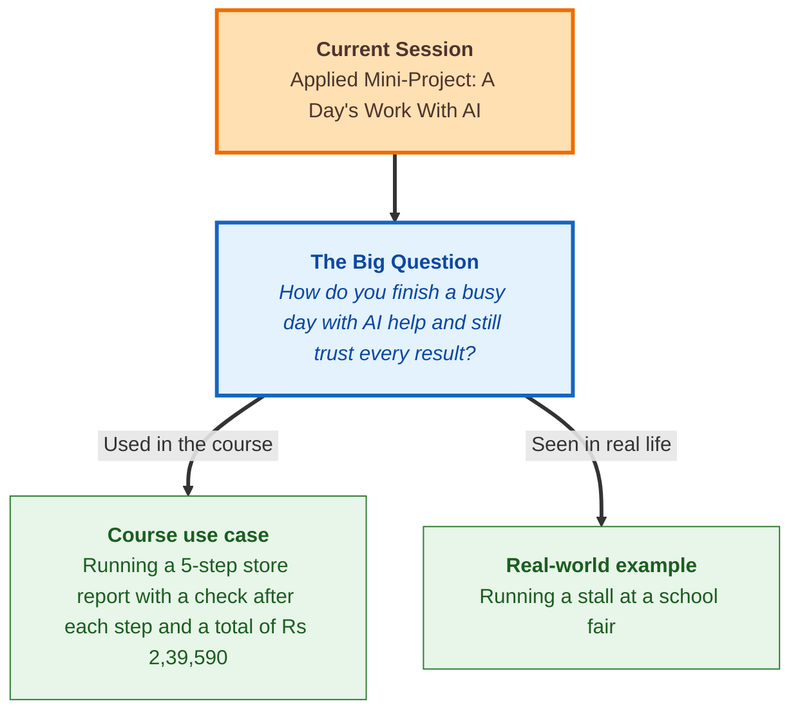

## Applied Mini-Project: A Day's Work With AI

### Mental Map

---

### What You'll Learn

Have you ever wondered how a fair stall runs smoothly when three jobs land on you in one morning?

By the end of this session, you will be able to:

- **Describe** what you tried, what you expected and what happened when your cash box total looked wrong.
- **Calculate** the total for 12 coupons at Rs 10 each.
- **Compare** two helpers' counts of the same 12 coupons to find where they differ.
- **Check** each price on the board against the written list.
- **Plan** a stall day as 4 ordered jobs with a check after each one.

> **Topics you will meet:** Running three task types in one tool, workflow with checks, comparing two tools, help requests.
>
> Join the session to learn each of these in detail.

---

### Why You Are Learning This Topic

Your class runs a stall at the school fair. You must finish three jobs before noon.

You write the price board, tally the coupons sold, and write a thank-you note for the teacher.

You check each job before starting the next. A wrong price on the board would make the tally wrong too.

A **workflow** means a set of jobs done in a set order. In this course you will build one with AI tools and a check after each job.

> **Think about it:** Where would you stop and check before moving to the next job?

---

### The School Fair Puzzle

Here is your morning, with the input for each job.

| Job | Input | Check you could make |
|:----------:|:----------:|:----------:|
| Price board | 4 items with prices | Match each price to the list |
| Coupon tally | 12 coupons, Rs 10 each | Count again by hand |
| Thank-you note | Total of Rs 120 and 4 helper names | Match every name and number |

**What you want to happen:**

- Every job passes its check before the next one starts.
- Two helpers count the same coupons and agree.
- When something fails, you can ask the teacher for help in one message.

> **Wonder about this:**
>
> - What if one helper counts 12 coupons and another counts 11?
> - What would you tell the teacher so she can help at once?

---

### Think It Through

There is no wrong first try. Keep your guesses for the session.

**1. The price board says samosa Rs 15, but the list says Rs 10. Which later job does the error spoil?**
Hint: Follow the price into the tally.

**2. Two helpers count 12 and 11 coupons. What is your first check?**
Hint: Count the coupons yourself, one by one.

**3. The tally does not match your hand count. What 3 facts go into your message to the teacher?**
Hint: Think about what you did, what you wanted and what you saw.

---

### One Question to Carry Into the Session

> **Where in your day would a 1-minute check save the most trouble later?**
>
> Whom would you ask for help, and what would you say?
