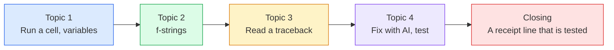
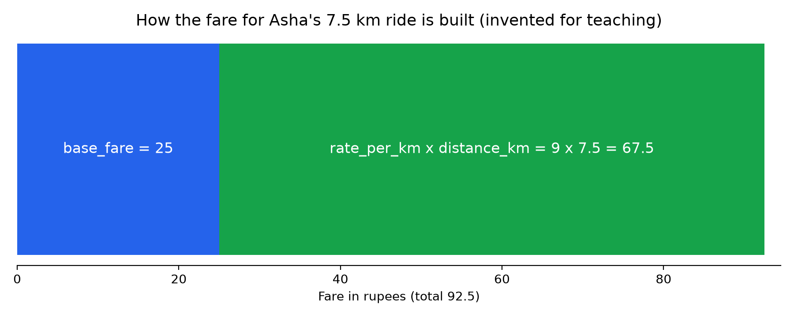
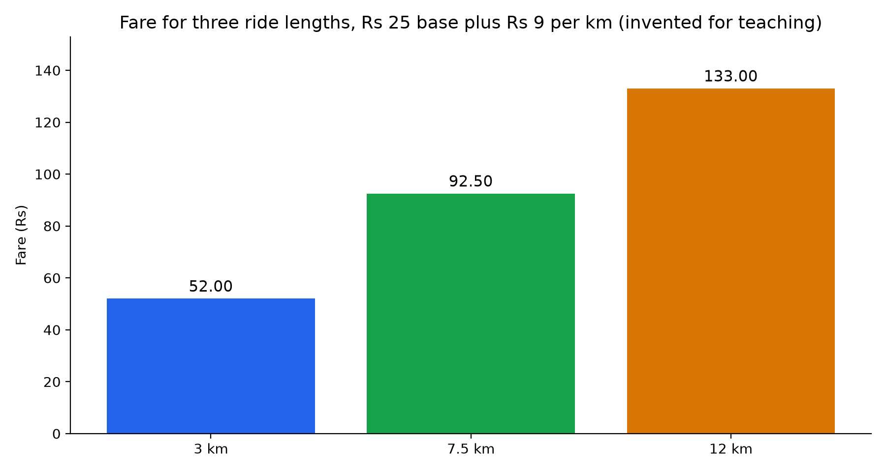
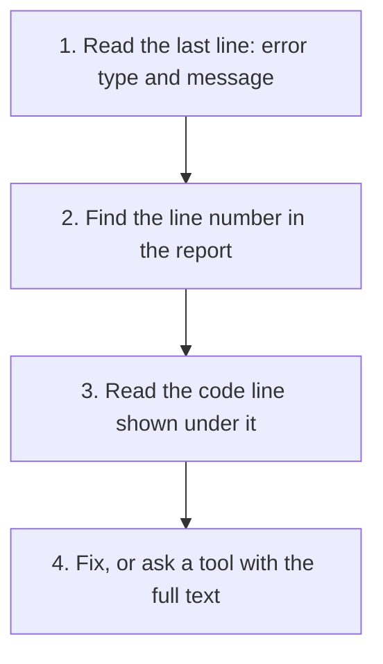
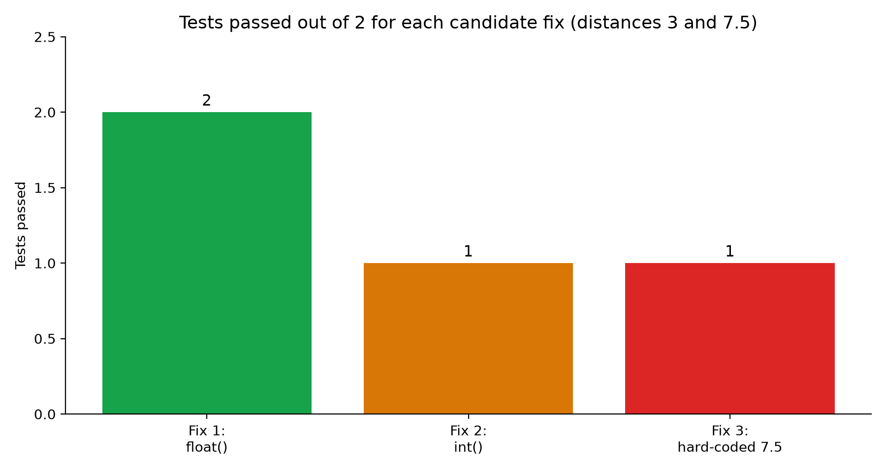

# <font color='#1d4ed8'>Lecture Script: Python Basics for Working With AI</font>

---

## <font color='blue'>Agenda</font>

The lecture runs as four topics. Each topic ends with a quiz.

| Topic | What we do | Learning objectives covered | Minutes |
|:-:|:--|:--|:-:|
| 1 | Run a cell and store values in named variables | Write a script that stores values in named variables following Python naming conventions | 30 |
| 2 | Build text with f-strings | Format a string using f-strings with embedded expressions | 25 |
| 3 | Read an error message | Interpret a Python traceback to locate the failing line | 30 |
| 4 | Fix an error with an AI tool and test the fix | Debug a failing script, query or formula with an AI tool's fix, testing it before accepting | 20 |
| — | Closing: Outcome & Summary | | 15 |
| | **Total** | | **120** |

> <font color="red">**🎯 Instructor Note**</font> Pace: Topic 1 includes opening Colab, so allow time. Spend the extra minutes on tracebacks in Topic 3. Learners need a Google account for Colab and one free chat tool.
> Every output below came from a real run of Python 3.14. Colab may print an error in its own layout and wording. Read the error type, the message and the line number. Run the AI step live. Do not paste its reply here.

---

## <font color='blue'>Scenario</font>

**Before and after.** Dev works in ride operations at a Rapido-style bike-taxi app. Each evening he writes receipt lines for rides by hand.

| | Before | After |
|:--|:--|:--|
| How a receipt line is made | Dev types the name, distance and fare for every ride | A short Python script builds the line from stored values |
| Typical slip | A typed fare that does not match 25 + 9 per km | The fare is calculated from the same two numbers every time |
| When something breaks | Dev guesses | Dev reads the error message and tests the fix |

> <font color="red">**🎯 Instructor Note**</font> The company is only the setting. Do not claim it works this way. The rider, the base fare of Rs 25, the rate of Rs 9 per km and every ride are invented for teaching.

---

## <font color='blue'>Problem Statement</font>

Dev pastes a half-working script into a chat tool, and the tool returns a "fixed" version. He runs it, sees a number, and ships the receipt for a 3 km ride. The receipt says Rs 92.5, but the right fare is Rs 52. The rider complains, and Dev cannot see why the "fixed" script was wrong.

You have used chat tools for text, tables and writing, and you have checked their answers against a source. Today you meet Python, and you check the tool's code by running it.

> <font color='purple'>**How does Dev store ride values, build a receipt line, read an error, and test a tool's fix before he trusts it?**</font>

> <font color="red">**🎯 Instructor Note**</font> Poll: "If a tool's fixed script runs without an error, is it correct?" Options: yes or no. Give learners 30 seconds to respond in chat. Reveal the answer in the Closing.

---

## <font color='blue'>What We Will Use</font>

Google Colab to run Python in a browser, and a free chat tool for the fix. Everything else is plain Python.

| Topic | Tools | In one line |
|:-:|:--|:--|
| 1 | Colab cell, variables | Run a cell and keep values under names |
| 2 | f-strings | Put values inside text with `{ }` |
| 3 | Tracebacks | Read the error type, message and line number |
| 4 | Chat tool, Colab | Ask for a fix and test it on known inputs |

---

## <font color='blue'>How: Walking Through Dev's Receipt Script</font>



---

## <font color='blue'>Topic 1: Run a cell and store values in named variables</font> `30 min`

> <font color='purple'>**Dev has four facts about one ride. Where does he keep them so a script can use them?**</font>

### <font color='green'>Example: Four variables in one cell</font>

> <font color='purple'>**How do we store a name, a distance and two prices, and see them?**</font>

A **variable** is a name that holds a value. In Colab, open a new notebook, click in a code cell, type the code and press the run button or Shift+Enter. The result appears under the cell.

**Predict before running: What will happen?**

> <font color="red">**🎯 Instructor Note**</font> Expected: one line with the four values separated by spaces. Common wrong guess: that the names are printed instead of the values.

```python
rider_name = "Asha"
distance_km = 7.5
base_fare = 25
rate_per_km = 9
print(rider_name, distance_km, base_fare, rate_per_km)
```

**Output**

```
Asha 7.5 25 9
```

#### <font color='#c2410c'>Code Explanation</font>

- **Line 1** stores the text "Asha" under the name `rider_name`. Text sits inside quotes.
- **Lines 2 to 4** store numbers. `7.5` has a decimal point. `25` and `9` do not.
- **Line 5** prints the four values, with a space between each.

> <font color='green'>**Result**</font> Four names now hold four values, and the cell shows them. Later cells in the same notebook can use these names.

### <font color='green'>Extending it: Use the variables</font>

> <font color='purple'>**How does Dev work out the fare from the stored values?**</font>

> <font color="red">**🎯 Instructor Note**</font> Ask for a prediction in chat. Expected: $25 + 9 \times 7.5 = 92.5$.

```python
fare = base_fare + rate_per_km * distance_km
print(fare)
```

**Output**

```
92.5
```

<p align="center"></p>

> <font color='green'>**Result**</font> The fare is Rs 92.5: base fare 25 plus 67.5 for distance. Python multiplies before it adds.

### <font color='green'>Extending it: Naming conventions</font>

> <font color='purple'>**Which names are allowed, and which are good habits?**</font>

Python naming conventions for variables: use lowercase words joined by underscores (`rider_name`), start with a letter or an underscore, use no spaces or hyphens, and choose a name that says what the value is. Names are case sensitive, so `fare` and `Fare` are different.

> <font color="red">**🎯 Instructor Note**</font> Ask learners which of the three names will be accepted. Expected: only the first. The `isidentifier()` check returns True when a name follows Python's rules.

```python
print("rider_name".isidentifier())
print("2nd_ride".isidentifier())
print("ride-fare".isidentifier())
```

**Output**

```
True
False
False
```

> <font color='green'>**Result**</font> `2nd_ride` starts with a digit and `ride-fare` has a hyphen, which Python reads as minus. Both are rejected.

> <font color='#b45309'>**Common mistake**</font> Naming a variable `x` or `d`. Fix: use a name such as `distance_km`, so the script reads like a sentence.

### <font color='purple'>Quiz 1</font>

**Question:** Which line follows Python naming conventions for a variable that holds a ride distance?

**Options:**
- A) `Distance KM = 7.5`
- B) `distance-km = 7.5`
- C) `7.5 = distance_km`
- D) `distance_km = 7.5`

**Correct Answer:** D

**Explanation:**
- **A)** Spaces are not allowed in a name, and capitals break the lowercase convention.
- **B)** A hyphen is read as minus, so the name is rejected.
- **C)** The name must be on the left and the value on the right.
- **D)** Correct. It is lowercase with an underscore, and it says what the value is.

---

## <font color='blue'>Topic 2: Build text with f-strings</font> `25 min`

> <font color='purple'>**The values are stored. How does Dev turn them into one readable receipt line?**</font>

### <font color='green'>Example: Put variables inside text</font>

> <font color='purple'>**How do we write a sentence that includes values?**</font>

An **f-string** is a string with an `f` before the opening quote. Anything inside curly braces `{ }` is worked out and put into the text.

**Predict before running: What will happen?**

> <font color="red">**🎯 Instructor Note**</font> Expected: "Asha rode 7.5 km. Fare: Rs 92.5". This cell uses the names from Topic 1, so run them first.

```python
print(f"{rider_name} rode {distance_km} km. Fare: Rs {fare}")
```

**Output**

```
Asha rode 7.5 km. Fare: Rs 92.5
```

#### <font color='#c2410c'>Code Explanation</font>

- **The `f` before the quote** switches on the braces. Without it, the braces print as plain text.
- **`{rider_name}`, `{distance_km}`, `{fare}`** are replaced by the stored values.

> <font color='green'>**Result**</font> One line of code builds a full receipt sentence from three stored values.

### <font color='green'>Extending it: Expressions and formats inside the braces</font>

> <font color='purple'>**Can the braces hold a calculation, a method, or a format?**</font>

> <font color="red">**🎯 Instructor Note**</font> Ask what `:.2f` does. Expected: it shows two digits after the decimal point.

```python
print(f"Round trip: {distance_km * 2} km")
print(f"Fare: Rs {fare:.2f}")
print(f"Rider: {rider_name.upper()}")
```

**Output**

```
Round trip: 15.0 km
Fare: Rs 92.50
Rider: ASHA
```

#### <font color='#c2410c'>Code Explanation</font>

- **Line 1** works out `distance_km * 2` inside the braces: $7.5 \times 2 = 15.0$.
- **Line 2** `:.2f` shows two decimal places, so 92.5 becomes 92.50.
- **Line 3** `.upper()` changes the text to capitals.

> <font color='green'>**Result**</font> Braces can hold a calculation, a text method or a format. The `:.2f` format suits money.

### <font color='green'>Extending it: Three ride lengths</font>

> <font color='purple'>**What are the fares for a 3 km, a 7.5 km and a 12 km ride?**</font>

> <font color="red">**🎯 Instructor Note**</font> Ask for predictions first. Expected: $25 + 9 \times 3 = 52$, 92.5 and $25 + 9 \times 12 = 133$.

```python
print(f"3 km: Rs {base_fare + rate_per_km * 3:.2f}")
print(f"7.5 km: Rs {base_fare + rate_per_km * 7.5:.2f}")
print(f"12 km: Rs {base_fare + rate_per_km * 12:.2f}")
```

**Output**

```
3 km: Rs 52.00
7.5 km: Rs 92.50
12 km: Rs 133.00
```

<p align="center"></p>

> <font color='green'>**Result**</font> Longer rides cost more, by Rs 9 for each km. A 3 km ride costs Rs 52.00, which matters in the Problem Statement.

### <font color='green'>Extending it: Forgetting the f</font>

> <font color='purple'>**What if the `f` is missing?**</font>

```python
print("Fare: Rs {fare}")
```

**Output**

```
Fare: Rs {fare}
```

> <font color='#b45309'>**Common mistake**</font> Leaving out the `f`. Fix: if you see braces in your output, check for the missing `f` before the quote.

### <font color='purple'>Quiz 2</font>

**Question:** `fare` holds 92.5. What does `print(f"Fare: Rs {fare:.2f}")` show?

**Options:**
- A) Fare: Rs {fare:.2f}
- B) Fare: Rs 92.5
- C) Fare: Rs 92.50
- D) Fare: Rs 92.500

**Correct Answer:** C

**Explanation:**
- **A)** The `f` before the quote makes Python fill in the braces.
- **B)** `:.2f` forces two digits after the decimal point.
- **C)** Correct. `.2f` shows exactly two decimal places.
- **D)** It asks for two decimal places, not three.

---

## <font color='blue'>Topic 3: Read an error message</font> `30 min`

> <font color='purple'>**Dev's script stops with a wall of red text. Where does he look first?**</font>

### <font color='green'>Example: A NameError</font>

> <font color='purple'>**Which line failed, and why?**</font>

A **traceback** is Python's report of where an error happened. Read it from the bottom: the last line names the error type and the reason. The line above points to the failing line, and the line number is in the report.



**Predict before running: What will happen?**

> <font color="red">**🎯 Instructor Note**</font> Expected: an error on line 4, because `fare_total` was never created. The script ran lines 1 to 3 without a problem. Colab may show an arrow layout, with the same facts.

```python
rider_name = "Asha"
distance_km = 7.5
fare = 25 + 9 * distance_km
print(f"{rider_name} paid Rs {fare_total}")
```

**Output**

```
Traceback (most recent call last):
  File "cell.py", line 4, in <module>
    print(f"{rider_name} paid Rs {fare_total}")
                                  ^^^^^^^^^^
NameError: name 'fare_total' is not defined
```

#### <font color='#c2410c'>Code Explanation</font>

- **Last line** `NameError: name 'fare_total' is not defined` says Python met a name it has never seen.
- **`line 4`** is the failing line. Lines 1 to 3 ran fine.
- **The `^^^^` marks** point to the exact name. The script made `fare`, not `fare_total`.

> <font color='green'>**Result**</font> The failing line is line 4. The cause is a name that was never created.

### <font color='green'>Extending it: A TypeError</font>

> <font color='purple'>**What does the error say when a number meets text?**</font>

> <font color="red">**🎯 Instructor Note**</font> Ask which line fails before running. Expected: line 2, where `25 +` meets text. Stress that `"7.5"` in quotes is text, not a number.

```python
distance_km = "7.5"
fare = 25 + 9 * distance_km
print(f"Fare: Rs {fare}")
```

**Output**

```
Traceback (most recent call last):
  File "cell.py", line 2, in <module>
    fare = 25 + 9 * distance_km
           ~~~^~~~~~~~~~~~~~~~~
TypeError: unsupported operand type(s) for +: 'int' and 'str'
```

> <font color='green'>**Result**</font> The failing line is line 2. `int` is a whole number and `str` is text, and Python cannot add them.

### <font color='green'>Extending it: A SyntaxError</font>

> <font color='purple'>**What if the script is not even readable?**</font>

> <font color="red">**🎯 Instructor Note**</font> Ask what is missing. Expected: a closing bracket on line 3. A SyntaxError stops the whole script before anything runs, so the first two lines never run.

```python
rider_name = "Asha"
fare = 92.5
print(f"{rider_name} paid Rs {fare}"
print("Receipt done")
```

**Output**

```
  File "cell.py", line 3
    print(f"{rider_name} paid Rs {fare}"
         ^
SyntaxError: '(' was never closed
```

> <font color='green'>**Result**</font> Python points to the bracket that was opened on line 3 and never closed.

> <font color='#b45309'>**Common mistake**</font> Reading from the top and getting lost in the report. Fix: read the last line first, then the line number.

### <font color='purple'>Quiz 3</font>

**Question:** A report ends with `NameError: name 'fare_total' is not defined` and shows `line 4`. What is the most useful reading?

**Options:**
- A) Line 4 has a name that was never created
- B) The whole notebook is broken
- C) Lines 1 to 3 must be deleted
- D) Python could not start

**Correct Answer:** A

**Explanation:**
- **A)** Correct. The error type says a name is missing, and the line number says where.
- **B)** The report is about one line. Lines 1 to 3 ran fine.
- **C)** The earlier lines worked, so nothing needs deleting.
- **D)** Python started and ran the first three lines.

---

## <font color='blue'>Topic 4: Fix an error with an AI tool and test the fix</font> `20 min`

> <font color='purple'>**The TypeError in line 2 needs a fix. Can Dev trust a tool's fix without testing it?**</font>

### <font color='green'>Example: Ask the tool with the full report</font>

> <font color='purple'>**What do we send, and how do we check the answer?**</font>

Send the whole script and the whole traceback, and say what you expected. The same loop works for a failing query or a spreadsheet formula: send the exact error, get a fix, then test it on inputs you know.

> <font color="red">**🎯 Instructor Note**</font> Live step: learners paste the TypeError script and report from Topic 3 into a chat tool and ask for a fix. Read the real reply. Do not paste it here, because it changes on every run.

Test any fix on two known inputs. The right fares are Rs 52 for 3 km and Rs 92.5 for 7.5 km. Here are 3 candidate fixes, written by the mentor so we can test them. A real tool's fix should be run the same way.

**Predict before running: What will happen?**

> <font color="red">**🎯 Instructor Note**</font> Fix 1 uses `float()`. Expected: 52.0 and 92.5. Ask whether `float` suits a distance with a decimal point. Expected: yes.

```python
distance_km = "3"
fare = 25 + 9 * float(distance_km)
print(f"3 km: Rs {fare}")
distance_km = "7.5"
fare = 25 + 9 * float(distance_km)
print(f"7.5 km: Rs {fare}")
```

**Output**

```
3 km: Rs 52.0
7.5 km: Rs 92.5
```

> <font color='green'>**Result**</font> Fix 1 passes both tests, because `float()` turns text into a number with a decimal point.

### <font color='green'>Extending it: A fix that fails the second test</font>

> <font color='purple'>**What if the fix uses `int()` instead?**</font>

> <font color="red">**🎯 Instructor Note**</font> Ask for a prediction. Expected: it works for "3" and fails for "7.5". Say that `int` cannot read a decimal point.

```python
distance_km = "3"
fare = 25 + 9 * int(distance_km)
print(f"3 km: Rs {fare}")
distance_km = "7.5"
fare = 25 + 9 * int(distance_km)
print(f"7.5 km: Rs {fare}")
```

**Output**

```
3 km: Rs 52
Traceback (most recent call last):
  File "cell.py", line 5, in <module>
    fare = 25 + 9 * int(distance_km)
                    ~~~^^^^^^^^^^^^^
ValueError: invalid literal for int() with base 10: '7.5'
```

> <font color='green'>**Result**</font> Fix 2 passes the first test and fails the second. One test on "3" alone would have hidden the fault.

### <font color='green'>Extending it: A fix that runs and is wrong</font>

> <font color='purple'>**What if the fix hard-codes 7.5?**</font>

> <font color="red">**🎯 Instructor Note**</font> Ask whether it will run without an error. Expected: yes, and for 3 km it prints the wrong fare. This is the case in the Problem Statement.

```python
distance_km = "3"
fare = 25 + 9 * 7.5
print(f"3 km: Rs {fare}")
distance_km = "7.5"
fare = 25 + 9 * 7.5
print(f"7.5 km: Rs {fare}")
```

**Output**

```
3 km: Rs 92.5
7.5 km: Rs 92.5
```

<p align="center"></p>

#### <font color='#c2410c'>Logic Explanation</font>

- Fix 3 runs without an error and prints Rs 92.5 for 3 km, but the right fare is Rs 52. A script that runs is not a script that is right.
- Test with two inputs whose answers you already know. Only fix 1 passes both.

> <font color='green'>**Result**</font> Accept a tool's fix only after it passes tests on known inputs. No error message does not mean the answer is correct.

> <font color='#b45309'>**Common mistake**</font> Accepting a fix because the red error text is gone. Fix: check the output against a value you worked out by hand.

### <font color='purple'>Quiz 4</font>

**Question:** An AI tool returns a fixed script that runs without an error. What should Dev do before using it?

**Options:**
- A) Use it, because no error means it is right
- B) Test it on 2 inputs whose answers he already knows
- C) Ask the tool if it is sure
- D) Delete the old script

**Correct Answer:** B

**Explanation:**
- **A)** Fix 3 ran without an error and still gave a wrong fare.
- **B)** Correct. Known answers show whether the fix is right.
- **C)** A tool can say it is sure and still be wrong.
- **D)** Keep the old script until the fix passes.

---

## <font color='blue'>Closing: Outcome & Summary</font> `15 min`

Back to Dev. We answer the Problem Statement using each topic once.

> <font color='purple'>**1. Where does he store the ride values? (Topic 1)**</font>

In named variables such as `rider_name` and `distance_km`, written in lowercase with underscores.

> <font color='purple'>**2. How does he build the receipt line? (Topic 2)**</font>

With an f-string, using `:.2f` for money, and the code below.

> <font color='purple'>**3. How does he find a failure? (Topic 3)**</font>

He reads the last line of the traceback first, then the line number.

> <font color='purple'>**4. How does he trust a fix? (Topic 4)**</font>

He tests it on two known rides before he accepts it.

```python
rider_name = "Asha"
distance_km = "7.5"
base_fare = 25
rate_per_km = 9
fare = base_fare + rate_per_km * float(distance_km)
print(f"{rider_name} rode {distance_km} km. Fare: Rs {fare:.2f}")
```

**Output**

```
Asha rode 7.5 km. Fare: Rs 92.50
```

#### <font color='#c2410c'>Code Explanation</font>

- **Lines 1 to 4** store the values in clear names (Topic 1).
- **Line 5** turns the text "7.5" into a number with `float`, the fix that passed both tests (Topic 4).
- **Line 6** builds the line with an f-string and `:.2f` (Topic 2).

### <font color='green'>Outcome</font>

| | Fix accepted because it ran | Fix tested on known inputs |
|:--|:-:|:-:|
| Receipt for 3 km | Rs 92.5 (wrong) | Rs 52.0 (right) |
| Receipt for 7.5 km | Rs 92.5 | Rs 92.5 |
| Dev's confidence | Based on no error | Based on two matching tests |

> <font color='green'>**Therefore,**</font> Dev should name his values clearly, build text with f-strings, read errors from the last line up, and test every AI fix on inputs with known answers. A fix that runs without an error can still be wrong.

> <font color="red">**🎯 Instructor Note**</font> Reveal the poll: no. Fix 3 ran without an error and printed the wrong fare for 3 km.

### <font color='green'>Summary</font>

| Learning objective | Takeaway |
|:--|:--|
| Named variables | Lowercase words with underscores, and a name that says what the value is |
| f-strings | An `f` before the quote, and `{ }` for values, calculations and formats |
| Traceback | Read the last line, then the line number, then the code line |
| Debug with an AI fix | Send the full report, then test the fix on known inputs |
| **Practical value** | You can run small scripts, read their errors and test an AI tool's fix before you rely on it |

---

# <font color='red'>Launch the Feedback Poll</font>

> <font color="red">**🎯 Instructor Note**</font> Reminder: launch the feedback poll now to collect learner feedback.
