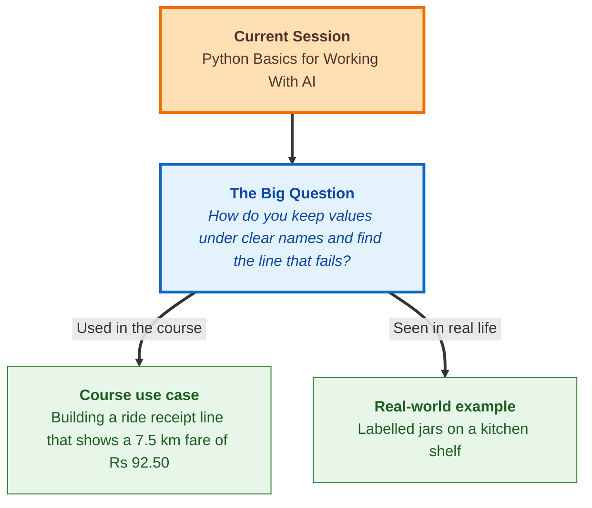

## <span style="color:#2F7DDE">Python Basics for Working With AI</span>

### <span style="color:#2F7DDE">Mental Map</span>



---

### <span style="color:#2F7DDE">What You'll Learn</span>

Have you ever wondered how a cook finds the right jar in the dark by its label alone?

By the end of this session, you will be able to:

- <span style="color:#D9660B">**Name**</span> 3 jars with labels that say what is inside.
- <span style="color:#D9660B">**Interpret**</span> a note that says the jar "turmeric_powder" is not on the shelf.
- <span style="color:#D9660B">**Apply**</span> a fill-in sentence to show "Add 200 g of sugar" for each jar.
- <span style="color:#D9660B">**Trace**</span> which line of a 4-line recipe fails when a jar is missing.
- <span style="color:#D9660B">**Check**</span> a helper's fix against 2 jars with known amounts.

> <span style="color:#2F7DDE">**Topics you will meet:**</span> Running a cell, variables, f-strings, reading errors, fixing errors with an AI tool.
>
> Join the session to learn each of these in detail.

---

### <span style="color:#2F7DDE">Why You Are Learning This Topic</span>

Your kitchen shelf has jars. Each jar has a label: sugar, salt, tea.

The recipe says, "Add 200 g of sugar." You read the label, open the jar and measure 200 g.

A <span style="color:#D9660B">**variable**</span> means a name that holds a value, like a label on a jar. A script reads the name and finds the value.

In this course you will write small Python scripts and ask AI tools to fix them.

> <span style="color:#2F7DDE">**Think about it:**</span> What happens if the recipe asks for a jar that has no label?

---

### <span style="color:#2F7DDE">The Kitchen Jar Puzzle</span>

Here are the jars on your shelf and what each holds.

| Jar label | Contents |
|:----------:|:----------:|
| sugar_grams | 200 |
| salt_grams | 5 |
| tea_spoons | 2 |

<span style="color:#D9660B">**What you want to happen:**</span>

- Each recipe line shows the amount from the right jar.
- A missing jar gives a note that tells you the line.
- A helper's fix is tested before you cook.

Here is how it might start. You do not need to understand it yet.

```python
sugar_grams = 200
print(f"Add {sugar_grams} g of sugar")
```

> <span style="color:#D9660B">**Wonder about this:**</span>
>
> - Why might a label like "tea_spoons" be clearer than "x"?
> - How would you find the one wrong line in a 4-line recipe?

---

### <span style="color:#2F7DDE">Think It Through</span>

There is no wrong first try. Keep your guesses for the session.

**1. A recipe line says to add the salt jar's grams, and the jar says 5. What should the line show?**
Hint: Swap the label for the amount inside it.

**2. A note says "line 3: jar turmeric_powder not found". Where do you look first?**
Hint: Go straight to the line number.

**3. A helper suggests a fix that works for sugar but not for salt. How would you catch that?**
Hint: Test the fix on more than one jar.

---

### <span style="color:#2F7DDE">One Question to Carry Into the Session</span>

> <span style="color:#2F7DDE">**How can a short note tell you exactly which line went wrong?**</span>
>
> What would you test before you trust a helper's fix?
