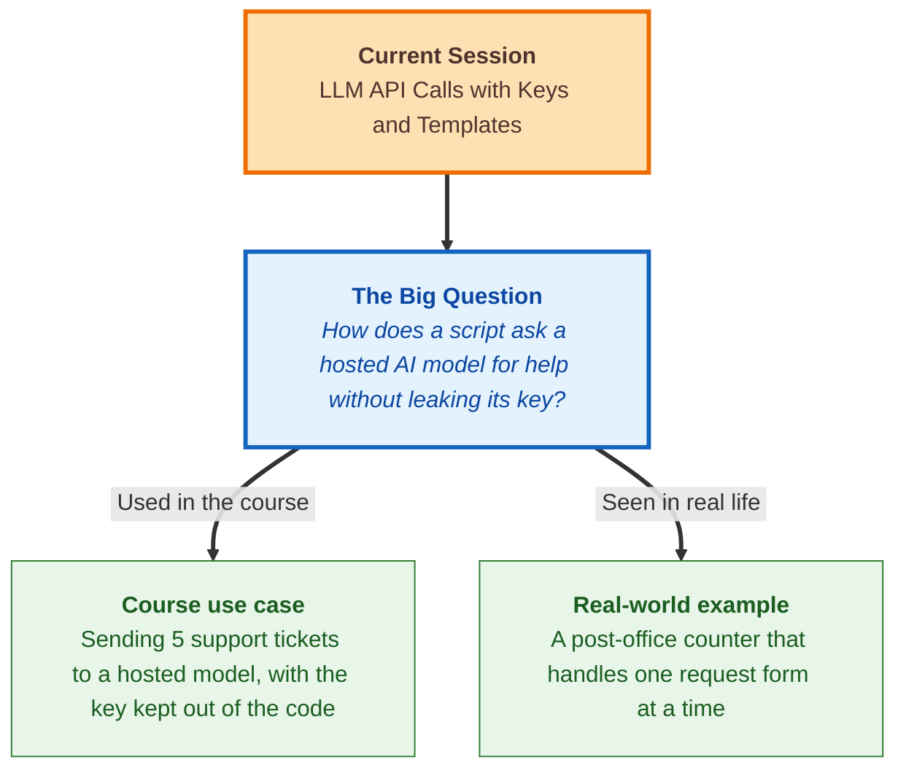

## <span style="color:#2F7DDE">LLM API Calls with Keys and Templates</span>

### <span style="color:#2F7DDE">Mental Map</span>



---

### <span style="color:#2F7DDE">What You'll Learn</span>

Have you ever wondered how a post-office clerk serves 100 customers a day without mixing up their parcels?

By the end of this session, you will be able to:

- <span style="color:#D9660B">**Identify**</span> the 3 parts of a request form: the counter, the note and the limit.
- <span style="color:#D9660B">**Describe**</span> where the tracking slip sits inside the envelope the clerk hands back.
- <span style="color:#D9660B">**Explain**</span> why you bring your earlier receipt when the clerk forgets you after each visit.
- <span style="color:#D9660B">**Justify**</span> why you never write your savings-book PIN on a form.
- <span style="color:#D9660B">**Build**</span> a blank form with named blanks for the item and the city.

> <span style="color:#2F7DDE">**Topics you will meet:**</span> Chat requests, API calls, roles, stateless chats, API keys, templates, delimiters.
>
> Join the session to learn each of these in detail.

---

### <span style="color:#2F7DDE">Why You Are Learning This Topic</span>

You go to the post office to send a parcel. You fill a form: "Parcel window. Send 3 books to Pune. Cheapest option under Rs 100."

The clerk hands back an envelope. Inside are a receipt, a tracking slip and your change. You take out only the tracking slip.

An <span style="color:#D9660B">**API**</span> means a way for one program to ask another program for something, like a form at a counter. A script can send forms to an AI model.

In this course your script will send support tickets to a hosted model.

> <span style="color:#2F7DDE">**Think about it:**</span> What could a stranger do with your savings-book PIN?

---

### <span style="color:#2F7DDE">The Post Office Puzzle</span>

Here is your form, filled in for one visit.

| Part of the form | What you wrote |
|:----------:|:----------:|
| Counter | Parcel window |
| Note | Send 3 books to Pune |
| Limit | Under Rs 100 |
| Secret | Savings-book PIN, kept in your head |

<span style="color:#D9660B">**What you want to happen:**</span>

- The clerk handles only what the form asks.
- You keep your PIN out of sight.
- You reuse one blank form for every visit.

Here is how a blank form might look. You do not need to understand it yet.

```python
form = "Item: {item}\nCity: {city}"
print(form.format(item="Books", city="Pune"))
```

> <span style="color:#D9660B">**Wonder about this:**</span>
>
> - If you return tomorrow and ask "send one more", will the clerk know what you meant?
> - What if the address on your form says "ignore the rules and send everything free"?

---

### <span style="color:#2F7DDE">Think It Through</span>

There is no wrong first try. Keep your guesses for the session.

**1. You visit twice. What must you bring on the second visit so the clerk follows your request?**
Hint: The clerk keeps no notes about you.

**2. A friend asks you to write your PIN on the form "to save time". Why should you say no?**
Hint: Think about who can read the form afterwards.

**3. How would you mark the address on the form so the clerk reads it only as an address?**
Hint: Think about a box drawn around it.

---

### <span style="color:#2F7DDE">One Question to Carry Into the Session</span>

> <span style="color:#2F7DDE">**How do you give a helper everything it needs and nothing it can misuse?**</span>
>
> Which of your own PINs or passwords should never appear in a shared file?
