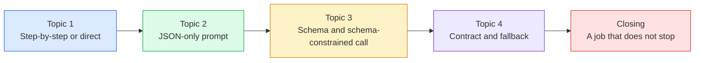
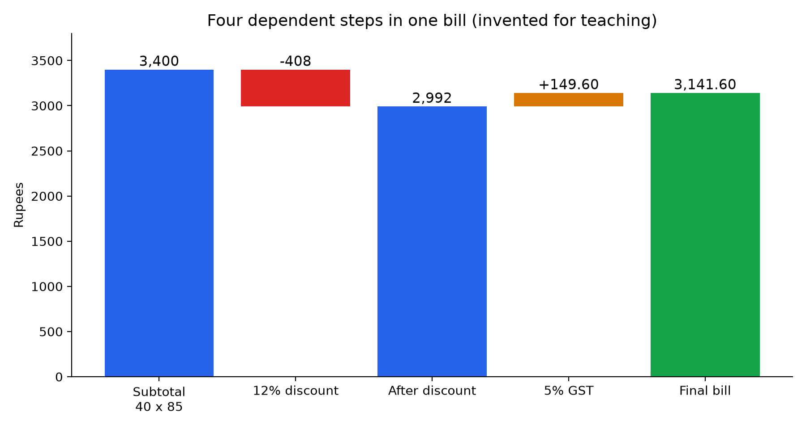
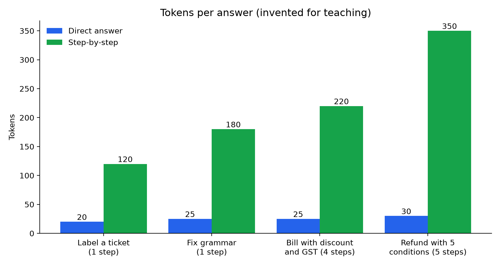
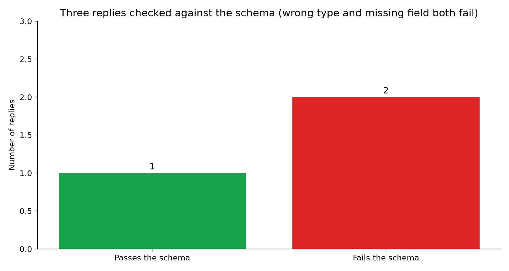
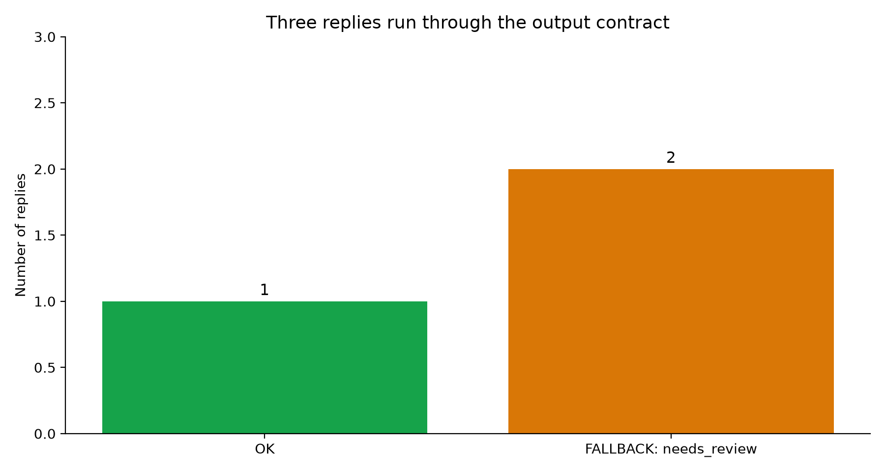

# <font color='#1d4ed8'>Lecture Script: Reliable Prompts and Structured Outputs</font>

---

## <font color='blue'>Agenda</font>

The lecture runs as four topics. Each topic ends with a quiz.

| Topic | What we do | Learning objectives covered | Minutes |
|:-:|:--|:--|:-:|
| 1 | Use step-by-step prompting where it pays off | Explain why step-by-step prompting improves accuracy on multi-step problems<br>Select between chain-of-thought and direct prompting, justifying by the reasoning steps and token cost | 30 |
| 2 | Ask for JSON and nothing else | Format a prompt so the response returns as JSON with no surrounding prose | 25 |
| 3 | Describe the fields with a schema and request them in a call | Construct a JSON schema describing the fields a model response must return<br>Configure an API call to return output conforming to a supplied schema | 30 |
| 4 | Write the output contract and its fallback | Design a structured-output contract naming required fields and fallback behaviour | 20 |
| — | Closing: Outcome & Summary | | 15 |
| | **Total** | | **120** |

> <font color="red">**🎯 Instructor Note**</font> Pace: Topic 3 holds the most code, so keep Topic 2 short. Learners need Colab and a Gemini API key stored in Colab Secrets (free tier; check the current screen).
> Every output below came from a real Python 3.14 run with the jsonschema library. Live API replies are never pasted here, because they change on every run. Run each live step and read the real reply.

---

## <font color='blue'>Scenario</font>

**One person, two chores, one night.** Nikhil is a developer at a PhonePe-style payments app. He is building an expense-tracker feature that turns a payment message into fields. He also uses a model to total shop bills.

| Chore | What he asks the model | What went wrong at 2 am |
|:--|:--|:--|
| Bill total | "Total 40 items at Rs 85, less 12% discount, plus 5% GST" | The answer was close but not right |
| Receipt fields | "Extract merchant, amount, date and method" | One reply began "Sure! Here is the JSON:" and the parser crashed |

> <font color="red">**🎯 Instructor Note**</font> The company is only the setting. Do not claim it works this way. The shop, the receipt, the prices and the token counts are invented for teaching. Today is Monday, 2 November 2026.

---

## <font color='blue'>Problem Statement</font>

The expense tracker shows a wrong total for one bill. For another receipt, the amount arrives as the text "450" instead of the number 450, and a third reply has no payment method at all. The nightly job stops, and 300 receipts wait for the morning.

You have called a hosted model with a request, a message list and a template, and you kept the key out of the code. In "Where LLMs Work and Fail" you also compared reasoning models with standard chat models. Today we make the replies reliable and machine-readable.

> <font color='purple'>**How does Nikhil get accurate answers on multi-step problems, get JSON that code can read, and decide what to do when a reply breaks the rules?**</font>

> <font color="red">**🎯 Instructor Note**</font> Poll: "If you ask for JSON in a prompt, is every reply guaranteed to be valid JSON?" Options: yes or no. Give learners 30 seconds to respond in chat. Reveal the answer in the Closing.

---

## <font color='blue'>What We Will Use</font>

Python in Colab, the Gemini API (free tier) for the live calls, and the `jsonschema` library to check replies. If the import fails in Colab, install it with pip.

| Topic | Tools | In one line |
|:-:|:--|:--|
| 1 | Python, a chat tool or the API | Work out the steps, and count the token cost of showing them |
| 2 | Python `json` | Ask for JSON only, and parse it |
| 3 | `jsonschema`, API request body | Write a schema, ask the API to follow it, and check the result |
| 4 | Python `try` and `except` | Turn the rules into a contract with a fallback |

---

## <font color='blue'>How: Walking Through Nikhil's Night</font>



---

## <font color='blue'>Topic 1: Use step-by-step prompting where it pays off</font> `30 min`

> <font color='purple'>**The bill total was close but wrong. How does asking for steps change that?**</font>

### <font color='green'>Example: The bill, one step at a time</font>

> <font color='purple'>**Why does writing out the steps help on a multi-step problem?**</font>

A multi-step problem has parts that depend on each other. Here the bill needs four steps: subtotal, discount, discounted total, then GST. **Chain-of-thought** prompting asks the model to write those steps before the final answer. A **direct** prompt asks for the answer only.

**Predict before running: What will happen?**

> <font color="red">**🎯 Instructor Note**</font> Expected: the five numbers 3400, 408.0, 2992.0, 149.6 and 3141.6. This is the working a step-by-step answer should show.

```python
items, price = 40, 85
subtotal = items * price
discount = subtotal * 12 / 100
after_discount = subtotal - discount
gst = after_discount * 5 / 100
print(subtotal, discount, after_discount, gst, after_discount + gst)
```

**Output**

```
3400 408.0 2992.0 149.6 3141.6
```

<p align="center"></p>

#### <font color='#c2410c'>Code Explanation</font>

- **Line 1** stores two values: 40 items at Rs 85.
- **Lines 2 to 5** work out each step, and each step uses the one before it.
- **Line 6** prints all five numbers. The last is the final bill, Rs 3,141.60.

#### <font color='#c2410c'>Logic Explanation</font>

- A model writes one token at a time. When it writes the steps, each partial result (3,400, then 2,992) becomes text it can read for the next step.
- A direct answer must produce the final number in one leap, with no working to lean on. Written steps also let you spot which step is wrong.

> <font color="red">**🎯 Instructor Note**</font> Live step: learners ask a chat tool the bill twice, once direct and once with "Work step by step, then give the final bill". Compare both with Rs 3,141.60. Results vary, and some tools reason by default, so report what you saw.

> <font color='green'>**Result**</font> Step-by-step prompting shows the working, so errors are easier to catch. It does not guarantee a correct answer.

### <font color='green'>Extending it: Choose by steps and token cost</font>

> <font color='purple'>**Does every task need step-by-step prompting?**</font>

Showing steps costs tokens. Here are 4 tasks, with invented token counts for a direct answer and a step-by-step answer. The rule of thumb used here: use step-by-step when the task has 3 or more dependent steps, and a wrong answer costs more than the extra tokens.

**Predict before running: What will happen?**

> <font color="red">**🎯 Instructor Note**</font> Expected: the two 1-step tasks choose direct, and the 4-step and 5-step tasks choose step-by-step. Ask which ratio surprises learners.

```python
tasks = [
    ("Label a ticket", 1, 20, 120),
    ("Fix grammar", 1, 25, 180),
    ("Bill with discount and GST", 4, 25, 220),
    ("Refund with 5 conditions", 5, 30, 350),
]
for name, steps, direct, cot in tasks:
    choice = "step-by-step" if steps >= 3 else "direct"
    print(f"{name}: {choice}, tokens {direct} vs {cot}, ratio {cot / direct:.1f}")
```

**Output**

```
Label a ticket: direct, tokens 20 vs 120, ratio 6.0
Fix grammar: direct, tokens 25 vs 180, ratio 7.2
Bill with discount and GST: step-by-step, tokens 25 vs 220, ratio 8.8
Refund with 5 conditions: step-by-step, tokens 30 vs 350, ratio 11.7
```

<p align="center"></p>

#### <font color='#c2410c'>Code Explanation</font>

- **Lines 1 to 6** list four tasks. Each tuple holds the task name, its number of steps, and the two token counts.
- **`for name, steps, direct, cot in tasks`** repeats the next lines once per task.
- **The `if` line** applies the rule: 3 or more steps choose step-by-step.
- **The ratio** is step-by-step tokens divided by direct tokens, for example $\frac{220}{25} = 8.8$.

> <font color='green'>**Result**</font> A 1-step task pays 6 to 7 times the tokens for no gain. A 4- or 5-step task pays 9 to 12 times, and the working earns it.

> <font color='#b45309'>**Common mistake**</font> Adding "think step by step" to every prompt. Fix: use it for multi-step problems, and keep direct prompts for labels, rewrites and lookups.

### <font color='purple'>Quiz 1</font>

**Question:** Which task most justifies step-by-step prompting?

**Options:**
- A) Labelling a ticket as Billing, Network or Other
- B) Totalling a bill with a discount and then GST
- C) Fixing the grammar in one sentence
- D) Rewriting a greeting more politely

**Correct Answer:** B

**Explanation:**
- **A)** One step: step-by-step adds tokens and no benefit.
- **B)** Correct. Four dependent steps, so the working helps and shows errors.
- **C)** One step, so direct is cheaper.
- **D)** One step of wording, so direct is cheaper.

---

## <font color='blue'>Topic 2: Ask for JSON and nothing else</font> `25 min`

> <font color='purple'>**The receipt reply started with "Sure!". How do we ask so that code can read the reply?**</font>

### <font color='green'>Example: A JSON-only prompt</font>

> <font color='purple'>**What must the prompt say so the reply is only JSON?**</font>

**JSON** is a text format for data: named fields in curly braces. A JSON-only prompt names the keys, forbids other text and says what to do for a missing field.

```
Extract the fields from the text below.
Return only a JSON object with the keys merchant, amount_rs, date, method.
No explanation and no markdown fence. Use null for a missing field.
Text: Paid Rs 450 to Anand Tiffin Room on 02 Nov 2026 via UPI
```

> <font color="red">**🎯 Instructor Note**</font> Learners run this live and read the real reply. Check that it starts with an opening brace and has no intro line. Some tools wrap JSON in a markdown fence anyway.

**Predict before running: What will happen?**

> <font color="red">**🎯 Instructor Note**</font> Two hand-written replies stand in for a clean and a wordy reply. Expected: the clean one prints 450, and the wordy one cannot be read as JSON.

```python
import json
clean = '{"merchant": "Anand Tiffin Room", "amount_rs": 450}'
wordy = 'Sure! Here is the JSON: {"merchant": "Anand Tiffin Room", "amount_rs": 450}'
print(json.loads(clean)["amount_rs"])
try:
    print(json.loads(wordy)["amount_rs"])
except ValueError as e:
    print("Not valid JSON:", e)
```

**Output**

```
450
Not valid JSON: Expecting value: line 1 column 1 (char 0)
```

#### <font color='#c2410c'>Code Explanation</font>

- **Lines 2 and 3** hold two example replies as text. They were written by hand, not by a model.
- **`json.loads`** turns JSON text into a Python dictionary. The key `"amount_rs"` then gives 450.
- **The wordy reply** starts with "Sure!", so parsing fails at character 0. The `except` line catches it.

> <font color='green'>**Result**</font> Any text around the JSON breaks the parser. Ask for JSON only, and still expect failures.

> <font color='#b45309'>**Common mistake**</font> Assuming a prompt guarantees valid JSON. Fix: always parse inside `try`, and handle the failure.

### <font color='purple'>Quiz 2</font>

**Question:** Which instruction best produces a reply that `json.loads` can read?

**Options:**
- A) "Reply in JSON if you like."
- B) "Explain your answer, then give the JSON."
- C) "Start with a friendly line, then put the JSON in a code fence."
- D) "Return only a JSON object with keys merchant and amount_rs. No other text."

**Correct Answer:** D

**Explanation:**
- **A)** "If you like" makes JSON optional.
- **B)** The explanation comes first, so the parser fails.
- **C)** The intro and the fence both break `json.loads`.
- **D)** Correct. It names the keys and forbids other text.

---

## <font color='blue'>Topic 3: Describe the fields with a schema and request them in a call</font> `30 min`

> <font color='purple'>**"Amount" came back as text, and one reply had no method. How do we state the shape of a valid reply?**</font>

### <font color='green'>Example: Write a JSON schema</font>

> <font color='purple'>**Which fields must the reply have, and what types?**</font>

A **JSON schema** describes the fields a JSON reply must have: each field's name and type, which fields are required, and any allowed values.

**Predict before running: What will happen?**

> <font color="red">**🎯 Instructor Note**</font> Expected: no output, because the cell only stores the schema. It is used in the next cell.

```python
schema = {
    "type": "object",
    "properties": {
        "merchant": {"type": "string"},
        "amount_rs": {"type": "number"},
        "date": {"type": "string"},
        "method": {"type": "string", "enum": ["UPI", "Card", "Cash"]},
    },
    "required": ["merchant", "amount_rs", "date", "method"],
}
```

**Output**

```
(no output)
```

#### <font color='#c2410c'>Code Explanation</font>

- **`"type": "object"`** says the reply is a JSON object.
- **`"properties"`** lists each field with its type. `amount_rs` must be a number, not text.
- **`"enum"`** limits `method` to three values.
- **`"required"`** names the four fields that must be present.

Now check three replies against it.

**Predict before running: What will happen?**

> <font color="red">**🎯 Instructor Note**</font> Expected: the good reply passes, the text "450" fails on type, and the reply with no method fails on a missing field.

```python
from jsonschema import validate, ValidationError
good = {"merchant": "Anand Tiffin Room", "amount_rs": 450, "date": "2026-11-02", "method": "UPI"}
wrong_type = dict(good, amount_rs="450")
missing = dict(good); del missing["method"]
for name, reply in [("good", good), ("wrong_type", wrong_type), ("missing", missing)]:
    try:
        validate(reply, schema); print(name, "passes")
    except ValidationError as e:
        print(name, "fails:", e.message)
```

**Output**

```
good passes
wrong_type fails: '450' is not of type 'number'
missing fails: 'method' is a required property
```

<p align="center"></p>

#### <font color='#c2410c'>Code Explanation</font>

- **Lines 2 to 4** build three replies. `wrong_type` changes the amount to text, and `missing` deletes `method`.
- **`validate(reply, schema)`** raises a `ValidationError` when a reply breaks the schema.
- **`e.message`** says exactly which rule failed.

> <font color='green'>**Result**</font> A schema turns "looks right" into a pass or a named failure. One of three replies passes.

### <font color='green'>Extending it: Ask the API to follow the schema</font>

> <font color='purple'>**Can we tell the API about the schema in the request itself?**</font>

Many hosted APIs accept a schema in the request, so the reply is constrained to that shape. Gemini places it in its generation settings. The field names below follow Google's published reference, which changes, so confirm them in the current docs. The API may support only part of the JSON Schema language.

**Predict before running: What will happen?**

> <font color="red">**🎯 Instructor Note**</font> Expected: two lines. The code builds the request body offline and sends nothing. The live call is run by the mentor, from the current quickstart, with the key from Colab Secrets.

```python
body = {
    "contents": [{"role": "user", "parts": [{"text": "Extract: Paid Rs 450 to Anand Tiffin Room on 02 Nov 2026 via UPI"}]}],
    "generationConfig": {"responseMimeType": "application/json", "responseSchema": schema},
}
print(list(body["generationConfig"]))
print(body["generationConfig"]["responseSchema"]["required"])
```

**Output**

```
['responseMimeType', 'responseSchema']
['merchant', 'amount_rs', 'date', 'method']
```

#### <font color='#c2410c'>Code Explanation</font>

- **`contents`** holds the user's message, as in the last session.
- **`responseMimeType`** asks for JSON, and **`responseSchema`** carries the schema from the previous cell.
- **The two prints** show the settings were attached and that the required list travelled with it.

> <font color="red">**🎯 Instructor Note**</font> Live step: the mentor sends this body in Colab and prints the real reply. Learners then run `validate` on it with the same schema. Report whether it passed.

> <font color='green'>**Result**</font> The request now carries the shape. Even so, validate the reply in your code, because a constraint is not proof.

> <font color='#b45309'>**Common mistake**</font> Skipping validation because the call used a schema. Fix: keep the `validate` step, since the call can still fail or return an error.

### <font color='purple'>Quiz 3</font>

**Question:** A reply has `"amount_rs": "450"` as text, and the schema says number. What happens when you validate?

**Options:**
- A) It fails, because the type is text and not a number
- B) It passes, because the digits are right
- C) It passes, because the key exists
- D) It fails, because the merchant is missing

**Correct Answer:** A

**Explanation:**
- **A)** Correct. The check reports `'450' is not of type 'number'`.
- **B)** The schema checks the type, not only the digits.
- **C)** The key exists, but its type is wrong.
- **D)** The merchant is present in this reply.

---

## <font color='blue'>Topic 4: Write the output contract and its fallback</font> `20 min`

> <font color='purple'>**Some replies will still break the rules. What should the job do when they do?**</font>

### <font color='green'>Example: A contract on one page</font>

> <font color='purple'>**What does an output contract name?**</font>

A **structured-output contract** is the agreement between your code and the model: which fields are required, their types and allowed values, and the **fallback**, which is what happens when a reply breaks the agreement.

| Part | Nikhil's contract |
|:--|:--|
| Required fields | merchant, amount_rs, date, method |
| Types and values | amount_rs is a number. method is UPI, Card or Cash |
| Format | One JSON object, no text around it |
| On a failure | Retry once with the same prompt |
| Fallback | Save the raw text with the status "needs_review" for a person. Never guess a missing field |

> <font color="red">**🎯 Instructor Note**</font> Ask learners why the fallback matters more than the retry. Expected: a retry may fail too, and the job still needs a safe next step.

**Predict before running: What will happen?**

> <font color="red">**🎯 Instructor Note**</font> Expected: "3 replies to check". The replies are hand-written stand-ins: one valid, one with prose, one with the amount as text.

```python
replies = [
    '{"merchant": "Anand Tiffin Room", "amount_rs": 450, "date": "2026-11-02", "method": "UPI"}',
    'Sure! Here is the JSON: {"merchant": "Anand Tiffin Room"}',
    '{"merchant": "Anand Tiffin Room", "amount_rs": "450", "date": "2026-11-02", "method": "UPI"}',
]
print(len(replies), "replies to check")
```

**Output**

```
3 replies to check
```

> <font color='green'>**Result**</font> Three replies are ready to meet the contract.

### <font color='green'>Extending it: Enforce the fallback in code</font>

> <font color='purple'>**What does the job do with each of the three replies?**</font>

**Predict before running: What will happen?**

> <font color="red">**🎯 Instructor Note**</font> Expected: OK for the first, then two fallbacks with different reasons. Ask which except branch handles the "Sure!" reply.

```python
for text in replies:
    try:
        validate(json.loads(text), schema); print("OK")
    except ValueError:
        print("FALLBACK: not valid JSON")
    except ValidationError as e:
        print("FALLBACK:", e.message)
```

**Output**

```
OK
FALLBACK: not valid JSON
FALLBACK: '450' is not of type 'number'
```

<p align="center"></p>

#### <font color='#c2410c'>Code Explanation</font>

- **`json.loads(text)`** raises `ValueError` when the text is not JSON, so the first `except` catches the "Sure!" reply.
- **`validate(...)`** raises `ValidationError` when the JSON breaks the schema, so the second `except` catches the text amount.
- **Each fallback** prints its reason. In a real job it would save the raw text with the status "needs_review".

> <font color='green'>**Result**</font> One reply is accepted, and two go to a person with a reason. Nothing crashes, and nothing is guessed.

> <font color='#b45309'>**Common mistake**</font> Filling a missing field with a guess so the job can continue. Fix: send it to review with the raw text.

### <font color='purple'>Quiz 4</font>

**Question:** After one retry, a reply still breaks the contract. What should the fallback do?

**Options:**
- A) Fill the missing fields with the most likely values
- B) Stop the whole job and delete the receipt
- C) Save the raw text as "needs_review" and pass it to a person
- D) Ignore the receipt without a record

**Correct Answer:** C

**Explanation:**
- **A)** Guessing puts invented data in the tracker.
- **B)** One bad reply should not stop 300 other receipts.
- **C)** Correct. The raw text is kept, nothing is guessed, and a person decides.
- **D)** Silent loss hides the problem.

---

## <font color='blue'>Closing: Outcome & Summary</font> `15 min`

Back to Nikhil. We answer the Problem Statement using each topic once.

> <font color='purple'>**1. How does he get a reliable bill total? (Topic 1)**</font>

For the 4-step bill he asks for step-by-step working and checks it against Rs 3,141.60. For 1-step tasks he keeps prompts direct.

> <font color='purple'>**2. How does he get JSON the code can read? (Topic 2)**</font>

He asks for JSON only, with named keys and no other text, and parses inside `try`.

> <font color='purple'>**3. How does he state and request the shape? (Topic 3)**</font>

He writes a schema with four required fields and sends it in the request, then validates every reply.

> <font color='purple'>**4. What happens when a reply breaks the rules? (Topic 4)**</font>

The contract says retry once, then save the raw text as "needs_review".

```python
results = {"OK": 0, "FALLBACK": 0}
for text in replies:
    try:
        validate(json.loads(text), schema); results["OK"] += 1
    except (ValueError, ValidationError):
        results["FALLBACK"] += 1
print(results)
```

**Output**

```
{'OK': 1, 'FALLBACK': 2}
```

#### <font color='#c2410c'>Code Explanation</font>

- **Line 1** starts two counters for the nightly report (Topic 4).
- **Lines 3 and 4** parse and validate each reply with the schema (Topics 2 and 3).
- **Line 5** catches either kind of failure and counts a fallback.

### <font color='green'>Outcome</font>

| | Nikhil's 2 am job | Nikhil's contract |
|:--|:-:|:-:|
| Bill total | Direct answer, unchecked | Step-by-step for 4 steps, checked against Rs 3,141.60 |
| Reply format | Free text with an intro | JSON only, parsed in `try` |
| Field types | Amount as text | Schema: amount_rs must be a number |
| A bad reply | Job crashes | "needs_review", job continues |

> <font color='green'>**Therefore,**</font> Nikhil should use step-by-step prompts for multi-step problems and direct prompts for one-step tasks, ask for JSON only, give the shape as a schema, validate every reply, and send any failure to review. A prompt asking for JSON is a request, not a guarantee.

> <font color="red">**🎯 Instructor Note**</font> Reveal the poll: no. A reply can still contain prose or a wrong type, so the code validates and has a fallback.

### <font color='green'>Summary</font>

| Learning objective | Takeaway |
|:--|:--|
| Why step-by-step helps | Written steps give later steps something to build on and show where an error is |
| Chain-of-thought or direct | Step-by-step for 3 or more dependent steps, direct for one-step tasks, weighing token cost |
| JSON-only prompt | Name the keys, forbid other text, and parse in `try` |
| JSON schema | Fields, types, allowed values and required names |
| Schema-constrained call | Send the schema in the request, and still validate the reply |
| Output contract | Required fields, retry once, and a fallback to review |
| **Practical value** | You can build model-driven jobs whose failures are caught, counted and reviewed instead of crashing |

---

# <font color='red'>Launch the Feedback Poll</font>

> <font color="red">**🎯 Instructor Note**</font> Reminder: launch the feedback poll now to collect learner feedback.
