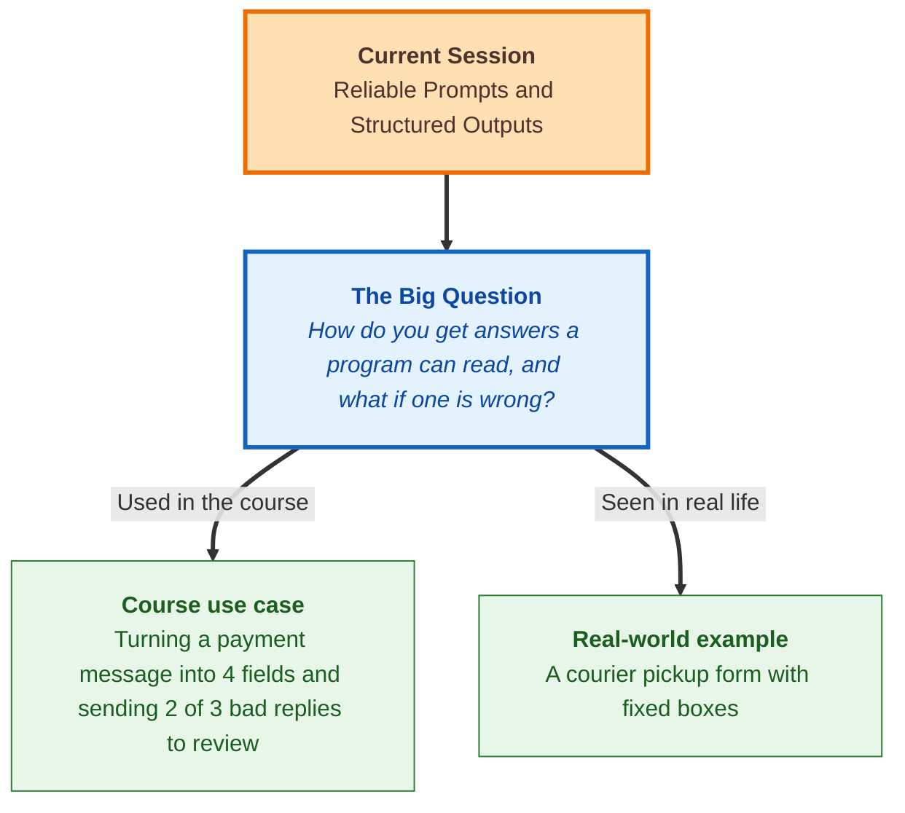

## <span style="color:#2F7DDE">Reliable Prompts and Structured Outputs</span>

### <span style="color:#2F7DDE">Mental Map</span>



---

### <span style="color:#2F7DDE">What You'll Learn</span>

Have you ever wondered why a courier form has fixed boxes instead of a blank page?

By the end of this session, you will be able to:

- <span style="color:#D9660B">**Explain**</span> why writing out each part of a Rs 70 charge helps you catch a slip.
- <span style="color:#D9660B">**Determine**</span> when a 1-step job needs no working and a 4-step job does.
- <span style="color:#D9660B">**Write**</span> a request that asks the clerk to fill the boxes and add no extra words.
- <span style="color:#D9660B">**Build**</span> a form with 3 boxes: name, weight in kg and city.
- <span style="color:#D9660B">**Design**</span> a rule for what the clerk does when a box is blank or holds a wrong entry.

> <span style="color:#2F7DDE">**Topics you will meet:**</span> Step-by-step prompts, JSON-only prompts, JSON schema, schema-constrained calls, output contracts.
>
> Join the session to learn each of these in detail.

---

### <span style="color:#2F7DDE">Why You Are Learning This Topic</span>

You book a courier pickup. The form has fixed boxes: name, weight in kg, city and pickup day.

The clerk's computer reads each box. A box that holds the word "two" instead of the number 2 stops the system.

A <span style="color:#D9660B">**JSON**</span> reply means data written as named boxes in curly braces, such as a weight and a city. A program can read it.

In this course you will ask AI tools to fill such boxes and you will check each reply.

> <span style="color:#2F7DDE">**Think about it:**</span> What should the desk do when a box is blank?

---

### <span style="color:#2F7DDE">The Courier Form Puzzle</span>

Here is one pickup, and the charge for it.

| Box | Your entry |
|:----------:|:----------:|
| Name | Meera |
| Weight in kg | 2 |
| City | Pune |
| Pickup day | Friday |

The charge is Rs 40 plus Rs 15 for each kg. Working it out in parts: 15 times 2 is 30, and 40 plus 30 is 70.

<span style="color:#D9660B">**What you want to happen:**</span>

- Every box holds the right entry.
- The charge is worked out in checkable parts.
- A bad form goes to a person, not into the system.

Here is how one box could be read by a program. You do not need to understand it yet.

```python
import json
print(json.loads('{"parcel": "Books", "weight_kg": 2}')["weight_kg"])
```

> <span style="color:#D9660B">**Wonder about this:**</span>
>
> - What would a program do with "two" in the weight box?
> - Would a 1-box job such as "write the city" need written working?

---

### <span style="color:#2F7DDE">Think It Through</span>

There is no wrong first try. Keep your guesses for the session.

**1. A parcel weighs 3 kg. Write the charge in 2 parts, then add them.**
Hint: Use Rs 40 plus Rs 15 for each kg.

**2. The clerk writes "Sure! Here is your form:" above the boxes. Why might a program fail?**
Hint: Think about what the program expects to see first.

**3. The weight box is blank. Name 2 safe actions the desk could take.**
Hint: Do not guess a weight.

---

### <span style="color:#2F7DDE">One Question to Carry Into the Session</span>

> <span style="color:#2F7DDE">**How do you agree on the exact boxes a helper must fill, and what happens when it cannot?**</span>
>
> Which form in your own life has a box that people often fill wrongly?
