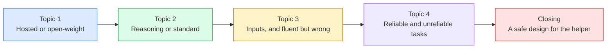
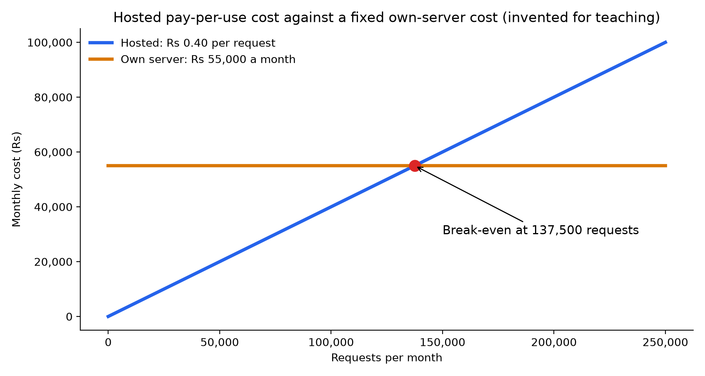
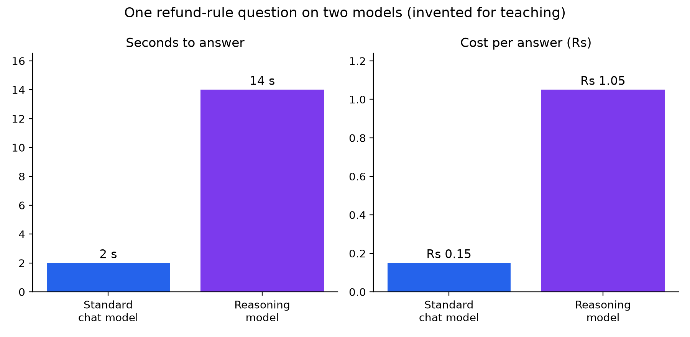
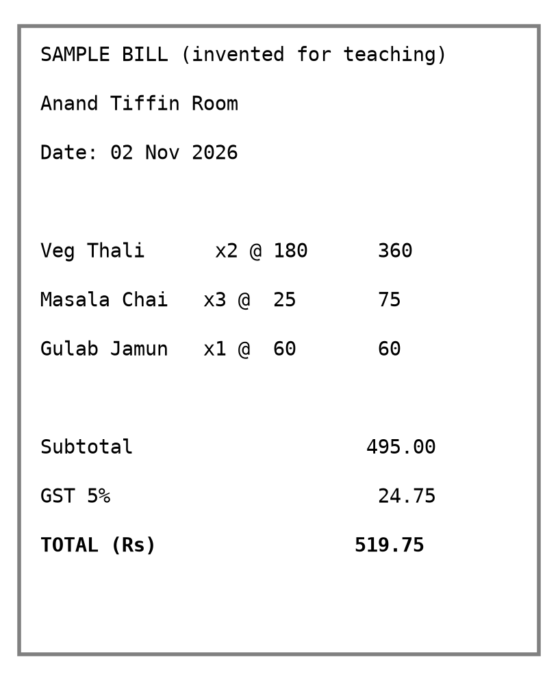
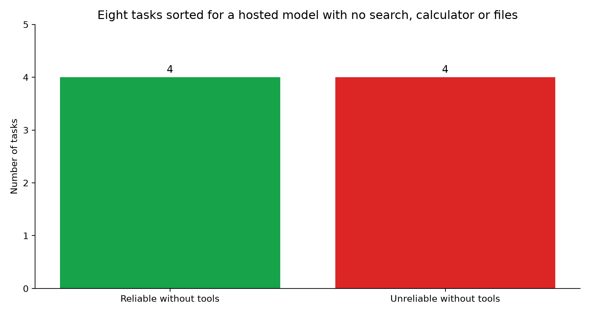

# Lecture Script: Where LLMs Work and Fail

---

## Agenda

The lecture runs as four topics. Each topic ends with a quiz.

| Topic | What we do | Learning objectives covered | Minutes |
|:-:|:--|:--|:-:|
| 1 | Choose between hosted and open-weight models | Compare open-weight and proprietary hosted models on cost, control and deployment | 25 |
| 2 | Choose between a reasoning model and a standard chat model | Compare a reasoning model with a standard chat model on latency, cost and task fit | 25 |
| 3 | See what a model can read and why it can be wrong | Describe the input types a multimodal model accepts beyond text Explain why a model can produce fluent text that is factually wrong | 30 |
| 4 | Sort tasks into reliable and unreliable | Classify tasks as reliable or unreliable for a hosted LLM without external tools | 25 |
| — | Closing: Outcome & Summary | | 15 |
| | **Total** | | **120** |

> **🎯 Instructor Note** Pace: Topic 3 carries two ideas, so keep the input-type part short and spend the time on fluent but wrong answers. Learners need one free chat tool open: ChatGPT, Claude or Gemini.
> Costs, speeds and token counts are invented for teaching, because real prices and limits change. Model replies are never pasted here. Run each live step and read the real reply.

---

## Scenario

**Five decisions on one whiteboard.** Ishaan leads the support team of an IRCTC-style train ticket app. He wants an AI helper for refund questions, and the whiteboard has five decisions.

1. Which kind of model: a hosted one or an open-weight one?
2. Which model for which question: a reasoning model or a standard chat model?
3. Can the helper read a photo of a damaged ticket?
4. What if the helper states a refund rule that does not exist?
5. Which tasks should the helper never do alone?

> **🎯 Instructor Note** The company is only the setting. Do not claim it works this way. The team, the costs, the timings and the bill are invented for teaching. Today is Monday, 2 November 2026.

---

## Problem Statement

Ishaan picks the "most powerful" setup for everything. He routes all chats, with passenger IDs, to a hosted model. He uses a slow, costly reasoning model for simple opening-hours questions. Then the helper tells a passenger, in perfect English, that a ticket cancelled 4 hours before departure gets a 50% refund. No such rule exists. The passenger claims it, and the team must pay or explain.

You know that a model predicts the next token, that its training has a cutoff date, and that fluent text can be false. Today we place these ideas into design choices.

> **How should Ishaan choose a model type, match models to questions, understand what the helper can read, and decide which tasks to trust it with?**

> **🎯 Instructor Note** Poll: "If an answer is fluent and confident, is it more likely to be correct?" Options: yes or no. Give learners 30 seconds to respond in chat. Reveal the answer in the Closing.

---

## What We Will Use

A decision table for each topic and one free chat tool for the live checks. Where a topic uses numbers, they are invented for teaching.

| Topic | Ideas | In one line |
|:-:|:--|:--|
| 1 | Open-weight and hosted models | Compare cost, control and deployment |
| 2 | Reasoning and standard chat models | Compare latency, cost and task fit |
| 3 | Multimodal input, fluent but wrong text | See what a model can read, and why a smooth answer can be false |
| 4 | Reliable and unreliable tasks | Sort tasks for a model with no search, calculator or files |

---

## How: Walking Through Ishaan's Whiteboard

---

## Topic 1: Choose between hosted and open-weight models `25 min`

> **Ishaan's data includes passenger IDs. Who runs the model, and who pays for what?**

### Example: Three comparison points

> **How do hosted and open-weight models differ on cost, control and deployment?**

A **proprietary hosted model** is run by its provider. You reach it through the provider's app or a web service, and you do not get its weights. An **open-weight model** publishes its weights for download under a licence, so you can run it on machines you choose. Read the licence, because terms differ.

| | Proprietary hosted model | Open-weight model |
|:--|:--|:--|
| Cost | Pay per use or by subscription. No hardware to buy | No per-call fee to the model maker under many licences. You pay for hardware, hosting and staff time |
| Control | Provider sets the version, updates and filters. Your data travels to its servers under its terms | You choose the version, can adapt it and can keep data on your own machines. You also own the safety work |
| Deployment | Call it over the internet from any device | Run it on your own or rented machines, including without internet. Setup and upkeep are yours |

> **🎯 Instructor Note** Ask learners which row matters most for passenger IDs. Expected: control, because the data can stay inside the company. Ask what the licence might limit. Expected: some uses or user counts.

> **Result** Hosted is easy to start and costs by use. Open-weight gives control and costs by running it yourself.

### Extending it: When does a fixed cost win?

> **At what volume does running your own server cost less than paying per request?**

Suppose a hosted model costs Rs 0.40 per request, and an own server costs a fixed Rs 55,000 a month (both invented for teaching, and the server cost includes upkeep).

$$\boxed{ \text{break-even requests} = \frac{\text{fixed monthly cost}}{\text{cost per request}} = \frac{55000}{0.40} = 137{,}500 }$$

At 50,000 requests, hosted costs $50000 \times 0.40 = 20{,}000$ rupees. At 200,000 requests, it costs $200000 \times 0.40 = 80{,}000$ rupees, which is more than 55,000.

> **🎯 Instructor Note** Remind learners the numbers are invented, and that real prices change. The lesson is the shape: pay-per-use rises, a fixed cost is flat.

> **Result** Below 137,500 requests a month, hosted costs less. Above it, the own server costs less, if the team can run it.

> **Common mistake** Calling open-weight models free. Fix: count hardware, hosting and the time of the people who run it.

### Quiz 1

**Question:** A firm must keep customer chats on its own servers. It has the budget for hardware and staff. Which option fits best?

**Options:**
- A) A hosted model, because it needs no hardware
- B) An open-weight model run on its own servers
- C) Either one, because control does not matter
- D) Neither, because models cannot run on a server

**Correct Answer:** B

**Explanation:**
- **A)** Hosted models send data to the provider's servers.
- **B)** Correct. It gives control over where the data lives, at the cost of running it.
- **C)** Control over data location is the main requirement here.
- **D)** Open-weight models run on machines you choose.

---

## Topic 2: Choose between a reasoning model and a standard chat model `25 min`

> **The model type is chosen. Does every question need the same kind of model?**

### Example: Same question, two models

> **How do a reasoning model and a standard chat model differ on latency, cost and task fit?**

A **standard chat model** replies directly. A **reasoning model** spends extra tokens working through the problem before it answers. That makes it slower and costlier per answer, and often better at multi-step problems. Many tools offer both, so check the tool's model picker.

Suppose both models answer one refund-rule question, with invented numbers.

| | Standard chat model | Reasoning model |
|:--|:-:|:-:|
| Time to answer | 2 s | 14 s |
| Tokens used | 300 | 2,100 |
| Cost at Rs 0.50 per 1,000 tokens | Rs 0.15 | Rs 1.05 |

$$\text{cost} = \frac{\text{tokens}}{1000} \times 0.50: \quad \frac{300}{1000} \times 0.50 = 0.15, \qquad \frac{2100}{1000} \times 0.50 = 1.05$$

The reasoning model is $\frac{2100}{300} = 7$ times the tokens, 7 times the cost and 7 times the wait.

> **🎯 Instructor Note** Learners may try the same 3-condition question in two models if their tool offers both. Say that the numbers above are invented, and ask them to note the real wait for the two replies.

> **Result** A reasoning model costs more time and money per answer, so use it where the extra thinking pays off.

### Extending it: Match the question to the model

> **Which questions deserve the reasoning model?**

| Question | Better fit | Why |
|:--|:--|:--|
| "What are the opening hours of the helpline?" | Standard chat model | One lookup in pasted text, no steps |
| "Rewrite this reply politely." | Standard chat model | Wording only |
| "A booking has 2 tickets, one confirmed and one waitlisted, cancelled 6 hours before departure. Work out the refund using the pasted refund rule." | Reasoning model | Several conditions combine |

For 10,000 simple FAQ questions a month, the standard model costs $10000 \times 0.15 = 1{,}500$ rupees and the reasoning model costs $10000 \times 1.05 = 10{,}500$ rupees in these invented numbers.

> **🎯 Instructor Note** Ask learners to sort 2 more questions of their own into the table. Expected: multi-condition rules and maths go to reasoning, wording and lookups go to standard.

> **Result** Use the standard model for simple questions, and the reasoning model for multi-step work. You still check the answer in both cases.

> **Common mistake** Assuming a reasoning model never errs. Fix: it can still be fluent and wrong, so check its result.

### Quiz 2

**Question:** Ishaan must answer 10,000 simple opening-hours questions a month. Which choice fits?

**Options:**
- A) The reasoning model, because it is always better
- B) The reasoning model, because it is faster
- C) Either, because cost does not change
- D) The standard chat model, because it is quicker and costs less per answer

**Correct Answer:** D

**Explanation:**
- **A)** "Always better" is wrong. Simple questions do not need extra steps.
- **B)** It is slower, not faster, in the invented numbers.
- **C)** Cost differs: Rs 1,500 against Rs 10,500 for 10,000 answers.
- **D)** Correct. Simple lookups do not need extra thinking, so the cheaper and faster model fits.

---

## Topic 3: See what a model can read and why it can be wrong `30 min`

> **A passenger sends a photo of a damaged ticket. Can the helper read it, and can it still be wrong?**

### Example: Input types beyond text

> **Which input types does a multimodal model accept besides text?**

A **multimodal model** accepts more than one type of input. Beyond text, models may accept images, audio, video and documents such as PDFs. Which types a particular tool takes depends on the tool, so check its attach button.

| Input type | Ishaan's example |
|:--|:--|
| Image | A photo of a damaged ticket |
| Audio | A voice note from a passenger |
| Video | A short clip of a faulty ticket machine |
| Document | A scanned PDF of a refund form |

Here is an invented sample bill. Learners save the image and attach it to their tool.

> **🎯 Instructor Note** Learners ask: "List each item, quantity, price and the total on this bill." Compare with the bill. Expected key: items total $360 + 75 + 60 = 495$, GST $495 \times 0.05 = 24.75$, total 519.75. If the tool has no image option, describe the bill in words instead.

> **Result** A multimodal model can read an image, but you still compare what it read with the original.

### Extending it: Why fluent text can be false

> **Why would the helper state a refund rule that does not exist?**

A model writes the most likely next tokens. It does not look a fact up, and it has no built-in check for truth. Four causes lead to smooth but false text.

| Cause | Plain meaning |
|:--|:--|
| Trained to sound plausible | The goal is likely-sounding text, not verified text |
| No lookup | A rule is produced from patterns, not read from the rule book |
| Rare or recent facts | Facts seen rarely, or after the cutoff, are weak or missing |
| False premise in the prompt | A question that assumes a made-up fact often gets an answer that accepts it |

> **🎯 Instructor Note** Live step: ask the tool, "What is the 50% refund rule for tickets cancelled 4 hours before departure?" The rule is invented. Read the reply and ask if it accepted the premise.

> **Result** Fluent does not mean true. A confident reply to a question with a false premise is a warning sign.

> **Common mistake** Treating tone as evidence. Fix: ask for the rule's source, and check it in the official rule book.

### Quiz 3

**Question:** The helper states a refund rule that does not exist, in smooth language. Why can that happen?

**Options:**
- A) It generates likely-sounding text and has no built-in fact check
- B) It always copies rules from the official rule book
- C) Smooth language proves the rule is real
- D) Models cannot write about refunds

**Correct Answer:** A

**Explanation:**
- **A)** Correct. A model predicts plausible tokens and does not verify them.
- **B)** It does not read the rule book unless you supply it.
- **C)** Smooth language and truth are separate.
- **D)** Models can write about refunds, and that is the problem when they write wrongly.

---

## Topic 4: Sort tasks into reliable and unreliable `25 min`

> **Ishaan now knows the model's limits. Which tasks can the helper do alone?**

### Example: Eight tasks, two groups

> **Which tasks are reliable, and which are unreliable, for a hosted model with no search, calculator or files?**

"Without external tools" means the model has only its training and what you paste into the chat. A task is **reliable** when the answer depends on the text you supplied or on wording. It is **unreliable** when it needs live facts, exact long calculations, sources or letter-level work.

> **🎯 Instructor Note** Cover the last two columns. Ask learners to sort each task in chat, then reveal. Expected: 1 to 4 reliable, 5 to 8 unreliable.

| # | Task | Verdict | Why |
|:-:|:--|:--|:--|
| 1 | Rewrite a pasted refund reply in a polite tone | Reliable | Wording of supplied text |
| 2 | Summarise a pasted 200-word policy into 3 bullets | Reliable | Answer comes from the pasted text |
| 3 | Explain "waitlist" in simple words | Reliable | A well-known concept, but read the answer |
| 4 | Brainstorm 10 subject lines for a reminder | Reliable | No fact needs to be right |
| 5 | Give the live waiting-list status of a named train | Unreliable | Needs live data the model does not have |
| 6 | Multiply 48,371 by 6,294 exactly | Unreliable | Long arithmetic needs a calculator. The true product is 304,447,074 |
| 7 | Quote the current refund rule with its page number | Unreliable | No source, and the rule may be newer than the cutoff |
| 8 | Count the letter "r" in "extraordinarily irregular timetable" | Unreliable | Models see tokens, not letters. The true count is 6 |

#### Logic Explanation

- A reliable task still needs a read-through. "Reliable" means the risk is low, not zero.
- For each unreliable task, the fix is a tool or a source: a search, a calculator or the real rule book.
- $48371 \times 6294 = 304{,}447{,}074$, computed in Python as the answer key.

> **Result** Four tasks are fit for the helper alone, with a read-through. Four need a tool or a human with a source.

### Extending it: Test one unreliable task live

> **What happens when we ask the multiplication in task 6?**

> **🎯 Instructor Note** Learners ask the question in their tool and compare with 304,447,074. Some tools run a calculator behind the scenes, so say which behaviour you saw. Read the reply before judging.

> **Result** Compare the reply with the key. A wrong or unchecked answer shows why long arithmetic needs a calculator.

> **Common mistake** Judging a task from one lucky reply. Fix: classify by what the task needs, not by one result.

### Quiz 4

**Question:** Which task is reliable for a hosted model with no external tools?

**Options:**
- A) Giving today's seat availability on a named train
- B) Multiplying two 5-digit numbers exactly
- C) Summarising a pasted 200-word policy into 3 bullets
- D) Quoting the current rule with its page number

**Correct Answer:** C

**Explanation:**
- **A)** Needs live data the model does not have.
- **B)** Long exact arithmetic needs a calculator.
- **C)** Correct. The answer comes from text you supplied.
- **D)** Needs a source, and the rule may be newer than the cutoff.

---

## Closing: Outcome & Summary `15 min`

Back to Ishaan. We answer the Problem Statement using each topic once.

> **1. Hosted or open-weight? (Topic 1)**

For passenger IDs, control matters, so he considers an open-weight model run on his own servers. Below 137,500 requests a month in the invented numbers, hosted costs less. He compares cost, control and deployment, not only price.

> **2. Reasoning or standard? (Topic 2)**

Simple FAQs go to the standard model at Rs 0.15 an answer. Multi-condition refund rules go to the reasoning model at Rs 1.05, and a person checks the result.

> **3. What can the helper read, and why was it wrong? (Topic 3)**

A multimodal model can take images, audio, video and documents, and he compares what it read with the original. The invented 50% rule came from plausible text, with no lookup and no check.

> **4. What can it do alone? (Topic 4)**

Wording and summaries of pasted text, with a read-through. Live status, exact sums and rule citations need a tool or the real rule book.

### Outcome

| | "Most powerful for everything" | Matched design |
|:--|:-:|:-:|
| Model for passenger IDs | Hosted, all chats | Chosen on control, cost and deployment |
| Opening-hours questions | Reasoning model, Rs 1.05 each | Standard model, Rs 0.15 each |
| Refund rule in a reply | Invented rule, sent as fact | Sourced from the rule book |
| Long sums and live status | Asked of the model | Calculator and live system |

> **Therefore,** Ishaan should pick the model type by cost, control and deployment, give each question the cheapest model that fits, treat smooth text as unverified, and keep live facts, long sums and rule citations out of the helper's solo tasks.

> **🎯 Instructor Note** Reveal the poll: no. Fluent tone and correctness are separate, which is why every refund rule is checked against the rule book.

### Summary

| Learning objective | Takeaway |
|:--|:--|
| Open-weight and hosted models | Hosted is easy and pay-per-use. Open-weight gives control and costs running it |
| Reasoning and standard models | Reasoning costs more time and money. Use it for multi-step work |
| Multimodal input | Text, images, audio, video and documents, depending on the tool |
| Fluent but wrong text | Models predict plausible text and do not verify it |
| Reliable and unreliable tasks | Reliable: supplied text and wording. Unreliable: live data, long sums, sources, letters |
| **Practical value** | You can choose a model, give it work that suits it, and know when to check or hand the task to a tool |

---

# Launch the Feedback Poll

> **🎯 Instructor Note** Reminder: launch the feedback poll now to collect learner feedback.
