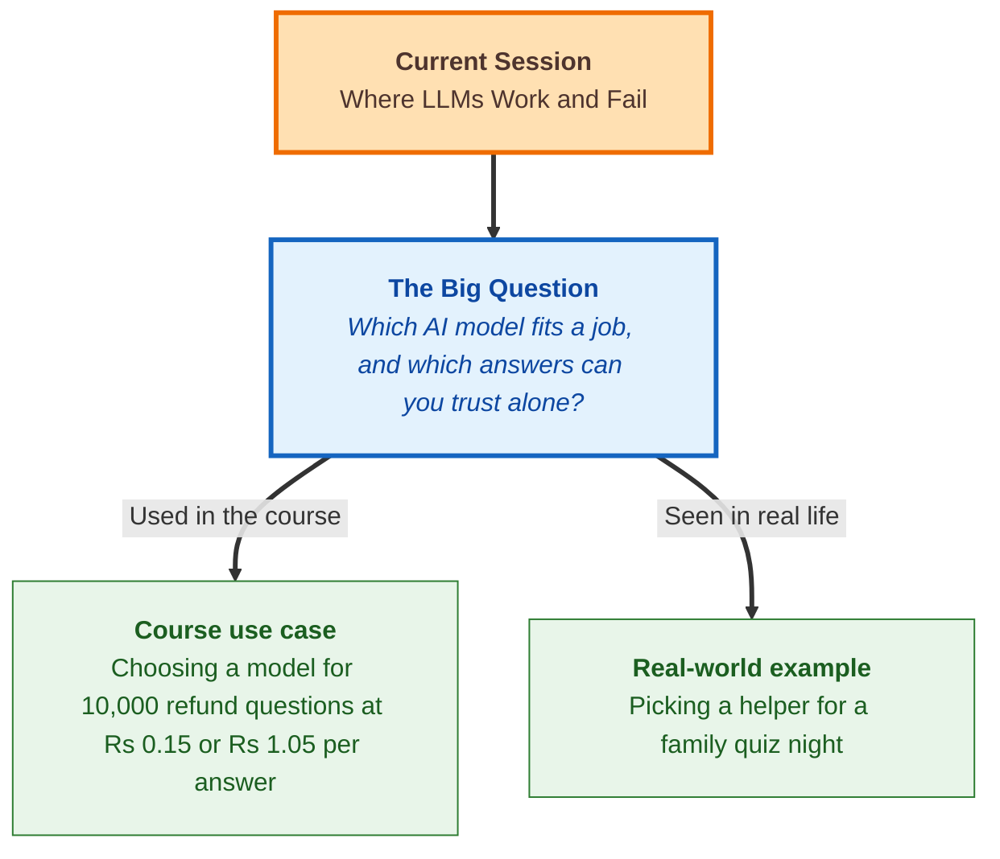

## Where LLMs Work and Fail

### Mental Map

---

### What You'll Learn

Have you ever wondered why a confident quiz-night friend can give a wrong answer?

By the end of this session, you will be able to:

- **List** the 3 kinds of clue a quiz can hold: words, a picture and a sound.
- **Explain** why a sure-sounding friend can be wrong about last week's match.
- **Classify** 6 quiz questions as safe or unsafe for your friend to answer alone.
- **Compare** a friend who answers in 2 seconds with one who thinks for 14 seconds.
- **Judge** whether a helper from a call centre or one living at home suits your budget.

> **Topics you will meet:** Hosted and open models, reasoning models, multimodal input, fluent but wrong answers, reliable tasks.
>
> Join the session to learn each of these in detail.

---

### Why You Are Learning This Topic

Your family plays a quiz on Sunday. You may call a helper from a call centre, or keep a helper at home.

The call-centre helper charges Rs 5 a call. The helper at home costs Rs 2,000 a month. You do not see the call-centre helper's notes, but you see your home helper's notes.

An **LLM** means a large language model, a program that writes text by predicting the next small piece. Different models suit different jobs.

In this course you will choose a model for each job and check its answers.

> **Think about it:** Which helper would you pick if you asked 100 questions a month?

---

### The Quiz Night Puzzle

Here are 4 questions from Sunday and what each one needs.

| Question | What it needs |
|:----------:|:----------:|
| What is the capital of France? | A quick answer |
| A train leaves at 3 pm at 60 km an hour. When does it reach 150 km? | Time to think |
| What animal is in this photo? | A look at a picture |
| What was today's cricket score? | A live scoreboard |

**What you want to happen:**

- Each question goes to the helper who suits it.
- You know when the helper may give a smooth but wrong reply.
- You keep live facts away from a helper who cannot see them.

> **Wonder about this:**
>
> - Would a helper who thinks for 14 seconds suit the capital question?
> - What would your helper say about the score with no scoreboard nearby?

---

### Think It Through

There is no wrong first try. Keep your guesses for the session.

**1. You ask 100 questions a month. Which costs less: Rs 5 a call or Rs 2,000 a month?**
Hint: Divide 2,000 by 5 to find where they tie.

**2. The friend answers the cricket score with total confidence. Why should you still doubt it?**
Hint: Ask where he could have seen the score.

**3. You hold up a photo and a voice clip. Which of your helpers can use both?**
Hint: Think about which senses a helper needs.

---

### One Question to Carry Into the Session

> **Which jobs would you give a smooth talker alone, and which would you check?**
>
> What would you ask a helper to show you before you trust an answer?
