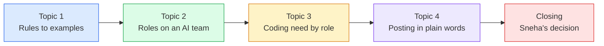
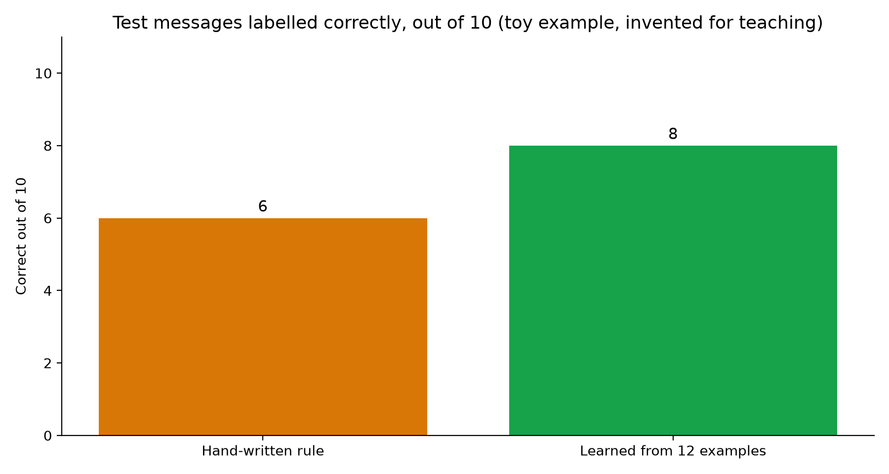
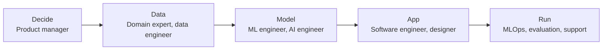
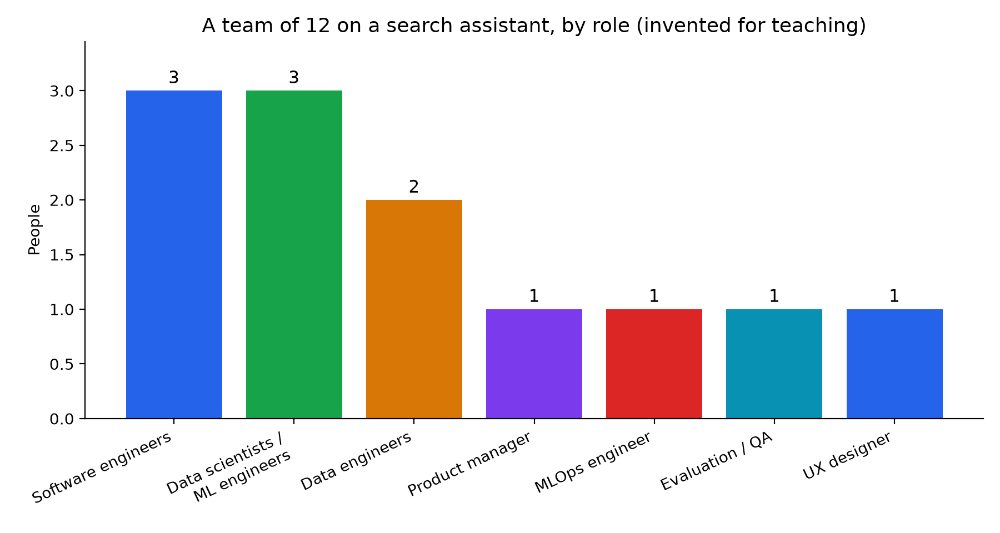
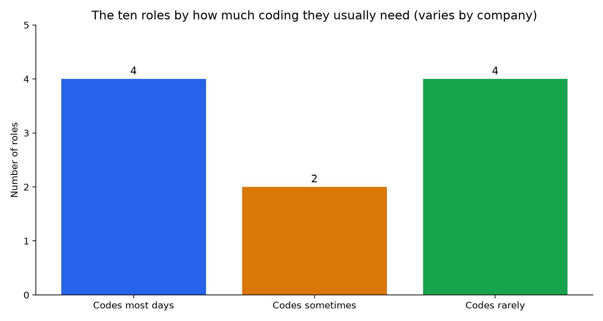
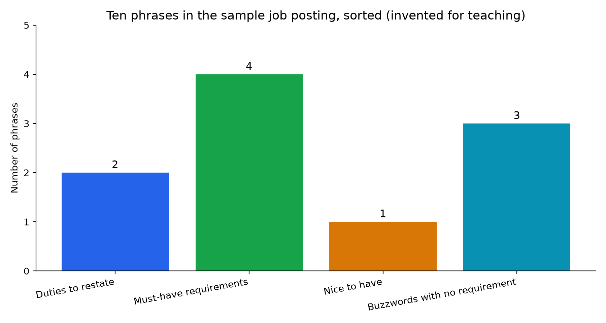

# <font color='#1d4ed8'>Lecture Script: Careers in AI: Who Does What</font>

---

## <font color='blue'>Agenda</font>

The lecture runs as four topics. Each topic ends with a quiz.

| Topic | What we do | Learning objectives covered | Minutes |
|:-:|:--|:--|:-:|
| 1 | See how AI moved from rules to examples | Explain how AI moved from following hand-written rules to learning from examples | 25 |
| 2 | Meet the roles that build and run an AI product | List the roles that build and run an AI product and what each does | 30 |
| 3 | Find where non-technical people fit | The roles from Topic 2, sorted by how much coding each needs | 20 |
| 4 | Read a job posting in plain words | Rewrite an AI job posting as a plain-language list of requirements | 30 |
| — | Closing: Outcome & Summary | | 15 |
| | **Total** | | **120** |

> <font color="red">**🎯 Instructor Note**</font> Pace: Topic 1 is a short story with one worked example. Spend the extra minutes on the live rewrite of the job posting in Topic 4. No software is needed, but a chat tool can help with the rewrite.
> Job titles and duties differ between companies, so present the role list as a common pattern, not a rule. The team sizes and the posting are invented for teaching.

---

## <font color='blue'>Scenario</font>

Sneha has 2 years of experience in store operations at a Flipkart-style online marketplace. She does not write code. One evening she sees a posting titled "AI Product Analyst" and decides, "That is for engineers", and closes the page.

A week later a colleague with the same 2 years of experience applies for the same posting. He reads each line, finds he already meets 4 of the requirements, and gets an interview.

> <font color="red">**🎯 Instructor Note**</font> The company is only the setting. Do not claim it works this way. Sneha, her colleague, the posting and the team sizes are invented for teaching.

---

## <font color='blue'>Problem Statement</font>

Sneha lost a week and a possible role because the posting looked like a wall of technical words. She did not know that AI teams include people who check answers, label examples, design screens and manage the product. She also did not know how to turn the posting into a plain list of what the job asks.

You know that machine learning sits inside AI, and that a model predicts the next token. Today we look at how AI came to learn from examples, who builds and runs an AI product, and how to read a posting.

> <font color='purple'>**How did AI change from hand-written rules to learning from examples, who builds and runs an AI product, and how does Sneha read a posting to find where she fits?**</font>

> <font color="red">**🎯 Instructor Note**</font> Poll: "Do all roles on an AI team need to write code every day?" Options: yes or no. Give learners 30 seconds to respond in chat. Reveal the answer in the Closing.

---

## <font color='blue'>What We Will Use</font>

No software today. We use a worked example, a role table and one sample job posting.

| Topic | Material | In one line |
|:-:|:--|:--|
| 1 | A toy message sorter | A hand-written rule against a rule learned from 12 examples |
| 2 | A role table | Ten roles, and what each does |
| 3 | The same table | Which roles need coding, and which rarely do |
| 4 | A sample posting | Sort its phrases and rewrite it in plain words |

---

## <font color='blue'>How: Walking Through Sneha's Posting</font>



---

## <font color='blue'>Topic 1: See how AI moved from rules to examples</font> `25 min`

> <font color='purple'>**Before AI learned from data, someone had to write every rule. What did that look like?**</font>

### <font color='green'>Example: A rule against a learner</font>

> <font color='purple'>**What is the difference between following hand-written rules and learning from examples?**</font>

Early AI systems followed rules that people wrote by hand: "if the message contains this word, do that". Modern machine learning gives the computer many labelled examples and lets it find patterns. A model is the pattern that it found.

Here is a toy case. The marketplace sorts customer messages into "refund" (R) or "other" (O). The hand-written rule says: if the message contains the word "refund", call it R. The learner reads 12 labelled examples (6 refund, 6 other) and scores each word by how often it appears in refund messages minus how often in other messages. A message with a positive total is R.

| Word | Seen in refund examples | Seen in other examples | Score |
|:--|:-:|:-:|:-:|
| refund | 3 | 0 | +3 |
| money | 2 | 0 | +2 |
| back | 2 | 0 | +2 |
| payment | 1 | 0 | +1 |
| the | 0 | 3 | -3 |
| thanks | 0 | 1 | -1 |

> <font color="red">**🎯 Instructor Note**</font> The 12 examples and 10 test messages are invented for teaching. The scores were counted by a small Python script, and the 6 and 8 below come from running it. A real system is far larger. Do not call this toy a real model.

Both approaches face the same 10 new messages.

| New message | Truth | Rule | Learner |
|:--|:-:|:-:|:-:|
| "refund my booking now" | R | R | R |
| "give me my money back" | R | O (missed) | R |
| "return the payment" | R | O (missed) | O (missed) |
| "my refund is still pending" | R | R | R |
| "i need my money back today" | R | O (missed) | R |
| "no refund needed thanks" | O | R (wrong) | R (wrong) |
| "what time does the train leave" | O | O | O |
| "my password is not working" | O | O | O |
| "how do i change the seat" | O | O | O |
| "thanks for the help" | O | O | O |

<p align="center"></p>

#### <font color='#c2410c'>Logic Explanation</font>

- The rule catches only the exact word "refund". It misses "money back" and "return the payment", because nobody wrote a rule for those phrasings.
- The learner found that "money" and "back" appear in refund examples, so it caught two more messages. It still missed "return the payment", where "the" pulled the score below zero.
- Both approaches mislabelled "no refund needed thanks". Neither understands meaning. The scores are $6$ and $8$ correct out of $10$.

> <font color='green'>**Result**</font> Rules need a person to foresee every case. Learning from examples finds patterns in data, so more and better examples improve it. It is still not perfect.

### <font color='green'>Extending it: What changed for the people</font>

> <font color='purple'>**If AI learns from examples, what does the human do now?**</font>

> <font color="red">**🎯 Instructor Note**</font> Ask learners what a person must supply when rules are replaced by examples. Expected: labelled examples, checks of the results, and decisions about what "correct" means.

> <font color='green'>**Result**</font> The human work moves from writing rules to collecting and labelling examples, testing results and deciding what counts as correct. That creates the roles in Topic 2.

> <font color='#b45309'>**Common mistake**</font> Believing that learning means understanding. Fix: a learner finds patterns in examples, and it can still be wrong.

### <font color='purple'>Quiz 1</font>

**Question:** What is the main change when AI moves from hand-written rules to learning from examples?

**Options:**
- A) A person writes more rules, faster
- B) The computer stops needing any data
- C) The computer reads a rule book instead of examples
- D) The computer finds patterns in labelled examples instead of following a person's rules

**Correct Answer:** D

**Explanation:**
- **A)** More rules is the old approach.
- **B)** Learning needs examples, so it needs data.
- **C)** A rule book is the old approach.
- **D)** Correct. Patterns in the examples replace rules that a person wrote.

---

## <font color='blue'>Topic 2: Meet the roles that build and run an AI product</font> `30 min`

> <font color='purple'>**Learning from examples needs data, models, an app and watchful people. Who does each job?**</font>

### <font color='green'>Example: Ten roles on a search assistant</font>

> <font color='purple'>**Which roles build and run an AI product, and what does each do?**</font>

Think of a product-search assistant in the marketplace app. Here are ten roles that appear on teams like this. Titles differ between companies.

| # | Role | What the role does |
|:-:|:--|:--|
| 1 | Product manager | Decides what to build and how to judge it |
| 2 | Domain expert or data labeller | Marks examples with the right answer, using business knowledge |
| 3 | Data engineer | Collects, cleans and moves the data |
| 4 | Data scientist or ML engineer | Trains and tests the models |
| 5 | Software engineer | Builds the app and connects it to the model |
| 6 | AI or prompt engineer | Designs prompts and links the model to tools |
| 7 | Evaluation or QA specialist | Tests the answers and tracks the errors |
| 8 | MLOps or platform engineer | Deploys the model and watches its cost and speed |
| 9 | UX designer | Designs the screens and the wording |
| 10 | Operations or support lead | Handles complaints and passes errors back to the team |

> <font color="red">**🎯 Instructor Note**</font> Cover the third column and ask learners to guess each role's job in chat. Remind them that small teams give one person several roles.



<p align="center"></p>

#### <font color='#c2410c'>Logic Explanation</font>

- The invented team has $3 + 3 + 2 + 1 + 1 + 1 + 1 = 12$ people. Builders of the model are 5 of 12, and the rest decide, design, connect and watch.
- The flow shows that a product moves through five stages. Each stage has an owner.

> <font color='green'>**Result**</font> An AI product needs more than model builders. Data, apps, tests and support each have owners.

### <font color='green'>Extending it: Match a task to a role</font>

> <font color='purple'>**Who owns each of these problems?**</font>

> <font color="red">**🎯 Instructor Note**</font> Read each line and ask for a role in chat. Expected: 1 data engineer, 2 evaluation specialist, 3 MLOps engineer, 4 UX designer.

| # | Problem |
|:-:|:--|
| 1 | The training data has 200 duplicate rows |
| 2 | 1 in 10 answers is wrong and nobody is counting |
| 3 | The assistant costs more per answer every week |
| 4 | Customers do not see the "report a wrong answer" button |

> <font color='green'>**Result**</font> Match a problem to the role whose job it is. Many problems fall between roles, so teams meet to agree.

> <font color='#b45309'>**Common mistake**</font> Thinking that "AI team" means only engineers. Fix: list the roles by the work they do, not by a title.

### <font color='purple'>Quiz 2</font>

**Question:** Which role collects, cleans and moves the data a model learns from?

**Options:**
- A) Data engineer
- B) UX designer
- C) Product manager
- D) Support lead

**Correct Answer:** A

**Explanation:**
- **A)** Correct. A data engineer prepares and moves the data.
- **B)** A UX designer designs screens and wording.
- **C)** A product manager decides what to build and how to judge it.
- **D)** A support lead handles complaints and passes errors back.

---

## <font color='blue'>Topic 3: Find where non-technical people fit</font> `20 min`

> <font color='purple'>**Sneha does not write code. Which of the ten roles could she grow into?**</font>

### <font color='green'>Example: Sort the roles by coding need</font>

> <font color='purple'>**Which roles code most days, and which rarely do?**</font>

> <font color="red">**🎯 Instructor Note**</font> Learners sort the ten roles into three groups in chat before the reveal. These groups are a common pattern, not a rule, because needs differ by company.

| Group | Roles (numbers from the table) |
|:--|:--|
| Codes most days (4) | 3 Data engineer, 4 Data scientist or ML engineer, 5 Software engineer, 8 MLOps engineer |
| Codes sometimes (2) | 6 AI or prompt engineer, 7 Evaluation or QA specialist |
| Codes rarely (4) | 1 Product manager, 2 Domain expert or data labeller, 9 UX designer, 10 Operations or support lead |

<p align="center"></p>

#### <font color='#c2410c'>Logic Explanation</font>

- The groups hold $4 + 2 + 4 = 10$ roles. Six of the ten code sometimes or rarely.
- Sneha's store operations experience matches role 2 (she knows what a correct answer looks like), role 7 (testing answers) and role 10 (handling complaints).

> <font color='green'>**Result**</font> Many roles on an AI team need business knowledge, care and clear writing more than code.

### <font color='green'>Extending it: Name two skills Sneha already has</font>

> <font color='purple'>**Which of Sneha's current skills help in these roles?**</font>

> <font color="red">**🎯 Instructor Note**</font> Ask learners for a skill of their own that fits a role. Expected: checking facts, writing clear emails, knowing the customer, finding patterns in a sheet.

> <font color='green'>**Result**</font> Skills such as spotting wrong answers, explaining clearly and knowing customers carry over. Coding is one route, not the only one.

> <font color='#b45309'>**Common mistake**</font> Closing a posting because of its title. Fix: read what the job asks, line by line.

### <font color='purple'>Quiz 3</font>

**Question:** Which role usually needs coding least?

**Options:**
- A) Software engineer
- B) MLOps engineer
- C) Domain expert who labels examples
- D) Data engineer

**Correct Answer:** C

**Explanation:**
- **A)** Software engineers write code most days.
- **B)** MLOps engineers deploy and monitor with code and tools.
- **C)** Correct. A domain expert uses business knowledge to mark the right answers.
- **D)** Data engineers build data pipelines with code.

---

## <font color='blue'>Topic 4: Read a job posting in plain words</font> `30 min`

> <font color='purple'>**Now Sneha reads the posting again. What does it actually ask for?**</font>

### <font color='green'>Example: The posting, sorted into four types</font>

> <font color='purple'>**Which phrases are duties, must-haves, nice-to-haves and buzzwords?**</font>

Here is the invented posting.

```
AI Product Analyst
We seek a results-driven self-starter to leverage cutting-edge LLM
capabilities, drive cross-functional alignment and own the end-to-end
evaluation lifecycle of conversational AI features.
Requirements: 2+ years in analytics or operations; proficiency in SQL and
spreadsheets; ability to write precise prompts and test-case suites;
excellent stakeholder communication; Python is a plus; comfortable working
in ambiguity.
```

> <font color="red">**🎯 Instructor Note**</font> Learners underline the ten phrases and sort them. Expected: 3 buzzwords, 2 duties, 4 must-haves, 1 nice-to-have. Say that "LLM" was met in Session 1 as a model that writes text.

| Phrase | Type |
|:--|:--|
| results-driven self-starter | Buzzword |
| leverage cutting-edge LLM capabilities | Buzzword |
| drive cross-functional alignment | Duty |
| own the end-to-end evaluation lifecycle of conversational AI features | Duty |
| 2+ years in analytics or operations | Must-have |
| proficiency in SQL and spreadsheets | Must-have |
| write precise prompts and test-case suites | Must-have |
| excellent stakeholder communication | Must-have |
| Python is a plus | Nice to have |
| comfortable working in ambiguity | Buzzword |

<p align="center"></p>

> <font color='green'>**Result**</font> Of ten phrases, four are firm requirements, and Python is only a plus. Sneha's 2 years of operations meet the first one.

### <font color='green'>Extending it: Rewrite it in plain language</font>

> <font color='purple'>**What does the posting say when the buzzwords are gone?**</font>

> <font color="red">**🎯 Instructor Note**</font> Learners rewrite the posting as a plain list, using a chat tool if they wish. Check the tool's draft against the posting, because it can add requirements that were not there.

A plain-language rewrite (written by the mentor).

```
The job: check whether our chat assistant gives right answers.
You will: write test questions, score the answers, report problems to
engineers, and work with the support team.
You need: 2+ years in analytics or operations; SQL and spreadsheets;
clear prompt writing; explaining results to non-technical colleagues.
Nice to have: some Python.
```

> <font color='green'>**Result**</font> The rewrite says what you will do and what you need. It drops words that carry no requirement.

> <font color='#b45309'>**Common mistake**</font> Treating every "plus" as a must-have. Fix: separate "you need" from "nice to have".

### <font color='purple'>Quiz 4</font>

**Question:** Which phrase in a posting is a plain requirement?

**Options:**
- A) "results-driven self-starter"
- B) "2+ years in analytics or operations"
- C) "comfortable working in ambiguity"
- D) "leverage cutting-edge capabilities"

**Correct Answer:** B

**Explanation:**
- **A)** A buzzword with nothing to check.
- **B)** Correct. It names a measurable need: years of experience in a field.
- **C)** A buzzword with no concrete skill.
- **D)** A buzzword that names no skill.

---

## <font color='blue'>Closing: Outcome & Summary</font> `15 min`

Back to Sneha. We answer the Problem Statement using each topic once.

> <font color='purple'>**1. How did AI change? (Topic 1)**</font>

It moved from rules that people wrote to patterns found in labelled examples. In the toy case, the rule got 6 of 10 and the learner got 8 of 10.

> <font color='purple'>**2. Who builds and runs it? (Topic 2)**</font>

Ten roles: from product manager to data, model, app, testing and support roles.

> <font color='purple'>**3. Where does she fit? (Topic 3)**</font>

Six of the ten roles code sometimes or rarely. Her operations experience fits roles 2, 7 and 10.

> <font color='purple'>**4. What does the posting ask? (Topic 4)**</font>

Four must-haves and one plus. The rest is buzzwords and two duties to restate.

### <font color='green'>Outcome</font>

| | Sneha's first reading | Sneha's second reading |
|:--|:-:|:-:|
| What she saw | A technical wall of words | Ten phrases sorted into four types |
| Requirements she thought she lacked | All of them | 4 firm ones, which she can check one by one |
| Her decision | Close the page | Match her skills and apply |

> <font color='green'>**Therefore,**</font> AI moved from hand-written rules to learning from examples, which created roles for data, models, apps, tests and support. Many of those roles need little code. Sneha should read the posting line by line, rewrite it in plain words and apply if she meets the firm requirements.

> <font color="red">**🎯 Instructor Note**</font> Reveal the poll: no. Six of the ten roles code only sometimes or rarely, though titles and duties vary by company.

### <font color='green'>Summary</font>

| Learning objective | Takeaway |
|:--|:--|
| Rules to examples | People once wrote the rules. Now models find patterns in labelled examples |
| Roles that build and run | Product, data, model, app, testing, design and support roles each own a stage |
| Plain-language posting | Separate duties, must-haves and nice-to-haves, and drop the buzzwords |
| **Practical value** | You can see where your skills fit on an AI team and read a posting without being put off by its words |

---

# <font color='red'>Launch the Feedback Poll</font>

> <font color="red">**🎯 Instructor Note**</font> Reminder: launch the feedback poll now to collect learner feedback.
