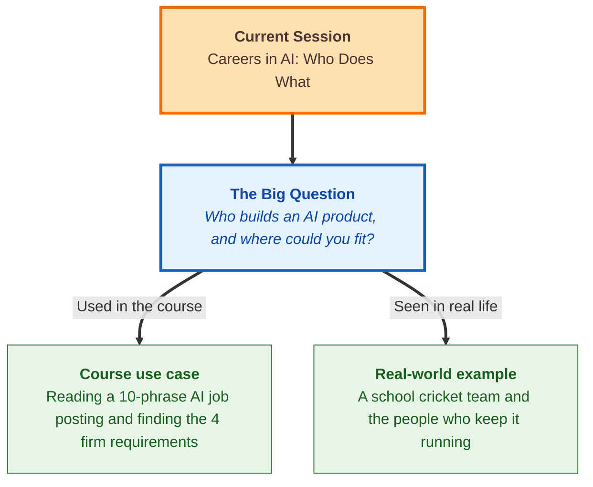

## Careers in AI: Who Does What

### Mental Map

---

### What You'll Learn

Have you ever wondered who works behind a school cricket team besides the 11 players?

By the end of this session, you will be able to:

- **List** 5 people who keep a school team running, from scorer to coach.
- **Explain** why a coach who studies last week's match videos beats a printed rule sheet.
- **Classify** 4 team jobs as needing playing skill or not.
- **Write** a plain 3-line notice from a long, fancy one.

> **Topics you will meet:** How AI got here, who builds it, where non-technical people fit, reading a job posting.
>
> Join the session to learn each of these in detail.

---

### Why You Are Learning This Topic

Years ago, a coach kept a printed sheet: "If the ball is short, pull. If it is full, drive."

Today the coach watches 20 match videos and spots patterns the sheet never had. The coach also needs a scorer, an analyst and a physio.

A **training example** means one past case with its right answer attached. One video marked "out" is an example.

AI moved the same way, from printed rules to learning from examples. In this course you will see who does each job.

> **Think about it:** Which team jobs would you do well without ever batting?

---

### The Cricket Team Puzzle

Here are 4 jobs on the team.

| Job | What the person does |
|:----------:|:----------:|
| Coach | Chooses the drills and the lineup |
| Scorer | Records every run and wicket |
| Video analyst | Studies match clips for patterns |
| Physio | Treats injuries and plans recovery |

**What you want to happen:**

- You know who owns each job.
- You can tell which jobs need playing skill.
- You can read a long notice and see what it asks.

Here is the long notice: "Seeking a dynamic go-getter to own match-day excellence across squads. Needs 2 seasons of scoring and a loud whistle."

> **Wonder about this:**
>
> - Which words in the notice ask for a skill, and which only sound grand?
> - Would you apply if you scored for 2 seasons but never played?

---

### Think It Through

There is no wrong first try. Keep your guesses for the session.

**1. The printed sheet says "pull short balls". A new bowler bowls a ball the sheet never listed. What does the coach lack?**
Hint: Think about cases the rule writer never saw.

**2. A video analyst marks 20 clips "out" or "not out". Why does the right label matter?**
Hint: Ask what the coach learns from a wrong label.

**3. The notice says "go-getter" and "2 seasons of scoring". Which part can you check?**
Hint: Look for a number.

---

### One Question to Carry Into the Session

> **Which job on an AI team would suit what you already do well?**
>
> How would you tell a firm requirement from a fancy phrase?
